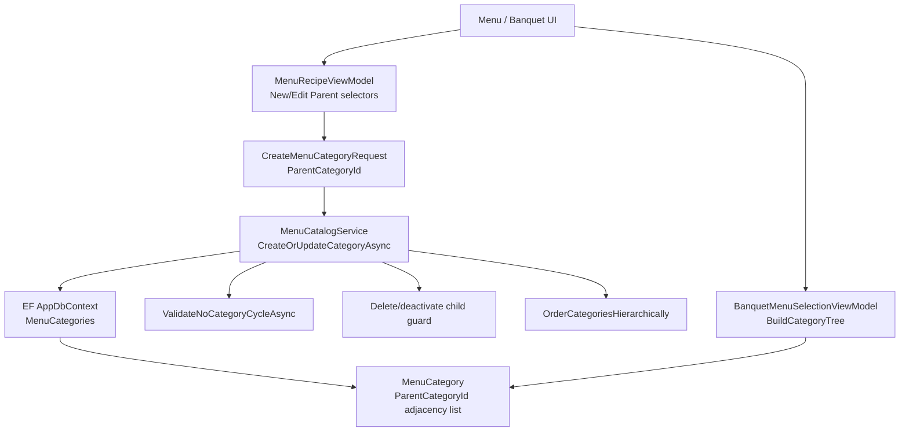
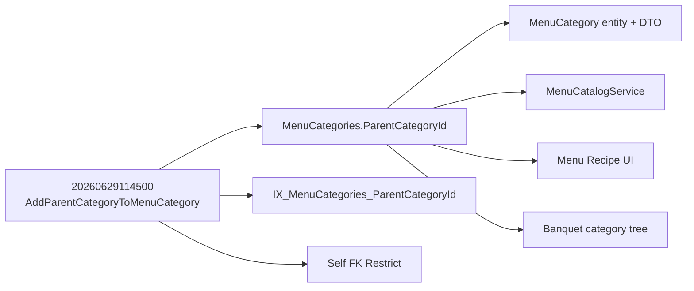

# KẾT QUẢ PHÁT HIỆN MIGRATION KHÔNG CÒN DÙNG — `ParentCategoryId`

## Phạm vi và nguyên tắc

Đối tượng phân tích duy nhất là migration:

`20260629114500_AddParentCategoryToMenuCategory`

Đã khảo sát source production, ViewModel/XAML, DTO, EF mapping, migration, seed và các tệp SQL/report trong solution. Không có migration, database, lịch sử EF hoặc source nghiệp vụ nào bị sửa; migration không được apply và không baseline history.

## Kết luận điều hành

**Phân loại cuối cùng: ACTIVE.**

`ParentCategoryId` vẫn là quan hệ cha–con đang được dùng để tổ chức cây `MenuCategory`. Nó được đọc, ghi, kiểm tra tồn tại, chống vòng lặp, bảo vệ thao tác xóa nhóm cha, sắp xếp theo cây và hiển thị trong cả màn quản lý menu lẫn cây chọn menu Banquet.

Migration không bị migration khác thay thế. Nếu bỏ migration này khỏi source, database mới/reconstructed database sẽ thiếu cột, index và self foreign key mà EF model và runtime hiện tại yêu cầu; source menu sẽ không chạy đúng.

## Migration thực hiện gì

| Thành phần | Nội dung |
|---|---|
| Table | Thay đổi bảng hiện có `dbo.MenuCategories` |
| Column | Thêm nullable `ParentCategoryId uniqueidentifier` |
| Index | Tạo `IX_MenuCategories_ParentCategoryId` |
| Constraint | Tạo self-FK `FK_MenuCategories_MenuCategories_ParentCategoryId`: `ParentCategoryId` → `MenuCategories.Id` |
| Seed | Không có |
| Sequence | Không có |
| Thay thế bởi migration khác | Không có; chỉ migration này có `Up()` tạo các đối tượng trên |

Nguồn: [migration](D:/ASMILE-BO/ASMILE.BO.Infrastructure/Persistence/Migrations/20260629114500_AddParentCategoryToMenuCategory.cs:8).

## Dấu vết `ParentCategoryId` đang còn dùng

| Lớp | File / dòng | Mục đích |
|---|---|---|
| Entity | [BreakfastCafeSalesEntities.cs](D:/ASMILE-BO/ASMILE.BO.Core/Entities/BreakfastCafeSalesEntities.cs:120) | `MenuCategory.ParentCategoryId` tồn tại, kiểu `Guid?`; entity hiện tại **vẫn có** field này. |
| DTO | [BreakfastCafeSalesDtos.cs](D:/ASMILE-BO/ASMILE.BO.Application/DTOs/BreakfastCafeSalesDtos.cs:3) | `MenuCategoryDto` mang ID cha về UI. |
| Command/request DTO | [BreakfastCafeSalesDtos.cs](D:/ASMILE-BO/ASMILE.BO.Application/DTOs/BreakfastCafeSalesDtos.cs:13) | `CreateMenuCategoryRequest` nhận ID cha khi tạo/cập nhật. |
| DbContext mapping | [AppDbContext.cs](D:/ASMILE-BO/ASMILE.BO.Infrastructure/Persistence/AppDbContext.cs:623) | EF khai báo index cho field. |
| DbContext mapping | [AppDbContext.cs](D:/ASMILE-BO/ASMILE.BO.Infrastructure/Persistence/AppDbContext.cs:626) | EF khai báo self-FK và `DeleteBehavior.Restrict`. |
| Query/repository service | [MenuCatalogService.cs](D:/ASMILE-BO/ASMILE.BO.Infrastructure/Services/MenuCatalogService.cs:19) | `GetCategoriesAsync` đọc ID cha và tên nhóm cha từ `MenuCategories`. |
| Write service | [MenuCatalogService.cs](D:/ASMILE-BO/ASMILE.BO.Infrastructure/Services/MenuCatalogService.cs:60) | Kiểm tra nhóm cha tồn tại, chống tự làm cha/vòng lặp, rồi ghi `entity.ParentCategoryId`. |
| Delete guard | [MenuCatalogService.cs](D:/ASMILE-BO/ASMILE.BO.Infrastructure/Services/MenuCatalogService.cs:260) | Cấm xóa/vô hiệu hóa nhóm đang có nhóm con. |
| Tree validation | [MenuCatalogService.cs](D:/ASMILE-BO/ASMILE.BO.Infrastructure/Services/MenuCatalogService.cs:448) | Đi ngược chuỗi cha để phát hiện cycle. |
| Hierarchical ordering | [MenuCatalogService.cs](D:/ASMILE-BO/ASMILE.BO.Infrastructure/Services/MenuCatalogService.cs:472) | Nhóm theo `ParentCategoryId`, sau đó append theo cha–con. |
| Runtime schema diagnosis | [MenuCatalogService.cs](D:/ASMILE-BO/ASMILE.BO.Infrastructure/Services/MenuCatalogService.cs:520) | Có xử lý nhận biết lỗi schema chứa `ParentCategoryId`. |
| WPF ViewModel | [MenuRecipeViewModel.cs](D:/ASMILE-BO/ASMILE.BO.App/ViewModels/MenuRecipeViewModel.cs:760) | Lưu giá trị chọn nhóm cha khi chỉnh sửa; tạo nhóm dùng cùng request tại dòng 1198. |
| WPF ViewModel | [MenuRecipeViewModel.cs](D:/ASMILE-BO/ASMILE.BO.App/ViewModels/MenuRecipeViewModel.cs:2252) | Tính `Level` hiển thị bằng cách đi theo `ParentCategoryId`. |
| WPF XAML | [MenuCategoriesScreen.xaml](D:/ASMILE-BO/ASMILE.BO.App/Views/MenuRecipe/Screens/MenuCategoriesScreen.xaml:84) | ComboBox tạo nhóm bind `NewCategoryParentId`. |
| WPF XAML | [MenuCategoriesScreen.xaml](D:/ASMILE-BO/ASMILE.BO.App/Views/MenuRecipe/Screens/MenuCategoriesScreen.xaml:276) | ComboBox sửa nhóm bind `EditCategoryParentId`. |
| Banquet UI | [BanquetMenuSelectionViewModel.cs](D:/ASMILE-BO/ASMILE.BO.App/ViewModels/BanquetMenuSelectionViewModel.cs:112) | Tạo root khi `ParentCategoryId == null`, sau đó tìm con bằng parent ID. |
| Unit tests | `MenuCatalogCategoryTests` (caller của `CreateOrUpdateCategoryAsync`) | Có test trực tiếp cho luồng tạo nhóm menu; đây là bằng chứng service đang thuộc bề mặt chạy được của solution. |

## Các lớp không có sử dụng trực tiếp

| Hạng mục khảo sát | Kết quả |
|---|---|
| AutoMapper | Không có profile hoặc `CreateMap` cho `MenuCategory`/`ParentCategoryId`; mapping hiện làm thủ công trong `MenuCatalogService`. |
| CQRS/Mediator | Không có command/query handler CQRS riêng cho menu category; luồng WPF gọi application/infrastructure menu catalog service trực tiếp. |
| SQL script / stored procedure | Không có tệp `.sql`/stored procedure source tham chiếu `ParentCategoryId`. |
| Seed | Seed mặc định tạo các root category, không gán `ParentCategoryId`; đây không phải bằng chứng feature chết, vì runtime cho phép người dùng tạo cây sau seed. |
| Report | Không có report template/code report tham chiếu trực tiếp field này. |
| WPF binding trực tiếp `ParentCategoryId` | XAML bind qua properties trung gian `NewCategoryParentId`/`EditCategoryParentId`; ViewModel chuyển chúng thành request `ParentCategoryId`. |

## Cơ chế tổ chức cây MenuCategory

Đây là **adjacency list**:

- Root: `ParentCategoryId = null`.
- Node con: `ParentCategoryId = Id` của node cha.
- Quan hệ được bảo toàn bởi self-FK `Restrict` theo EF mapping.
- Cycle được kiểm tra ở application service.
- Thứ tự sibling dùng `SortOrder`, sau đó `Name`.

`Level` không phải cơ chế lưu trữ cây: nó được tính động trong `MenuRecipeViewModel` để hiển thị/indent. `Code` là mã nhóm unique, không phải materialized path. Không thấy nested set (`Left`/`Right`) hoặc materialized path trong model/source đã khảo sát.

## Call graph nghiệp vụ

Các caller runtime được graph xác nhận cho `CreateOrUpdateCategoryAsync`: `MenuRecipeViewModel.SaveCategoryEditAsync`, `MenuRecipeViewModel.CreateCategoryAsync`, `MenuRecipeViewModel.ToggleCategoryActiveAsync`, `BreakfastCafeSalesViewModel.SaveCategorySettingsAsync` và `AlacarteRestaurantViewModel.SaveSettingMenuGroupAsync`.

## Dependency và tác động nếu bỏ migration

- Migration này không phụ thuộc migration enterprise/Front Office sau này để tạo đối tượng của nó.
- Các migration designer/snapshot đời sau tiếp tục chứa property, index và self-FK, tức model hiện tại kế thừa chứ không thay thế migration này.
- Bỏ file migration sẽ làm clean/reconstructed database thiếu schema cần thiết; xóa field khỏi source cũng sẽ phá entity, mapping, service và UI nêu trên.

## Schema hay history?

Vì migration **ACTIVE**, câu trả lời không phải “chỉ sửa history”. Cần có đủ **schema** mà migration định nghĩa.

Đối chiếu fingerprint đã xác minh trước đó trên `ASMILE_BO`: column nullable `ParentCategoryId` đã có, nhưng `IX_MenuCategories_ParentCategoryId` và `FK_MenuCategories_MenuCategories_ParentCategoryId` còn thiếu. Đây là **partial schema**, không phải `EXACT_MATCH`; baseline history đơn thuần sẽ không hoàn tất index/FK mà source model yêu cầu.

Theo giới hạn prompt này, không có schema repair, apply migration hoặc baseline history nào được thực hiện hay đề xuất thực thi ngay.

## Kết luận cuối

| Tiêu chí | Kết quả |
|---|---|
| Migration còn được dùng thực tế | Có |
| Có migration thay thế trực tiếp | Không |
| Classification | **ACTIVE** |
| Có thể bỏ | Không |
| Nhu cầu đúng | Hoàn chỉnh schema theo governance được phê duyệt trong bước riêng; không baseline history khi schema còn partial |
| Thay đổi đã thực hiện trong nhiệm vụ này | Không có thay đổi code, database, migration hoặc EF history; chỉ tạo báo cáo này |

