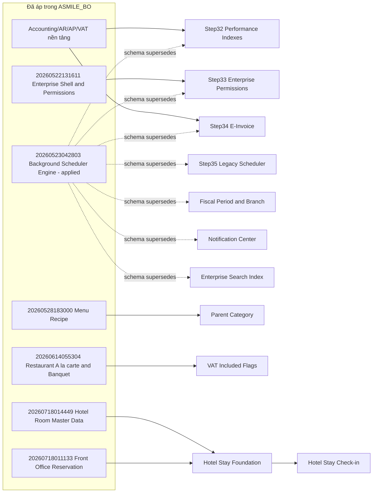

# Phân tích dependency của 11 migration pending

**Phạm vi:** chỉ đọc source và xác minh schema read-only trên `ASMILE_BO`.  
**Không thực hiện:** apply migration, tạo migration, sửa database, sửa code hoặc sửa UI.

## 1. Kết luận

11 entry pending trong EF history **không đồng nghĩa** 11 schema change đều còn thiếu:

- **7 migration Enterprise đầu** đã được migration hợp nhất `20260523042803_AddBackgroundSchedulerEngine` tạo lại về mặt schema. Migration hợp nhất này đã có trong `__EFMigrationsHistory`; các table/index mục tiêu cũng đang tồn tại. Các file cũ là **obsolete/superseded cho việc thực thi**.
- **2 migration Menu/VAT** có đầy đủ column/constraint/index mục tiêu trong database, nhưng không có entry history. Đây là **history gap**, không phải schema gap. Chúng không nên tự chạy lại để “sửa” Check-in.
- **2 migration Hotel Stay** là schema gap thực sự: `[fo].[LuuTruKhachSan]` chưa tồn tại và Check-in đang truy vấn trực tiếp bảng này.

## 2. Phân loại A / B / C

| Nhóm | Migration | Kết luận |
| --- | --- | --- |
| A — bắt buộc để hoàn chỉnh Front Office Stay | `20260718092912_AddFrontOfficeHotelStayFoundation` | Thiếu toàn bộ Hotel Stay schema; Check-in không thể chạy. |
| A — bắt buộc ngay sau Foundation | `20260718095823_AddFrontOfficeHotelStayCheckIn` | Phụ thuộc trực tiếp Foundation; tạo invariant một phòng chỉ có một stay `InHouse`. |
| B — có thể bỏ thực thi schema, nhưng phải xử lý history có kiểm soát | `20260629114500_AddParentCategoryToMenuCategory` | Column/FK/index đã tồn tại; migration id thiếu trong history. |
| B — có thể bỏ thực thi schema, nhưng phải xử lý history có kiểm soát | `20260630113000_AddVatIncludedFlagsToMenuAndRestaurantServices` | Bốn column VAT/default constraint đã tồn tại; migration id thiếu trong history. |
| C — obsolete / superseded | Bảy migration Enterprise từ `20260522221500` đến `20260523014000` | Được schema hợp nhất trong migration đã-applied `20260523042803_AddBackgroundSchedulerEngine`. Không được chạy lại. |

## 3. Phân tích từng migration

| Migration | Tạo/thay đổi | Còn dùng thật? | Trạng thái / thay thế | Nếu bỏ migration file |
| --- | --- | --- | --- | --- |
| `20260522221500_Phase3Step32SqlPerformanceScaling` | 42 index trên Audit, inventory, accounting, AR/AP, costing, reporting, VAT. Không table/seed. | Các index có ích cho truy vấn hiện tại. | **C — Superseded by `20260523042803`**. Các index mẫu đã tồn tại trong database. | Runtime hiện tại vẫn chạy; không xóa file vì sẽ làm migration assembly/history khó truy vết. |
| `20260522223000_Phase3Step33EnterprisePermissions` | Table `AppDataPermissions`, `AppRoleInheritances`; 6 index; FK sang `AppRoles`. | `PermissionService` vẫn truy vấn `AppDataPermissions` cho data-scope permission. | **C — Superseded by `20260523042803`**. Hai table đã tồn tại. | Tính năng vẫn chạy vì schema được migration hợp nhất tạo. Không xóa file lịch sử. |
| `20260522224500_Phase3Step34EInvoiceFoundation` | 5 table: provider config, invoices, lines, tax breakdown, issue log; 16 index; FK sang Journal/AR/AP/VAT. | `EInvoiceService` và tests vẫn dùng các entity/table này. | **C — Superseded by `20260523042803`**. Tất cả table đích đã tồn tại. | Runtime vẫn chạy nhờ schema hợp nhất; không xóa migration file. |
| `20260522230000_Phase3Step35SchedulerEngine` | 4 table legacy scheduler: `JobDefinitions`, `JobExecutions`, `JobLogs`, `JobRetries`; 11 index/FK. | `SchedulerService` hiện vẫn dùng trực tiếp các DbSet này. | **C — Superseded by `20260523042803`**; database đã có đủ 4 table. Không phải tính năng scheduler đã bị bỏ; chỉ migration lịch sử bị thay thế. | Runtime hiện tại chạy; xóa file vẫn không được khuyến nghị. |
| `20260523010000_AddFiscalPeriodAndBranchEngine` | `FiscalYears`, `PeriodLocks`, `CompanyBranchPermissions`; 7 index. | `AccountingPeriodService`, fiscal-period UI và tests dùng `FiscalYears`/`PeriodLocks`. | **C — Superseded by `20260523042803`**. Cả 3 table đã tồn tại. | Runtime vẫn chạy nhờ schema hợp nhất; không xóa file lịch sử. |
| `20260523012000_AddEnterpriseNotificationCenter` | `UserNotifications`, `TaskInboxItems`, `TaskComments`, `TaskAttachmentMetadata`; 8 index/FK. | `NotificationTaskService` và Notification/Task Center vẫn dùng. | **C — Superseded by `20260523042803`**. Tất cả table đích tồn tại. | Runtime vẫn chạy nhờ schema hợp nhất; không xóa file lịch sử. |
| `20260523014000_AddEnterpriseSearchIndex` | `SearchIndexEntries`, `RecentSearches`; 5 index. | `EnterpriseSearchService`, archive service và test search index vẫn dùng. | **C — Superseded by `20260523042803`**. Hai table tồn tại. | Runtime vẫn chạy nhờ schema hợp nhất; không xóa file lịch sử. |
| `20260629114500_AddParentCategoryToMenuCategory` | Thêm `MenuCategories.ParentCategoryId`; index `IX_MenuCategories_ParentCategoryId`; self-FK. Không seed. | Menu catalog, recipe và Banquet menu selection dùng property này. | **B — schema đã hiện diện, history thiếu**. Không tìm thấy migration mới thay thế trực tiếp. | Runtime hiện tại chạy vì column/FK/index đã có. Không xóa file: clean/reconstructed database cần schema change này. |
| `20260630113000_AddVatIncludedFlagsToMenuAndRestaurantServices` | Thêm `IsVatIncluded` + default constraint vào `MenuItems`, `RestaurantExtraServices`, `AlacarteOrderLines`, `RestaurantOrderExtraServices`. | Restaurant/menu/breakfast-cafe services và ViewModels dùng. | **B — schema đã hiện diện, history thiếu**. Không tìm thấy migration mới thay thế trực tiếp. | Runtime hiện tại chạy vì cả 4 column đã có. Không xóa file: clean/reconstructed database cần schema change này. |
| `20260718092912_AddFrontOfficeHotelStayFoundation` | Sequence `fo.TrinhTuSoLuuTru`; table `fo.LuuTruKhachSan`, `fo.LichSuLuuTruKhachSan`; 10 index; 4 FK. Không seed. | `HotelStay` aggregate, repository, number generator, Stay CQRS và Reception Check-in đang dùng trực tiếp. | **A — required**. Không có migration thay thế; table hiện **MISSING**. | Check-in/Stay source không chạy được; chính là lỗi runtime đã tái hiện. |
| `20260718095823_AddFrontOfficeHotelStayCheckIn` | Drop `IX_LuuTruKhachSan_RoomId`; tạo filtered unique index `UQ_fo_LuuTruKhachSan_Phong_InHouse`. | Check-in domain rule cần invariant này. | **A — required after Foundation**. Không có migration thay thế. | Có thể query Stay sau Foundation, nhưng Check-in thiếu database-level invariant; không chấp nhận cho release. |

## 4. Bằng chứng schema cho phân loại C/B

Đã query read-only `ASMILE_BO`:

- Toàn bộ 20 table của bảy migration Enterprise C tồn tại: permissions, e-invoice, legacy scheduler, fiscal/period lock, notification/task, search.
- Các index hiệu năng mẫu của Step32 tồn tại: Audit, Stock, Journal, AR/AP, costing, reporting và VAT.
- `MenuCategories.ParentCategoryId` tồn tại.
- Bốn column `IsVatIncluded` đều tồn tại.
- Ngược lại, `[fo].[LuuTruKhachSan]` không tồn tại.

`20260523042803_AddBackgroundSchedulerEngine` đã nằm trong `__EFMigrationsHistory` và source của chính migration này chứa các table/index của bảy migration Enterprise C. Đây là bằng chứng thay thế schema, không phải suy luận từ tên file.

## 5. Dependency graph

### Dependency thực tế của hai migration Hotel Stay

`AddFrontOfficeHotelStayFoundation` chỉ có FK tới:

- `[fo].[DatPhong]` từ Reservation (đã có);
- `[fo].[PhongKhachSan]` và `[fo].[LoaiPhongKhachSan]` từ Hotel Room Master Data (đã có).

Nó không tham chiếu table/index/sequence của bảy migration Enterprise C, cũng không tham chiếu `ParentCategoryId` hay `IsVatIncluded`.

`AddFrontOfficeHotelStayCheckIn` phụ thuộc **trực tiếp và duy nhất** vào Foundation vì nó drop/create index trên `[fo].[LuuTruKhachSan]`.

## 6. Trả lời đặc biệt: Hotel Stay có phụ thuộc Enterprise pending không?

**Không.** Hai migration Hotel Stay không có dependency schema hay FK với các migration Enterprise đang pending. Prerequisite Front Office của chúng (`DatPhong`, `PhongKhachSan`, `LoaiPhongKhachSan`) đều đang tồn tại trong `ASMILE_BO`.

Tuy nhiên, EF Core theo history vẫn xem 9 entry trước Hotel Stay là pending. Vì vậy không thể an toàn chạy `database update` trực tiếp tới Check-in: bảy migration C sẽ tạo trùng table/index và có thể fail, dù schema mục tiêu hiện đã tồn tại.

## 7. Phương án an toàn nhất (đề xuất, không thực hiện)

1. Không apply bất kỳ migration nào ngay trên `ASMILE_BO`.
2. Lập script **read-only schema fingerprint** cho 9 migration trước Hotel Stay: table, column, type, nullability, PK/FK, index, filter và default constraint; không chỉ kiểm tra “có tồn tại”.
3. Sau khi fingerprint khớp và có backup, thực hiện một đợt **migration-history baselining/repair được phê duyệt** cho 9 entry đã materialize. Đây là thay đổi database riêng, cần owner phê duyệt và có rollback plan.
4. Khi history đã nhất quán tới `20260630113000`, review/generate SQL cho đúng hai migration Hotel Stay theo thứ tự:
   - `20260718092912_AddFrontOfficeHotelStayFoundation`
   - `20260718095823_AddFrontOfficeHotelStayCheckIn`
5. Apply trên staging trước; kiểm tra `fo.LuuTruKhachSan`, sequence, FK, filtered unique index, sau đó mới cân nhắc `ASMILE_BO`.
6. Cuối cùng chạy live Reception → Check-in trên Debug và Release.

Không nên chèn riêng Hotel Stay SQL mà không cập nhật history: sẽ để EF Core migration chain sai lệch hơn và tái phát lỗi ở release sau.

## 8. Final assessment

- Không có cơ sở để apply trọn 11 migration.
- Không có cơ sở để đổi connection string.
- Hotel Stay là dependency độc lập với Enterprise pending về mặt schema.
- Nút thắt an toàn là **repair/baseline migration history trước**, không phải tạo migration mới hay apply mù.
