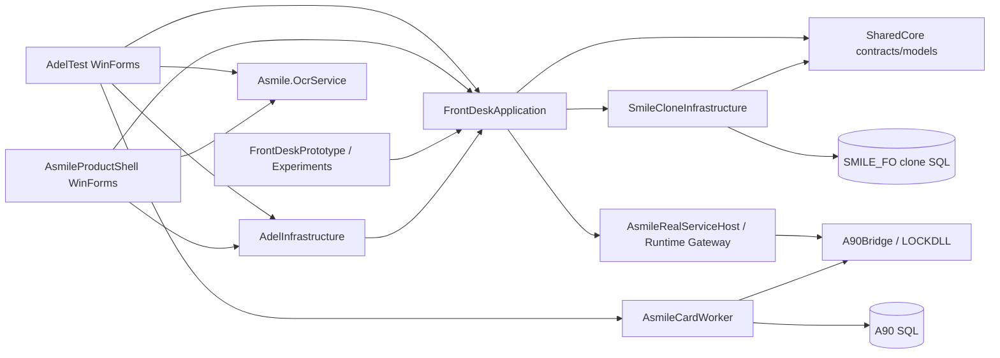
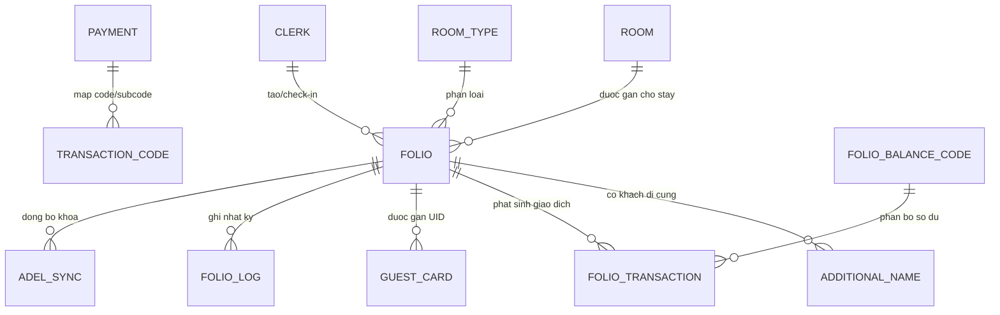

# PHÂN TÍCH DỰ ÁN FRONT OFFICE CŨ `v12fix`

## 0. Kết luận điều hành

Thư mục được phân tích: `K:\TESTCODE\Locldll-adel-Asmile\v12fix`.

Kết luận quan trọng nhất: đây **không phải một bộ Front Office/PMS hoàn chỉnh theo nghĩa truyền thống**, mà là một workspace lai gồm:

- một ứng dụng WinForms tích hợp A-Smile/SMILE_FO và khóa thẻ ADEL;
- một Product Shell Front Desk mới hơn nhưng vẫn là WinForms;
- một phòng thí nghiệm kiểm chứng các write-path trên bản sao database SMILE_FO;
- nhiều executable phục vụ thẻ khóa, OCR, bridge x86/net48, kiểm thử và chẩn đoán phần cứng.

Do đó, tri thức đáng lấy nhất không nằm ở giao diện hay cấu trúc project, mà nằm ở các quy tắc đã được thử nghiệm quanh chuỗi **tạo Folio → check-in → ghi thẻ → đọc UID → kiểm tra trùng → đồng bộ thẻ ăn sáng**, các chốt an toàn tài chính trước checkout, cơ chế chống ghi trùng và các trạng thái retry của thẻ khóa.

Không nên sao chép kiến trúc, database hay UI của dự án này sang Asmile-BO. Nên dùng nó như một bộ bằng chứng nghiệp vụ và acceptance baseline để thiết kế lại Front Office theo WPF + MVVM + EF Core.

### Phạm vi và mức độ chắc chắn

Toàn bộ repository đã được lập chỉ mục ở chế độ đầy đủ, không lưu artifact vào source cũ. Phạm vi đọc gồm 274.089 node/303.776 quan hệ trong knowledge graph; phần source chính có 243 file C# với khoảng 116.694 dòng, cùng SQL, script, tài liệu, cấu hình và acceptance logs. Các luồng nghiệp vụ trọng yếu được đọc sâu từ service/use case, UI shell, SQL adapter và tài liệu handoff.

Đánh giá trong báo cáo được chia ngầm thành ba mức:

- **Đã xác nhận:** có luồng thực thi hoặc truy vấn/ghi dữ liệu rõ ràng.
- **Một phần:** có UI, preview hoặc dữ liệu tham chiếu nhưng chưa có quy trình end-to-end hoàn chỉnh.
- **Không có trong source:** không tìm thấy symbol, chuỗi, service hoặc màn hình tương ứng; không suy diễn thêm.

---

## 1. Kiến trúc tổng thể

### 1.1. Số lượng Project và Solution

Có **16 project C#** trong **3 solution**.

| # | Project | Loại | Chức năng chính |
|---:|---|---|---|
| 1 | `SharedCore` | Class library, `net8.0;net48` | DTO, contract, result model, RBAC, check-in, checkout, tài chính và thẻ. Đây là lớp giao tiếp chung. |
| 2 | `SmileCloneInfrastructure` | Class library, `net8.0` | Truy cập SQL trực tiếp vào clone SMILE_FO; tạo Folio, check-in tối thiểu, checkout, payment/void, đọc Folio, thẻ khách, thẻ ăn sáng, mã danh mục. |
| 3 | `FrontDeskApplication` | Class library, `net8.0` | Application service/use case: truy vấn Front Desk, chuỗi create-check-in-issue, phiên ghi thẻ, checkout readiness, financial posting workflow, permission. |
| 4 | `AdelInfrastructure` | Class library, `net8.0` | Adapter hạ tầng ADEL/thẻ, phụ thuộc application contract. |
| 5 | `FrontDeskPrototype` | WinForms executable, `net8.0-windows` | Prototype/lab UI, composition root và acceptance runner; không phải UI production. |
| 6 | `CheckInExperiment` | Console executable, `net8.0` | Thử nghiệm check-in, snapshot, rollback/commit và regression. |
| 7 | `AsmileIntegrationTest` | Console executable, `net8.0` | Kiểm thử tích hợp payload, thẻ thực, room mapping và batch validation. |
| 8 | `AsmileRealServiceHost` | Console/host, `net48` | Host x86/net48 để gọi ADEL/LOCKDLL đúng runtime; bridge cho issue/read/readiness. |
| 9 | `AsmileProductShell` | WinForms executable, `net8.0-windows` | Shell Front Desk đầu tiên: Dashboard, In-house, Search, Check-in/Reservation, Check-out, Settings. |
| 10 | `AdelTest` | WinForms executable, `net8.0-windows` | Ứng dụng tích hợp lớn: Front Desk hub, map phòng, lịch đặt phòng, dashboard, cấu hình, log, worker, ADEL. Có bản sao nội bộ của Product Shell. |
| 11 | `AdelTest.Tests` | xUnit, `net8.0-windows` | Test cấu hình, migration JSON và adapter FO; phạm vi test tự động còn hẹp. |
| 12 | `AsmileCardWorker` | Console/Windows worker | Hàng đợi ghi thẻ, lease/retry, provider selection, state/log/health, đồng bộ DB A90. |
| 13 | `AsmileCardRuntimeHost` | Console executable, `net8.0` | Host tách biệt cho runtime thẻ ADEL/LOCKDLL và trace. |
| 14 | `A90Bridge` | Console executable | Bridge lớn cho A90/LOCKDLL, resolve context phòng và thực thi lệnh native. |
| 15 | `RegCodeProbe` | Console executable | Probe/chẩn đoán hành vi thư viện thẻ; không phải nghiệp vụ Front Office. |
| 16 | `Asmile.OcrService` | ASP.NET Core service, `net8.0` | OCR giấy tờ qua PaddleOCR/OpenCV/ZXing; endpoint health và identity OCR. |

Ba solution không phân vùng nghiệp vụ sạch mà chồng lấn project:

- `AsmileLabs.sln`: 8 project lab/application/infrastructure.
- `AdelTest.sln`: 8 project app tích hợp và runtime thẻ, đồng thời tham chiếu 4 project từ AsmileLabs.
- `AsmileProductShell.sln`: Product Shell cùng 4 project lõi từ AsmileLabs.

### 1.2. Quan hệ giữa các Project

Dependency chính đi từ UI/harness xuống application service, rồi xuống contract và SQL/native adapter. Tuy nhiên ranh giới bị phá vỡ ở nhiều nơi: UI có SQL trực tiếp, `AdelTest` chứa bản sao mã Product Shell, database tự dò cột/tên bảng, và một số service hạ tầng gắn chặt với stored procedure/bảng legacy.

### 1.3. Kiến trúc đang sử dụng

Kiến trúc có ý định theo kiểu **layered/Clean-ish architecture**:

1. `SharedCore`: contracts và models.
2. `FrontDeskApplication`: use case/domain workflow.
3. `SmileCloneInfrastructure` và `AdelInfrastructure`: adapter.
4. WinForms shell/prototype: composition root và UI.

Ý định này tốt nhưng thực tế là kiến trúc lai:

- application service tương đối độc lập;
- hạ tầng dùng ADO.NET và SQL viết tay, không có ORM/domain aggregate;
- UI shell chứa nhiều orchestration, SQL và business decision;
- có nhiều executable/bridge do ràng buộc x86, net48 và DLL native;
- nhiều tính năng chỉ ở mức lab/acceptance, chưa phải product-grade PMS.

### 1.4. Có MVVM hay không?

**Không.** Không tìm thấy `ViewModel`, `INotifyPropertyChanged`, `ICommand` hoặc `ObservableCollection`. UI chính dùng WinForms, event handler và control được dựng bằng code. Một phần service/use case có thể tái dùng về mặt ý tưởng, nhưng UI không theo WPF/MVVM.

### 1.5. Dependency giữa các module nghiệp vụ

| Module nghiệp vụ | Phụ thuộc bắt buộc | Phụ thuộc tùy chọn/ngoại vi |
|---|---|---|
| Reservation/Folio | SMILE_FO, Room, RoomType, Clerk, Folio | Company/TA, RateCode, market/source |
| Check-in | Folio hợp lệ, clerk, phòng, AdditionalName | posting tiền phòng, OCR, khách cũ |
| Issue card | Folio in-house, room mapping, runtime readiness | A90/LOCKDLL, worker queue, breakfast sync |
| Checkout | Folio in-house, checkout service | readiness tài chính, khóa/thẻ, permission |
| Payment/Void | Folio in-house, Payment mapping, TransactionCode | duplicate guard, reconciliation, telemetry |
| In-house/Search/Map | Folio read model | dữ liệu deposit/balance/rate có thể thay đổi theo schema |
| OCR | camera/mobile/sidecar OCR | so khớp khách cũ, xác nhận thủ công |
| Extend stay | Folio/DepartureDate, ADEL sync | dashboard task và issue-card validity |

---

## 2. Toàn bộ chức năng Front Office tìm thấy

### 2.1. Chức năng đã xác nhận

1. Dashboard Front Desk và tác vụ trong ngày.
2. Sơ đồ/map phòng theo tầng, trạng thái trống/đang ở/dự kiến/overdue.
3. Lịch đặt phòng dạng timeline.
4. Tạo đặt phòng/Folio.
5. Sửa ngày và phòng của booking bằng kéo/thả timeline.
6. Hủy đặt phòng.
7. Walk-in/tạo Folio và check-in trực tiếp.
8. Nghỉ giờ/quick stay/hourly check-in.
9. Check-in từ Folio có sẵn.
10. Quản lý khách chính và khách đi cùng (`AdditionalName`).
11. Quét CCCD/passport/MRZ, camera hoặc mobile QR bridge.
12. Tìm và tái sử dụng hồ sơ khách cũ.
13. Chọn công ty/Travel Agent, sửa danh mục và xem báo cáo đơn giản.
14. Chọn room type, rate code, market segment, booking source, payment method.
15. Extra bed và kiểm tra sức chứa phòng ở mức UI/chi tiết.
16. In-house list, tìm phòng, tìm Folio/khách.
17. Xem chi tiết Folio và trạng thái vận hành.
18. Ghi thẻ phòng, đọc thẻ, nhiều thẻ theo số người lớn.
19. Kiểm tra trùng UID đang active.
20. Đồng bộ UID thẻ ăn sáng.
21. Hàng đợi ghi thẻ, retry, lease, health và giám sát worker.
22. Gia hạn thời gian ở và ghi nhận kết quả đồng bộ ADEL.
23. Post tiền phòng/charge theo gate cấu hình.
24. Thu tiền/payment posting.
25. Void giao dịch và reconciliation.
26. Kiểm tra số dư/công nợ trước checkout.
27. Check-out và vô hiệu hóa thẻ khách trong database.
28. RBAC tối thiểu cho check-in, issue card, payment, void, checkout.
29. Nhật ký, telemetry, trace, dashboard sức khỏe tích hợp.
30. Cấu hình kết nối, room mapping SMILE ↔ A90 và tài khoản quản trị.

### 2.2. Chức năng chỉ có một phần

- **Đặt cọc:** có trường số tiền, phương thức, trạng thái “đã thu”, preview tổng tiền/công nợ; chưa thấy workflow posting đặt cọc end-to-end riêng biệt và có đối soát.
- **Khách đoàn:** có nhiều khách, company/group field và tổng phòng theo nhóm trên calendar; chưa có group master, allotment, rooming list, routing charge hoặc group billing hoàn chỉnh.
- **Công nợ:** có folio balance và chặn checkout khi còn số dư; chưa có city ledger/AR aging, hạn mức tín dụng, chuyển công nợ hoặc thu nợ doanh nghiệp hoàn chỉnh.
- **Báo cáo:** có dashboard vận hành, Company/TA report, acceptance/diagnostic reports; chưa có bộ báo cáo PMS chuẩn như occupancy, ADR, RevPAR, forecast, audit pack.
- **Trạng thái phòng:** map suy ra trạng thái từ Folio và A90; chưa có quy trình housekeeping độc lập.

### 2.3. Chức năng không có trong source

Không tìm thấy triển khai cho:

- Night Audit/End of Day/chuyển business date;
- Housekeeping task, dirty/clean/inspected, minibar, discrepancy;
- Lost & Found;
- Wake Up Call;
- chuyển phòng/đổi phòng có workflow hoàn chỉnh;
- khóa phòng Out of Order/Out of Service theo nghiệp vụ PMS;
- group allotment/rooming list/group billing hoàn chỉnh;
- invoice/e-invoice hoàn chỉnh;
- accounts receivable/city ledger hoàn chỉnh;
- channel manager/OTA distribution;
- rate plan/season/package engine;
- forecast, yield/revenue management;
- audit trail nghiệp vụ toàn diện cho thay đổi đặt phòng.

---

## 3. Phân tích từng nhóm chức năng

| Chức năng | Mục đích và quy trình tóm tắt | Điểm mạnh | Điểm yếu | Có đáng giữ? |
|---|---|---|---|---|
| Dashboard/Front Desk hub | Tập trung tác vụ check-in, checkout, thẻ, tìm kiếm, log và task | Tác vụ chính dễ thấy; có summary vận hành | Lẫn nghiệp vụ với kỹ thuật runtime; số liệu summary chưa đồng đều | **Giữ ý tưởng**, thiết kế lại |
| Map phòng | Cho lễ tân nhìn trạng thái phòng và mở thao tác nhanh | Trực quan theo tầng; có tooltip guest/rate/deposit/balance | Trạng thái suy ra từ Folio, chưa có nguồn Housekeeping; layout vẽ tay | **Giữ nghiệp vụ và UX concept** |
| Reservation timeline | Tạo/sửa/hủy booking, kéo thả phòng/ngày | Hiệu quả cho điều phối phòng; có filter và group totals | Ghi trực tiếp Folio; fallback delete khi thiếu `CancelNum`; thiếu audit/availability lock | **Giữ nghiệp vụ, viết lại** |
| Create Folio/Reservation | Thu thập stay, guest, booking, finance và tạo record | Trường nghiệp vụ khá phong phú; validation cơ bản | Wizard quá lớn; schema-adaptive; confirm number và status phụ thuộc legacy | **Giữ bộ dữ liệu/rule, viết lại** |
| Walk-in/Check-in | Tạo Folio rồi chuyển in-house | Chuỗi bước rõ; permission, idempotency lock, telemetry | Tạo Folio trước rồi check-in có thể để lại hồ sơ dở; rollback hạn chế | **Rất đáng giữ nghiệp vụ** |
| Hourly/Quick stay | Tạo nhanh khách nghỉ giờ từ map phòng | Phù hợp vận hành khách sạn thực tế; ít bước | Quy tắc giờ/giá còn hard-code hoặc preset đơn giản | **Giữ**, xây policy rõ ràng |
| Hồ sơ khách/OCR | Quét giấy tờ, chuẩn hóa, đối chiếu khách cũ, cho sửa tay | MRZ-first, provenance, nhiều nguồn camera/mobile; giảm nhập liệu | Pipeline rất lớn, phụ thuộc sidecar; text/encoding có dấu hiệu hỏng | **Giữ nghiệp vụ**, tách dịch vụ |
| Company/TA | Chọn, tạo/sửa công ty/đại lý, preset code | Hỗ trợ source/market/rate; có tìm kiếm | Gắn với bảng `CLIENT`, chưa thành CRM/contract/rate agreement hoàn chỉnh | **Giữ ý tưởng**, tích hợp CRM mới |
| Extra bed/occupancy | Kiểm tra số khách, giường phụ và sức chứa | Có cảnh báo vận hành | Chủ yếu UI/lookup; chưa có inventory/charge lifecycle đầy đủ | **Giữ rule**, viết lại |
| Folio/In-house/Search | Tra cứu phòng, khách, Folio và chi tiết | Read service tách tương đối tốt; nhiều tiêu chí | Query phụ thuộc tên cột động và `FolioSubNum=0` ở vài chỗ | **Giữ use case**, thiết kế read model mới |
| Room charge | Post tiền phòng sau check-in nếu gate cho phép | Có validation, mapping, duplicate safety và khả năng block | Tích hợp tùy chọn, nhiều `NEED VALIDATION`; chưa phải night posting | **Giữ nguyên tắc an toàn**, không giữ code |
| Payment | Thu tiền vào Folio | Kiểm tra Folio in-house, mapping dấu tiền, idempotency, retry, reconciliation, audit trail | Guard in-memory không bền vững; mapping legacy phức tạp | **Rất đáng giữ nghiệp vụ** |
| Deposit | Ghi số tiền/phương thức/đã thu và trừ preview | UX dễ hiểu | Chưa thấy posting ledger độc lập; dễ lệch giữa UI và sổ cái | **Chỉ giữ yêu cầu**, phải thiết kế lại hoàn toàn |
| Void transaction | Hủy giao dịch qua XRef và tạo reversal | Chặn void trùng, permission, retry, hậu kiểm | Phụ thuộc pattern transaction legacy; chưa có approval theo ngưỡng | **Giữ nghiệp vụ**, bổ sung kiểm soát |
| Checkout readiness | Chặn checkout nếu thiếu dữ liệu, lệch số hoặc còn công nợ | Đây là rule rất giá trị; phân biệt outstanding, negative, mismatch | Khi read service thiếu có cấu hình fail-open; tolerance cấu hình rời | **Giữ bắt buộc**, mặc định fail-closed |
| Checkout | Đổi trạng thái Folio và vô hiệu thẻ | Có permission và readiness gate | Chưa bao phủ invoice, room status dirty, key revoke vật lý, late checkout charge | **Giữ khung**, mở rộng nghiệp vụ |
| Extend stay | Chọn số ngày, cập nhật ngày đi và đồng bộ ADEL | Có task trên dashboard và bảng sync lịch sử | Chưa thấy availability/rate reprice/approval đầy đủ | **Giữ nghiệp vụ**, bổ sung guard |
| Issue/read card | Ghi thẻ, đọc lại, phân biệt lỗi, retry nhiều thẻ | Chuỗi an toàn và xử lý lỗi phần cứng rất sâu; có worker lease | Hệ thống bridge phức tạp, phụ thuộc vendor/native/x86 | **Giữ kinh nghiệm và protocol**, cô lập adapter |
| Breakfast UID | Đồng bộ thẻ ăn sáng theo số người lớn | Có precheck UID active và semantics cảnh báo rõ | Gắn cứng nghiệp vụ vào issue flow; market `DU` là ngoại lệ hard-code | **Giữ rule**, chuyển thành entitlement |
| RBAC | Chặn hành động nhạy cảm theo clerk/role | Đã có điểm chặn ở use case | Phạm vi action còn hẹp, thiếu approval/audit đầy đủ | **Giữ ý tưởng**, dùng auth chung của Asmile-BO |
| Logs/worker monitor | Quan sát health, retry, failure | Rất hữu ích cho vận hành thiết bị | Quá nhiều technical UI trong Front Desk | **Giữ backend/ops**, tách khỏi màn hình lễ tân |
| Reports | Company/TA, dashboard và báo cáo acceptance | Có bằng chứng regression và vận hành | Không phải reporting PMS hoàn chỉnh | **Giữ acceptance reports**, xây report mới |

---

## 4. Phân tích Database

### 4.1. Đặc điểm chung

Source không chứa một migration/schema hoàn chỉnh của SMILE_FO. Hệ thống đọc/ghi trực tiếp database legacy, tự dò bảng/cột qua `sys.tables`, `sys.columns` và `INFORMATION_SCHEMA`, rồi chọn cột tương thích. Vì vậy danh sách dưới đây là các bảng **được source tham chiếu**, không phải data dictionary đầy đủ của database ngoài source.

Không thấy EF Core trong dự án cũ. Data access chủ yếu là `SqlConnection`, `SqlCommand`, SQL động và stored procedure boundary.

### 4.2. Bảng nghiệp vụ chính đã xác nhận

| Bảng | Vai trò | Quan hệ logic |
|---|---|---|
| `Folio` | Trung tâm booking/stay/in-house/checkout | Khóa logic `FolioNum` + `FolioSubNum`; tham chiếu Room, Clerk, guest, transaction |
| `AdditionalName` | Khách đi cùng/guest names | Gắn `FolioNum`, `FolioSubNum` |
| `Room` | Danh mục phòng và trạng thái | `RoomCode` được Folio tham chiếu logic |
| `RoomType` | Danh mục loại phòng | `RoomTypeCode` dùng khi tạo Folio |
| `FolioTransaction` | Sổ giao dịch/charge/payment/void | Gắn Folio, transaction code, balance code, XRef |
| `GuetsCard` | UID/thẻ của khách; tên bảng legacy bị sai chính tả | Gắn Folio; có `SeqNo`, `CardNumber`, `Deleted` |
| `TelephonePending` | Side effect/pending liên quan check-in | Gắn Folio trong kiểm chứng hậu check-in |
| `FolioLog` | Log thay đổi/trạng thái Folio | Gắn Folio; dùng kiểm tra side effect |

### 4.3. Bảng danh mục/tham chiếu

- `Clerk`: nhân viên lễ tân/posting clerk.
- `RateCode`: mã giá.
- `Payment`: mapping payment code sang transaction code/subcode và balance code.
- `TransactionCode`: danh mục giao dịch và quy tắc dấu.
- `FolioBalanceCode`: bucket/sổ số dư Folio.
- `CLIENT`: company/travel agent và thông tin hóa đơn.
- `UserDefineDef`: mã tự định nghĩa/market/source.
- `HotelParameter`, `SYSPARA`: tham số khách sạn/hệ thống được tham chiếu trong lớp legacy.

### 4.4. Bảng lịch sử, đồng bộ và log

- `FolioTransaction`, `FolioLog`: lịch sử nghiệp vụ legacy.
- `AdelSync`: kết quả đồng bộ check-in/ghi thẻ theo Folio-phòng-thời gian.
- `AdelCheckoutSync`: kết quả đồng bộ checkout.
- `AdelExtendSync`: lịch sử gia hạn và kết quả ADEL.
- `CardIssueGuard`: chống ghi thẻ trùng theo Folio, card type và slot.
- `ASMILE_CARD_WORKER_STATE`: trạng thái queue/lease/retry của từng card job.
- `ASMILE_CARD_WORKER_LOG`: log chi tiết worker.
- `ASMILE_CARD_WORKER_HEALTH`: heartbeat và số liệu health.
- `AppLog`: log ứng dụng.
- `TaskQueue`: hàng đợi tác vụ nền.
- `AppSettings`: cấu hình key-value.
- `AsmileAdminUsers`: tài khoản quản trị riêng của ứng dụng tích hợp.

### 4.5. Bảng A90/thẻ khóa

Các bảng `SETCARD`, `KRK`, `JBB`, `ROOMINFO`, `ROOMSTATUS` và một số bảng vendor như `KYQY`, `SJK1`, `QJK`, `YSZX` phục vụ queue, thẻ, phòng và trạng thái thiết bị A90. Đây là schema vendor, không nên đưa vào domain database của Asmile-BO; chỉ nên truy cập qua adapter tích hợp.

### 4.6. Quan hệ dữ liệu cốt lõi

Quan hệ trên chủ yếu được thực thi bằng code và natural key; source không chứng minh có foreign key đầy đủ.

### 4.7. Đánh giá thiết kế Database

**Điểm tốt**

- `Folio` là aggregate nghiệp vụ dễ hiểu.
- Giao dịch tách khỏi Folio và có XRef phục vụ void/reversal.
- Có log/sync table cho ADEL và worker, hữu ích khi điều tra lỗi thiết bị.
- Payment mapping tách khỏi logic màn hình.

**Điểm yếu nghiêm trọng**

- Schema legacy thiếu tính tự mô tả; code phải dò và chọn cột thay thế.
- Tên bảng/cột không nhất quán, có lỗi chính tả (`GuetsCard`).
- Dùng số trạng thái magic như `FolioStatus=2`.
- Quan hệ dựa nhiều vào `FolioSubNum=0`, chuỗi trim/cast và natural key.
- SQL trực tiếp trải ở UI, service và worker; transaction boundary không đồng nhất.
- Tự tạo/sửa bảng khi runtime khởi động làm tăng rủi ro vận hành.
- Idempotency payment/void một phần nằm trong memory, không đủ cho nhiều instance.
- Booking, stay, room assignment và folio chưa tách thành entity rõ ràng.
- Không có mô hình business date/night audit, housekeeping room state, rate plan, inventory hay audit event đầy đủ.

**Khuyến nghị cho Asmile-BO**

Không sao chép schema. Thiết kế mới nên tách tối thiểu: `Reservation`, `Stay`, `RoomAssignment`, `Guest`, `ReservationGuest`, `Folio`, `FolioWindow`, `FolioEntry`, `Payment`, `Deposit`, `RoomStatus`, `HousekeepingTask`, `KeyCredential`, `BusinessDate`, `AuditEvent`, `Company`, `TravelAgent`, `RatePlan`, `RoomRate`, `IntegrationOutbox`. Mọi bảng cần PK/FK, concurrency token, tenant/property scope, audit fields và status enum có kiểm soát.

---

## 5. Phân tích giao diện

### 5.1. Giao diện làm tốt

- **Hotel Map:** cho phép nhìn theo tầng, phân biệt phòng trống/đang ở/dự kiến/quá hạn và mở thao tác nhanh.
- **Reservation Timeline:** phù hợp điều phối phòng theo ngày, có kéo/thả và chọn dải ngày.
- **Front Desk Hub:** nhóm action card theo công việc lễ tân, giúp onboarding nhanh.
- **Check-in workflow:** gom stay, khách, booking, tài chính, OCR, thẻ và confirmation vào một luồng có trạng thái từng phần.
- **Quick Stay:** từ phòng trống vào form nghỉ giờ với preset, giảm thao tác.
- **Thông tin hover/quick view:** hiển thị Folio, khách, giờ ở, rate, deposit và balance ngay trên map.
- **Worker/runtime health:** hữu ích cho quản trị kỹ thuật khi thẻ khóa có lỗi.

### 5.2. Giao diện lỗi thời hoặc có rủi ro

- WinForms dựng control bằng code, fixed pixel và custom painting; khó responsive, test và bảo trì.
- Nhiều modal lồng nhau; người dùng dễ mất ngữ cảnh.
- UI và business/data access trộn trong class rất lớn.
- Product Shell bị nhân bản trong `AdelTest/AsmileProductShellInternal`, gây drift.
- Technical concepts như runtime, queue, bridge, trace xuất hiện gần nghiệp vụ lễ tân.
- Có dấu hiệu mojibake/encoding tiếng Việt trong nhiều chuỗi UI.
- Wizard check-in quá dày; trường nâng cao xuất hiện cùng lúc với trường bắt buộc.
- Màu trạng thái chưa có semantic source thống nhất; phòng “sẵn sàng” có thể chỉ là suy luận từ Folio.
- Không có accessibility, keyboard flow và validation summary nhất quán như một WPF product hiện đại cần có.

### 5.3. Luồng thao tác thuận tiện

- Chọn phòng trên map → walk-in/hourly check-in.
- Chọn booking trên timeline → sửa vị trí/ngày hoặc mở chi tiết.
- Chọn Folio in-house → issue/read card hoặc checkout.
- OCR → so khớp khách cũ → cho phép xác nhận/sửa tay.
- Checkout có bước readiness tài chính trước khi commit.

### 5.4. Luồng nên thay đổi

- Tách `Reservation` và `Walk-in Check-in`; không dùng một form khổng lồ cho mọi trường hợp.
- Dùng workspace một màn hình với panel chi tiết thay vì chuỗi modal.
- Tách “tác vụ lễ tân” khỏi “vận hành tích hợp/thẻ/worker”.
- Deposit phải post vào ledger thật, không chỉ tick “đã thu”.
- Checkout cần checklist rõ: charge cuối, balance, deposit/refund, invoice, key revoke, room dirty, confirmation.
- Gia hạn phải kiểm tra availability, reprice, deposit/credit và cập nhật key validity trước khi lưu.
- Kéo/thả booking phải có conflict check, optimistic concurrency, confirmation và audit trail.
- Trạng thái phòng phải kết hợp Reservation/Stay + Housekeeping + Maintenance, không chỉ suy từ Folio.

---

## 6. Tri thức nghiệp vụ cần trích xuất

Phần này mô tả nghiệp vụ, không mô tả code.

### 6.1. Quy trình đặt phòng

1. Chọn khoảng ngày đến/ngày đi và loại phòng.
2. Kiểm tra phòng phù hợp và xung đột trong khoảng ở.
3. Nhập khách chính, số người lớn/trẻ em/em bé, người đặt.
4. Chọn công ty/TA, nguồn đặt, market segment, rate code và phương thức thanh toán dự kiến.
5. Ghi chú yêu cầu đặc biệt, ăn sáng, giường phụ và thông tin liên hệ.
6. Tạo mã xác nhận và Folio/booking ở trạng thái reserved.
7. Khi đổi phòng/ngày trên timeline phải kiểm tra không cho cập nhật về quá khứ, kiểm tra xung đột và ghi audit.
8. Khi hủy phải chuyển trạng thái hủy, giữ lịch sử; không xóa vật lý.

**Bài học:** timeline là công cụ điều phối tốt, nhưng việc ghi dữ liệu phải đi qua reservation aggregate và conflict engine, không update trực tiếp Folio.

### 6.2. Quy trình Walk-in/Check-in

1. Chọn phòng trống và loại stay: qua đêm hoặc nghỉ giờ.
2. Thu thập/kiểm tra giấy tờ khách; tìm khách cũ trước khi tạo hồ sơ mới.
3. Xác nhận ngày giờ đến/đi, số khách, room type booked/actual, rate, source, market và clerk.
4. Kiểm tra phòng tồn tại, loại phòng hợp lệ, clerk hợp lệ và thời gian đi sau thời gian đến.
5. Tạo reservation/Folio.
6. Kiểm tra quyền check-in của clerk.
7. Chuyển Folio sang in-house và kiểm chứng các side effect cần thiết.
8. Nếu được cấu hình, post room charge với duplicate guard.
9. Nếu khách cần thẻ, chuyển sang quy trình phát hành thẻ.
10. Trả kết quả theo từng bước; lỗi kỹ thuật không được giả thành lỗi nghiệp vụ.

**Bài học:** thứ tự bước và kết quả theo step rất đáng giữ. Thiết kế mới cần saga/outbox hoặc transaction boundary rõ để xử lý Folio đã tạo nhưng check-in thất bại.

### 6.3. Quy trình khách nghỉ giờ

1. Chỉ mở từ phòng đang sẵn sàng.
2. Áp preset giờ đi và mức giá nghỉ giờ theo property policy.
3. Thu thông tin khách tối thiểu nhưng vẫn phải có định danh và clerk.
4. Tạo stay, check-in và phát hành thẻ giống luồng thường.
5. Theo dõi sắp hết giờ/quá giờ trên dashboard.
6. Khi gia hạn, tính lại phí và thời hạn thẻ.

**Bài học:** quick flow nên giảm thao tác, không giảm kiểm soát danh tính, tài chính và phòng.

### 6.4. Quy trình nhận dạng khách

1. Chụp/nhận ảnh CCCD hoặc passport từ camera hay thiết bị di động.
2. Với passport, ưu tiên MRZ; dùng vùng chữ nhìn thấy để bổ sung.
3. Chuẩn hóa họ tên, ngày sinh, giới tính, quốc tịch, số giấy tờ, ngày/nơi cấp.
4. Gắn nguồn/provenance cho từng trường và giữ ảnh/raw result theo chính sách bảo mật.
5. Tìm khách cũ bằng số giấy tờ và các thuộc tính gần đúng.
6. Nếu có match, cho lễ tân so sánh và chọn dùng hồ sơ cũ hay cập nhật.
7. Luôn cho phép sửa tay và yêu cầu xác nhận trước khi hoàn tất.

**Bài học:** OCR chỉ là dữ liệu đề xuất; quyết định cuối phải thuộc về người dùng và có audit.

### 6.5. Quy trình phát hành thẻ phòng

1. Folio phải tồn tại, đã in-house, có phòng và thời gian ở hợp lệ.
2. Kiểm tra quyền issue card và readiness của encoder/runtime.
3. Map mã phòng PMS sang mã phòng vendor A90.
4. Lập kế hoạch số thẻ theo chính sách; source cũ giới hạn theo số người lớn và tối đa ba thẻ trong một rule cụ thể.
5. Với từng thẻ: chờ thẻ, ghi, đọc lại UID và xác minh kết quả.
6. Chống double issue theo Folio/card type/slot và correlation/idempotency key.
7. Nếu lỗi tạm thời, giữ trạng thái waiting/retry; không hard-fail cả phiên một cách mơ hồ.
8. Nếu ghi vật lý thành công nhưng sync quyền ăn sáng lỗi do UID đang active ở Folio khác, trả thành công có cảnh báo, không tuyên bố thẻ phòng thất bại.
9. Ghi telemetry đủ để truy từ yêu cầu → worker → provider → card UID.

**Bài học:** đây là phần tri thức có giá trị cao nhất. Vendor runtime phải nằm sau adapter; domain chỉ biết `KeyCredential` và trạng thái phát hành.

### 6.6. Quy trình thẻ ăn sáng/quyền lợi

1. Xác định số entitlement từ số người lớn và package/rate.
2. Một số market có thể không áp dụng; không hard-code market trong workflow chung.
3. Sau khi đọc UID, kiểm tra UID có đang active ở Folio khác không.
4. Nếu không trùng, gán UID cho Folio và entitlement tương ứng.
5. Nếu trùng, không ghi đè âm thầm; yêu cầu xử lý hoặc trả cảnh báo có bằng chứng.

**Bài học:** nên mô hình hóa thành entitlement service dùng được cho breakfast, lounge, spa, parking thay vì gắn cứng vào thẻ.

### 6.7. Quy trình thu tiền

1. Chọn Folio in-house, payment method/code và số tiền dương.
2. Xác thực clerk và quyền thu tiền.
3. Resolve payment mapping sang transaction code/subcode và folio balance bucket.
4. Xác định quy ước dấu; chuẩn hóa amount theo loại giao dịch.
5. Tạo reference/idempotency key chống bấm lặp.
6. Kiểm tra duplicate bền vững trong ledger trước khi post.
7. Post giao dịch trong transaction boundary.
8. Đọc lại ledger và số dư để reconciliation.
9. Nếu timeout/deadlock/network, retry có giới hạn; không retry lỗi nghiệp vụ.
10. Ghi audit request, mapping, số dư trước/sau, kết quả và người thực hiện.

**Bài học:** phải giữ các guard và reconciliation; thay in-memory guard bằng unique key/idempotency record trong database.

### 6.8. Quy trình đặt cọc

Source chỉ cung cấp tri thức một phần. Quy trình mới nên hoàn thiện như sau:

1. Chọn Folio/reservation, số tiền, tiền tệ, phương thức và reference.
2. Post một deposit receipt vào ledger, không chỉ đánh dấu checkbox.
3. Phân biệt authorized/collected/refunded/forfeited/applied.
4. Khi check-in hoặc checkout, apply deposit vào folio balance bằng entry đối ứng.
5. Hoàn/giữ cọc phải có quyền, lý do và audit.

### 6.9. Quy trình void giao dịch

1. Xác định chính xác giao dịch gốc bằng transaction id hoặc XRef.
2. Kiểm tra Folio, quyền void và trạng thái giao dịch.
3. Không cho void lại một chain đã void.
4. Bắt buộc lý do; với số tiền lớn nên có approval.
5. Tạo reversal, không xóa giao dịch gốc.
6. Reconcile: giao dịch gốc được đánh dấu, reversal tồn tại và số dư thay đổi đúng.

### 6.10. Quy trình checkout

1. Folio phải tồn tại và đang in-house.
2. Đọc số dư và tổng giao dịch từ nguồn tin cậy.
3. Nếu thiếu dữ liệu tài chính, chặn hoặc chuyển manual review; không nên mặc định cho qua.
4. Nếu ledger total lệch folio balance vượt tolerance, chặn checkout.
5. Nếu số dư dương, thu tiền/chuyển công nợ theo quyền; nếu số dư âm, xử lý refund/manual review.
6. Xác nhận charge cuối, deposit, invoice và phương thức settlement.
7. Commit checkout.
8. Vô hiệu credential/thẻ, cập nhật phòng sang dirty và phát housekeeping task.
9. Ghi thời điểm, clerk, số dư cuối, invoice và integration result.

**Bài học:** financial readiness gate là rule bắt buộc; source cũ còn thiếu invoice, housekeeping handoff và physical key revoke đầy đủ.

### 6.11. Quy trình gia hạn

1. Chọn Folio in-house và ngày/giờ đi mới.
2. Kiểm tra phòng không bị booking khác chiếm trong thời gian gia hạn.
3. Tính lại rate/charge, deposit/credit requirement và quyền override.
4. Cập nhật stay/reservation.
5. Gia hạn hiệu lực credential/thẻ.
6. Đồng bộ vendor và ghi kết quả; nếu vendor lỗi, tạo integration task để xử lý.

### 6.12. Quy trình khách đoàn

Source chỉ cho thấy company/group field, nhiều khách và tổng phòng theo nhóm; chưa đủ thành quy trình đoàn. Front Office mới cần bổ sung:

1. Group master và hợp đồng/cut-off/allotment.
2. Rooming list và gán phòng hàng loạt.
3. Routing charge: master folio, individual folio, split rule.
4. Check-in/out hàng loạt có kiểm soát theo từng phòng.
5. Deposit, credit limit, billing instruction và invoice theo đoàn.

### 6.13. Night Audit và Housekeeping

Không có tri thức triển khai đáng tin cậy trong source để trích xuất. Không nên lấy dự án này làm chuẩn cho hai module đó. Cần khảo sát vận hành khách sạn và thiết kế mới độc lập cho business date, room charge batch, no-show, rollover, trial balance, dirty/clean/inspected, discrepancy và maintenance block.

---

## 7. Đánh giá khả năng tái sử dụng

### 7.1. Phân loại theo module

| Module/khối | Hạng | Lý do |
|---|:---:|---|
| Acceptance semantics và scenario catalog | **A** | Có baseline rõ cho sequence, duplicate UID, dependent precondition và retry second card; có thể giữ gần nguyên vẹn ở dạng test specification. |
| Contracts kết quả theo từng bước | **A/B** | Cấu trúc outcome, failure category, diagnostics có giá trị; cần đổi tên/domain model cho hệ mới. |
| Check-in workflow | **B** | Nghiệp vụ tốt, code phụ thuộc SMILE_FO và service legacy. |
| Checkout readiness | **B** | Rule rất đáng giữ; phải viết lại trên ledger mới và fail-closed. |
| Payment/Void/Reconciliation | **B** | Guard, idempotency, sign mapping, retry rất giá trị; persistence và accounting model phải mới. |
| Issue/read card session | **B** | Giữ state machine và error semantics; viết adapter mới cho vendor. |
| Reservation timeline nghiệp vụ | **B** | Giữ create/change/cancel/conflict concepts; bỏ ghi SQL trực tiếp. |
| Folio/In-house/Search read model | **B** | Giữ use case và tiêu chí tìm kiếm; viết query/model mới. |
| OCR và existing guest comparison | **B/C** | Giữ workflow và UX; pipeline kỹ thuật cần tách và đánh giá bảo mật. |
| Hotel Map UI concept | **C** | Ý tưởng tốt nhưng custom WinForms drawing và state source không phù hợp. |
| Hourly/Quick Stay | **B** | Nghiệp vụ thực tế; cần policy/rate engine mới. |
| Company/TA catalog/report | **C** | Chỉ là lookup đơn giản; CRM mới nên là nguồn chuẩn. |
| Deposit hiện tại | **C** | Chủ yếu preview/UI, không đủ ledger lifecycle. |
| Group booking hiện tại | **C** | Chỉ có vài field và grouping; không phải group module. |
| Dashboard/tác vụ | **C** | Giữ ý tưởng command center; xây lại KPI và data source. |
| WinForms UI/`AdelTest` shell | **D** | Không MVVM, class lớn, fixed layout, trộn SQL và runtime. |
| Bản sao `AsmileProductShellInternal` | **D** | Duplicate source, rủi ro drift. |
| Adaptive SQL dò cột/tên bảng | **D** | Che giấu schema drift, khó đảm bảo integrity. |
| Runtime DDL/bootstrap migration | **D** | Không phù hợp migration discipline của EF Core. |
| Fake snapshot/sample/fallback data | **D** | Không dùng trong product path. |
| Probe, Frida, RegCode diagnostics | **D** đối với Front Office | Chỉ giữ riêng trong engineering toolkit nếu còn cần hỗ trợ vendor. |
| A90 vendor tables trong domain DB | **D** | Cô lập sau integration adapter; không đưa vào schema Asmile-BO. |

### 7.2. Kết luận tái sử dụng

Phần được giữ gần nguyên vẹn nên là **acceptance knowledge**, không phải source code. Hầu hết module nghiệp vụ ở hạng B: giữ rule và sequence, viết lại code. UI và hạ tầng legacy chủ yếu hạng C/D.

---

## 8. Đề xuất đưa sang Asmile-BO

### 8.1. Quy trình và rule ưu tiên cao

1. Check-in step result rõ ràng và sequence có kiểm soát.
2. Checkout financial readiness gate.
3. Payment/void idempotency, duplicate detection và reconciliation.
4. State machine phát hành nhiều thẻ, retry/wait và phân loại lỗi.
5. Duplicate active UID và entitlement sync semantics.
6. Existing guest search + OCR confirmation.
7. Quick Stay/Hourly Stay như một policy riêng.
8. Reservation timeline với conflict check và audit.
9. Extend stay với availability, repricing và key extension.
10. Room map làm command surface chính của lễ tân.

### 8.2. Thiết kế dữ liệu nên đưa sang ở mức ý tưởng

- Folio ledger append-only với reversal thay cho xóa/sửa giao dịch.
- Transaction/payment mapping có hiệu lực theo property và thời gian.
- Integration outbox/inbox và idempotency record bền vững.
- Key credential tách khỏi bảng vendor.
- Audit event cho mọi thay đổi reservation/stay/folio.
- Company/TA liên kết CRM, không tạo master data song song.
- Room state là tổng hợp của occupancy, housekeeping và maintenance.

### 8.3. Luồng giao diện đề xuất

Front Office mới nên có năm workspace chính:

1. **Front Desk Board:** arrivals, departures, in-house, alerts, quick actions.
2. **Room Plan:** map phòng + timeline, filter theo tầng/type/status.
3. **Reservation Workspace:** guest, stay, rate, guarantee/deposit, notes, history.
4. **In-house/Folio Workspace:** folio windows, entries, payment, deposit, key, extend/move/check-out.
5. **Operations:** housekeeping, maintenance, night audit, integration exceptions; phân quyền rõ.

Mỗi workspace dùng panel chi tiết và command bar; modal chỉ dành cho xác nhận hành động nhỏ. Validation hiển thị theo section và có summary. Các màn hình kỹ thuật worker/runtime phải nằm trong Admin/Integration Monitor, không nằm ở hub lễ tân.

### 8.4. Báo cáo cần xây

- Arrival/Departure/In-house/No-show.
- Occupancy, ADR, RevPAR và room revenue.
- Reservation pickup và forecast.
- Payment/Deposit/Refund/Void audit.
- Folio balance và checkout exception.
- Company/TA production.
- Key issuance và integration failure.
- Housekeeping status/discrepancy.
- Night audit pack và business-date reconciliation.

### 8.5. Kế hoạch triển khai đề xuất

#### Giai đoạn 0 — Chuẩn hóa nghiệp vụ

- Chuyển các scenario cũ thành business acceptance test bằng ngôn ngữ domain mới.
- Chốt state machine Reservation, Stay, Folio, Payment, Room và KeyCredential.
- Phỏng vấn vận hành cho các khoảng trống: Night Audit, Housekeeping, group, AR, invoice.

#### Giai đoạn 1 — Nền dữ liệu và read-only Front Desk

- Thiết kế entity/EF Core migration mới.
- Xây Room Plan, In-house, Search và Folio read model.
- Tích hợp CRM/property/room master hiện có của Asmile-BO.

#### Giai đoạn 2 — Reservation và Check-in

- Reservation create/change/cancel/no-show.
- Walk-in và Hourly Stay.
- Guest/OCR/existing guest.
- Deposit guarantee đúng ledger.

#### Giai đoạn 3 — Folio và tài chính

- Folio windows, charge, payment, split/transfer, deposit apply/refund.
- Void/reversal, approval, idempotency và reconciliation.
- Invoice và AR handoff.

#### Giai đoạn 4 — In-house operations

- Extend stay, room move/room change.
- Key issuance adapter và entitlement service.
- Checkout đầy đủ, room dirty handoff.

#### Giai đoạn 5 — Housekeeping và Night Audit

- Room status lifecycle, task/inspection/discrepancy.
- Business date, daily posting, no-show, rollover và audit pack.

#### Giai đoạn 6 — Pilot và cutover

- Shadow read với dữ liệu thật.
- Pilot theo property/ca làm việc.
- Theo dõi exception, reconciliation và rollback plan.
- Chỉ mở write-path khi acceptance và audit đạt yêu cầu.

### 8.6. Nguyên tắc kiến trúc cho Asmile-BO

- WPF + MVVM; ViewModel không truy cập SQL trực tiếp.
- Application command/query rõ ràng; transaction boundary ở application service.
- EF Core migration có review; không tự sửa schema lúc runtime.
- Outbox cho ADEL/OCR/POS/Inventory/CRM integration.
- Optimistic concurrency cho reservation, room assignment và folio.
- Durable idempotency cho payment, checkout, issue card.
- Domain event cho `GuestCheckedIn`, `RoomMoved`, `PaymentPosted`, `GuestCheckedOut`, `RoomMarkedDirty`.
- Permission + approval + audit là yêu cầu nền, không bổ sung sau.
- Không để vendor code A90/LOCKDLL rò vào domain model.

---

## 9. Quyết định cuối cùng

Không nên “migrate project” `v12fix`. Nên thực hiện **business-knowledge migration**:

- lấy acceptance scenario làm hợp đồng hành vi;
- lấy các guard tài chính và thẻ khóa làm rule bắt buộc;
- lấy Room Map/Timeline/Quick Stay làm cảm hứng UX;
- thiết kế lại toàn bộ domain model, database, WPF/MVVM UI và integration boundary;
- bổ sung từ đầu các mảng mà source cũ không có: Night Audit, Housekeeping, room move, group, AR và reporting PMS chuẩn.

ĐÃ SẴN SÀNG CHO BƯỚC THIẾT KẾ FRONT OFFICE MỚI.
