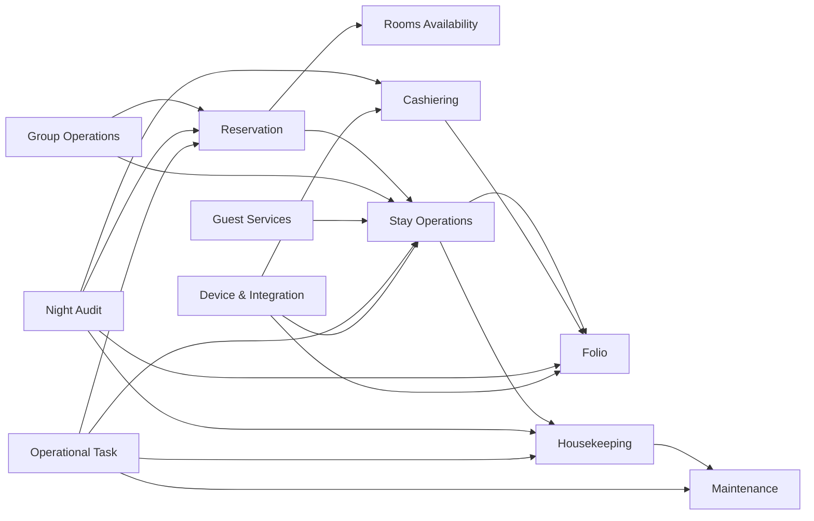

# THIẾT KẾ DOMAIN MODEL FRONT OFFICE ASMILE-BO

## 1. Executive Summary

Tài liệu này chuyển kiến trúc Front Office đã được duyệt thành domain blueprint có thể dùng trực tiếp cho bước thiết kế database và implementation planning, nhưng không chứa code, cấu hình ORM, SQL, API, ViewModel hay UI.

### 1.1. Quyết định cốt lõi

- Front Office là một modular monolith gồm 12 bounded context; mỗi dữ liệu nghiệp vụ chỉ có một context sở hữu.
- `Reservation` mô tả cam kết tương lai; `Stay` mô tả lưu trú thực tế. Hai khái niệm không thay thế nhau.
- `RoomAvailability` sở hữu sellable inventory; `RoomAssignment` sở hữu việc gán phòng; `RoomOperation` sở hữu trạng thái vệ sinh; `RoomOperationalBlock` sở hữu block kỹ thuật.
- `Folio` là guest subledger, không phải invoice và không phải General Ledger.
- `Payment`, `Deposit`, `RefundRequest`, `CashierShift` thuộc Cashiering; Accounting sở hữu journal, AR, accounting period và e-invoice.
- CRM sở hữu Guest Profile toàn hệ thống; Front Office giữ guest reference và snapshot đúng thời điểm giao dịch.
- Aggregate nhỏ, ghi độc lập, dùng optimistic concurrency. Không tạo distributed transaction giữa context/module.
- Local transaction luôn lưu aggregate change, audit record và outbox message cùng nhau.
- External request phải có durable idempotency; external result không rõ ràng phải vào reconciliation, không tự lặp giao dịch tài chính.
- `PropertyBusinessDate` là khái niệm hạng nhất; không thay bằng ngày máy chủ.
- AI chỉ đề xuất/kiểm tra/chuẩn bị; quyền thực thi luôn bị giới hạn bởi quyền của người dùng và domain rule.

### 1.2. Context map

### 1.3. Quy ước identity

- Mỗi Aggregate Root có khóa kỹ thuật global, bất biến, không mang ý nghĩa nghiệp vụ.
- Mã hiển thị có thể đọc được và thường unique theo Property; không dùng làm foreign key liên context.
- Mọi aggregate giao dịch có `PropertyId`, version concurrency và audit metadata.
- Event sử dụng global event ID; external request sử dụng idempotency key unique theo endpoint/source/property.

---

## 2. Ubiquitous Language

| Thuật ngữ | Định nghĩa và phạm vi | Owner | Dễ nhầm và quy tắc dùng từ |
|---|---|---|---|
| **Property** | Một cơ sở khách sạn vận hành độc lập theo timezone, currency, tax, room inventory và business date. | Enterprise/Property Master | Không đồng nghĩa Legal Entity; một pháp nhân có thể có nhiều Property. |
| **Business Date** | Ngày nghiệp vụ đang mở của một Property, được Night Audit rollover có kiểm soát. | Night Audit | Không dùng `DateTime.Now`, calendar date hoặc accounting posting date thay thế. |
| **Reservation** | Cam kết/ý định lưu trú trong tương lai, gồm period, demand, rate, guarantee và guest/contact. | Reservation | Không đồng nghĩa Stay; Reservation có thể cancel/no-show mà không tạo Stay. |
| **Booking** | Từ giao tiếp đồng nghĩa thông thường với Reservation. Trong model và rule phải dùng `Reservation`. | Reservation | Không tạo Aggregate Booking riêng; không dùng Booking để chỉ Stay. |
| **Stay** | Lần lưu trú thực tế từ check-in đến checkout, kể cả walk-in/day-use. | Stay Operations | Không đồng nghĩa Reservation hoặc Room Assignment. |
| **Arrival** | Góc nhìn vận hành đối với Reservation dự kiến đến hoặc Stay vừa bắt đầu trong business date. | Stay/Read Model | Không phải Aggregate; không dùng thay `Check-in`. |
| **Departure** | Góc nhìn vận hành đối với Stay dự kiến rời hoặc đã checkout trong business date. | Stay/Read Model | Không đồng nghĩa Checkout; Departure là lịch/queue, Checkout là hành vi. |
| **Guest** | Cá nhân liên kết CRM profile hoặc guest snapshot tham gia Reservation/Stay. | CRM sở hữu profile; FO sở hữu participation | Không đồng nghĩa Customer/Payer/Contact. |
| **Primary Guest** | Guest chịu trách nhiệm chính cho Reservation/Stay và registration. | Reservation/Stay | Không mặc nhiên là payer hoặc invoice buyer. |
| **Accompanying Guest** | Guest đi cùng, có identity/registration và period tham gia riêng nếu cần. | Reservation/Stay | Không dùng “Additional Name” làm thuật ngữ domain. |
| **Room** | Đơn vị phòng vật lý thuộc Property. | Property/Room Master | Không đồng nghĩa Room Type hoặc sellable inventory. |
| **Room Type** | Nhóm phòng thương mại/khả năng bán có đặc tính và capacity chung. | Property/Revenue Master | Không đồng nghĩa Room; Reservation có thể giữ Room Type mà chưa có Room. |
| **Room Assignment** | Quyết định gán một Room cụ thể cho Stay trong một khoảng thời gian. | Stay Operations | Không đồng nghĩa Reservation Room Demand hoặc housekeeping status. |
| **Room Move** | Chuyển assignment đang hoạt động từ Room cũ sang Room mới, giữ lịch sử và handoff. | Stay Operations | Không dùng “đổi RoomNo” hoặc “Room Upgrade” thay thế. |
| **Upgrade** | Chuyển sang sản phẩm/Room Type có giá trị cao hơn theo policy, có thể trả phí hoặc complimentary. | Stay Operations | Không phải mọi Room Move đều là Upgrade. |
| **Downgrade** | Chuyển sang Room Type có giá trị thấp hơn, cần reason và xử lý giá/compensation. | Stay Operations | Không đồng nghĩa room move ngang hạng. |
| **Room Block** | Cam kết một lượng room-type inventory cho đoàn/crew trong date range. | Group Operations | Không đồng nghĩa Room Operational Block/OOO. |
| **Allotment** | Số lượng inventory dành cho đối tác/đoàn theo ngày, điều kiện release/cut-off. | Group/Distribution | Không đồng nghĩa Room Block instance hay Room Assignment. |
| **Rooming List** | Danh sách hành khách/khách và nhu cầu phòng của một Group Stay. | Group Operations | Không phải danh sách Room đã assign. |
| **Waitlist** | Nhu cầu reservation chưa được confirm do thiếu inventory/điều kiện. | Reservation | Không đồng nghĩa Tentative Hold; Waitlist không giữ inventory. |
| **Folio** | Sổ phụ của khách/stay ghi obligations, charges, credits, transfers và balance. | Folio | Không đồng nghĩa Invoice, Bill printout hoặc GL Journal. |
| **Folio Window** | Ngăn logic trong Folio để nhóm/routing charge theo payer hoặc mục đích settlement. | Folio | Không phải một Folio độc lập hay invoice bắt buộc. |
| **Folio Entry** | Bút toán append-only trong Folio; debit/credit có source, money, tax và posting reference. | Folio | Không sửa/xóa entry đã post; không gọi mọi entry là Charge. |
| **Charge** | Folio Entry làm tăng nghĩa vụ thanh toán, phát sinh từ room/service/POS/Banquet. | Folio | Không đồng nghĩa Payment; allowance/credit không phải Charge. |
| **Payment** | Giao dịch nhận tiền/giá trị từ khách hoặc payer qua một phương thức thanh toán. | Cashiering | Không đồng nghĩa Deposit; payment có thể settle Folio, deposit là prepayment/liability. |
| **Deposit** | Khoản nhận/authorize trước để bảo đảm nghĩa vụ tương lai, có unallocated balance. | Cashiering | Không dùng thay Payment hoặc Guarantee; guarantee có thể không phải tiền. |
| **Refund** | Quy trình trả lại giá trị đã nhận, tham chiếu nguồn gốc và refundable amount. | Cashiering | Không đồng nghĩa Void; refund xảy ra sau giao dịch đã thành công. |
| **Void** | Vô hiệu giao dịch chưa/được phép hủy theo lifecycle provider/ledger, luôn có reference và reason. | Context sở hữu giao dịch | Không xóa dữ liệu; không dùng Void thay Reversal nếu sổ đã post. |
| **Reversal** | Bút toán đối ứng làm mất tác động của bút toán đã post nhưng giữ lịch sử. | Folio/Accounting tương ứng | Không đồng nghĩa delete/void UI. |
| **Adjustment** | Bút toán sửa sai/điều chỉnh có reason, approval và source entry. | Folio | Không đồng nghĩa discount mặc định. |
| **Allowance** | Credit/miễn giảm thương mại hoặc service recovery làm giảm nghĩa vụ. | Folio | Phải phân biệt với reversal sai sót và refund tiền. |
| **Routing Instruction** | Quy tắc chuyển category/source charge đến Folio Window/payer đích trong thời gian hiệu lực. | Folio | Không đồng nghĩa transfer đã xảy ra; routing áp trước posting. |
| **Direct Billing** | Settlement chuyển nghĩa vụ sang AR/company sau approval tín dụng. | Accounting/AR; FO giữ request | Không đồng nghĩa ghi nợ tùy ý hoặc company profile. |
| **Cashier Shift** | Phiên làm việc tài chính của cashier tại Property/workstation với opening, transactions, closing và variance. | Cashiering | Không đồng nghĩa ca nhân sự hoặc Business Date. |
| **Checkout Readiness** | Kết quả đánh giá blocker trước checkout, có hard/soft blocker và evidence. | Stay Application/Domain Service | Không phải trạng thái thanh toán duy nhất; không đồng nghĩa balance bằng 0. |
| **Housekeeping** | Năng lực vận hành làm sạch, kiểm tra và release Room. | Housekeeping | Không đồng nghĩa Room Availability hoặc Maintenance. |
| **Room Operation Status** | Trạng thái vệ sinh/vận hành như Dirty, Cleaning, Clean, Inspected, Ready, DND. | Housekeeping | Không đồng nghĩa occupancy status hoặc sellability. |
| **Maintenance Case** | Hồ sơ sự cố/kế hoạch sửa chữa ảnh hưởng asset/Room, có SLA và verification. | Maintenance | Không đồng nghĩa housekeeping task. |
| **Out of Order (OOO)** | Block Room nghiêm trọng, loại khỏi sellable inventory và thường ảnh hưởng occupancy forecast. | Maintenance | Không đồng nghĩa OOS; OOO thường cần kỹ thuật/approval mạnh hơn. |
| **Out of Service (OOS)** | Block vận hành ngắn/nhẹ theo policy, có thể khác cách tính inventory. | Maintenance | Không dùng hoán đổi với OOO; semantics cấu hình theo Property. |
| **Night Audit** | Quy trình kiểm tra, post batch, reconcile, sign-off và rollover Business Date. | Night Audit | Không chỉ là chạy báo cáo hoặc đổi ngày hệ thống. |
| **Integration Exception** | Trường hợp message/job external không hoàn tất và cần retry/reconcile/manual action. | Device & Integration | Không đồng nghĩa technical log; phải có owner, state, severity, SLA. |
| **Operational Task** | Công việc có assignee/team, due time, priority, context và completion evidence. | Operational Task | Không đồng nghĩa Notification; notification chỉ truyền thông tin. |
| **Key Credential** | Quyền truy cập phòng dạng thẻ/digital key, có validity, issue/revoke lifecycle và vendor reference. | Stay Operations | Không đồng nghĩa UID vật lý hoặc Guest Entitlement. |
| **Guest Entitlement** | Quyền hưởng dịch vụ như breakfast/lounge/parking theo Stay/package/guest. | Stay/Entitlement service | Không gắn cứng vào key card; key chỉ là carrier tùy chọn. |
| **Service Request** | Yêu cầu dịch vụ cho guest/stay, có SLA, chargeability và completion. | Guest Services | Không đồng nghĩa Operational Task; request có thể sinh nhiều task. |
| **Wake-up Call** | Cam kết gọi/nhắc guest tại thời điểm cụ thể với attempt và escalation. | Guest Services | Không chỉ là reminder/notification. |
| **Lost & Found** | Hồ sơ đồ thất lạc/tìm thấy, custody, match, claim, return/disposal. | Guest Services | Không lưu như note tự do hoặc task đơn thuần. |

### 2.1. Cặp thuật ngữ tuyệt đối không dùng thay nhau

`Reservation ≠ Stay`; `Room ≠ Room Type`; `Room Assignment ≠ Room Availability`; `Occupancy Status ≠ Housekeeping Status`; `Folio ≠ Invoice ≠ Journal`; `Payment ≠ Deposit ≠ Guarantee`; `Void ≠ Reversal ≠ Refund`; `Room Block ≠ Operational Block`; `Operational Task ≠ Notification`; `Key Credential ≠ Guest Entitlement`; `Business Date ≠ Calendar Date ≠ Posting Date`.

---

## 3. Bounded Context Map

Mỗi context dưới đây có persistence boundary và transaction riêng. “Tham chiếu” luôn bằng identity/snapshot/contract, không sở hữu bản ghi của context khác.

### 3.1. Reservation

- **Mục tiêu:** quản lý nhu cầu lưu trú tương lai từ inquiry đến confirmed/guaranteed/cancelled/no-show.
- **Sở hữu:** Reservation, WaitlistEntry, reservation guest/contact snapshot, demand, rate quote snapshot, guarantee reference, source/change history.
- **Chỉ tham chiếu:** CRM Guest/Company, Room Type master, rate plan, Property, Deposit.
- **Roots:** Reservation, WaitlistEntry. RoomBlock thuộc Group Operations.
- **VO:** ReservationPeriod, Occupancy, RoomTypeRequirement, RateQuote, GuaranteeMethod, ContactInformation.
- **Services/Policy/Specification/Factory:** AvailabilityService; Cancellation/NoShow/Guarantee/Overbooking policies; confirm/guarantee/check-in specifications; Reservation/WalkIn factories.
- **Repository:** Reservation, Waitlist.
- **Nhận command:** create, quote/apply rate, confirm, guarantee, amend, cancel, reinstate, mark no-show, add guest/request.
- **Query:** search, availability view, arrivals forecast, change history, waitlist opportunities.
- **Domain event:** created/confirmed/guaranteed/amended/cancelled/reinstated/no-show.
- **Integration event:** reservation lifecycle summary cho CRM, Reporting, Notification, channel/group consumers.
- **Transaction:** một Reservation hoặc Waitlist Root + audit + outbox. Deposit collection là transaction Cashiering sau commit.
- **Không đặt tại đây:** actual check-in/out, room cleaning, payment capture, GL posting, physical key.

### 3.2. Stay Operations

- **Mục tiêu:** quản lý lưu trú thực tế, guest participation, room assignment, extension/move và credential.
- **Sở hữu:** Stay, RoomAssignment, KeyCredential, StayGuest, restrictions, posting permission, entitlement reference.
- **Tham chiếu:** Reservation, CRM profile, Room, RoomOperation status, Folio, Deposit, Property.
- **Roots:** Stay, RoomAssignment, KeyCredential.
- **VO:** StayPeriod, RoomAssignmentPeriod, KeyValidityPeriod, Occupancy, ReasonCode, ApprovalReference.
- **Services/Policy/Specification/Factory:** CheckInEligibility, RoomAssignment, RoomMove, RateRepricing, Entitlement; early/late/upgrade/move policies; StayFactory.
- **Repository:** Stay, RoomAssignment, KeyCredential.
- **Command:** check-in, add/remove guest, extend/shorten, assign/move/upgrade room, change privacy/posting permission, issue/revoke key, checkout.
- **Query:** arrivals/in-house/departures, active assignment, guest location, key status.
- **Events:** GuestCheckedIn, StayExtended/Shortened, RoomAssigned/Moved/Upgraded, GuestCheckedOut, Key lifecycle.
- **Transaction:** từng Root riêng. Check-in orchestration tạo Stay trước, sau commit mở Folio và request key bằng outbox; không distributed transaction.
- **Không đặt tại đây:** reservation pricing master, Folio ledger, room cleanliness, payment/refund.

### 3.3. Folio

- **Mục tiêu:** guest subledger append-only, routing, balance, transfer và close/reopen.
- **Sở hữu:** Folio, FolioWindow, RoutingInstruction, FolioEntry, tax breakdown, source reference, transfer/reversal chains.
- **Tham chiếu:** Stay/GroupStay, payer CRM reference, Payment/Deposit, POS/Banquet source, accounting mapping version.
- **Roots:** Folio, FolioWindow, RoutingInstruction. Window là Root riêng để giảm contention; Folio giữ window references và balance summary versioned.
- **VO:** Money, TaxBreakdown, FolioBalance, PostingReference, ExternalSourceReference, CreditLimit.
- **Services/Policy/Specification/Factory:** ChargeRouting, FolioTransfer; credit-limit policy; receive-charge/close specs; FolioFactory.
- **Repository:** Folio, FolioWindow, RoutingInstruction.
- **Command:** open, add window, post/reverse/adjust/allow, transfer, set routing, close/reopen.
- **Query:** statement, balance, unsettled windows, source reconciliation, checkout blockers.
- **Events:** FolioOpened, FolioEntryPosted, ChargeTransferred, FolioClosed/Reopened.
- **Transaction:** một posting cập nhật Window ledger, Folio balance projection/version, source uniqueness, audit, outbox atomically trong cùng persistence boundary.
- **Không đặt tại đây:** gateway payment lifecycle, invoice lifecycle, GL accounts, cashier drawer.

### 3.4. Cashiering

- **Mục tiêu:** money movement, deposit, refund, cashier accountability và reconciliation.
- **Sở hữu:** Payment, Deposit, RefundRequest, CashierShift; authorization/capture/refund attempts và provider references.
- **Tham chiếu:** Folio, Reservation, Stay, CRM payer, Accounting result, payment terminal.
- **Roots:** Payment, Deposit, CashierShift, RefundRequest.
- **VO:** Money, PaymentMethod, PaymentReference, ExchangeRate, IdempotencyKey, ApprovalReference.
- **Services/Policy/Specification/Factory:** DepositAllocation, PaymentReconciliation, RefundEligibility; Deposit/Credit/Refund/Void policies; Payment/Deposit factories.
- **Repository:** Payment, Deposit, RefundRequest, CashierShift, idempotency read/write through Integration context.
- **Command:** initiate/authorize/capture/post/reconcile payment, receive/allocate/refund/forfeit deposit, request/approve/execute refund, open/close/reconcile shift.
- **Query:** cashier totals, payment exceptions, refundable amount, unallocated deposit, variance.
- **Events:** PaymentReceived/ReconciliationRequired, DepositReceived/Allocated, RefundRequested/Completed, CashierShiftClosed.
- **Transaction:** local lifecycle change + outbox. Gateway call không nằm trong DB transaction; kết quả được persist trước khi request Folio posting.
- **Không đặt tại đây:** Folio charge, GL journal, AR balance, e-invoice.

### 3.5. Rooms Availability

- **Mục tiêu:** tính và bảo vệ sellable room-type inventory theo Property/date.
- **Sở hữu:** RoomAvailability, RoomInventoryControl, holds/allocations/overbooking limit theo ngày.
- **Tham chiếu:** Room/RoomType master, Reservation demand, Group RoomBlock, OOO/OOS blocks.
- **Roots:** RoomAvailability, RoomInventoryControl.
- **VO:** BusinessDate range, RoomTypeRequirement, inventory quantity, policy version.
- **Services/Policy/Specification/Factory:** AvailabilityService, OverbookingPolicy, RoomIsAvailable specification; snapshot/control factory.
- **Repository:** availability ledger/control; read model riêng cho calendar.
- **Command:** hold, confirm allocation, release, apply block/unblock, adjust overbooking control.
- **Query:** availability by type/date, sellable/committed/blocked, displacement risk.
- **Events:** InventoryHeld/Allocated/Released, InventoryControlChanged.
- **Transaction:** một property-room-type-date bucket hoặc atomic date-range reservation; dùng conflict detection/serializable strategy ngắn khi confirm.
- **Không đặt tại đây:** cụ thể guest nào ở Room nào, cleaning state, rate.

### 3.6. Housekeeping

- **Mục tiêu:** biến Room từ Dirty thành Ready với task, cleaning và inspection có bằng chứng.
- **Sở hữu:** RoomOperation, HousekeepingTask, RoomInspection, discrepancy và cleaning checklist.
- **Tham chiếu:** Room, Stay occupancy summary, Maintenance block, Inventory item reference, staff/team.
- **Roots:** RoomOperation, HousekeepingTask, RoomInspection.
- **VO:** SLA, RoomOperationStatus, checklist result, ReasonCode.
- **Services/Policy/Specification/Factory:** HousekeepingReleaseService; inspection policy; Ready-for-check-in specification; task factory.
- **Repository:** room operation, task, inspection.
- **Command:** mark dirty, assign/start/complete cleaning, record DND/discrepancy, inspect, release.
- **Query:** board by floor/status/assignee/SLA, arrival priority, discrepancy queue.
- **Events:** RoomMarkedDirty, CleaningStarted, RoomCleaned, RoomInspected, RoomReleased.
- **Transaction:** mỗi Root; release RoomOperation chỉ sau khi Inspection result được tham chiếu và block check đạt. Inventory consumption qua outbox.
- **Không đặt tại đây:** sellable inventory calculation, maintenance repair, guest checkout.

### 3.7. Maintenance

- **Mục tiêu:** quản lý sự cố/sửa chữa và block Room/asset theo thời gian.
- **Sở hữu:** MaintenanceCase, RoomOperationalBlock, work log, verification, cost reference.
- **Tham chiếu:** Room/asset, staff/vendor, Inventory/Purchasing references, impacted Reservation read model.
- **Roots:** MaintenanceCase, RoomOperationalBlock.
- **VO:** severity, SLA, block period, OOO/OOS type, ReasonCode.
- **Services/Policy/Specification/Factory:** block impact assessment; release policy; case/block factory.
- **Repository:** case và operational block.
- **Command:** report/triage/assign/start/pause/complete/verify; create/extend/release block.
- **Query:** maintenance board, downtime, impacted arrivals, part/vendor wait.
- **Events:** MaintenanceReported/Completed, RoomBlocked/BlockReleased.
- **Transaction:** Case và Block không commit chung; Case phát request tạo/release Block qua application orchestration/outbox với compensation/manual review.
- **Không đặt tại đây:** housekeeping release, stock issue, purchase order.

### 3.8. Guest Services

- **Mục tiêu:** quản lý request có SLA, wake-up call và custody Lost & Found.
- **Sở hữu:** ServiceRequest, WakeUpCall, LostFoundCase và attempt/custody/claim evidence.
- **Tham chiếu:** Stay/Guest/Room, CRM contact, Folio charge result, PBX endpoint, task.
- **Roots:** ServiceRequest, WakeUpCall, LostFoundCase.
- **VO:** SLA, schedule/timezone, contact channel, item description, custody handover, ConfidenceScore.
- **Services/Policy/Specification/Factory:** matching/escalation/chargeability policies; request factories.
- **Repository:** service request, wake-up call, lost-found.
- **Command:** create/assign/complete/cancel request; schedule/attempt/escalate call; register/match/claim/return/dispose item.
- **Query:** due/overdue requests, calls due, custody inventory, candidate matches.
- **Events:** ServiceRequest lifecycle, WakeUpCall lifecycle, LostFound lifecycle.
- **Transaction:** mỗi Root; task/PBX/CRM/Folio interactions sau commit.
- **Không đặt tại đây:** generic Task delivery, CRM profile mutation, PBX implementation.

### 3.9. Group Operations

- **Mục tiêu:** room block, rooming list, group stay coordination và master billing instruction.
- **Sở hữu:** GroupStay, RoomBlock, RoomingList, GroupBillingInstruction.
- **Tham chiếu:** CRM Company/Contact, individual Reservation/Stay/Folio, Banquet Event, rate contract.
- **Roots:** GroupStay, RoomBlock, RoomingList, GroupBillingInstruction.
- **VO:** group code, allotment/cut-off, pickup summary, billing route, occupancy.
- **Services/Policy/Specification/Factory:** GroupRoomAssignmentService; cut-off/pickup/billing policy; GroupStayFactory.
- **Repository:** group stay, room block, rooming list, billing instruction.
- **Command:** create group, allocate/release block, import/validate rooming list, link reservation, batch check-in request, define billing.
- **Query:** pickup, unassigned members, billing completeness, group arrival/departure.
- **Events:** GroupCreated/Changed, RoomBlockAllocated/Released, RoomingListPublished, GroupBillingChanged.
- **Transaction:** một Group Root; individual reservations/stays xử lý riêng và trả per-item result. Không batch distributed transaction.
- **Không đặt tại đây:** Banquet contract, CRM company, individual Folio ledger.

### 3.10. Night Audit

- **Mục tiêu:** kiểm soát kết thúc Business Date, batch posting, reconciliation, sign-off và rollover.
- **Sở hữu:** PropertyBusinessDate, NightAuditRun, AuditChecklist, AuditException và checkpoints.
- **Tham chiếu:** summary/readiness từ Reservation, Folio, Cashiering, POS, Accounting, HK, integrations.
- **Roots:** NightAuditRun, AuditChecklist, AuditException; PropertyBusinessDate là Root đặc biệt một bản active mỗi Property.
- **VO:** BusinessDate, checkpoint, blocker severity, ApprovalReference, PostingReference.
- **Services/Policy/Specification/Factory:** NightAuditReadinessService; blocking policy; rollover spec; NightAuditRunFactory.
- **Repository:** business date, audit run/checklist/exception.
- **Command:** prepare/start/trial/post/reconcile/block/resolve/sign-off/rollover/reopen/resume.
- **Query:** readiness, blockers, checkpoint progress, audit history/pack.
- **Events:** NightAuditStarted/Blocked/TrialCompleted/Completed, BusinessDateRolledOver/Reopened.
- **Transaction:** mỗi checkpoint local và idempotent. Rollover dùng concurrency guard một Property; downstream module qua events.
- **Không đặt tại đây:** sửa Folio thủ công, close cashier thay cashier, tạo journal trực tiếp.

### 3.11. Operational Task

- **Mục tiêu:** công việc xuyên context có ownership, SLA, escalation và shift handover.
- **Sở hữu:** OperationalTask, ShiftHandover, comments/evidence/assignment history.
- **Tham chiếu:** object context bằng ExternalSourceReference; user/team/delivery notification.
- **Roots:** OperationalTask, ShiftHandover.
- **VO:** SLA, priority, deep link, AuditActor, ReasonCode.
- **Services/Policy/Specification/Factory:** assignment/escalation/handover policy; task factory.
- **Repository:** task, shift handover.
- **Command:** create/assign/ack/start/complete/reopen/cancel/escalate; prepare/accept handover.
- **Query:** my/team/due/overdue/context tasks, handover board.
- **Events:** TaskCreated/Assigned/Escalated/Completed, ShiftHandedOver.
- **Transaction:** một task/handover + outbox notification; delivery failure không rollback task.
- **Không đặt tại đây:** business resolution của source object, notification channel implementation.

### 3.12. Device & Integration Operations

- **Mục tiêu:** reliable delivery, device jobs, external references, idempotency, exception và replay.
- **Sở hữu:** IntegrationJob, IntegrationException, ExternalReference mapping, IdempotencyRecord, inbox/outbox processing state.
- **Tham chiếu:** source aggregate/event ID, endpoint, credential secret reference, operational owner.
- **Roots:** IntegrationJob, IntegrationException, ExternalReference, IdempotencyRecord.
- **VO:** IntegrationEndpoint, CorrelationId, IdempotencyKey, retry schedule, masked payload digest.
- **Services/Policy/Specification/Factory:** retry classification, reconciliation, replay approval, device adapter selection; job factory.
- **Repository:** job/exception/reference/idempotency/inbox-outbox.
- **Command:** enqueue/claim/complete/fail/retry/reconcile/replay/abandon; register external result.
- **Query:** queue health, exception SLA, correlation trace, duplicate status.
- **Events:** IntegrationExceptionRaised, job lifecycle và normalized external result events.
- **Transaction:** job state/attempt/audit atomically; external call ngoài transaction; inbox dedupe trước consumer action.
- **Không đặt tại đây:** quyết định domain như cho phép check-in/refund/room release; raw secrets/PII payload không cần thiết.

---

## 4. Aggregate Catalog

### 4.1. Reservation, Stay, Folio và Cashiering

| Root | Root/Entity bên trong; loại trừ | Identity và state | Behavior và invariant | Transaction, concurrency và audit |
|---|---|---|---|---|
| **Reservation** | Root vì bảo vệ cam kết booking. Chứa Guest, Demand, RateSnapshot, GuaranteeRef, Contact, Note, Preference, ChangeRecord. Không chứa Stay/Deposit/Room. | Global technical ID; confirmation code unique theo Property; Draft→Confirmed→Guaranteed/Cancelled/NoShow→CheckedIn; Cancelled/NoShow terminal trừ Reinstate. | Confirm, Guarantee, Amend, Cancel, Reinstate, NoShow, demand/guest/rate/request. Period hợp lệ; cancelled không guarantee/check-in; rate có version; occupancy hợp lệ. | Commit toàn bộ amendment + audit + outbox. Conflict khi sửa cùng booking/availability; optimistic version, bắt user compare/refresh. Rate override/cancel/no-show/reinstate audit; override cần approval. |
| **WaitlistEntry** | Root vì lifecycle/prioritization độc lập. Chứa demand/contact/offer attempts. Không giữ inventory hay Reservation. | Global ID; waitlist code unique Property; Active→Offered→Converted/Expired/Withdrawn. | Prioritize, offer, accept/decline, expire, convert. Active không giữ inventory; conversion chỉ một lần. | Offer/accept atomic; race nhiều agent dùng version. Manual priority override audit. |
| **RoomBlock** | Root Group vì giữ inventory đoàn. Chứa day allotments, cut-off/release records. Không chứa individual reservations. | Global ID; block code unique Property; Draft→Active→Cutoff/Released→Closed/Cancelled. | Activate, allocate, pickup, release, extend cut-off. Pickup không vượt allotment+override. | Range allocation + outbox atomic; conflict inventory bucket; over-allotment/extension audit và approval. |
| **Stay** | Root vì sở hữu lưu trú thực tế. Chứa StayGuest, period, preferences, restrictions, privacy, posting permission, extensions. Không chứa RoomAssignment/Folio/Payment. | Global ID; stay number unique Property; PendingCheckIn→InHouse→CheckoutReady→CheckedOut→Archived; CheckInFailed là retryable application state ngoài aggregate. | CheckIn, add/remove guest, extend/shorten, restrict posting, set privacy, mark checkout-ready/out. In-house có primary guest, valid period; checked-out không extend. | Stay commit độc lập; room/key/folio qua outbox. Concurrent extension/checkout dùng version; override, privacy, posting restriction, checkout audit. |
| **RoomAssignment** | Root riêng do conflict cao. Chứa assignment segment/change reason. Không chứa Room/Stay aggregate. | Global ID; một active assignment per Stay segment; Proposed→Reserved→Active→Ended/Cancelled; Failed không là domain state. | Reserve, activate, move-end, cancel. Period không overlap Room assignment khác; Room Ready khi activate trừ override. | Reservation bucket/unique exclusion + version; conflict trả room vừa bị chiếm. Move/override/upgrade audit before-after và approval ref. |
| **KeyCredential** | Root vì device lifecycle độc lập. Chứa issue/revoke attempts, carrier refs. Không chứa raw secret/key material. | Global ID; credential display masked; Requested→Issuing→Issued→Revoking→Revoked/Expired; Unknown/Failed retryable. | RequestIssue, record issued/unknown/fail, revoke, replace, expire. Validity nằm trong assignment/stay; không double issue cùng idempotency. | State + outbox atomic; device call ngoài transaction. Unknown không tự issue lại; reconcile trước. Issue/revoke/replay audit. |
| **Folio** | Root summary/subledger header. Chứa window references, balance summary, close/reopen history. Entry nằm ở Window Root. | Global ID; folio number unique Property; Open→CheckoutPending→Closed→Reopened→Closed; Archived terminal. | Add window ref, update balance summary, begin close, close, reopen. Closed không nhận entry; sum windows=folio balance. | Posting orchestrator cập nhật Window và Folio trong cùng Folio persistence transaction. Version conflict retry domain-aware. Close/reopen/credit override dual audit. |
| **FolioWindow** | Root riêng giảm contention và bảo vệ append-only ledger. Chứa FolioEntry, taxes, source refs, reversal/transfer links. | Global ID; window number unique trong Folio; Open→Locked→Closed/Reopened. Entry global ID và posting ref unique. | Post charge/credit/payment representation, reverse, adjust, transfer out/in, lock/close. Posted entry immutable; debit-credit/tax/currency cân bằng; source unique. | Append entry+source uniqueness+outbox atomic. Concurrent post có sequence/version retry an toàn theo idempotency. Manual/void/transfer audit. |
| **RoutingInstruction** | Root vì rule thay đổi độc lập và được đọc ở high throughput. Chứa conditions/destination/effective period/version. | Global ID; display sequence unique Folio; Draft→Active→Suspended→Expired/Cancelled. | Activate, reprioritize, suspend, expire; match charge. Destination tồn tại; effective ranges/rules không mâu thuẫn. | Một instruction commit; publish routing snapshot. Concurrent reprioritize dùng version. Activation/override audit. |
| **Payment** | Root vì gateway lifecycle và reconciliation độc lập. Chứa authorization/capture/post attempts. Không chứa Folio entry. | Global ID; merchant/payment reference globally unique theo provider; Initiated→Authorized→Captured→Posted→Reconciled; Failed/Unknown/Refunded branches. | Authorize, capture, mark unknown, request Folio post, reconcile. Amount/currency bất biến sau authorize; idempotency unique; không capture lại Unknown. | Persist intent trước external call; result + outbox sau call. Concurrent callback/poll dedupe. Capture/ref/refailure audit; manual resolve dual control. |
| **Deposit** | Root vì prepayment lifecycle nhiều Reservation/Folio allocation. Chứa receipt/authorization và allocations. | Global ID; deposit number unique Property; Expected→Authorized/Received→Partially/FullyAllocated→Released/Refunded/Forfeited. | Receive/authorize/capture, allocate/deallocate, release/refund/forfeit. Allocation ≤ unallocated; currency/payer policy. | Deposit change atomic; Folio entry request outbox, later reconcile. Allocation conflict version. Refund/forfeit/deallocate audit/approval. |
| **CashierShift** | Root bảo vệ accountability. Chứa tender totals, declarations, variance, handover. | Global ID; shift number unique Property+business date; Opening→Open→Closing→Closed/Reopened. | Open, register transaction refs, declare cash, close, reopen. Một cashier/workstation không có hai shift open theo policy; closed immutable trừ reopen. | Close totals snapshot atomic. Payment arrivals concurrent cập nhật qua refs/projection. Close/reopen/variance audit; reopen dual control. |
| **RefundRequest** | Root tách approval và execution. Chứa source refs, approval steps, execution attempts. | Global ID; refund number unique Property; Draft→Submitted→Approved/Rejected→Executing→Completed/Failed/Cancelled. | Submit, approve/reject, execute, record result, cancel. Refundable amount không vượt; requester không tự approve theo threshold. | Approval local; gateway/refund execution async. Concurrent approval version. Full before/source/evidence; high amount dual control. |

### 4.2. Rooms, Housekeeping, Maintenance, Guest/Group/Night/Operations/Integration

| Root | Root/Entity bên trong; loại trừ | Identity và state | Behavior và invariant | Transaction, concurrency và audit |
|---|---|---|---|---|
| **RoomAvailability** | Root theo Property+RoomType+date bucket, chứa holds/allocations. Không chứa Reservation. | Composite business identity; global technical ID; Open→Frozen→Closed. | Hold/confirm/release/block quantity. Sellable-committed-held-blocked + overbooking limit không âm. | Date buckets atomic theo booking strategy; hot conflict retry/return alternative. Manual adjustment audit. |
| **RoomInventoryControl** | Root policy theo Property/RoomType/period. Chứa overbooking/closeout/restriction versions. | Global ID; control code unique scope; Draft→Active→Superseded/Cancelled. | Activate limit/closeout, supersede. Không overlap conflicting active control. | Activation atomic + event; version conflict. Overbooking/closeout requires manager audit. |
| **RoomOperation** | Root một Room tại Property, chứa status history/discrepancy/DND. | Global ID tied Room; Ready/Clean/Dirty/Cleaning/Inspected/DND/MaintenanceHold. | Mark dirty, start/complete cleaning ref, set DND/discrepancy, inspect/release. Dirty không Ready trực tiếp nếu inspection required. | Status transition atomic; version conflict shows latest status. Manual Ready/DND override audit. |
| **HousekeepingTask** | Root vì assignment/SLA độc lập. Chứa checklist, consumption refs, work segments. | Global ID; task no unique Property/date; Created→Assigned→InProgress→Completed/Failed/Cancelled/Reopened. | Assign, accept, start, pause, checklist, complete, reopen. Completion requires checklist/evidence. | Task atomic; RoomOperation update by event. Concurrent assignment version. Reopen/skip item audit. |
| **RoomInspection** | Root vì supervisor evidence và policy độc lập. Chứa findings/photos refs/check items. | Global ID; inspection no unique Property; Scheduled→InProgress→Passed/Failed/Cancelled. | Start, record finding, pass/fail. Inspector khác cleaner nếu policy; pass requires mandatory checks. | Atomic result + RoomReleased request. Conflict rare/version. Pass/fail/change finding audit. |
| **MaintenanceCase** | Root case lifecycle. Chứa issue, work logs, part/vendor refs, verification. | Global ID; case no unique Property; Reported→Triaged→Assigned→InProgress→Waiting→Fixed→Verified→Closed/Cancelled. | Triage, assign, start, pause, add work, fix, verify, close. Critical issue cần block assessment; technician không tự verify nếu policy. | Case atomic; block/inventory/purchase async. Concurrent work logs append; state version. Severity/change/verification audit. |
| **RoomOperationalBlock** | Root riêng vì inventory impact/date interval. Chứa extensions/releases. | Global ID; block no unique Property; Proposed→Active→Extended→Released/Cancelled. Type OOO/OOS. | Activate, extend, release. Valid period; active block không overlap trái policy; release có verification. | Block atomic + availability outbox. Concurrency with reservations resolved by impact workflow. OOO create/release approval/audit. |
| **ServiceRequest** | Root guest promise. Chứa request items, assignments, completion evidence, charge ref. | Global ID; request no unique Property; Open→Assigned→InProgress→Completed/Cancelled/Escalated/Reopened. | Assign, schedule, update, complete, cancel, escalate, mark chargeable. SLA và Stay context hợp lệ. | Local; tasks/Folio async. Conflict assignment version. Complaint/recovery/complimentary audit. |
| **WakeUpCall** | Root safety-sensitive schedule. Chứa attempts/escalations. | Global ID; call no unique Property; Scheduled→Due→Attempting→Acknowledged→Completed; Retrying/Escalated/Failed/Cancelled. | Schedule/reschedule/cancel, record attempt/ack, retry/escalate. Time future theo Property; completion needs evidence. | Call atomic; PBX job async. Duplicate callback dedupe. Schedule change/failure/escalation audit. |
| **LostFoundCase** | Root custody lifecycle. Chứa item, custody handovers, matches, claims, disposition. | Global ID; case no unique Property; Registered→InCustody→Matched→ClaimVerification→Returned; Unmatched→Expired→Disposed. | Register, handover, propose match, verify claimant, return/dispose. Chain custody liên tục; return requires verification. | Handover atomic; notification async. Concurrent claim version. Custody/PII access/return/disposal full audit; disposal approval. |
| **GroupStay** | Root group coordination. Chứa links/summaries, coordinator, status. Không chứa individual Stay/Reservation. | Global ID; group code unique Property; Inquiry→Confirmed→Rooming→Arriving→InHouse→Departing→Closed/Cancelled. | Confirm, link block/list/billing, open arrival, complete group. Close only when children financially/operationally complete. | Group changes local; batch child commands async/per-item. Concurrent rooming/billing version. Group close/cancel/override audit. |
| **RoomingList** | Root vì import/validation/version độc lập. Chứa RoomingMember/room demand/match decisions. | Global ID; version no unique Group; Draft→Imported→Validated→Published→Superseded/Cancelled. | Import, validate, match CRM, resolve duplicate, publish. Published immutable; unresolved hard errors block publish. | One list version atomic; conversion async. PII access/import/match audit. |
| **GroupBillingInstruction** | Root riêng cho routing/approval. Chứa charge categories, payer, effective period. | Global ID; instruction version unique Group; Draft→Approved→Active→Superseded/Cancelled. | Define, validate, approve, activate, supersede. No ambiguous category route; payer/credit valid. | Activation local + events to Folio. Concurrent edits version. Approval/credit override audit/dual control. |
| **NightAuditRun** | Root orchestration/checkpoint. Chứa checkpoint refs, summary/signoffs. | Global ID; one run unique Property+BusinessDate; Preparing→Blocked/Trial→Posting→Reconciling→AwaitingSignoff→Completed→RolledOver; Failed resumable. | Start, record checkpoint, block/resume, trial, reconcile, signoff, complete. One active run/date; checkpoint idempotent. | Mỗi transition atomic; jobs async. Version/lease prevents two auditors. Signoff/skip/reopen dual audit. |
| **AuditChecklist** | Root cấu hình/instance checklist. Chứa items/evidence. | Global ID; checklist version unique Property/type; Draft→Active→InProgress→Completed/Superseded. | Activate template, start, satisfy/waive item, complete. Hard item không waive nếu thiếu authority. | Item updates atomic/version. Waiver evidence/audit. |
| **AuditException** | Root blocker lifecycle. Chứa evidence/owner/resolution. | Global ID; exception fingerprint unique Run; Open→Assigned→Resolved/AcceptedRisk→Reopened. | Raise/dedupe, assign, resolve, accept risk, reopen. Hard blocker chỉ resolved hoặc approved risk. | Atomic + task event. Dedupe race protected. Accepted risk dual control. |
| **OperationalTask** | Root task lifecycle. Chứa comments, evidence, assignment history. | Global ID; task no unique Property; Open→Assigned→Acknowledged→InProgress→Completed/Cancelled/Escalated/Reopened. | Assign/ack/start/complete/escalate/reopen. Completion evidence theo type; source context bất biến. | Atomic + notification outbox. Concurrent claim version. Reassign/cancel/reopen audit. |
| **ShiftHandover** | Root bàn giao vận hành. Chứa open item snapshots/acknowledgments. | Global ID; handover no unique Property+shift; Draft→Submitted→Accepted→Closed/Reopened. | Add item snapshot, submit, accept, close. Submitted immutable; receiver ack required. | Atomic snapshot + task refs. Concurrency version. Submit/accept/reopen audit. |
| **IntegrationJob** | Root delivery/device attempt lifecycle. Chứa attempts/result digests. | Global ID; idempotency unique endpoint+operation; Queued→Claimed→Executing→Succeeded/RetryScheduled/Failed/Unknown/Cancelled. | Claim/renew lease, record result, schedule retry, mark unknown/reconcile. Unknown không tự lặp unsafe op. | Job state atomic; external call outside. Lease/version protects worker. Replay/cancel/manual outcome audit. |
| **IntegrationException** | Root exception work item. Chứa evidence/resolution/replay refs. | Global ID; fingerprint unique active scope; Open→Assigned→Investigating→Resolved/Accepted/Abandoned/Reopened. | Dedupe, assign, attach evidence, resolve/replay/accept. Critical financial/device unknown cannot abandon without approval. | Atomic + OperationalTask event. Version. Resolve/accept/replay dual audit where sensitive. |
| **ExternalReference** | Root mapping local↔external, prevents duplicate. Chứa endpoint/source/version history. | Global ID; unique endpoint+external type+external ID; Active→Superseded/Invalidated. | Register, bind, verify, supersede. One active mapping per key; local target immutable unless approved remap. | Atomic uniqueness. Concurrent registration returns existing. Remap full audit. |
| **IdempotencyRecord** | Root durable request outcome. Chứa request hash, status, result reference/expiry. | Key unique global within namespace+Property/source; Received→Processing→Completed/FailedRetryable/FailedFinal/Unknown. | Reserve, start, complete, fail, reconcile. Same key khác payload hash bị reject. | Reservation and business effect ideally same local transaction; version/lease. Manual reset/reconcile audit. |

---

## 5. Entity Catalog

Các bảng dưới đây chỉ mô tả Entity có identity và lifecycle nghiệp vụ bên trong Aggregate. Value thuần không có identity được đưa sang Value Object, tránh entity “túi dữ liệu”. Module ngoài chỉ tham chiếu Aggregate Root hoặc public reference, không tham chiếu Entity nội bộ.

### 5.1. Reservation/Stay/Folio/Cashiering Entities

| Entity | Aggregate | Mục đích, identity/lifecycle | Dữ liệu bắt buộc/tùy chọn | Behavior, invariant, external reference, audit |
|---|---|---|---|---|
| ReservationGuest | Reservation | Participation ID; Proposed→Confirmed→Removed | Guest ref/snapshot, role; identity/contact optional theo stage | Set primary/remove; đúng một primary khi Confirmed. Không external direct ref. Audit role/remove. |
| ReservationRoomDemand | Reservation | Demand line ID theo room type/period | Room type, quantity, occupancy; preference optional | Change quantity/type; >0, trong reservation period. Không external direct. Audit amendment. |
| ReservationRateSnapshot | Reservation | Snapshot ID/version áp dụng | Rate quote/version/currency/effective time | Apply/supersede; total breakdown nhất quán. External chỉ qua Reservation. Audit override. |
| ReservationGuaranteeRef | Reservation | Guarantee link lifecycle Pending→Valid→Released/Failed | Method, required amount/rule; deposit/payment ref optional | Validate/release; không tự thu tiền. Audit change. |
| ReservationContact | Reservation | Contact role ID | name/contact/language; CRM ref optional | Update notification preference theo consent snapshot. PII audit access/change. |
| ReservationNote | Reservation | Note ID, active/redacted | category/text/actor; expiry optional | Redact, classify; không chứa raw payment secrets. Audit riêng. |
| ReservationPreference | Reservation | Preference ID/snapshot | type/value/source; CRM ref/consent optional | Apply/withdraw; không tự cập nhật CRM. Audit sensitive preference. |
| ReservationChangeRecord | Reservation | Append-only sequence | action, reason, actor, before/after digest | Không sửa/xóa; dùng explain history, không thay Audit Store. |
| WaitlistOfferAttempt | WaitlistEntry | Attempt ID; Offered→Accepted/Declined/Expired | offer period/rate/expiry | Một accepted; không giữ inventory sau expiry. Audit. |
| StayGuest | Stay | Participation ID; Expected→InHouse→Departed/Removed | guest ref/snapshot, role, arrival | Add/depart/set primary; ít nhất một primary in-house. PII audit. |
| StayExtension | Stay | Extension ID append-only | old/new period, quote, reason | Apply once; new departure > current. Audit/approval if override. |
| StayRestriction | Stay | Restriction ID Active→Released | type/reason/effective period | No-post/privacy/safety; release reason. Không external direct. Audit sensitive. |
| StayPostingPermission | Stay | Permission version | allowed categories/limits/payer | Restrict/restore; cannot exceed credit policy. Audit. |
| StayPrivacySetting | Stay | Versioned setting | privacy type/effective period | Apply/revoke; masking enforced on read. Audit access/change. |
| AssignmentSegment | RoomAssignment | Segment ID Reserved→Active→Ended | room/stay/period; source assignment optional | Activate/end; no gap/overlap trái policy. External chỉ Root reference. Audit move. |
| CredentialAttempt | KeyCredential | Attempt ID Pending→Known result/Unknown | provider op/ref/time/digest | Append result; no raw key. Retry classification. Audit. |
| FolioEntry | FolioWindow | Global entry ID, immutable Posted/Reversed | money, type, business date, posting/source refs | Reverse/transfer link only; balanced/tax valid/source unique. Consumers dùng public entry ref. Audit mandatory. |
| FolioEntryTax | FolioWindow | Tax component ID inside entry | tax code/rate/base/amount | Tổng component khớp breakdown; immutable. |
| FolioTransferLink | FolioWindow | Transfer ID links out/in entries | source/destination/amount/reason | Hai đầu cùng transfer correlation; bảo toàn tiền. Audit. |
| FolioAdjustmentLink | FolioWindow | Adjustment ID | original/new entry refs, reason/approval | Không sửa entry gốc; approval theo threshold. Audit. |
| RoutingCondition | RoutingInstruction | Condition ID/order | source/category/guest/period predicates | Deterministic match; không arbitrary script. Audit rule change. |
| PaymentAttempt | Payment | Attempt ID; Created→Sent→Succeeded/Failed/Unknown | provider, amount, request/ref | Same idempotency; Unknown reconcile first. Audit. |
| DepositAllocation | Deposit | Allocation ID Active→Reversed | target Folio/window, money, posting refs | Sum active ≤ received; reverse có reason. Public allocation ref allowed. Audit. |
| RefundApprovalStep | RefundRequest | Step ID Pending→Approved/Rejected | approver role/user/time | Requester separation theo policy. Audit evidence. |
| RefundExecutionAttempt | RefundRequest | Attempt ID Pending→Succeeded/Failed/Unknown | provider/reference/money | Unknown không auto retry. Audit. |
| CashierTenderSummary | CashierShift | Tender type line ID | method/currency/system total | Declare/compare; derived refs traceable. Audit close. |
| CashierVariance | CashierShift | Variance ID Open→Explained/Approved | money/reason/evidence | Threshold approval. Audit/dual control. |

### 5.2. Operations/Group/Night/Integration Entities

| Entity | Aggregate | Mục đích, identity/lifecycle | Bắt buộc/tùy chọn | Behavior/invariant/reference/audit |
|---|---|---|---|---|
| AvailabilityHold | RoomAvailability | Hold ID Active→Confirmed/Released/Expired | quantity, source, expiry | Không âm/quá control; auto expiry idempotent. External qua Root. Audit manual release. |
| AvailabilityAllocation | RoomAvailability | Allocation ID Active→Released | quantity/source reservation/block | Một source allocation active per demand version. Audit correction. |
| InventoryRestriction | RoomInventoryControl | Rule ID Draft→Active→Superseded | type/period/value | Non-conflicting active rules. Audit/approval. |
| RoomStatusTransition | RoomOperation | Append-only transition sequence | from/to/reason/actor/time | Hợp lệ theo state machine; không external direct. Audit source of truth. |
| RoomDiscrepancy | RoomOperation | Discrepancy ID Open→Resolved | reported/expected status, evidence | Resolve reason; critical creates task. Audit. |
| CleaningWorkSegment | HousekeepingTask | Segment ID Started→Paused/Ended | worker/time | Không overlap cùng task/worker trái policy. Audit productivity-sensitive access. |
| CleaningChecklistItem | HousekeepingTask | Item ID Pending→Passed/Failed/Skipped | definition/result | Mandatory không skip thiếu approval. Audit skip. |
| InspectionFinding | RoomInspection | Finding ID Open→Corrected/Waived | severity, description, evidence | Hard finding blocks pass; waiver approval. Audit. |
| MaintenanceWorkLog | MaintenanceCase | Append-only log ID | action/time/actor | Không sửa; attachment refs optional. Audit inherent. |
| MaintenancePartRef | MaintenanceCase | Part request ref lifecycle | item/qty/source request | Không đổi stock; chỉ reference Inventory. Audit link. |
| BlockExtension | RoomOperationalBlock | Extension ID | old/new period, reason | New end > old; impact reassessed. Audit approval. |
| ServiceRequestItem | ServiceRequest | Line ID Open→Completed/Cancelled | service/qty | Chargeability/result consistent. Audit complimentary override. |
| ServiceCompletionEvidence | ServiceRequest | Evidence ID immutable | type/time/actor/ref | Required by service type; external no direct. |
| WakeUpAttempt | WakeUpCall | Attempt ID Pending→Connected/NoAnswer/Failed | channel/time/result | Ordered, retry policy. Safety audit. |
| LostFoundItem | LostFoundCase | Item ID in case | category/description/found context | Sensitive descriptors masked. Audit custody. |
| CustodyHandover | LostFoundCase | Handover sequence immutable | from/to/time/location/evidence | Chain continuous. Audit mandatory. |
| ClaimVerification | LostFoundCase | Verification ID Pending→Passed/Failed | claimant proof/digest | No raw excessive PII; passed before return. Audit. |
| GroupMemberLink | GroupStay | Link ID Active→Removed | rooming member/reservation/stay refs | Một active mapping per member version. Audit remap. |
| RoomBlockDay | RoomBlock | Day line identity date+type | allotment/pickup/released | Pickup ≤ allowed; derived daily invariant. Audit adjustment. |
| RoomingMember | RoomingList | Member ID Draft→Validated→Published/Rejected | guest snapshot, occupancy, period | Duplicate/missing hard field resolved before publish. PII audit. |
| BillingRouteLine | GroupBillingInstruction | Line ID/order | category/payer/window policy | Deterministic, no overlap ambiguity. Audit/approval. |
| AuditCheckpoint | NightAuditRun | Checkpoint key unique run | type/status/attempt/result digest | Idempotent; completed checkpoint not rerun unsafe. Audit. |
| AuditSignoff | NightAuditRun | Signoff ID immutable | actor/role/time/result | Required roles distinct if dual control. Audit inherent. |
| ChecklistItem | AuditChecklist | Item ID | severity/owner/evidence rule | Hard item blocks completion. Waiver audit. |
| ExceptionEvidence | AuditException | Evidence ID append-only | source/time/digest/ref | No oversized PII payload. Audit. |
| TaskAssignment | OperationalTask | Assignment ID Active→Ended | user/team/time | Một active primary assignment. Audit reassign. |
| TaskEvidence | OperationalTask | Evidence ID immutable | type/ref/actor/time | Required by task type. |
| HandoverItemSnapshot | ShiftHandover | Item ID immutable | source ref/status/owner/risk | Snapshot, không thay source object. Audit. |
| IntegrationAttempt | IntegrationJob | Attempt ID | lease/endpoint/time/result/retry class | Append-only; unsafe unknown not auto retry. Audit. |
| ExceptionResolution | IntegrationException | Resolution ID | action/actor/evidence/replay ref | Critical resolution requires approval. Audit. |
| ExternalMappingVersion | ExternalReference | Version ID Active→Superseded | local/external refs/validity | One active mapping. Audit remap. |
| IdempotencyOutcome | IdempotencyRecord | Outcome version | status/result ref/hash/time | Same request hash required; immutable completed outcome. Audit manual reset. |

---

## 6. Value Object Catalog

Tất cả Value Object bất biến, equality theo toàn bộ thành phần đã chuẩn hóa, không có lifecycle độc lập.

| Value Object | Ý nghĩa và thành phần | Validation/equality | Property dependency và snapshot |
|---|---|---|---|
| PropertyId | Identity Property toàn hệ thống | Non-empty; equality ID | Global reference; không snapshot nội dung Property |
| BusinessDate | Ngày nghiệp vụ Property | Calendar date hợp lệ; không time/timezone | Phụ thuộc Property; snapshot trên mọi transaction/event |
| ReservationPeriod | Arrival/departure planned + timezone semantics | departure > arrival, duration policy | Property timezone; snapshot |
| StayPeriod | Actual/planned check-in/out | actual sequence hợp lệ | Property timezone; snapshot |
| RoomAssignmentPeriod | Start/end assignment | end > start, nằm trong Stay trừ approved exception | Property timezone; snapshot |
| KeyValidityPeriod | Valid-from/to credential | within allowed Stay/late window | Property/key policy; snapshot |
| Money | Amount + Currency + scale/rounding context | currency hợp lệ, scale theo currency; equality amount chuẩn hóa+currency | Tax/rounding policy Property; luôn snapshot. Không bao giờ chỉ Decimal |
| Currency | ISO code, minor units | supported code | Base/allowed currencies theo Property; snapshot code |
| ExchangeRate | From/to currency, rate, source, effective time, version | rate >0; pair khác nhau; version/source bắt buộc | Property rate source; snapshot bắt buộc |
| GuestName | Given/middle/family/display/native script | ít nhất một phần; Unicode normalize | Locale dependent display; snapshot khi giao dịch |
| ContactInformation | Phone/email/language/channel/consent ref | chuẩn hóa, maskable | Property communication policy; snapshot consent/time |
| IdentityDocument | Type, country, number, issue/expiry dates, issue place, source/confidence | number/type/country required; expiry logic; source required | Jurisdiction/Property retention; encrypted snapshot/digest |
| Address | Lines, city, region, postal, country | country required khi dùng invoice | Tax locale dependent; snapshot cho invoice request |
| Occupancy | Adults/children/infants + child ages optional | non-negative, total>0 | Capacity policy Property/RoomType; snapshot |
| RoomTypeRequirement | RoomType ref, quantity, occupancy/accessibility/preferences | quantity>0 | Property catalog; snapshot reference/version |
| RateQuote | Quote ID/version, rate plan, period, currency, breakdown, validity, guarantee conditions | version/effective/expiry bắt buộc; total=breakdown | Property/tax/rate; snapshot toàn bộ |
| RateBreakdown | Daily/package/tax/service components | component totals reconcile | Property tax/rounding; snapshot |
| GuaranteeMethod | Type, provider/ref, required amount/deadline/status | type-specific validation | Property guarantee policy; snapshot |
| PaymentMethod | Tender type/provider/channel/card brand masked | supported/allowed; không raw PAN | Property/cashier/provider; snapshot |
| PaymentReference | Merchant/provider/reference/terminal/time | unique provider scope, masked | Endpoint/provider; snapshot |
| ExternalSourceReference | Source system, object type, external ID, version, property, request hash | non-empty; canonical equality; uniqueness scope rõ | Có thể Property-specific; snapshot chống duplicate |
| TaxBreakdown | Tax code, base, rate, tax amount, inclusive flag | total consistent, rate/version valid | Legal entity/Property; immutable snapshot |
| FolioBalance | Debit, credit, net, currency, as-of sequence/time | debit/credit non-negative; net derived | Property currency; computed snapshot |
| CreditLimit | Money, source, effective/expiry, override ref | ≥0; same currency context | Property/payer policy; snapshot |
| PostingReference | Property, business date, sequence/source ref | canonical, unique scope | Property required; snapshot |
| IdempotencyKey | Namespace, key, source/property, payload hash | bounded/canonical; same key requires same hash | Scope explicit; persist snapshot |
| CorrelationId | Global trace ID | valid UUID/opaque format | Global; event snapshot |
| ReasonCode | Controlled code + optional safe note | code in catalog; note length/PII policy | Catalog may Property-specific; snapshot code/version |
| ApprovalReference | Approval ID, policy, approver(s), decision/time | approved and within scope/time | Property/threshold dependent; snapshot |
| SLA | Due duration/time, calendar, escalation levels | positive, ordered escalation | Property/team calendar; snapshot policy version |
| AuditActor | User/service ID, role, property, session/workstation | identity and context required | Property-scoped; snapshot mandatory |
| IntegrationEndpoint | System/endpoint/operation/version/tenant | registered, enabled, secret by reference only | Property/global scope explicit; snapshot endpoint version |
| ConfidenceScore | 0..1, model/rule version, evaluated time | bounded, model version required | Không quyết định domain một mình; snapshot cho AI/audit |
| TimeWindow | Zoned start/end | end>start, timezone explicit | Property timezone; snapshot |
| Quantity | Value, unit | >0/allow zero by context; unit compatible | Inventory/property catalog; snapshot |
| MaskedIdentifier | last digits/hash/token/type | không chứa raw secret | Policy-dependent; snapshot safe form |

---

## 7. Domain Services

Domain Service chỉ tính/quyết định rule xuyên nhiều Aggregate hoặc external snapshot; không tự commit, không gọi UI, không phát network side effect.

| Service | Vì sao cần service | Input → Output | Rule và side effect |
|---|---|---|---|
| AvailabilityService | Cần demand, inventory control, block và holds từ nhiều Root | period+demand+snapshot → availability decision/options | Áp closeout/overbooking/allotment. Chỉ tính/quyết định; không hold/confirm trực tiếp. |
| RoomAssignmentService | Chọn Room cần Stay, availability, HK, maintenance, preference | stay need+candidates → ranked assignment decision | Capacity/ready/accessibility/conflict. Không mutate Room/Stay. |
| CheckInEligibilityService | Eligibility vượt Reservation, Stay, Deposit, Room status, identity | snapshots → eligible/blockers/required approvals | Hard/soft blockers. Không check-in hay thu cọc. |
| CheckoutReadinessService | Tổng hợp Folio, pending charge, payment, deposit, key, invoice | snapshots → readiness report | Phân loại blocker/evidence. Không close Folio/Stay. |
| RateRepricingService | Extend/move/amend cần rate policy/version | old quote+new period/context → new quote/delta | Giữ guarantee/override rules. Không áp quote vào Reservation. |
| RoomMoveService | Move chạm assignment, room readiness, rate, key, HK | current stay/assignment+target snapshots → move plan | Xác định upgrade/downgrade/charge/task. Không commit nhiều Root. |
| ChargeRoutingService | Routing rules và payer/window riêng | charge context+active rules → destination decision | Deterministic priority, ambiguity blocker. Không post entry. |
| FolioTransferService | Transfer chạm hai Window và tax/source links | source entry/dest context/money → balanced transfer plan | Bảo toàn value/currency. Không commit distributed giữa Folio khác context; application orchestrates local boundary. |
| DepositAllocationService | Deposit và Folio độc lập | deposit balance+folio obligation → allocation plan | Không vượt unallocated/eligible amount; không post. |
| PaymentReconciliationService | So sánh gateway, Payment, Folio, Accounting | references/snapshots → matched/action-required | Không capture/refund/post; chỉ decision/evidence. |
| RefundEligibilityService | Cần source payment/deposit, prior refunds, policy | source+request+actor → refundable decision/approval | Không execute refund. |
| HousekeepingReleaseService | Room Ready cần cleaning, inspection, block, arrival priority | operation/inspection/block snapshots → release decision | Không set Ready; trả blocker/approval. |
| NightAuditReadinessService | Tổng hợp nhiều context/module | business date+checkpoint summaries → readiness/blockers | Không tự sửa blocker/rollover. |
| GroupRoomAssignmentService | Batch assignment cần block/list/rooms/preferences | group/list/candidates → per-member plan | Không all-or-nothing; trả conflict từng member. |
| EntitlementService | Entitlement đến từ rate/package/guest/stay và carrier | context → entitlement grants/revokes | Không gắn cứng key; không post charge. |

---

## 8. Policies

| Policy | Quyết định chính | Phiên bản/phạm vi | Override |
|---|---|---|---|
| CancellationPolicy | deadline, penalty, refundable deposit, reinstate | Property/rate/channel/version | Supervisor theo threshold; reason/audit |
| NoShowPolicy | cutoff, penalty, inventory release, deposit forfeit | Property/rate/channel | Manager cho waiver/late arrival |
| GuaranteePolicy | loại guarantee, amount/deadline/validity | Property/rate/segment | Supervisor có expiry/amount limit |
| DepositPolicy | required amount, authorization, allocation/refund/forfeit | Property/rate/payer | Financial approval theo threshold |
| OverbookingPolicy | limit theo type/date, protected inventory | Property/room type/season | Revenue/FO Manager, evidence bắt buộc |
| EarlyCheckInPolicy | giờ, room readiness, fee/waiver | Property/rate/tier | Supervisor miễn phí |
| LateCheckoutPolicy | giờ, availability, fee/waiver | Property/rate/tier | Supervisor/Manager theo giờ/amount |
| CreditLimitPolicy | no-post/high-balance/override | Property/payer/tier | Cashier không tự override; supervisor/manager |
| RoomUpgradePolicy | paid/complimentary eligibility và pricing | Property/rate/tier | Complimentary cần reason/approval |
| RoomMovePricingPolicy | giữ giá/reprice/compensation | Property/reason/category | Manager cho service recovery |
| RefundApprovalPolicy | amount/method/age/source/dual control | Legal entity/Property | Không override refundable maximum |
| VoidApprovalPolicy | window, source, amount, cashier separation | Property/tender/category | Threshold approval/dual control |
| HousekeepingInspectionPolicy | room nào cần inspect, segregation, checklist | Property/room type/shift | Emergency release supervisor audit |
| NightAuditBlockingPolicy | hard/soft blocker, waivable items | Property/version | Hard financial/legal blocker không waive; risk acceptance dual control |
| DataRetentionPolicy | thời hạn reservation/PII/document/audit/event | Jurisdiction/legal entity | Legal hold, không user override |
| PrivacyMaskingPolicy | field/role/context masking | Legal entity/Property/role | Break-glass có approval/audit |

---

## 9. Specifications

| Specification | Dữ liệu đánh giá | Kết quả và tái sử dụng |
|---|---|---|
| ReservationCanBeConfirmed | period, demand, guest/contact, rate, availability | pass hoặc rule violations; command và batch validation |
| ReservationCanBeGuaranteed | confirmed state, guarantee/deposit, deadline | pass/blocker; reservation và pre-arrival |
| ReservationCanBeCheckedIn | reservation state, identity, room, deposit/credit, business date | hard/soft blocker/approval |
| RoomIsAvailable | room/type assignment intervals, blocks, control | boolean+conflicts; assign/move/extend |
| RoomIsReadyForCheckIn | RoomOperation, inspection, block | pass/override requirement |
| StayCanBeExtended | state, new period, availability, quote, credit | decision/delta/blockers |
| StayCanMoveRoom | active assignment, target availability/ready, approval | move eligibility/requirements |
| FolioCanReceiveCharge | Folio/window state, source uniqueness, routing, credit | destination/accept/reject |
| FolioCanBeClosed | balance, window states, pending sources/payment/deposit/invoice | blockers |
| PaymentCanBeRefunded | captured amount, prior refunds, age/method/policy | max refundable/approval |
| DepositCanBeAllocated | state, unallocated amount, eligible obligation/currency | max allocation/blocker |
| CheckoutHasNoHardBlocker | readiness snapshot | pass + complete evidence list |
| NightAuditCanRollover | run/checklist/exceptions/jobs/signoffs | pass + blocking IDs |

Specification không gọi repository/network và không mutate aggregate; có thể compose nhưng phải trả rule code rõ.

---

## 10. Factories

| Factory | Chịu trách nhiệm | Không chịu trách nhiệm |
|---|---|---|
| ReservationFactory | Tạo Draft hợp lệ từ property, period, guest/contact, demand; gắn source/version ban đầu | Không confirm, hold inventory, thu deposit |
| WalkInReservationFactory | Tạo Reservation tối giản theo walk-in/day-use policy trước check-in | Không bỏ identity/rate/availability rule |
| StayFactory | Tạo Pending/InHouse Stay từ eligible Reservation hoặc Walk-in decision, guest snapshot, period | Không assign room, mở Folio, issue key |
| FolioFactory | Mở Folio header và default window plan theo Stay/Group/payer policy | Không post opening charge/payment/journal |
| PaymentFactory | Tạo Payment intent với money/method/idempotency/actor hợp lệ | Không gọi gateway/capture |
| DepositFactory | Tạo expected/received/authorized Deposit theo policy và source | Không allocate hoặc post Folio |
| HousekeepingTaskFactory | Sinh task từ checkout/dirty/schedule với checklist/SLA policy snapshot | Không assign worker hoặc mark Room status |
| GroupStayFactory | Tạo GroupStay với CRM/company refs, period, coordinator và scope | Không tạo individual Reservations/block tự động |
| NightAuditRunFactory | Tạo duy nhất Run cho Property+BusinessDate với checklist/policy versions | Không start posting, close shift hoặc rollover |

---

## 11. Repository Boundaries

### 11.1. Domain Repository catalog

| Repository | Load/save và key | Domain lookup được phép | Read Model riêng | Version + Outbox |
|---|---|---|---|---|
| ReservationRepository | Reservation by global ID/property+confirmation code | existence, active by exact ID | search/calendar/arrival forecast | Bắt buộc version; save cùng audit/outbox |
| WaitlistRepository | WaitlistEntry by ID/code | active exact match/source | opportunity/ranking board | Có version/outbox |
| RoomBlockRepository | RoomBlock by ID/code | active exact block | pickup/pace report | Có version/outbox |
| StayRepository | Stay by ID/property+stay no | active by reservation/guest exact ref | arrivals/in-house/departures | Có version/outbox |
| RoomAssignmentRepository | Assignment by ID/active stay/room exact interval | overlap existence/active assignment | room rack/timeline | Có version; transaction conflict guard/outbox |
| KeyCredentialRepository | Credential by ID/idempotency/external ref | active credentials for assignment | device status dashboard | Có version/outbox |
| FolioRepository | Folio by ID/no/stay ref | open/closed exact | statement/dashboard via read model | Có version; audit/outbox |
| FolioWindowRepository | Window by ID/folio+number | source ref uniqueness, entry exact | statement/balance projections | Có sequence/version; audit/outbox |
| RoutingInstructionRepository | by ID/folio active | active ordered rules | routing preview read model | Có version/outbox |
| PaymentRepository | by ID/payment/provider ref/idempotency | unresolved exact | cashier/payment exception board | Có version; result+outbox |
| DepositRepository | by ID/no/source ref | active/unallocated exact | deposit aging/summary | Có version/outbox |
| RefundRequestRepository | by ID/no/source | active request for source | approval/refund board | Có version/outbox |
| CashierShiftRepository | by ID/open cashier/workstation | exact active shift | tender totals/variance report | Có version/outbox |
| RoomAvailabilityRepository | property+type+date bucket | holds/allocations exact | availability calendar projection | Conflict token; outbox |
| RoomInventoryControlRepository | control ID/active scope | overlapping controls | control overview | Có version/outbox |
| HousekeepingRepository | RoomOperation/Task/Inspection by Root ID | active room/task exact | HK board riêng | Mỗi Root version/outbox |
| MaintenanceRepository | Case/Block by Root ID | active block exact | maintenance/impact board | Version/outbox |
| GuestServiceRepository | ServiceRequest/WakeUp/LostFound Root | due exact/source ref | service boards/search | Version/outbox |
| GroupStayRepository | Group/Rooming/Billing Root | exact links/code | pickup/group board | Version/outbox |
| NightAuditRepository | BusinessDate/Run/Checklist/Exception | active run/date/fingerprint | audit dashboard/pack | Strong version/lease; outbox |
| OperationalTaskRepository | Task/Handover Root | open exact context | my/team/SLA board | Version/outbox |
| IntegrationRepository | Job/Exception/ExternalRef/Idempotency | unique dedupe/lease/exact correlation | queue health/trace | Version/lease; inbox/outbox atomic |

### 11.2. Phân biệt các loại persistence/query

- **Domain Repository:** load/save Aggregate Root và bảo vệ persistence invariant; không generic CRUD, không trả Entity nội bộ rời rạc.
- **Read Repository/Read Model:** projection cho grid, search, dashboard, timeline; không dùng để commit command.
- **Integration Adapter:** chuyển contract domain/application sang provider/device/module khác; không giả làm repository.
- **Reporting Query:** truy vấn lịch sử/tổng hợp lớn, chấp nhận eventual consistency và parameterized business semantics.
- **Lookup Provider:** cung cấp Property/RoomType/CRM/payment method/tax catalog reference; không sở hữu transaction Front Office.

Không repository nào được expose query tùy ý, `IQueryable` xuyên layer hoặc `Save(any object)`.

---

## 12. Domain Event Catalog

### 12.1. Chuẩn sự kiện domain

Mọi Domain Event là sự thật đã xảy ra trong một Bounded Context, được đặt tên ở thì quá khứ. Envelope tối thiểu gồm `EventId`, `EventType`, `SchemaVersion`, `OccurredAtUtc`, `PropertyId`, `BusinessDate`, `AggregateType`, `AggregateId`, `AggregateVersion`, `CorrelationId`, `CausationId`, `ActorId`, `ActorRole`, `WorkstationId` và `TraceId`. Dữ liệu nhạy cảm chỉ chứa định danh hoặc snapshot tối thiểu; không phát tán số giấy tờ, dữ liệu thẻ hoặc ghi chú bí mật. Event được ghi cùng transaction với Aggregate và Outbox; consumer phải idempotent.

### 12.2. Danh mục theo Bounded Context

| Context | Domain Event | Khi phát sinh | Payload nghiệp vụ tối thiểu | Consumer nội bộ chính |
|---|---|---|---|---|
| Reservation | ReservationCreated | Tạo hồ sơ đặt phòng hợp lệ | ReservationId, channel, dates, room type, guest/profile ref | availability, task, projection |
| Reservation | ReservationConfirmed | Đủ điều kiện xác nhận | ReservationId, confirmation no, guarantee status | notification, arrival board |
| Reservation | ReservationGuaranteed | Guarantee được chấp nhận | ReservationId, guarantee type, deadline | arrival risk, cashiering |
| Reservation | ReservationModified | Thay đổi có version | changed fields, old/new stay dates, quote version | availability, notification |
| Reservation | ReservationCancelled | Hủy hợp lệ | reason, cancellation policy result, fee decision | availability, folio/cashiering |
| Reservation | ReservationMarkedNoShow | Quá cutoff và được xử lý | cutoff, reason, fee decision | availability, CRM/reporting |
| Reservation | ReservationReinstated | Khôi phục sau hủy/no-show | approval ref, new quote/version | availability, arrival |
| Reservation | RateQuoteAccepted | Khách chấp nhận báo giá | quote id/version, total, currency, inclusions | reservation snapshot |
| Stay | StayCreatedFromReservation | Chuyển ý định sang lưu trú | StayId, ReservationId, guest snapshot, dates | room assignment, folio |
| Stay | StayCheckedIn | Hoàn tất check-in | StayId, room assignment, actual arrival | CRM, notification, POS |
| Stay | StayExtended | Gia hạn được duyệt | old/new departure, rate decision | availability, HK, folio |
| Stay | StayShortened | Rút ngắn kỳ ở | old/new departure, penalty decision | availability, HK, folio |
| Stay | CheckoutReadinessChanged | Kết quả readiness thay đổi | blocking reasons, balance snapshot | departure board |
| Stay | StayCheckedOut | Hoàn tất departure | actual departure, folio settlement refs | CRM, HK, Accounting |
| Stay | StayReopened | Mở lại theo phê duyệt | reason, approval ref | folio, audit exception |
| Stay | RoomAssigned | Phòng được gán | assignment id, room id, interval | availability, HK, key |
| Stay | RoomMoveInitiated | Bắt đầu đổi phòng | from/to, reason, effective time | HK, key, task |
| Stay | RoomMoveCompleted | Hoàn tất bàn giao | old/new assignment, actual time | POS, HK, guest history |
| Stay | KeyCredentialIssued | Cấp chìa khóa thành công | credential id, room, validity, provider ref | audit, task |
| Stay | KeyCredentialRevoked | Khóa bị thu hồi/vô hiệu | credential id, reason | security audit |
| Folio | FolioOpened | Mở sổ công nợ khách | FolioId, stay/group/company owner | POS/routing |
| Folio | FolioChargePosted | Posting hợp lệ | posting id, type, amount, source ref | balance, Accounting projection |
| Folio | FolioChargeVoided | Void có quyền | original posting, reason, approval | balance, audit |
| Folio | FolioChargeAdjusted | Điều chỉnh bằng bút toán đối ứng | original/new posting, reason | balance, audit |
| Folio | ChargeRouted | Routing thực thi | source/target folio, rule id, amount | folio projections |
| Folio | FolioClosed | Balance và điều kiện đóng đạt | close reason, zero/AR disposition | checkout, Accounting |
| Cashiering | PaymentAuthorized | Provider chấp thuận authorize | payment id, token ref, amount | folio |
| Cashiering | PaymentCaptured | Thu tiền xác nhận | payment id, tender, amount, provider ref | folio, Accounting |
| Cashiering | PaymentFailed | Thu tiền thất bại | normalized reason, retryability | task, checkout risk |
| Cashiering | DepositReceived | Nhận đặt cọc | deposit id, amount, source ref | reservation/folio |
| Cashiering | DepositAllocated | Phân bổ đặt cọc | deposit id, target, amount | folio |
| Cashiering | RefundRequested | Yêu cầu hoàn tiền | refund id, source, amount, reason | approval board |
| Cashiering | RefundApproved | Được duyệt đúng thẩm quyền | refund id, approver, limit band | provider execution |
| Cashiering | RefundCompleted | Provider xác nhận hoàn | refund id, provider ref | folio, Accounting |
| Cashiering | CashierShiftOpened | Mở ca hợp lệ | shift id, cashier, workstation, float | cashier board |
| Cashiering | CashierShiftClosed | Đối soát và đóng ca | declared/system totals, variance | Accounting/audit |
| Rooms | InventoryHeld | Giữ tồn tạm thời | hold id, room type, interval, expiry | reservation |
| Rooms | InventoryHoldExpired | Hold hết hạn | hold id, expiry | reservation/task |
| Rooms | RoomInventoryControlled | Stop-sell/OOO/OOS/house-use áp dụng | control id, scope, interval, reason | availability |
| Housekeeping | RoomOperationalStatusChanged | HK chuyển trạng thái vận hành | room, old/new status, reason | Room Rack, arrival |
| Housekeeping | HousekeepingTaskAssigned | Giao việc | task, assignee, SLA | Task Center |
| Housekeeping | HousekeepingTaskCompleted | Nhân viên hoàn tất | task, completion evidence | inspection/room status |
| Housekeeping | RoomInspectionPassed | Kiểm phòng đạt | inspection, inspector, checklist | room-ready |
| Housekeeping | RoomInspectionFailed | Kiểm phòng không đạt | findings, rework required | HK task, maintenance |
| Maintenance | MaintenanceCaseReported | Ghi nhận sự cố | case, room/asset, severity | maintenance board |
| Maintenance | RoomBlockActivated | Block phòng có hiệu lực | block, room, interval, severity | availability, stay risk |
| Maintenance | RoomBlockReleased | Phòng hết block | block, release evidence | HK inspection, availability |
| Guest Services | ServiceRequestRaised | Yêu cầu khách được ghi nhận | request, type, due, SLA | task/notification |
| Guest Services | WakeUpCallScheduled | Lịch gọi được chốt | request, stay/room, scheduled instant | device queue |
| Guest Services | WakeUpCallOutcomeRecorded | Có kết quả thực thi | attempt, outcome, evidence | escalation/task |
| Guest Services | LostFoundItemRegistered | Vật phẩm được đăng ký | item id, category, location, custody state | search/audit |
| Guest Services | LostFoundCustodyTransferred | Bàn giao có bằng chứng | from/to custodian, evidence | chain-of-custody audit |
| Group | GroupStayCreated | Tạo hồ sơ đoàn | group id, dates, block ref | reservation/availability |
| Group | RoomingListImported | Danh sách được nhận | version, counts, errors | matching workflow |
| Group | GroupMemberMatched | Dòng rooming được ghép | entry, reservation/stay | arrival board |
| Group | GroupBillingInstructionChanged | Điều khoản billing đổi | version, routing scope | folio/routing |
| Night Audit | NightAuditStarted | Bắt đầu run độc quyền | run id, closing date, cutoff snapshot | audit dashboard |
| Night Audit | AuditChecklistItemCompleted | Control đạt | item, evidence, actor | audit readiness |
| Night Audit | AuditExceptionRaised | Phát hiện ngoại lệ | exception, severity, owner | task/approval |
| Night Audit | BusinessDateAdvanced | Đóng ngày thành công | old/new business date, run id | mọi projection theo ngày |
| Task | OperationalTaskCreated | Tạo việc từ người/event/rule | task, source, priority, SLA | team board |
| Task | OperationalTaskEscalated | Quá SLA/rủi ro tăng | task, escalation level | notification/dashboard |
| Task | ShiftHandoverPublished | Bàn giao được khóa phiên bản | handover, outgoing/incoming shift | next shift board |
| Integration | IntegrationJobQueued | Có công việc ngoại vi | job, operation, dedupe key | worker |
| Integration | IntegrationJobFailed | Lỗi được chuẩn hóa | job, attempt, retry class | exception board |
| Integration | IntegrationExceptionResolved | Ngoại lệ được xử lý | exception, resolution | replay/close |

### 12.3. Versioning, ordering và replay

- Thay đổi tương thích được thêm field optional; thay đổi semantics tạo `SchemaVersion` mới và upcaster ở integration boundary.
- Ordering chỉ được đảm bảo trong một Aggregate qua `AggregateVersion`; consumer không suy luận thứ tự toàn hệ thống từ timestamp.
- Replay projection không được gọi provider, gửi notification hoặc tạo side effect. Side-effect consumer phải nhận biết chế độ replay.
- Event lỗi schema được quarantine, gắn correlation và tạo IntegrationException; không silently drop.
- Event domain không phải audit log đầy đủ. Audit trail ghi cả command intent, before/after quan trọng, quyền và phê duyệt.

---

## 13. Integration Event Catalog

Integration Event là contract đã được làm ổn định để giao tiếp giữa module; không công khai trực tiếp Domain Event nội bộ. Producer sở hữu schema, consumer sở hữu cách phản ứng. Mỗi message có `MessageId`, `ContractVersion`, `Producer`, `PropertyId`, `BusinessDate`, `CorrelationId`, `CausationId`, `OccurredAtUtc`, `SubjectId`, `IdempotencyKey` và classification dữ liệu.

| Integration Event | Producer | Consumer | Mục đích/contract tối thiểu | Idempotency và lỗi |
|---|---|---|---|---|
| GuestStayStarted | Front Office Stay | CRM, POS, Notification, AI | guest/profile ref, StayId, property, arrival/departure, room charge permission | MessageId; consumer retry/quarantine |
| GuestStayUpdated | Front Office Stay | CRM, POS, Banquet | dates/room/status version | StayId+version |
| GuestStayEnded | Front Office Stay | CRM, POS, Reporting | actual departure, stay summary refs | StayId+checkout version |
| GuestPreferenceObserved | Front Office | CRM | coded preference, provenance, confidence, consent class | observation id; CRM resolves merge |
| ReservationLifecycleChanged | Reservation | CRM, Notification, Reporting | reservation status/dates/channel | reservation+version |
| GuestRoomChargeEligibilityChanged | Stay/Folio | POS, Banquet | StayId, room, folio target, allowance, validity | eligibility version; deny-safe timeout |
| RoomChargeRequested | POS/Banquet | Front Office Folio | source transaction, StayId/room, amount, currency, signature/ref | ExternalSourceReference unique; duplicate returns prior result |
| RoomChargeAccepted | Front Office Folio | POS/Banquet | source ref, posting ref, accepted amount | correlation/source ref |
| RoomChargeRejected | Front Office Folio | POS/Banquet | source ref, reason code, retryability | stable rejection result |
| MinibarConsumptionConfirmed | Housekeeping/POS | Inventory, Folio | room/stay, item, qty, consumption time, source ref | line source ref unique |
| AmenityConsumptionConfirmed | Housekeeping | Inventory | room/stay, item, qty, cost center | source ref unique |
| StockIssueRequested | Front Office/HK | Inventory | property/store/item/qty/reason | request id; saga-like status |
| PaymentSettled | Cashiering | Accounting, Folio | payment ref, tender, amount, currency, settlement date | payment id+version |
| DepositLiabilityChanged | Cashiering | Accounting | deposit, received/allocated/refunded amounts | deposit+version |
| RefundSettled | Cashiering | Accounting, Folio | refund/source/amount/provider ref | refund+version |
| FolioFinancialActivityOccurred | Folio | Accounting | posting category, amount, tax/service metadata, business date | posting id immutable |
| FolioReadyForInvoice | Folio | Accounting | payer, folio refs, totals, tax snapshot, requested document type | request id; Accounting validates |
| InvoiceIssued | Accounting | Front Office | invoice id/no/status/totals/e-invoice ref | invoice id+version |
| InvoiceRejected | Accounting | Front Office | request id, validation/provider reason, retryability | request id result |
| JournalPosted | Accounting | Front Office Reporting | source refs, journal id, posting date | journal id |
| CompanyCreditStatusChanged | Accounting/CRM | Reservation, Folio | company ref, credit permission/limit/status | company+version; fail closed for credit |
| BanquetEventLinkedToStay | Banquet | Group/Stay | event/group/stay refs, dates, organizer | link id/version |
| BanquetChargeRequested | Banquet | Folio | event/order/source transaction, payer/routing, amount | source ref unique |
| RoomReadinessChanged | Housekeeping | Reservation/Stay, Dashboard | room, operational status, inspected time | room status version |
| RoomAvailabilityRestrictionChanged | Rooms/Maintenance | Reservation, Dashboard | property/room/type, interval, restriction | control/block version |
| MaintenanceImpactChanged | Maintenance | Stay, HK, Notification | room/asset, severity, interval, guest impact | case/block version |
| FrontOfficeTaskRequested | mọi module | Operational Task | source, subject, task type, SLA, owner hint | source event+task type unique |
| NotificationRequested | Front Office | Notification | template intent, audience ref, channel policy, locale, data refs | request id; consent checked again by Notification |
| NotificationDeliveryStatusChanged | Notification | Front Office | request, delivered/failed/suppressed, reason | delivery attempt id |
| AIRecommendationRequested | Front Office | AI Assistant | use case, sanitized features, subject refs, deadline | request id; timeout is normal outcome |
| AIRecommendationProduced | AI Assistant | Front Office | recommendation, confidence, reason codes, model/version, expiry | request/model version; never auto-commit privileged command |
| PropertyMasterDataChanged | Core/Administration | tất cả FO context | property/timezone/policy reference/version | reference version |

### 13.1. Boundary và anti-corruption

- CRM master profile được ánh xạ thành `GuestProfileReference` và snapshot tại thời điểm giao dịch; Front Office không nhận object CRM nội bộ.
- POS/Banquet chỉ yêu cầu posting bằng source reference bất biến; không ghi trực tiếp Folio database.
- Accounting quyết định invoice, journal, AR và credit; Front Office chỉ gửi business facts và giữ reference kết quả.
- Inventory quyết định tồn kho và xuất kho; Front Office không tự giảm quantity on hand.
- Device provider được bọc bởi adapter cho key, wake-up, payment terminal. Provider callback phải đi qua inbox, signature validation và dedupe.
- Không dùng transaction phân tán. Local commit + Outbox, Inbox, retry có backoff, dead-letter/quarantine, operator replay và reconciliation là chuẩn bắt buộc.

---

## 14. State Machines

Quy ước audit trong các bảng: mọi transition đều lưu actor, role, property, business date, UTC time, correlation, version trước/sau; ô Audit chỉ nêu bằng chứng bổ sung. `Approval` là phê duyệt tách biệt, không phải người thao tác tự xác nhận. State machine thuộc Domain, không chỉ thuộc UI.

### 14.1. Reservation

| Trạng thái hiện tại | Hành động | Điều kiện | Trạng thái mới | Event | Quyền cần thiết | Audit |
|---|---|---|---|---|---|---|
| Draft | Confirm | Quote còn hiệu lực, guest/dates/tồn hợp lệ | Confirmed | ReservationConfirmed | Reservation.Agent | quote/version |
| Confirmed | Guarantee | Guarantee hợp lệ | Guaranteed | ReservationGuaranteed | Agent/Cashier | guarantee ref |
| Confirmed/Guaranteed | Cancel | Chưa check-in; policy được tính | Cancelled | ReservationCancelled | Agent; Manager nếu miễn phí phạt | reason/policy/approval |
| Confirmed/Guaranteed | Mark no-show | Qua cutoff BusinessDate | NoShow | ReservationMarkedNoShow | Supervisor/Night Auditor | cutoff/fee |
| Cancelled/NoShow | Reinstate | Còn tồn, reprice, approval | Confirmed/Guaranteed | ReservationReinstated | Supervisor | approval/new quote |
| Confirmed/Guaranteed | Materialize Stay | Arrival eligible | Converted | StayCreatedFromReservation | Receptionist | StayId |

Cấm chuyển Cancelled/NoShow trực tiếp sang Guaranteed hoặc Converted. Reinstate là command mới, không rollback event cũ. Modification xung đột tồn phải retry sau refresh; guarantee/payment đã thành công nhưng confirm thất bại cần compensation hoặc manual reconciliation.

### 14.2. Stay

| Trạng thái hiện tại | Hành động | Điều kiện | Trạng thái mới | Event | Quyền cần thiết | Audit |
|---|---|---|---|---|---|---|
| Expected | Check in | Identity/guarantee đạt, phòng Ready hoặc override | InHouse | StayCheckedIn | Receptionist; Supervisor override | checklist/override |
| InHouse | Extend | Availability/rate/guarantee đạt | InHouse | StayExtended | Receptionist; approval nếu override | old/new dates/rate |
| InHouse | Mark checkout ready | Folio, POS, key, HK/minibar checks đạt | CheckoutReady | CheckoutReadinessChanged | Receptionist | blocker snapshot |
| CheckoutReady | Check out | Settlement/AR disposition hợp lệ | CheckedOut | StayCheckedOut | Receptionist/Cashier | folio/payment refs |
| CheckedOut | Reopen | Trong cửa sổ policy, lý do nghiêm ngặt | InHouse/CheckoutReady | StayReopened | FO Manager + Accounting nếu đã journal | approval/impact |

Cấm check-out từ Expected hoặc khi hard blocker; cấm sửa actual arrival/departure trực tiếp. Checkout orchestration có thể resume sau provider lỗi; payment đã capture không rollback mà bù trừ bằng refund/adjustment.

### 14.3. RoomAssignment

| Trạng thái hiện tại | Hành động | Điều kiện | Trạng thái mới | Event | Quyền cần thiết | Audit |
|---|---|---|---|---|---|---|
| Proposed | Reserve assignment | Không overlap/block, đúng interval | Reserved | RoomAssigned | Receptionist | availability token |
| Reserved | Activate | Stay check-in và room eligible | Active | RoomAssignmentActivated | Receptionist | room status snapshot |
| Active | Initiate move | To-room eligible; reason | Moving | RoomMoveInitiated | Receptionist; Supervisor nếu downgrade/dirty override | from/to/reason |
| Moving | Complete handover | Key/luggage/occupancy confirmed | Ended | RoomMoveCompleted | Receptionist | actual handover |
| Moving | Abort | Chưa bàn giao; old room vẫn usable | Active | RoomMoveAborted | Supervisor | compensation status |

Cấm hai Active assignment overlap cho cùng room/stay. Conflict optimistic/availability phải refresh và retry. Sau khi key mới cấp nhưng move thất bại phải revoke key mới; completed move không rollback, chỉ tạo move ngược mới.

### 14.4. Folio

| Trạng thái hiện tại | Hành động | Điều kiện | Trạng thái mới | Event | Quyền cần thiết | Audit |
|---|---|---|---|---|---|---|
| Open | Post/rout/settle | Source hợp lệ, kỳ mở | Open | FolioChargePosted/ChargeRouted | System/Cashier theo loại | source/rule |
| Open | Freeze | Đang checkout/audit/dispute | Frozen | FolioFrozen | Receptionist/Auditor | reason |
| Frozen | Reopen posting | Blocker hết | Open | FolioUnfrozen | Supervisor | approval/reason |
| Open/Frozen | Close | Balance zero hoặc AR disposition; không pending | Closed | FolioClosed | Cashier | settlement snapshot |
| Closed | Reopen | Policy và approval | Open | FolioReopened | FO Manager + Accounting impact check | approval |

Cấm sửa/xóa posting đã post; void/adjust bằng entry đối ứng. Close có thể resume sau pending integration. Posting đã publish không rollback; duplicate source trả lại kết quả cũ.

### 14.5. Payment

| Trạng thái hiện tại | Hành động | Điều kiện | Trạng thái mới | Event | Quyền cần thiết | Audit |
|---|---|---|---|---|---|---|
| Initiated | Authorize | Tender/provider hợp lệ | Authorized/Failed/Uncertain | PaymentAuthorized/Failed/Uncertain | Cashier | terminal/provider ref |
| Authorized | Capture | Amount trong authorization | Captured/Uncertain | PaymentCaptured/Uncertain | Cashier | provider result |
| Uncertain | Reconcile | Query provider bằng original ref | Captured/Failed | PaymentReconciled | Cashier/System; Supervisor close exception | evidence |
| Captured | Request refund | Refund policy đạt | Captured | RefundRequested | Cashier | RefundId |

Cấm retry tạo payment mới khi Uncertain; phải reconcile cùng idempotency key. Captured không rollback và không đổi thành Failed; reversal/refund là Aggregate khác. Provider retry có backoff và resume.

### 14.6. Deposit

| Trạng thái hiện tại | Hành động | Điều kiện | Trạng thái mới | Event | Quyền cần thiết | Audit |
|---|---|---|---|---|---|---|
| Pending | Receive | Payment confirmed | Available | DepositReceived | Cashier/System | payment/source ref |
| Available/PartiallyAllocated | Allocate | Target eligible; amount <= unallocated | PartiallyAllocated/FullyAllocated | DepositAllocated | Cashier | target/amount |
| Available/PartiallyAllocated | Refund remainder | Không hold/dispute | PartiallyRefunded/Refunded | RefundRequested | Cashier + approval band | reason/approval |
| FullyAllocated | Reverse allocation | Posting correction hợp lệ | PartiallyAllocated/Available | DepositAllocationReversed | Supervisor | original allocation |

Cấm allocation âm/vượt balance và cấm xóa receipt. Payment/Accounting lỗi sau receipt cần reconciliation; allocation đã journal không rollback mà tạo reversal.

### 14.7. RefundRequest

| Trạng thái hiện tại | Hành động | Điều kiện | Trạng thái mới | Event | Quyền cần thiết | Audit |
|---|---|---|---|---|---|---|
| Draft | Submit | Source/amount/reason/evidence đủ | PendingApproval | RefundRequested | Cashier | source snapshot |
| PendingApproval | Approve/Reject | Separation of duties, limit band | Approved/Rejected | RefundApproved/Rejected | Supervisor/Manager | approver/decision |
| Approved | Execute | Provider/source eligible | Processing | RefundExecutionStarted | Cashier/System | attempt |
| Processing | Record result | Provider definite/uncertain | Completed/Failed/Uncertain | RefundCompleted/Failed/Uncertain | System/Cashier | provider ref |
| Uncertain | Reconcile/resume | Original provider ref | Completed/Failed | RefundReconciled | Cashier/System | evidence |

Cấm requester tự approve và refund vượt refundable amount. Completed không rollback; sai refund xử lý theo quy trình thu hồi/adjustment riêng.

### 14.8. CashierShift

| Trạng thái hiện tại | Hành động | Điều kiện | Trạng thái mới | Event | Quyền cần thiết | Audit |
|---|---|---|---|---|---|---|
| Planned | Open | Không có ca mở cùng cashier/workstation; float hợp lệ | Open | CashierShiftOpened | Cashier | float/count |
| Open | Begin close | Không payment unresolved bắt buộc | Counting | CashierShiftCountingStarted | Cashier | system totals sealed |
| Counting | Submit count | Tender counts đầy đủ | VarianceReview/Closed | CashierShiftCounted/Closed | Cashier | declared totals |
| VarianceReview | Accept/resolve | Approval theo ngưỡng | Closed | CashierShiftClosed | Supervisor/Manager | variance/reason/approval |

Cấm backdate giao dịch vào ca đã đóng và cấm một cashier có hai ca mở không được policy cho phép. Close có thể resume; closed không rollback, correction sang ca/adjustment mới.

### 14.9. RoomOperation

| Trạng thái hiện tại | Hành động | Điều kiện | Trạng thái mới | Event | Quyền cần thiết | Audit |
|---|---|---|---|---|---|---|
| Clean/Inspected | Mark occupied/checkout | Stay event hợp lệ | Occupied/Dirty | RoomOperationalStatusChanged | System/Receptionist | source StayId |
| Dirty | Start cleaning | Task assigned | Cleaning | RoomOperationalStatusChanged | Housekeeper | task |
| Cleaning | Complete | Checklist/evidence đủ | Clean | RoomOperationalStatusChanged | Housekeeper | completion |
| Clean | Inspect | Inspection pass | Inspected | RoomInspectionPassed | HK Supervisor | checklist |
| Inspected | Release ready | Không active block | Ready | RoomOperationalStatusChanged | HK Supervisor/System | block snapshot |

Cấm Dirty/Cleaning thành Ready trực tiếp nếu property yêu cầu inspection. Ready override cần Supervisor và lý do; trạng thái do Stay/Maintenance gây ra không được HK tự đảo.

### 14.10. HousekeepingTask

| Trạng thái hiện tại | Hành động | Điều kiện | Trạng thái mới | Event | Quyền cần thiết | Audit |
|---|---|---|---|---|---|---|
| Created | Assign | Assignee có ca/zone/capability | Assigned | HousekeepingTaskAssigned | HK Supervisor | assignee/SLA |
| Assigned | Start | Assignee nhận việc | InProgress | HousekeepingTaskStarted | Housekeeper | start time |
| InProgress | Complete | Checklist/consumption/finding khai báo | Completed | HousekeepingTaskCompleted | Housekeeper | evidence |
| Completed | Fail inspection | Defect được ghi | Rework | RoomInspectionFailed | HK Supervisor | findings |
| Created/Assigned/InProgress | Cancel | Task không còn cần; reason | Cancelled | HousekeepingTaskCancelled | HK Supervisor | reason |

Cấm complete hộ nếu không có quyền; reassignment đang làm cần handoff. Mobile retry dùng TaskId+version; completion accepted không rollback, rework là transition mới.

### 14.11. MaintenanceCase

| Trạng thái hiện tại | Hành động | Điều kiện | Trạng thái mới | Event | Quyền cần thiết | Audit |
|---|---|---|---|---|---|---|
| Reported | Triage | Severity/impact/owner được xác định | Triaged | MaintenanceCaseTriaged | Engineer/Supervisor | assessment |
| Triaged | Start work | Safe access/assignment | InProgress | MaintenanceWorkStarted | Engineer | assignee |
| Reported/Triaged/InProgress | Activate room block | Guest/sell impact đủ ngưỡng | InProgress | RoomBlockActivated | Maintenance Supervisor/FO Manager | interval/reason |
| InProgress | Resolve | Work/evidence hoàn tất | Resolved | MaintenanceCaseResolved | Engineer | resolution |
| Resolved | Verify/close | HK/FO verification nếu ảnh hưởng room | Closed | MaintenanceCaseClosed | Supervisor | verifier |

Cấm đóng khi block chưa release hoặc safety check chưa đạt. OOO release cần kiểm tra/inspection; completed work không rollback, reopen Case mới hoặc transition Reopened có liên kết.

### 14.12. KeyCredential

| Trạng thái hiện tại | Hành động | Điều kiện | Trạng thái mới | Event | Quyền cần thiết | Audit |
|---|---|---|---|---|---|---|
| Requested | Issue | Stay/room/validity hợp lệ | Issuing | IntegrationJobQueued | Receptionist | device/request ref |
| Issuing | Record success | Provider xác nhận | Active | KeyCredentialIssued | System | provider ref, masked token |
| Issuing | Record failure/unknown | Kết quả definite/unknown | Failed/Uncertain | KeyCredentialIssueFailed/Uncertain | System | reason |
| Uncertain | Reconcile/resume | Query cùng request ref | Active/Failed | KeyCredentialReconciled | Receptionist/System | evidence |
| Active | Revoke/expire | Move/checkout/security/expiry | Revoked/Expired | KeyCredentialRevoked/Expired | Receptionist/System | reason |

Cấm issue ngoài assignment hoặc lộ credential secret. Active issue không rollback; nếu workflow sau đó thất bại phải revoke bằng compensation.

### 14.13. WakeUpCall

| Trạng thái hiện tại | Hành động | Điều kiện | Trạng thái mới | Event | Quyền cần thiết | Audit |
|---|---|---|---|---|---|---|
| Draft | Schedule | Stay active, instant/timezone hợp lệ | Scheduled | WakeUpCallScheduled | Receptionist | requested/scheduled time |
| Scheduled | Dispatch | Đến thời điểm, chưa hủy | InProgress | WakeUpCallDispatched | System | job ref |
| InProgress | Record outcome | Answered/no-answer/provider failure | Completed/RetryDue/Failed | WakeUpCallOutcomeRecorded | System/Operator | attempt/evidence |
| RetryDue | Retry/escalate | Policy cho phép | InProgress/Escalated | WakeUpCallRetried/Escalated | System/Receptionist | attempt/escalation |
| Draft/Scheduled | Cancel | Trước dispatch | Cancelled | WakeUpCallCancelled | Receptionist | reason |

Cấm sửa lịch đã Completed; tạo lịch mới. Retry giới hạn và resume được; provider success không rollback.

### 14.14. LostFoundCase

| Trạng thái hiện tại | Hành động | Điều kiện | Trạng thái mới | Event | Quyền cần thiết | Audit |
|---|---|---|---|---|---|---|
| Registered | Store | Tag/location/custodian đủ | InCustody | LostFoundItemStored | Authorized staff | photo/tag/location |
| InCustody | Match claimant | Claim/evidence được ghi | ClaimPending | LostFoundClaimRaised | Guest Services | claimant/evidence |
| ClaimPending | Approve release | Identity/ownership đạt | ApprovedForRelease | LostFoundReleaseApproved | Supervisor | approver |
| ApprovedForRelease | Release/ship | Receipt/courier evidence | Released | LostFoundItemReleased | Authorized staff | signature/tracking |
| InCustody | Dispose/donate | Quá retention; approval | Disposed | LostFoundItemDisposed | Manager | retention/approval |

Cấm xóa chain of custody hoặc release cho chính người approve khi policy tách nhiệm vụ. Released/Disposed không rollback; sai sót mở incident liên kết.

### 14.15. GroupStay

| Trạng thái hiện tại | Hành động | Điều kiện | Trạng thái mới | Event | Quyền cần thiết | Audit |
|---|---|---|---|---|---|---|
| Tentative | Confirm | Contract/block/guarantee đạt | Confirmed | GroupStayConfirmed | Group Coordinator | terms/version |
| Confirmed | Open rooming | Cutoff chưa qua | Rooming | RoomingListRequested | Group Coordinator | cutoff |
| Rooming | Finalize | Required entries matched, exceptions accepted | ArrivalReady | GroupRoomingFinalized | Group Supervisor | unmatched/approval |
| ArrivalReady | Start arrivals | BusinessDate eligible | InHouse | GroupArrivalStarted | Receptionist | arrival batch |
| InHouse | Close group | Members/billing exceptions resolved | Closed | GroupStayClosed | Group Supervisor/Cashier | pickup/billing summary |

Cấm batch check-in che lỗi từng khách/phòng. Import retry theo file fingerprint/version; partial success được resume theo từng entry, không rollback các member đã check-in.

### 14.16. NightAuditRun

| Trạng thái hiện tại | Hành động | Điều kiện | Trạng thái mới | Event | Quyền cần thiết | Audit |
|---|---|---|---|---|---|---|
| Planned | Start | Lease độc quyền, đúng closing date | Running | NightAuditStarted | Night Auditor | cutoff/lease/snapshot |
| Running | Raise blocker | Hard control thất bại | Blocked | AuditExceptionRaised | System/Auditor | rule/evidence |
| Blocked | Resolve/waive | Resolution hoặc approval đúng loại | Running | AuditExceptionResolved/Waived | Owner; Manager cho waiver | evidence/approval |
| Running | Complete checklist | Tất cả hard controls đạt | ReadyToRollover | NightAuditReady | Night Auditor | checklist snapshot |
| ReadyToRollover | Advance date | Outbox/critical integration durable | Completed | BusinessDateAdvanced | Night Auditor + policy approval | old/new date/run |
| Running/Blocked | Pause/resume | Lease được bảo toàn/tái chiếm | Paused/Running | NightAuditPaused/Resumed | Night Auditor | checkpoint |

Cấm chạy song song hoặc advance khi hard blocker. Mỗi step có checkpoint/fingerprint nên retry và resume được. Posting/date advance đã commit không rollback; correction vào ngày mới bằng adjustment có reference ngày cũ.

### 14.17. IntegrationJob

| Trạng thái hiện tại | Hành động | Điều kiện | Trạng thái mới | Event | Quyền cần thiết | Audit |
|---|---|---|---|---|---|---|
| Queued | Acquire lease | Due, chưa bị worker khác giữ | Processing | IntegrationJobStarted | System worker | lease/attempt |
| Processing | Succeed | Response hợp lệ/deduped | Succeeded | IntegrationJobSucceeded | System | response ref |
| Processing | Fail transient | Retry policy còn | RetryDue | IntegrationJobRetryScheduled | System | normalized error/backoff |
| Processing | Fail permanent/exhausted | Không retry được | DeadLettered | IntegrationJobDeadLettered | System | payload hash/error |
| DeadLettered | Resolve/replay | Operator sửa nguyên nhân, cùng dedupe identity | Queued/Resolved | IntegrationJobRequeued/Resolved | Integration Operator | reason/operator |

Cấm replay bằng identity mới để né dedupe và cấm lưu secret/raw card data. Succeeded không rollback; compensation là job nghiệp vụ riêng.

### 14.18. OperationalTask

| Trạng thái hiện tại | Hành động | Điều kiện | Trạng thái mới | Event | Quyền cần thiết | Audit |
|---|---|---|---|---|---|---|
| Open | Assign | Owner/team có quyền | Assigned | OperationalTaskAssigned | Supervisor/System | assignee/SLA |
| Assigned | Accept/start | Assignee nhận | InProgress | OperationalTaskStarted | Assignee | start |
| Open/Assigned/InProgress | Escalate | SLA/risk threshold | Escalated | OperationalTaskEscalated | System/Supervisor | rule/level |
| InProgress/Escalated | Complete | Outcome/evidence đủ | Completed | OperationalTaskCompleted | Assignee/Supervisor | outcome |
| Completed | Reopen | Kết quả không đạt, policy cho phép | InProgress | OperationalTaskReopened | Supervisor | reason |
| Open/Assigned | Cancel | Source không còn hiệu lực | Cancelled | OperationalTaskCancelled | Supervisor/System source | reason |

Cấm task completion tự thay đổi Aggregate nguồn; task chỉ ghi nhận công việc, command nghiệp vụ phải thực thi tại Context sở hữu. Mobile duplicate dùng TaskId+version; completion có thể reopen nhưng audit cũ bất biến.

### 14.19. Bảng phân loại transition đặc biệt

| Loại | Transition điển hình | Xử lý bắt buộc |
|---|---|---|
| Cần supervisor approval | Dirty-room check-in, miễn cancellation fee, reopen Folio/Stay, refund/variance vượt ngưỡng, lost-found release/disposal | ApprovalId, approver khác requester khi cần, reason và snapshot quyết định |
| Cần retry | Provider timeout, optimistic conflict, outbox delivery, device/network tạm lỗi | Cùng idempotency key; exponential backoff; giới hạn attempt |
| Có thể resume | Checkout orchestration, group arrival, Night Audit, IntegrationJob, key/wake-up execution | Checkpoint bền vững; không lặp step đã xác nhận |
| Cần compensation | Key cấp rồi check-in thất bại; deposit/payment thành công nhưng workflow sau lỗi; room move dở dang | Command bù trừ rõ, event riêng, không xóa lịch sử |
| Không rollback | Captured payment, posted folio entry, issued invoice/journal, completed checkout/date rollover, released lost-found | Correction/reversal/new transition có reference đến sự thật gốc |

---

## 15. Business Rule Catalog

`Hard` từ chối command nếu không đạt. `Soft` tạo cảnh báo/khuyến nghị; nếu cho override thì vẫn bắt buộc permission, reason và audit. Ký hiệu scenario liên kết tới mục 19.

| Mã | Tên và mô tả | Context | Mức | Override/ai | Evidence và audit | Scenario |
|---|---|---|---|---|---|---|
| RES-001 | Departure phải sau Arrival; hourly stay dùng interval dương | Reservation | Hard | Không | input dates/timezone | AC-01, AC-06 |
| RES-002 | Cancelled/NoShow không thể Guarantee/Convert; phải Reinstate | Reservation | Hard | Không | prior state, approval | AC-03 |
| RES-003 | Confirm cần RateQuote đúng version và chưa hết hạn | Reservation | Hard | Supervisor chỉ reprice, không bỏ quote | quote/version | AC-01, AC-02 |
| RES-004 | Sửa dates/type phải kiểm tra lại availability atomically | Reservation/Rooms | Hard | Overbooking permission riêng | availability token, reason | AC-02, AC-08 |
| RATE-001 | Không sửa giá đã chấp nhận; tạo quote/version mới | Reservation | Hard | Không | old/new quote | AC-02 |
| RATE-002 | Manual rate/discount ngoài band cần approval | Reservation | Hard | Supervisor/Manager theo band | rate source, variance, approval | AC-01 |
| GUA-001 | Guarantee chỉ hợp lệ khi type, amount/token/credit status còn hiệu lực | Reservation/Cashiering | Hard | Manager theo policy, không override invalid token | snapshot/reference | AC-04 |
| GUA-002 | Dữ liệu thẻ thô không thuộc domain/persistence | Cashiering | Hard | Không | token provider only | AC-13 |
| STAY-001 | Check-in cần identity, registration/consent và guarantee theo policy | Stay | Hard | Supervisor cho thiếu soft document; không bỏ legal requirement | checklist/override | AC-04, AC-05 |
| STAY-002 | Walk-in phải tạo RateQuote, Stay và Folio có nguồn | Stay | Hard | Không | origin/source | AC-05 |
| STAY-003 | Extend/shorten phải re-evaluate inventory, rate, guarantee và HK | Stay | Hard | Supervisor/Manager theo impact | old/new snapshots | AC-09 |
| CI-001 | Check-in cần room Ready/Inspected | Stay/HK | Hard | Supervisor nếu policy cho, reason bắt buộc | status/evidence | AC-07 |
| RA-001 | Một room không có Active assignment overlap | Stay/Rooms | Hard | Chỉ overbooking room type, không override physical overlap | interval/token | AC-08 |
| RA-002 | RoomAssignment interval nằm trong Stay hoặc có approved operational buffer | Stay | Hard | Supervisor | interval/reason | AC-09 |
| MOVE-001 | Room move cần to-room eligible và thời điểm bàn giao rõ | Stay | Hard | Dirty/blocked không được override safety; downgrade/upgrade cần approval | from/to/status | AC-10 |
| MOVE-002 | Key cũ phải revoke và HK nhận trạng thái hai phòng | Stay/Integration/HK | Hard orchestration | Resume/compensate, không bỏ qua | key/job/task refs | AC-10, AC-29 |
| CO-001 | Checkout cấm khi Folio unresolved balance không có AR disposition | Stay/Folio | Hard | Direct billing cần quyền/credit approval | readiness snapshot | AC-18, AC-20 |
| CO-002 | Pending POS/minibar/payment uncertain là blocker theo cutoff policy | Stay/Folio | Hard | Manager waiver chỉ với liability/evidence rõ | pending source list | AC-19 |
| FOLIO-001 | Posting đã post bất biến; sửa bằng void/adjustment đối ứng | Folio | Hard | Không | original/new refs | AC-17 |
| FOLIO-002 | ExternalSourceReference duy nhất trong source system/property | Folio | Hard | Không | dedupe result | AC-11, AC-12 |
| FOLIO-003 | Routing áp dụng version có hiệu lực tại thời điểm posting | Folio | Hard | Manual transfer có permission | rule/version | AC-11 |
| PAY-001 | Không xử lý trùng IdempotencyKey; trả kết quả trước | Cashiering | Hard | Không | key/result hash | AC-13, AC-14 |
| PAY-002 | Uncertain phải reconcile trước retry/checkout | Cashiering | Hard | Không | provider query evidence | AC-14 |
| PAY-003 | Money currency phải tương thích; FX dùng rate/version/time rõ | Cashiering | Hard | Manager trong policy FX | FX snapshot | AC-13 |
| DEP-001 | Allocation không vượt unallocated balance và không âm | Cashiering | Hard | Không | before/after | AC-15 |
| DEP-002 | Deposit receipt không bị xóa; refund/allocate/reverse bằng ledger action | Cashiering | Hard | Không | source/payment refs | AC-15 |
| REF-001 | Refund không vượt refundable amount và gắn source | Cashiering | Hard | Không | source balance | AC-16 |
| REF-002 | Requester không tự approve refund; limit band áp dụng | Cashiering | Hard | Dual control theo band | requester/approver | AC-16 |
| CASH-001 | Cashier phải có ca Open đúng workstation/property để thu/chi | Cashiering | Hard | Emergency supervisor procedure | shift/workstation | AC-13 |
| CASH-002 | Variance vượt ngưỡng cần approval trước close | Cashiering | Hard | Supervisor/Manager | counts/variance | AC-16 |
| HK-001 | Dirty/Cleaning không release-to-sell | Housekeeping | Hard | Không; Ready override chỉ từ Clean nếu policy cho | state/checklist | AC-21 |
| HK-002 | Property yêu cầu inspection thì Clean chưa phải Ready | Housekeeping | Hard | HK Supervisor theo emergency policy | inspection/override | AC-21 |
| MNT-001 | Active OOO/OOS block loại room khỏi assignment theo scope | Maintenance/Rooms | Hard | Safety block không override | block/version | AC-22 |
| MNT-002 | Release OOO cần resolution và verification/inspection | Maintenance | Hard | Maintenance Supervisor + HK/FO khi policy | evidence/approvers | AC-22 |
| GRP-001 | Rooming import idempotent theo fingerprint và version | Group | Hard | Không | file hash/version | AC-23 |
| GRP-002 | Batch action không che failure từng member; partial result phải truy vết | Group/Stay | Hard | Không | item results/correlation | AC-24 |
| NA-001 | Không rollover khi còn hard blocker/checklist chưa đạt | Night Audit | Hard | Chỉ rule được cấu hình waivable; safety/financial integrity không waive | blocker/evidence | AC-25 |
| NA-002 | Một Property chỉ có một active NightAuditRun/closing date | Night Audit | Hard | Không | lease/run | AC-26, AC-27 |
| NA-003 | BusinessDate chỉ tăng tuần tự; reopen là controlled correction, không quay clock tùy ý | Night Audit | Hard | Manager+Accountant dual control | old/new/period | AC-27 |
| INT-001 | Inbox/Outbox và consumer idempotency bắt buộc cho side effect | Integration | Hard | Không | message/dedupe/attempt | AC-12, AC-29 |
| INT-002 | Retry transient có giới hạn; permanent/exhausted vào exception queue | Integration | Hard | Integration Admin chỉ replay sau resolution | error class/operator | AC-29 |
| INT-003 | Provider callback phải xác thực, correlate và dedupe | Integration | Hard | Không | signature/ref/hash | AC-14 |
| AI-001 | AI chỉ recommend/explain; không tự commit privileged command | AI/All | Hard | Không | model/version/prompt class/recommendation | AC-30, AC-31 |
| AI-002 | Người dùng chỉ thực thi đề xuất trong permission hiện có | AI/All | Hard | Không; approval domain vẫn áp dụng | actor/permission/approval | AC-30 |
| AI-003 | Recommendation có confidence, reason, expiry và dữ liệu consent-safe | AI/All | Hard | Không | feature provenance/model | AC-30, AC-31 |
| AI-004 | Từ chối AI không làm giảm quyền hay thay đổi domain state | AI/All | Hard | Không | accepted/rejected reason optional | AC-31 |

Rule được cấu hình theo Property phải có version, effective interval và người phê duyệt. Thay đổi rule không hồi tố vào transaction đã chốt, trừ một correction workflow được kiểm soát.

---

## 16. Permission and Approval Matrix

### 16.1. Mô hình kiểm soát

- **Permission:** quyền tối đa để khởi tạo/thực thi action trong Property scope; không đồng nghĩa action luôn hợp lệ.
- **Approval:** quyết định cho một request cụ thể sau khi policy/risk/limit được đánh giá; có expiry và snapshot.
- **Dual control:** ít nhất hai danh tính độc lập; requester/executor không được là approver khi rule yêu cầu.
- **Reason required:** mã lý do chuẩn và mô tả; không chấp nhận chuỗi rỗng/“khác” không giải thích.
- **Evidence required:** tài liệu, count, provider result, checklist hoặc ảnh/reference phù hợp; phân loại retention/PII.
- **Audit required:** bắt buộc cho mọi action dưới đây, kể cả bị từ chối; lưu permission evaluation và approval chain.

Viết tắt vai trò: `RA` Reservation Agent, `FDA` Front Desk Agent, `CA` Cashier, `FOS` Front Office Supervisor, `FOM` Front Office Manager, `NA` Night Auditor, `HKA` Housekeeping Attendant, `HKS` Housekeeping Supervisor, `MT` Maintenance Technician, `MS` Maintenance Supervisor, `ACC` Accountant, `AR` AR Officer, `SA` System Administrator, `IA` Integration Administrator.

| Hành động | Khởi tạo/thực thi | Approval/dual control | Reason | Evidence | Giới hạn quan trọng |
|---|---|---|---|---|---|
| Override rate | RA/FDA | FOS hoặc FOM theo band; dual nếu ngoài band cao | Có | quote/variance | Không sửa quote cũ |
| Overbooking | RA/FOS | FOM; dual control cho mức vượt ngưỡng | Có | forecast/inventory snapshot | Không cho physical room overlap |
| Early check-in miễn phí | FDA | FOS theo policy; FOM ngoài band | Có | occupancy/readiness | Không override room unsafe |
| Late checkout miễn phí | FDA | FOS/FOM theo giờ/band | Có | availability/departure impact | Recheck HK/next arrival |
| Room move | FDA | FOS nếu dirty override, downgrade hoặc occupied conflict | Có | from/to/checklist | Safety block không override |
| Upgrade miễn phí | FDA/RA | FOS/FOM theo value band | Có | rate difference/reason | Audit revenue displacement |
| Post manual charge | CA/FDA theo category | FOS cho sensitive/high value | Có | source/support | Ca Open bắt buộc |
| Transfer charge | CA/FDA | FOS nếu cross payer/closed period | Có | payer/routing authorization | Không phá invoice/journal |
| Void charge | CA | FOS/FOM theo amount; requester khác approver ở band cao | Có | original posting | Entry đối ứng, không xóa |
| Refund payment | CA | FOS/FOM theo band; dual control | Có | provider/source | Không vượt refundable |
| Refund deposit | CA | FOS/FOM; dual control | Có | deposit balance/source | Accounting impact |
| Reopen Folio | FOS | FOM; ACC đồng duyệt nếu invoiced/journaled | Có | impact assessment | Không trực tiếp sửa closed entry |
| Direct billing | FDA/CA/AR | AR hoặc FOM theo credit policy; dual khi exception | Có | company credit snapshot | AR/Accounting sở hữu limit |
| Mark room Ready | HKS | FOS chỉ emergency override theo policy | Có khi override | inspection checklist | HKA không tự mark Ready nếu cần inspect |
| Release OOO room | MT/MS | MS; HKS/FO verification nếu ảnh hưởng sell | Có | repair/safety/inspection | MT không tự approve case của mình khi critical |
| Close cashier shift | CA | FOS/FOM nếu variance | Có nếu variance | tender counts | ACC read/reconcile, không vận hành ca |
| Rollover business date | NA | Theo policy: FOM cho exception/waiver | Có khi waiver | checklist/blockers | Hard non-waivable blocker cấm |
| Reopen business date | NA/ACC request | FOM + ACC dual control | Có | accounting period/impact | Ưu tiên adjustment ngày hiện tại |
| Replay integration event | IA | Domain owner/FOM hoặc ACC cho financial side effect | Có | root-cause fix/dedupe proof | SA không mặc nhiên có nghiệp vụ |
| Xem PII | Vai trò nghiệp vụ theo purpose | Không; break-glass cần FOM/Privacy authority | Có khi break-glass | purpose/subject | Masking, field-level, Property scope |
| Xem tài chính | CA/FOS/FOM/NA/ACC/AR theo scope | Không; export/bulk có kiểm soát | Có cho export | report/filter | Least privilege |
| Thực hiện thao tác do AI đề xuất | Vai trò vốn có quyền action | Approval y như thao tác thủ công | Theo action | AI recommendation + evidence domain | AI không cấp thêm quyền |

### 16.2. Ranh giới vai trò

- `SA` quản trị kỹ thuật, identity/configuration và health; không mặc nhiên được refund, void, rollover hoặc đọc PII.
- `IA` xử lý queue, mapping, replay; không được thay đổi business payload để tạo kết quả mong muốn.
- `ACC/AR` sở hữu journal, invoice, credit và AR; không tự check-in/move room nếu không có vai trò FO riêng.
- `HKA/MT` cập nhật công việc chuyên môn; release sellable/critical block thuộc supervisor và policy liên phòng ban.
- Mọi permission gắn `PropertyId`, effective time, role assignment và optional monetary/percentage band. Deny-by-default; quyền cross-property cấp riêng và có expiry.

---

## 17. Multi-property and Business Date

### 17.1. Nguyên tắc scope và định danh

| Phân loại | Quyết định |
|---|---|
| Bắt buộc Property scope | Tất cả Reservation, Stay, RoomAssignment, KeyCredential, Folio, Payment, Deposit, Refund, CashierShift, Room inventory/control, HK, Maintenance, Guest Service, GroupStay, NightAudit, Task và Integration operation |
| Global ID | Technical ID của mọi Aggregate/Event/Message; CRM GuestProfileId, enterprise CompanyId/TravelAgentId, shared catalog ID nếu owner quy định |
| Unique theo Property | ConfirmationNo, StayNo, FolioNo, cashier shift no, room no, lost-found case no, NightAudit run no; uniqueness luôn gồm PropertyId và khi cần BusinessDate/series |
| Dùng chung có kiểm soát | CRM profile, loyalty, company/travel-agent master, brand standards, global product/category mapping, AI model catalog |
| Không chia sẻ trực tiếp | Folio/payment/deposit, room status/block, PropertyBusinessDate, cashier shift, local consent/evidence, operational notes, key credential, local tax invoice transaction |
| Cross-property access | Qua explicit permission và contract; không query “bỏ Property filter” tùy ý |

Mọi Aggregate property-scoped giữ `PropertyId` bất biến. `LegalEntityId`, `TimezoneId`, base/accepted `Currency`, tax regime và Accounting mapping là reference snapshot/version khi phát sinh financial fact. Các identifier hiển thị không dùng làm global identity.

### 17.2. PropertyBusinessDate

`PropertyBusinessDate` là Aggregate riêng của Night Audit, gồm Property, current BusinessDate, timezone/IANA-Windows mapping version, trạng thái Open/Closing/Closed, active NightAuditRun, rollover sequence, opened/closed instant, accounting period reference và version. Nó không đồng nghĩa ngày calendar lấy từ `now`.

- Mọi transaction nghiệp vụ ghi cả `OccurredAtUtc` và `BusinessDate` được cấp từ context hiện hành; local time chỉ phục vụ diễn giải.
- BusinessDate tăng tuần tự theo Property, thường một ngày nhưng policy phải xử lý DST, hoạt động 24 giờ và downtime.
- Reservation đi qua nhiều ngày giữ `StayPeriod` theo local property calendar; rate/availability được phân rã thành từng business night. Arrival/departure instant được chuẩn hóa cùng timezone.
- CashierShift có thể bắc qua nửa đêm calendar nhưng gắn business date lúc mở và policy phân bổ transaction rõ; không tự đổi khi clock qua 00:00.
- AccountingPeriod do Accounting sở hữu. BusinessDate mở không bảo đảm accounting period còn mở.

### 17.3. Rollover, late posting và adjustment

1. NightAuditRun chiếm lease cho `(PropertyId, ClosingBusinessDate)` và đóng băng control snapshot.
2. Kiểm tra arrival/no-show, departure/overstay, folio balance, unresolved payment/POS, cashier shift, HK/maintenance critical, integration/outbox và accounting readiness.
3. Các recurring/night charge được post idempotent theo `(StayId, ChargeDate, ChargeType, PolicyVersion)`.
4. Khi mọi hard blocker đạt, commit `BusinessDateAdvanced` cùng new date và Outbox trong một local transaction.
5. Projection/consumer xử lý theo event; lỗi delivery không đảo ngày nếu event đã durable.

Late posting vào ngày đã đóng không giả mạo BusinessDate cũ. Nó được post vào current open BusinessDate với `EffectiveServiceDate`, `OriginalBusinessDateReference`, reason và approval theo policy. Cross-business-date adjustment là entry đối ứng ở ngày mở, liên kết original posting. Reopen business date chỉ là ngoại lệ cao: FOM và Accountant dual control, accounting period phải cho phép, không có downstream conflict; ưu tiên correction workflow thay vì “quay ngược ngày”.

### 17.4. Guest và giao dịch xuyên Property

- CRM sở hữu một profile đa Property và consent/preference scope; mỗi Property chỉ nhận field được phép và giữ transaction snapshot riêng.
- Lịch sử lưu trú consolidated dùng reference/pseudonym phù hợp; ghi chú nhạy cảm không tự động lan sang Property khác.
- Chuyển Reservation sang Property khác không đổi `PropertyId` của Aggregate. Source tạo `CrossPropertyTransferRequest`; target tạo Reservation mới sau khi kiểm tra rate/inventory/tax/policy và trả reference. Sau khi target xác nhận, source cancel/mark transferred theo policy. Deposit chuyển qua Cashiering/Accounting settlement riêng, không “move row”.
- Consolidated report union các fact đã chuẩn hóa, luôn giữ Property, LegalEntity, Currency, BusinessDate và timezone. Không cộng tiền khác currency khi chưa có FX context; không merge transaction ledger giữa Property.

---

## 18. Failure and Recovery Design

### 18.1. Chuẩn chung

- Command từ UI/API/device có `CommandId/IdempotencyKey`; external inbound có `ExternalSourceReference`; message consumer dùng Inbox.
- Retry tự động chỉ dành cho lỗi transient và operation được chứng minh idempotent. Business rejection, permission, invalid state, uncertain financial/device result không retry mù.
- Optimistic concurrency bảo vệ Aggregate version; availability/lease dùng conflict token phù hợp. Deadlock retry ở transaction/application infrastructure với cùng command identity sau rollback đầy đủ.
- Mọi saga-like workflow lưu step/checkpoint. Compensation tạo business fact mới; không xóa event đã đúng ở thời điểm xảy ra.

### 18.2. Ma trận tình huống

| Tình huống | Trạng thái nghiệp vụ | Retry/layer/key | Compensation/manual review/task | Audit và điều tuyệt đối không tự retry |
|---|---|---|---|---|
| Payment thành công nhưng Folio post thất bại | Payment `Captured`, Folio chưa settled; checkout blocked | Outbox/application retry posting; key `PaymentId+FolioId+AllocationVersion` | Nếu target sai: manual allocation/refund; tạo FinancialReconciliationTask | provider result, attempts, folio error; **không capture payment lần nữa** |
| POS gửi charge trùng | Một posting Accepted; lần sau là duplicate result | Inbox/Folio dedupe; `Property+POS+TransactionId+LineId` | Không compensation; exception nếu payload cùng key khác hash | request hashes/result; **không post bản thứ hai** |
| Key đã ghi nhưng hệ thống không nhận phản hồi | Key `Uncertain`, Stay không giả định key active | Integration adapter query provider cùng request ref | Nếu provider active, record success; nếu workflow abort, revoke; KeyExceptionTask | timeout/query/result; **không issue credential mới mù** |
| Accounting nhận event hai lần | Một journal/invoice effect | Accounting Inbox; `MessageId` và source posting id | Không; payload mismatch vào exception | duplicate handling; **không post journal lần hai** |
| Room Move commit nhưng key issue lỗi | Assignment `Moving` hoặc move committed với KeyException | Integration retry nếu definite transient; same KeyRequestId | Giữ old key tạm theo safety policy hoặc issue/revoke có kiểm soát; FO task | from/to/key attempts; **không đảo assignment bằng update trực tiếp** |
| Check-in thành công nhưng CRM update lỗi | Stay `InHouse`; CRM projection stale | Outbox retry; `StayId+CheckedInVersion` | Không rollback check-in; IntegrationException/CRM sync task khi quá SLA | check-in commit/message attempts; **không check-in lại** |
| Checkout thành công nhưng room không chuyển Dirty | Stay `CheckedOut`; RoomOperation inconsistent | HK consumer retry; `StayId+CheckoutVersion+RoomId` | Command reconcile room state; tạo urgent HK task | expected/actual room status; **không reopen Stay tự động** |
| Night Audit dừng giữa chừng | Run `Paused/Blocked/Running` tại durable checkpoint | Resume application workflow; `RunId+StepCode+Fingerprint` | Operator resolve blocker; AuditRecoveryTask | completed steps/lease/restart; **không chạy run mới cùng date** |
| Worker restart | Job Processing lease hết hạn rồi reclaim | Worker retry sau lease expiry; `JobId/DedupeKey` | Dead-letter sau limit; Integration task | worker/lease/attempt | **không reclaim lease còn hiệu lực** |
| Network timeout | Kết quả Unknown/Uncertain tùy operation | Query/status trước retry tại adapter; original request key | Manual review nếu provider không reconcile | endpoint class, no secrets, timing | **không retry non-idempotent financial/device call mù** |
| Database deadlock | Local transaction rollback, domain chưa commit | Infrastructure/application retry bounded với same CommandId | Alert nếu lặp; không compensation khi rollback toàn bộ | deadlock fingerprint/attempt | **không retry sau partial external side effect mà chưa reconcile** |
| Stale data | Command rejected với current version/reference | UI/application reload, người dùng xác nhận lại | Không auto-merge financial/state transitions; task không cần trừ xung đột lặp | submitted/current version | **không last-write-wins** |
| Optimistic concurrency conflict | Một writer thắng; writer kia chưa commit | Application retry chỉ command commutative; còn lại reload | Manual decision cho assignment/rate/folio conflict | aggregate/version/command | **không tự replay privileged decision trên state mới** |

### 18.3. Reconciliation và vận hành ngoại lệ

Exception board phải hiển thị business subject, property/date, current truth, desired outcome, attempts, next eligible retry, owner, severity, financial/guest impact và safe actions. Operator chỉ được `Retry same identity`, `Reconcile`, `Compensate`, `Resolve with evidence` hoặc `Escalate`; không được sửa payload lịch sử. Alert ưu tiên checkout/payment/key/night-audit/room readiness theo SLA. PII và provider secret luôn masked.

---

## 19. Acceptance Scenarios

Đây là acceptance scenario nghiệp vụ, chưa phải test code. Mọi audit mặc định gồm actor/role/property/business date/UTC/correlation/version; cột Audit nêu phần bằng chứng bổ sung.

| Mã/mục tiêu | Given và dữ liệu đầu vào | When | Then và event dự kiến | Rule; audit dự kiến | Failure; retry/idempotency |
|---|---|---|---|---|---|
| AC-01 Tạo Reservation | Property P1, guest ref, 10–12/8, room type DLX, RateQuote v3 còn hạn | RA xác nhận | Reservation Confirmed; `ReservationCreated`, `ReservationConfirmed`, hold/allocation cập nhật | RES-001/003, RATE-002; quote v3, channel | Hết tồn/quote: reject; retry cùng CommandId trả cùng Reservation |
| AC-02 Sửa Reservation | Confirmed v5, đổi departure/type, quote mới v4 | RA submit expected v5 | v6, availability cũ release/mới reserve; `ReservationModified` | RES-003/004, RATE-001; old/new snapshot | Conflict: reload/reprice, không last-write-wins |
| AC-03 Hủy và reinstate | Guaranteed booking, cancellation policy; sau đó còn tồn | Agent hủy rồi Supervisor reinstate | Cancelled rồi Confirmed/Guaranteed mới; hai event bất biến | RES-002; fee decision/approval | Không tồn: reinstate reject; không đảo event Cancelled |
| AC-04 Check-in reservation | Guaranteed arrival, ID/consent đủ, Room 501 Ready, Folio mở được | FDA check-in | Stay InHouse, assignment Active, key requested; `StayCheckedIn` | GUA-001, STAY-001, CI-001; checklist | Folio/key async lỗi: checkpoint/task; cùng CommandId không tạo Stay lần hai |
| AC-05 Walk-in | Guest, room Ready, quote/guarantee hợp lệ | FDA tạo walk-in và check-in | Reservation origin WalkIn hoặc direct Stay theo policy, Folio open, InHouse | STAY-002/001; quote/origin | Race room: reject/reselect; không physical overlap |
| AC-06 Hourly stay | Property cho hourly, interval 14:00–18:00, rate hourly | FDA xác nhận/check-in | StayPeriod instant hợp lệ, charge schedule hourly | RES-001; timezone/rate version | End <= start reject; DST ambiguity yêu cầu offset rõ |
| AC-07 Room chưa Ready | Arrival hợp lệ nhưng room Dirty | FDA check-in | Bị block; hoặc FOS approved override nếu policy/safety cho | CI-001, HK-001; status/reason/approval | Không tự retry; tạo room-priority task |
| AC-08 Room assignment conflict | Hai agent cùng chọn 501 với token/version cũ | Cả hai commit | Một assignment thắng; cái còn lại conflict | RA-001, RES-004; submitted/current token | Reload availability; không auto chọn phòng khác không xác nhận |
| AC-09 Extend stay | InHouse đến 12/8, yêu cầu 14/8, availability/rate/guarantee | FDA extend | Stay dates/rate schedule cập nhật; `StayExtended`; HK/availability notified | STAY-003, RA-002; old/new | Thiếu tồn/guarantee reject hoặc approval overbooking; retry version-safe |
| AC-10 Room move | InHouse 501 sang 703 Ready, reason noise | FDA initiate và xác nhận bàn giao | New assignment active, old ended, key cũ revoke, HK updates; `RoomMoveCompleted` | MOVE-001/002; from/to/time | Key lỗi: Moving/checkpoint + task/compensation; không sửa room id trực tiếp |
| AC-11 Post POS charge | POS txn T100 line 1, Stay eligible, routing rule v2, 500,000 VND | POS gửi request | Một posting/routing; `FolioChargePosted`; Accepted response | FOLIO-002/003; source/signature/rule | Timeout: POS retry cùng source ref nhận prior result |
| AC-12 Post charge trùng | T100 line 1 đã accepted, payload cùng hash | POS gửi lại | Không thêm posting; trả original PostingId | FOLIO-002, INT-001; duplicate count | Khác payload cùng key: quarantine/manual review |
| AC-13 Payment thành công | Ca Open, Folio balance, terminal token, 1,000,000 VND, key K1 | Cashier capture | Payment Captured, Folio settlement posted; `PaymentCaptured` | PAY-001/003, CASH-001; provider ref/masked tender | Duplicate K1 trả prior result; không capture lại |
| AC-14 Payment uncertain | Provider timeout sau submit K2 | Hệ thống nhận unknown | Payment Uncertain, checkout blocked, reconcile job/task | PAY-001/002, INT-003; request/provider query | Query same provider ref; tuyệt đối không payment mới trước reconciliation |
| AC-15 Deposit nhận và allocate | Confirmed Reservation, payment captured 2m | Cashier nhận rồi allocate 1.5m vào Folio | Deposit Available rồi PartiallyAllocated 0.5m; events tương ứng | DEP-001/002; balances/source | Duplicate receipt dedupe; allocate >2m reject |
| AC-16 Refund | Captured payment/deposit còn refundable, request 500k, approval band | Cashier submit, FOS approve, provider settles | Refund Completed, Folio/Accounting notified | REF-001/002; requester/approver/provider | Uncertain reconcile cùng RefundId; requester tự approve bị reject |
| AC-17 Void charge | Posted manual charge 300k, chưa invoiced, reason duplicate | Cashier request, FOS approve | Reversal entry, original giữ nguyên; `FolioChargeVoided` | FOLIO-001; original/reason/approval | Closed/invoiced: correction workflow, không xóa/edit |
| AC-18 Checkout có balance | InHouse, Folio còn 1m, không direct billing | FDA check-out | Bị block, readiness nêu balance | CO-001; blocker snapshot | Sau payment/AR disposition, re-evaluate; không auto waive |
| AC-19 Checkout có pending POS | Balance tạm zero nhưng POS transaction pending trong cutoff | FDA check-out | Bị block hoặc manager waiver đúng policy; task reconcile | CO-002; pending refs/waiver | Poll/reconcile same source; không coi timeout là no-charge |
| AC-20 Checkout thành công | CheckoutReady, zero/AR disposition, không pending, key active | FDA check-out | Stay CheckedOut, Folio Closed, key revoke, room Dirty; integration events | CO-001/002; settlement/readiness | HK/CRM delivery retry Outbox; không checkout lần hai |
| AC-21 Housekeeping lifecycle | Room Dirty sau checkout, task/ch checklist | HKS assign; HKA clean; HKS inspect | Dirty→Cleaning→Clean→Inspected→Ready; task/inspection events | HK-001/002; checklist/assignees | Mobile duplicate version-safe; fail inspection tạo Rework |
| AC-22 Maintenance OOO | Sự cố nước severity high ở 501 | MS activate OOO, MT sửa, MS/HKS verify release | Block active loại khỏi availability; sau evidence release và HK Ready | MNT-001/002; safety/repair/inspection | Provider/task lỗi không release block; retry messages idempotent |
| AC-23 Group rooming list | Group Confirmed, file fingerprint F1 v1 có 30 dòng/2 lỗi | Coordinator import | 28 entries matched/pending, 2 errors rõ; `RoomingListImported` | GRP-001/002; hash/item results | Import F1 lại không duplicate; v2 tạo version mới |
| AC-24 Group check-in | ArrivalReady 28 members, 25 phòng Ready, 3 lỗi ID/room | FDA batch arrival | 25 Stay check-in; 3 item failed/resumable, không che lỗi | GRP-002, STAY-001; per-item correlation | Retry chỉ 3 item cùng entry identity; không duplicate 25 Stay |
| AC-25 Night Audit blocker | Run active, payment Uncertain và cashier shift open | NA chạy checklist | Run Blocked, 2 AuditException/tasks | NA-001/002; control evidence | Resolve nguồn rồi resume; không waive non-waivable/rollover |
| AC-26 Night Audit resume | Run R1 paused sau step 8/12, worker restart | NA reclaim lease và resume | Steps 1–8 không lặp side effect; chạy 9–12 | NA-002; checkpoints/fingerprints | Same RunId/step keys; không tạo R2 cùng date |
| AC-27 Business date rollover | R1 Ready, P1 date 17/7, all hard controls pass | NA advance | Property date 18/7, R1 Completed; `BusinessDateAdvanced` | NA-001/002/003; old/new/run | Delivery lỗi retry Outbox; không rollback date đã durable |
| AC-28 Late posting sau rollover | Current 18/7, dịch vụ thực tế 17/7 bị bỏ sót | Authorized cashier post correction | Posting BusinessDate 18/7, EffectiveServiceDate 17/7, ref/reason | FOLIO-001, NA-003; approval/cross-date | Period closed: Accounting policy; không giả backdate |
| AC-29 Key issue partial failure | Check-in commit, device ghi key nhưng response timeout | Adapter reconcile | Key Uncertain rồi Active nếu provider xác nhận; nếu abort thì revoke | MOVE-002, INT-001/002; provider evidence | Same request ref; không issue key thứ hai mù |
| AC-30 AI recommendation accepted | AI gợi ý paid upgrade, confidence/reasons/expiry; FDA có permission, guest đồng ý | FDA review và execute normal upgrade command | Domain policy revalidates, Stay/quote updated; acceptance telemetry event | AI-001/002/003; model/reasons/user decision | Stale/conflict re-evaluate; AI request id deduped |
| AC-31 AI recommendation rejected | AI gợi ý upsell nhưng khách từ chối | FDA reject/ignore | Không domain state tài chính/lưu trú đổi; decision telemetry tối thiểu | AI-001/004; model + reject, không bắt buộc lý do nhạy cảm | Không retry gây phiền trong cooldown; AI không tự execute |
| AC-32 Direct billing | Company credit active, folio balance 5m, AR terms snapshot | AR/FOM approve disposition | Folio close với AR reference; Accounting receives request/fact | CO-001; credit/version/approval | Credit changed: reject/re-evaluate; no local fake AR |

---

## 20. Risks and Recommendations

| Rủi ro thiết kế sai | Hậu quả | Dấu hiệu nhận biết | Phòng tránh/khuyến nghị | Ưu tiên |
|---|---|---|---|---|
| Reservation Aggregate quá lớn | Lock contention, thay đổi khó, invariant mơ hồ | Guest/profile/payment/group/rate history đều nằm trong một root | Root chỉ giữ booking intent và snapshot; tách RateQuote, InventoryHold, Group | Critical |
| Folio thành God Object | Financial workflow chậm và khó nhất quán | Payment, invoice, routing, journal, cashier shift là child của Folio | Folio là guest subledger; Payment/Cashiering và Accounting là context riêng | Critical |
| Payment nằm sai Context | Trộn provider/ca với ledger khách | Payment được save bởi Folio hoặc Accounting trực tiếp | Cashiering sở hữu lifecycle Payment; publish fact cho Folio/Accounting | Critical |
| Housekeeping và Room Status chồng owner | Trạng thái phòng tự mâu thuẫn | FO, HK, Maintenance cùng cập nhật một cột status | RoomOperation do HK sở hữu; Maintenance block và Stay occupancy qua events/policies | Critical |
| Reservation và Stay không tách | Lịch sử actual làm biến dạng booking, state explosion | Check-in chỉ đổi Reservation.Status | Reservation là intent; Stay là execution; link bất biến | Critical |
| Folio và Accounting trộn lẫn | PMS phải hiểu GL/tax/e-invoice, coupling pháp lý | Folio tạo journal/invoice trực tiếp | Accounting sở hữu Invoice/Journal/AR; contract facts ổn định | Critical |
| Business Date thiết kế muộn | Audit/backdate/report sai, khó sửa dữ liệu | Dùng DateTime.Now hoặc CAST(timestamp AS date) | PropertyBusinessDate và dual timestamps từ đầu | Critical |
| Shared database giữa module | Bypass invariant, deploy/migration khóa nhau | Module khác update trực tiếp bảng FO | Schema/ownership rõ, contract/event/read model; cấm cross-write | Critical |
| Generic repository | Domain thành CRUD/anemic, query leak | `Save<T>`, `IQueryable` xuyên layer | Repository riêng Root với truy vấn invariant-oriented | High |
| Domain model chỉ là dữ liệu | Rule nằm rải ở UI/service | Setter public, state đổi trực tiếp | Behavior/invariant/state transition trong domain; policy/spec rõ | Critical |
| Event quá lớn | Coupling, replay nặng, schema khó version | Event chứa cả Aggregate graph | Event tối thiểu theo business fact; consumer query projection khi phù hợp | High |
| Event chứa quá nhiều PII | Rò rỉ diện rộng, retention khó | Full passport/card/note trong message | ID/snapshot tối thiểu, classification, encryption/masking/consent | Critical |
| Quá nhiều synchronous integration | Front desk bị treo dây chuyền | Check-in phụ thuộc CRM/Reporting/Notification online | Chỉ sync cho quyết định tức thời; còn lại local commit + Outbox | High |
| State machine chỉ ở UI | API/worker bypass rule | Button disabled nhưng endpoint vẫn đổi state | Domain command kiểm tra transition; UI chỉ phản ánh capability | Critical |
| AI vượt quyền người dùng | Rủi ro tài chính/pháp lý và mất niềm tin | AI auto refund/upgrade/waive | AI recommend-only; revalidate permission/rule/approval; full trace | Critical |
| Thiếu idempotency | Charge/payment/key/journal trùng | Duplicate sau timeout/retry | CommandId, source ref, Inbox/Outbox, result retention | Critical |
| Thiếu audit | Không điều tra được dispute/fraud | Không biết ai override/approve | Audit immutable, reason/evidence, before/after, correlation | Critical |
| Thiếu concurrency control | Double room, lost update, sai balance | Last-write-wins, random overwrite | Aggregate version, availability token, lease, conflict UX | Critical |
| Aggregate quá nhỏ | Invariant phải qua nhiều transaction | Một command cần save 8 root đồng bộ | Chọn consistency boundary theo invariant thật; orchestration cho cross-root | High |
| Distributed transaction ngầm | Hệ thống treo/khó recovery | UI chờ CRM+POS+Accounting cùng commit | Local transaction + message durability + reconciliation | Critical |
| Approval chỉ là cờ boolean | Có thể tự duyệt, không kiểm limit/expiry | `IsApproved=true` không actor/snapshot | Approval record có requester/approver/band/reason/expiry | High |
| Read model dùng để ghi | Bypass domain và stale decision | Grid row được attach/save | Command luôn load Root/revalidate; projection chỉ đọc | High |
| Cross-property scope rò rỉ | Lộ PII/tài chính và sai ngày/tiền | Query thiếu PropertyId, room no coi global | Property scope bắt buộc, global ID, explicit cross-property permission | Critical |

Khuyến nghị triển khai theo lát cắt domain: (1) PropertyBusinessDate + identity/audit/outbox/idempotency nền; (2) Reservation–Availability; (3) Stay–Assignment–Key; (4) Folio–Cashiering–POS; (5) HK–Maintenance; (6) Group/Night Audit/Guest Services; (7) AI trên các capability đã ổn định. Mỗi lát cắt phải có state transition, concurrency, recovery và acceptance scenario trước UI.

---

## 21. Final Domain Model Decision

1. Front Office là một **Modular Monolith theo Clean Architecture và DDD**, chia 12 Bounded Context; không phải một module CRUD lớn và không là phần mềm độc lập khỏi Asmile-BO.
2. `Reservation` sở hữu ý định tương lai; `Stay` sở hữu thực tế lưu trú. `RoomAssignment` và `KeyCredential` là Aggregate độc lập vì có concurrency/lifecycle/recovery riêng.
3. `Rooms Availability` sở hữu khả năng bán/hold/control; `Housekeeping` sở hữu trạng thái vận hành và quy trình làm phòng; `Maintenance` sở hữu case/block. Không Context nào được ghi trực tiếp dữ liệu owner khác.
4. `Folio` là sổ phụ khách bất biến theo posting; `Cashiering` sở hữu Payment/Deposit/Refund/CashierShift; `Accounting` sở hữu Invoice/Journal/AR/credit. Correction dùng reversal/adjustment, không sửa lịch sử.
5. `PropertyBusinessDate`, Property scope, timezone, currency, tax/legal-entity snapshot và accounting-period reference là quyết định nền tảng từ ngày đầu.
6. Transaction consistency chỉ trong Aggregate/local database boundary; cross-context dùng contract versioned, Outbox/Inbox, idempotency, retry/reconciliation và compensation. Không dùng distributed transaction.
7. State machine và business invariant thuộc Domain; UI, worker và integration đều phải đi qua cùng command policy. Read model, reporting và lookup không được dùng để ghi.
8. Permission không thay thế business validity; approval/dual control/reason/evidence/audit áp dụng độc lập. System/Integration Administrator không mặc nhiên có quyền nghiệp vụ.
9. AI là participant hỗ trợ quyết định: recommendation có provenance/confidence/expiry, không tự cấp quyền, không tự commit hành động đặc quyền và không làm thay đổi state khi người dùng từ chối.
10. Database design tiếp theo phải xuất phát từ Aggregate boundary, invariant, uniqueness, temporal/versioning, audit, inbox/outbox và query projection trong tài liệu này; không ánh xạ máy móc “mỗi thuật ngữ thành một bảng”.

SẴN SÀNG THIẾT KẾ DATABASE FRONT OFFICE.
