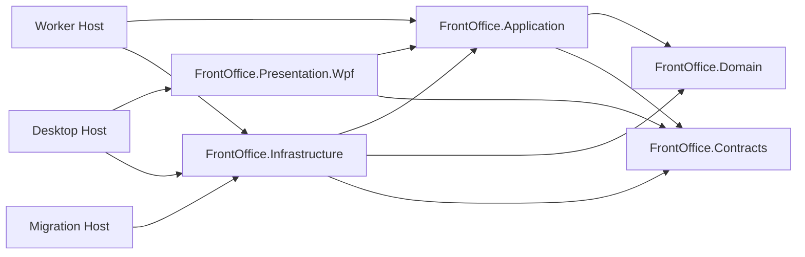

# THIẾT KẾ EF CORE, CODING CONVENTION VÀ SOLUTION STRUCTURE — FRONT OFFICE ASMILE-BO

## 1. Executive Summary

Tài liệu chốt chuẩn kỹ thuật trước khi sinh code: audit 166 Command xuyên Aggregate/Event/Process/Projection/Table/Permission/Error/Test; correction matrix; cấu trúc solution/project; dependency; coding/EF Core; persistence Integration/Process/Projection; WPF; migration/test/architecture gate và roadmap triển khai. Không tạo project, code, DbContext hay migration.

### 1.1 MÂU THUẪN CẦN XÁC NHẬN

| Mã | Nội dung | Quyết định thiết kế tạm thời |
|---|---|---|
| MC-001..005 | Ownership Room/Guest/Invoice/Notification, History/Audit, RoomBlock, 12 capability boundary | Giữ quyết định Domain/Database/CQRS gần nhất; không duplicate owner |
| MC-006 | Process persistence chưa có trong 121 bảng | **Chốt đề xuất +8 bảng schema fo_process, tổng 129**, cần phê duyệt migration trước triển khai |
| MC-007 | Prompt gọi model “Tera”, runtime khả dụng ghi “Terra”; Luna không được khai báo trong môi trường hiện tại | Roadmap dùng **Terra** cho implementation; Luna là tùy chọn chỉ sau khi model registry xác nhận |

## 2. Traceability Audit

Audit kiểm tra từng Command, không dùng template giả định một-một. Một Command có thể phát nhiều fact; một outcome event có thể do callback/process signal chứ không có user Command trực tiếp.

| Command | Aggregate Method | Domain Event | Integration Event | Process | Projection | Table | Permission | Error Prefix | Test ID | Kết quả |
|---|---|---|---|---|---|---|---|---|---|---|
| CreateReservation | Reservation.createReservation | ReservationCreated | ReservationCreatedV1 | Không cần Process Manager | DanhSachKhachDen; BangDieuHanhTienSanh | DatPhong; KhachDatPhong; NhuCauHangPhong; GhiChuDatPhong; YeuCauUuTienDatPhong; ChoPhong | FO.RES.CREATE_RESERVATION | RES/AUTH/CONC/VAL | TRC-001 | **Khớp** |
| ConfirmReservation | Reservation.confirmReservation | ReservationConfirmed | ReservationConfirmedV1 | ReservationConfirmationProcess | DanhSachKhachDen; BangDieuHanhTienSanh | DatPhong; KhachDatPhong; NhuCauHangPhong; GhiChuDatPhong; YeuCauUuTienDatPhong; ChoPhong | FO.RES.CONFIRM_RESERVATION | RES/AUTH/CONC/VAL | TRC-002 | **Khớp** |
| GuaranteeReservation | Reservation.guaranteeReservation | ReservationGuaranteed | Không cần hoặc mapper riêng theo Registry | Không cần Process Manager | DanhSachKhachDen; BangDieuHanhTienSanh | DatPhong; KhachDatPhong; NhuCauHangPhong; GhiChuDatPhong; YeuCauUuTienDatPhong; ChoPhong | FO.RES.GUARANTEE_RESERVATION | RES/AUTH/CONC/VAL | TRC-003 | **Khớp** |
| AmendReservation | Reservation.amendReservation | ReservationPeriodChanged | ReservationModifiedV1 (conditional mapping) | Không cần Process Manager | DanhSachKhachDen; BangDieuHanhTienSanh | DatPhong; KhachDatPhong; NhuCauHangPhong; GhiChuDatPhong; YeuCauUuTienDatPhong; ChoPhong | FO.RES.AMEND_RESERVATION | RES/AUTH/CONC/VAL | TRC-004 | **Cần xác nhận** |
| CancelReservation | Reservation.cancelReservation | ReservationCancelled | ReservationCancelledV1 | Không cần Process Manager | DanhSachKhachDen; BangDieuHanhTienSanh | DatPhong; KhachDatPhong; NhuCauHangPhong; GhiChuDatPhong; YeuCauUuTienDatPhong; ChoPhong | FO.RES.CANCEL_RESERVATION | RES/AUTH/CONC/VAL | TRC-005 | **Khớp** |
| ReinstateReservation | Reservation.reinstateReservation | ReservationReinstated | Không cần hoặc mapper riêng theo Registry | Không cần Process Manager | DanhSachKhachDen; BangDieuHanhTienSanh | DatPhong; KhachDatPhong; NhuCauHangPhong; GhiChuDatPhong; YeuCauUuTienDatPhong; ChoPhong | FO.RES.REINSTATE_RESERVATION | RES/AUTH/CONC/VAL | TRC-006 | **Khớp** |
| MarkReservationNoShow | Reservation.markReservationNoShow | ReservationMarkedNoShow | Không cần hoặc mapper riêng theo Registry | Không cần Process Manager | DanhSachKhachDen; BangDieuHanhTienSanh | DatPhong; KhachDatPhong; NhuCauHangPhong; GhiChuDatPhong; YeuCauUuTienDatPhong; ChoPhong | FO.RES.MARK_RESERVATION_NO_SHOW | RES/AUTH/CONC/VAL | TRC-007 | **Khớp** |
| AddReservationGuest | Reservation.addReservationGuest | ReservationGuestAdded | ReservationModifiedV1 (conditional mapping) | Không cần Process Manager | DanhSachKhachDen; BangDieuHanhTienSanh | DatPhong; KhachDatPhong; NhuCauHangPhong; GhiChuDatPhong; YeuCauUuTienDatPhong; ChoPhong | FO.RES.ADD_RESERVATION_GUEST | RES/AUTH/CONC/VAL | TRC-008 | **Khớp** |
| RemoveReservationGuest | Reservation.removeReservationGuest | ReservationGuestRemoved | ReservationModifiedV1 (conditional mapping) | Không cần Process Manager | DanhSachKhachDen; BangDieuHanhTienSanh | DatPhong; KhachDatPhong; NhuCauHangPhong; GhiChuDatPhong; YeuCauUuTienDatPhong; ChoPhong | FO.RES.REMOVE_RESERVATION_GUEST | RES/AUTH/CONC/VAL | TRC-009 | **Khớp** |
| ChangeReservationOccupancy | Reservation.changeReservationOccupancy | ReservationOccupancyChanged | ReservationModifiedV1 (conditional mapping) | Không cần Process Manager | DanhSachKhachDen; BangDieuHanhTienSanh | DatPhong; KhachDatPhong; NhuCauHangPhong; GhiChuDatPhong; YeuCauUuTienDatPhong; ChoPhong | FO.RES.CHANGE_RESERVATION_OCCUPANCY | RES/AUTH/CONC/VAL | TRC-010 | **Khớp** |
| ApplyReservationRateQuote | Reservation.applyReservationRateQuote | ReservationRateQuoteApplied | ReservationModifiedV1 (conditional mapping) | Không cần Process Manager | DanhSachKhachDen; BangDieuHanhTienSanh | DatPhong; KhachDatPhong; NhuCauHangPhong; GhiChuDatPhong; YeuCauUuTienDatPhong; ChoPhong | FO.RES.APPLY_RESERVATION_RATE_QUOTE | RES/AUTH/CONC/VAL | TRC-011 | **Khớp** |
| AddReservationNote | Reservation.addReservationNote | — | Không cần hoặc mapper riêng theo Registry | Không cần Process Manager | DanhSachKhachDen; BangDieuHanhTienSanh | DatPhong; KhachDatPhong; NhuCauHangPhong; GhiChuDatPhong; YeuCauUuTienDatPhong; ChoPhong | FO.RES.ADD_RESERVATION_NOTE | RES/AUTH/CONC/VAL | TRC-012 | **Thiếu** |
| AddReservationPreference | Reservation.addReservationPreference | — | Không cần hoặc mapper riêng theo Registry | Không cần Process Manager | DanhSachKhachDen; BangDieuHanhTienSanh | DatPhong; KhachDatPhong; NhuCauHangPhong; GhiChuDatPhong; YeuCauUuTienDatPhong; ChoPhong | FO.RES.ADD_RESERVATION_PREFERENCE | RES/AUTH/CONC/VAL | TRC-013 | **Thiếu** |
| CreateWaitlistEntry | Reservation.createWaitlistEntry | WaitlistEntryCreated | Không cần hoặc mapper riêng theo Registry | Không cần Process Manager | DanhSachKhachDen; BangDieuHanhTienSanh | DatPhong; KhachDatPhong; NhuCauHangPhong; GhiChuDatPhong; YeuCauUuTienDatPhong; ChoPhong | FO.RES.CREATE_WAITLIST_ENTRY | RES/AUTH/CONC/VAL | TRC-014 | **Khớp** |
| OfferWaitlistEntry | Reservation.offerWaitlistEntry | WaitlistOfferCreated | Không cần hoặc mapper riêng theo Registry | Không cần Process Manager | DanhSachKhachDen; BangDieuHanhTienSanh | DatPhong; KhachDatPhong; NhuCauHangPhong; GhiChuDatPhong; YeuCauUuTienDatPhong; ChoPhong | FO.RES.OFFER_WAITLIST_ENTRY | RES/AUTH/CONC/VAL | TRC-015 | **Khớp** |
| ConvertWaitlistToReservation | Reservation.convertWaitlistToReservation | WaitlistConvertedToReservation; ReservationCreated | ReservationCreatedV1 | Không cần Process Manager | DanhSachKhachDen; BangDieuHanhTienSanh | DatPhong; KhachDatPhong; NhuCauHangPhong; GhiChuDatPhong; YeuCauUuTienDatPhong; ChoPhong | FO.RES.CONVERT_WAITLIST_TO_RESERVATION | RES/AUTH/CONC/VAL | TRC-016 | **Khớp** |
| ExpireWaitlistEntry | Reservation.expireWaitlistEntry | WaitlistExpired | Không cần hoặc mapper riêng theo Registry | Không cần Process Manager | DanhSachKhachDen; BangDieuHanhTienSanh | DatPhong; KhachDatPhong; NhuCauHangPhong; GhiChuDatPhong; YeuCauUuTienDatPhong; ChoPhong | FO.RES.EXPIRE_WAITLIST_ENTRY | RES/AUTH/CONC/VAL | TRC-017 | **Khớp** |
| CheckInReservation | Stay.checkInReservation | StayCreated; StayCheckedIn | StayCheckedInV1 | CheckInProcess | DongThoiGianLuuTru; DanhSachKhachDangLuuTru; DanhSachKhachDi; SoDoPhong | LuuTru; KhachLuuTru; PhanPhong; PhanDoanPhanPhong; QuyenMoKhoaPhong; LanCapKhoa | FO.STY.CHECK_IN_RESERVATION | STY/AUTH/CONC/VAL | TRC-018 | **Khớp** |
| CreateWalkInStay | Stay.createWalkInStay | StayCreated; StayCheckedIn (qua WalkInProcess) | StayCheckedInV1 | WalkInProcess | DongThoiGianLuuTru; DanhSachKhachDangLuuTru; DanhSachKhachDi; SoDoPhong | LuuTru; KhachLuuTru; PhanPhong; PhanDoanPhanPhong; QuyenMoKhoaPhong; LanCapKhoa | FO.STY.CREATE_WALK_IN_STAY | STY/AUTH/CONC/VAL | TRC-019 | **Khớp** |
| CreateDayUseStay | Stay.createDayUseStay | StayCreated; StayCheckedIn (qua WalkInProcess) | StayCheckedInV1 | WalkInProcess | DongThoiGianLuuTru; DanhSachKhachDangLuuTru; DanhSachKhachDi; SoDoPhong | LuuTru; KhachLuuTru; PhanPhong; PhanDoanPhanPhong; QuyenMoKhoaPhong; LanCapKhoa | FO.STY.CREATE_DAY_USE_STAY | STY/AUTH/CONC/VAL | TRC-020 | **Khớp** |
| AddStayGuest | Stay.addStayGuest | StayGuestAdded | ReservationModifiedV1 (conditional mapping) | Không cần Process Manager | DongThoiGianLuuTru; DanhSachKhachDangLuuTru; DanhSachKhachDi; SoDoPhong | LuuTru; KhachLuuTru; PhanPhong; PhanDoanPhanPhong; QuyenMoKhoaPhong; LanCapKhoa | FO.STY.ADD_STAY_GUEST | STY/AUTH/CONC/VAL | TRC-021 | **Khớp** |
| RemoveStayGuest | Stay.removeStayGuest | StayGuestRemoved | ReservationModifiedV1 (conditional mapping) | Không cần Process Manager | DongThoiGianLuuTru; DanhSachKhachDangLuuTru; DanhSachKhachDi; SoDoPhong | LuuTru; KhachLuuTru; PhanPhong; PhanDoanPhanPhong; QuyenMoKhoaPhong; LanCapKhoa | FO.STY.REMOVE_STAY_GUEST | STY/AUTH/CONC/VAL | TRC-022 | **Khớp** |
| ExtendStay | Stay.extendStay | StayPeriodExtended | StayExtendedV1 | StayExtensionProcess | DongThoiGianLuuTru; DanhSachKhachDangLuuTru; DanhSachKhachDi; SoDoPhong | LuuTru; KhachLuuTru; PhanPhong; PhanDoanPhanPhong; QuyenMoKhoaPhong; LanCapKhoa | FO.STY.EXTEND_STAY | STY/AUTH/CONC/VAL | TRC-023 | **Khớp** |
| ShortenStay | Stay.shortenStay | StayPeriodShortened | Không cần hoặc mapper riêng theo Registry | Không cần Process Manager | DongThoiGianLuuTru; DanhSachKhachDangLuuTru; DanhSachKhachDi; SoDoPhong | LuuTru; KhachLuuTru; PhanPhong; PhanDoanPhanPhong; QuyenMoKhoaPhong; LanCapKhoa | FO.STY.SHORTEN_STAY | STY/AUTH/CONC/VAL | TRC-024 | **Khớp** |
| AssignRoom | Stay.assignRoom | RoomAssignmentReserved; RoomAssignmentActivated | Không cần hoặc mapper riêng theo Registry | Không cần Process Manager | DongThoiGianLuuTru; DanhSachKhachDangLuuTru; DanhSachKhachDi; SoDoPhong | LuuTru; KhachLuuTru; PhanPhong; PhanDoanPhanPhong; QuyenMoKhoaPhong; LanCapKhoa | FO.STY.ASSIGN_ROOM | STY/AUTH/CONC/VAL | TRC-025 | **Khớp** |
| MoveRoom | Stay.moveRoom | RoomAssignmentEnded; RoomMoved; RoomAssignmentActivated | RoomMovedV1 | RoomMoveProcess | DongThoiGianLuuTru; DanhSachKhachDangLuuTru; DanhSachKhachDi; SoDoPhong | LuuTru; KhachLuuTru; PhanPhong; PhanDoanPhanPhong; QuyenMoKhoaPhong; LanCapKhoa | FO.STY.MOVE_ROOM | STY/AUTH/CONC/VAL | TRC-026 | **Khớp** |
| UpgradeRoom | Stay.upgradeRoom | RoomAssignmentEnded; RoomUpgraded; RoomAssignmentActivated | RoomMovedV1 | RoomMoveProcess | DongThoiGianLuuTru; DanhSachKhachDangLuuTru; DanhSachKhachDi; SoDoPhong | LuuTru; KhachLuuTru; PhanPhong; PhanDoanPhanPhong; QuyenMoKhoaPhong; LanCapKhoa | FO.STY.UPGRADE_ROOM | STY/AUTH/CONC/VAL | TRC-027 | **Khớp** |
| DowngradeRoom | Stay.downgradeRoom | RoomAssignmentEnded; RoomDowngraded; RoomAssignmentActivated | RoomMovedV1 | RoomMoveProcess | DongThoiGianLuuTru; DanhSachKhachDangLuuTru; DanhSachKhachDi; SoDoPhong | LuuTru; KhachLuuTru; PhanPhong; PhanDoanPhanPhong; QuyenMoKhoaPhong; LanCapKhoa | FO.STY.DOWNGRADE_ROOM | STY/AUTH/CONC/VAL | TRC-028 | **Khớp** |
| ChangeStayPostingPermission | Stay.changeStayPostingPermission | StayPostingPermissionChanged | Không cần hoặc mapper riêng theo Registry | Không cần Process Manager | DongThoiGianLuuTru; DanhSachKhachDangLuuTru; DanhSachKhachDi; SoDoPhong | LuuTru; KhachLuuTru; PhanPhong; PhanDoanPhanPhong; QuyenMoKhoaPhong; LanCapKhoa | FO.STY.CHANGE_STAY_POSTING_PERMISSION | STY/AUTH/CONC/VAL | TRC-029 | **Khớp** |
| ChangeStayPrivacySetting | Stay.changeStayPrivacySetting | StayPrivacyChanged | Không cần hoặc mapper riêng theo Registry | Không cần Process Manager | DongThoiGianLuuTru; DanhSachKhachDangLuuTru; DanhSachKhachDi; SoDoPhong | LuuTru; KhachLuuTru; PhanPhong; PhanDoanPhanPhong; QuyenMoKhoaPhong; LanCapKhoa | FO.STY.CHANGE_STAY_PRIVACY_SETTING | STY/AUTH/CONC/VAL | TRC-030 | **Khớp** |
| MarkStayCheckoutReady | Stay.markStayCheckoutReady | StayMarkedCheckoutReady | Không cần hoặc mapper riêng theo Registry | CheckoutProcess | DongThoiGianLuuTru; DanhSachKhachDangLuuTru; DanhSachKhachDi; SoDoPhong | LuuTru; KhachLuuTru; PhanPhong; PhanDoanPhanPhong; QuyenMoKhoaPhong; LanCapKhoa | FO.STY.MARK_STAY_CHECKOUT_READY | STY/AUTH/CONC/VAL | TRC-031 | **Khớp** |
| CompleteCheckout | Stay.completeCheckout | StayCheckedOut | StayCheckedOutV1 | CheckoutProcess | DongThoiGianLuuTru; DanhSachKhachDangLuuTru; DanhSachKhachDi; SoDoPhong | LuuTru; KhachLuuTru; PhanPhong; PhanDoanPhanPhong; QuyenMoKhoaPhong; LanCapKhoa | FO.STY.COMPLETE_CHECKOUT | STY/AUTH/CONC/VAL | TRC-032 | **Khớp** |
| ReopenStay | Stay.reopenStay | StayReopened | Không cần hoặc mapper riêng theo Registry | Không cần Process Manager | DongThoiGianLuuTru; DanhSachKhachDangLuuTru; DanhSachKhachDi; SoDoPhong | LuuTru; KhachLuuTru; PhanPhong; PhanDoanPhanPhong; QuyenMoKhoaPhong; LanCapKhoa | FO.STY.REOPEN_STAY | STY/AUTH/CONC/VAL | TRC-033 | **Khớp** |
| RequestKeyIssue | Stay.requestKeyIssue | KeyCredentialRequested | Không cần hoặc mapper riêng theo Registry | KeyCredentialProcess | DongThoiGianLuuTru; DanhSachKhachDangLuuTru; DanhSachKhachDi; SoDoPhong | LuuTru; KhachLuuTru; PhanPhong; PhanDoanPhanPhong; QuyenMoKhoaPhong; LanCapKhoa | FO.STY.REQUEST_KEY_ISSUE | STY/AUTH/CONC/VAL | TRC-034 | **Khớp** |
| RevokeKeyCredential | Stay.revokeKeyCredential | KeyCredentialRevoked | Không cần hoặc mapper riêng theo Registry | KeyCredentialProcess | DongThoiGianLuuTru; DanhSachKhachDangLuuTru; DanhSachKhachDi; SoDoPhong | LuuTru; KhachLuuTru; PhanPhong; PhanDoanPhanPhong; QuyenMoKhoaPhong; LanCapKhoa | FO.STY.REVOKE_KEY_CREDENTIAL | STY/AUTH/CONC/VAL | TRC-035 | **Khớp** |
| ReplaceKeyCredential | Stay.replaceKeyCredential | KeyCredentialRevoked; KeyCredentialRequested | Không cần hoặc mapper riêng theo Registry | KeyCredentialProcess | DongThoiGianLuuTru; DanhSachKhachDangLuuTru; DanhSachKhachDi; SoDoPhong | LuuTru; KhachLuuTru; PhanPhong; PhanDoanPhanPhong; QuyenMoKhoaPhong; LanCapKhoa | FO.STY.REPLACE_KEY_CREDENTIAL | STY/AUTH/CONC/VAL | TRC-036 | **Cần xác nhận** |
| HoldRoomInventory | RoomAvailability.holdRoomInventory | RoomInventoryHeld | Không cần hoặc mapper riêng theo Registry | Không cần Process Manager | KeHoachPhong; SoDoPhong; DanhSachKhachDen | TonPhongKhaDung; GiuTonPhong; PhanBoTonPhong; KiemSoatTonPhong; HanCheBanPhong | FO.ROM.HOLD_ROOM_INVENTORY | ROM/AUTH/CONC/VAL | TRC-037 | **Khớp** |
| ConfirmRoomInventoryAllocation | RoomAvailability.confirmRoomInventoryAllocation | RoomInventoryAllocated | Không cần hoặc mapper riêng theo Registry | Không cần Process Manager | KeHoachPhong; SoDoPhong; DanhSachKhachDen | TonPhongKhaDung; GiuTonPhong; PhanBoTonPhong; KiemSoatTonPhong; HanCheBanPhong | FO.ROM.CONFIRM_ROOM_INVENTORY_ALLOCATION | ROM/AUTH/CONC/VAL | TRC-038 | **Khớp** |
| ReleaseRoomInventory | RoomAvailability.releaseRoomInventory | RoomInventoryReleased | Không cần hoặc mapper riêng theo Registry | Không cần Process Manager | KeHoachPhong; SoDoPhong; DanhSachKhachDen | TonPhongKhaDung; GiuTonPhong; PhanBoTonPhong; KiemSoatTonPhong; HanCheBanPhong | FO.ROM.RELEASE_ROOM_INVENTORY | ROM/AUTH/CONC/VAL | TRC-039 | **Khớp** |
| AdjustOverbookingLimit | RoomAvailability.adjustOverbookingLimit | OverbookingLimitChanged | Không cần hoặc mapper riêng theo Registry | Không cần Process Manager | KeHoachPhong; SoDoPhong; DanhSachKhachDen | TonPhongKhaDung; GiuTonPhong; PhanBoTonPhong; KiemSoatTonPhong; HanCheBanPhong | FO.ROM.ADJUST_OVERBOOKING_LIMIT | ROM/AUTH/CONC/VAL | TRC-040 | **Khớp** |
| ActivateRoomInventoryControl | RoomAvailability.activateRoomInventoryControl | RoomInventoryControlActivated | Không cần hoặc mapper riêng theo Registry | Không cần Process Manager | KeHoachPhong; SoDoPhong; DanhSachKhachDen | TonPhongKhaDung; GiuTonPhong; PhanBoTonPhong; KiemSoatTonPhong; HanCheBanPhong | FO.ROM.ACTIVATE_ROOM_INVENTORY_CONTROL | ROM/AUTH/CONC/VAL | TRC-041 | **Khớp** |
| StopSellRoomType | RoomAvailability.stopSellRoomType | RoomTypeStoppedForSale | Không cần hoặc mapper riêng theo Registry | Không cần Process Manager | KeHoachPhong; SoDoPhong; DanhSachKhachDen | TonPhongKhaDung; GiuTonPhong; PhanBoTonPhong; KiemSoatTonPhong; HanCheBanPhong | FO.ROM.STOP_SELL_ROOM_TYPE | ROM/AUTH/CONC/VAL | TRC-042 | **Khớp** |
| ReopenRoomTypeForSale | RoomAvailability.reopenRoomTypeForSale | RoomTypeReopenedForSale | Không cần hoặc mapper riêng theo Registry | Không cần Process Manager | KeHoachPhong; SoDoPhong; DanhSachKhachDen | TonPhongKhaDung; GiuTonPhong; PhanBoTonPhong; KiemSoatTonPhong; HanCheBanPhong | FO.ROM.REOPEN_ROOM_TYPE_FOR_SALE | ROM/AUTH/CONC/VAL | TRC-043 | **Khớp** |
| OpenFolio | Folio.openFolio | FolioOpened | Không cần hoặc mapper riêng theo Registry | Không cần Process Manager | BangTheoDoiSoDuKhach; DanhSachCanSanSangTraPhong | SoGiaoDichKhach; NganSoGiaoDich; ButToanSoGiaoDich; ChiDanDinhTuyen | FO.FOL.OPEN_FOLIO | FOL/AUTH/CONC/VAL | TRC-044 | **Khớp** |
| AddFolioWindow | Folio.addFolioWindow | FolioWindowAdded | Không cần hoặc mapper riêng theo Registry | Không cần Process Manager | BangTheoDoiSoDuKhach; DanhSachCanSanSangTraPhong | SoGiaoDichKhach; NganSoGiaoDich; ButToanSoGiaoDich; ChiDanDinhTuyen | FO.FOL.ADD_FOLIO_WINDOW | FOL/AUTH/CONC/VAL | TRC-045 | **Khớp** |
| PostFolioCharge | Folio.postFolioCharge | FolioChargePosted | FolioChargePostedV1 | Không cần Process Manager | BangTheoDoiSoDuKhach; DanhSachCanSanSangTraPhong | SoGiaoDichKhach; NganSoGiaoDich; ButToanSoGiaoDich; ChiDanDinhTuyen | FO.FOL.POST_FOLIO_CHARGE | FOL/AUTH/CONC/VAL | TRC-046 | **Khớp** |
| PostFolioCredit | Folio.postFolioCredit | FolioCreditPosted | Không cần hoặc mapper riêng theo Registry | Không cần Process Manager | BangTheoDoiSoDuKhach; DanhSachCanSanSangTraPhong | SoGiaoDichKhach; NganSoGiaoDich; ButToanSoGiaoDich; ChiDanDinhTuyen | FO.FOL.POST_FOLIO_CREDIT | FOL/AUTH/CONC/VAL | TRC-047 | **Khớp** |
| ReverseFolioEntry | Folio.reverseFolioEntry | FolioEntryReversed | Không cần hoặc mapper riêng theo Registry | Không cần Process Manager | BangTheoDoiSoDuKhach; DanhSachCanSanSangTraPhong | SoGiaoDichKhach; NganSoGiaoDich; ButToanSoGiaoDich; ChiDanDinhTuyen | FO.FOL.REVERSE_FOLIO_ENTRY | FOL/AUTH/CONC/VAL | TRC-048 | **Khớp** |
| AdjustFolioEntry | Folio.adjustFolioEntry | FolioEntryAdjusted | Không cần hoặc mapper riêng theo Registry | Không cần Process Manager | BangTheoDoiSoDuKhach; DanhSachCanSanSangTraPhong | SoGiaoDichKhach; NganSoGiaoDich; ButToanSoGiaoDich; ChiDanDinhTuyen | FO.FOL.ADJUST_FOLIO_ENTRY | FOL/AUTH/CONC/VAL | TRC-049 | **Khớp** |
| TransferFolioEntry | Folio.transferFolioEntry | FolioEntryTransferred | Không cần hoặc mapper riêng theo Registry | Không cần Process Manager | BangTheoDoiSoDuKhach; DanhSachCanSanSangTraPhong | SoGiaoDichKhach; NganSoGiaoDich; ButToanSoGiaoDich; ChiDanDinhTuyen | FO.FOL.TRANSFER_FOLIO_ENTRY | FOL/AUTH/CONC/VAL | TRC-050 | **Khớp** |
| CreateRoutingInstruction | Folio.createRoutingInstruction | RoutingInstructionCreated | Không cần hoặc mapper riêng theo Registry | Không cần Process Manager | BangTheoDoiSoDuKhach; DanhSachCanSanSangTraPhong | SoGiaoDichKhach; NganSoGiaoDich; ButToanSoGiaoDich; ChiDanDinhTuyen | FO.FOL.CREATE_ROUTING_INSTRUCTION | FOL/AUTH/CONC/VAL | TRC-051 | **Khớp** |
| ActivateRoutingInstruction | Folio.activateRoutingInstruction | RoutingInstructionActivated | Không cần hoặc mapper riêng theo Registry | Không cần Process Manager | BangTheoDoiSoDuKhach; DanhSachCanSanSangTraPhong | SoGiaoDichKhach; NganSoGiaoDich; ButToanSoGiaoDich; ChiDanDinhTuyen | FO.FOL.ACTIVATE_ROUTING_INSTRUCTION | FOL/AUTH/CONC/VAL | TRC-052 | **Khớp** |
| SuspendRoutingInstruction | Folio.suspendRoutingInstruction | RoutingInstructionSuspended | Không cần hoặc mapper riêng theo Registry | Không cần Process Manager | BangTheoDoiSoDuKhach; DanhSachCanSanSangTraPhong | SoGiaoDichKhach; NganSoGiaoDich; ButToanSoGiaoDich; ChiDanDinhTuyen | FO.FOL.SUSPEND_ROUTING_INSTRUCTION | FOL/AUTH/CONC/VAL | TRC-053 | **Khớp** |
| CloseFolio | Folio.closeFolio | FolioClosed | FolioClosedV1 | Không cần Process Manager | BangTheoDoiSoDuKhach; DanhSachCanSanSangTraPhong | SoGiaoDichKhach; NganSoGiaoDich; ButToanSoGiaoDich; ChiDanDinhTuyen | FO.FOL.CLOSE_FOLIO | FOL/AUTH/CONC/VAL | TRC-054 | **Khớp** |
| ReopenFolio | Folio.reopenFolio | FolioReopened | Không cần hoặc mapper riêng theo Registry | Không cần Process Manager | BangTheoDoiSoDuKhach; DanhSachCanSanSangTraPhong | SoGiaoDichKhach; NganSoGiaoDich; ButToanSoGiaoDich; ChiDanDinhTuyen | FO.FOL.REOPEN_FOLIO | FOL/AUTH/CONC/VAL | TRC-055 | **Khớp** |
| InitiatePayment | Payment.initiatePayment | PaymentInitiated | Không cần hoặc mapper riêng theo Registry | PaymentPostingProcess | BangDoiSoatThuNgan; BangTheoDoiSoDuKhach | ThanhToan; LanThuThanhToan; DatCoc; PhanBoDatCoc; YeuCauHoanTien; LanThucHienHoanTien; CaThuNgan | FO.PAY.INITIATE_PAYMENT | PAY/AUTH/CONC/VAL | TRC-056 | **Khớp** |
| RecordPaymentAuthorization | Payment.recordPaymentAuthorization | PaymentAuthorized | Không cần hoặc mapper riêng theo Registry | PaymentPostingProcess | BangDoiSoatThuNgan; BangTheoDoiSoDuKhach | ThanhToan; LanThuThanhToan; DatCoc; PhanBoDatCoc; YeuCauHoanTien; LanThucHienHoanTien; CaThuNgan | FO.PAY.RECORD_PAYMENT_AUTHORIZATION | PAY/AUTH/CONC/VAL | TRC-057 | **Khớp** |
| RecordPaymentCapture | Payment.recordPaymentCapture | PaymentCaptured | PaymentCapturedV1 | PaymentPostingProcess | BangDoiSoatThuNgan; BangTheoDoiSoDuKhach | ThanhToan; LanThuThanhToan; DatCoc; PhanBoDatCoc; YeuCauHoanTien; LanThucHienHoanTien; CaThuNgan | FO.PAY.RECORD_PAYMENT_CAPTURE | PAY/AUTH/CONC/VAL | TRC-058 | **Khớp** |
| MarkPaymentUnknown | Payment.markPaymentUnknown | PaymentOutcomeMarkedUnknown | Không cần hoặc mapper riêng theo Registry | PaymentPostingProcess | BangDoiSoatThuNgan; BangTheoDoiSoDuKhach | ThanhToan; LanThuThanhToan; DatCoc; PhanBoDatCoc; YeuCauHoanTien; LanThucHienHoanTien; CaThuNgan | FO.PAY.MARK_PAYMENT_UNKNOWN | PAY/AUTH/CONC/VAL | TRC-059 | **Khớp** |
| ReconcilePayment | Payment.reconcilePayment | PaymentReconciled | Không cần hoặc mapper riêng theo Registry | PaymentPostingProcess | BangDoiSoatThuNgan; BangTheoDoiSoDuKhach | ThanhToan; LanThuThanhToan; DatCoc; PhanBoDatCoc; YeuCauHoanTien; LanThucHienHoanTien; CaThuNgan | FO.PAY.RECONCILE_PAYMENT | PAY/AUTH/CONC/VAL | TRC-060 | **Khớp** |
| ReceiveDeposit | Payment.receiveDeposit | DepositReceived | DepositReceivedV1 | DepositAllocationProcess | BangDoiSoatThuNgan; BangTheoDoiSoDuKhach | ThanhToan; LanThuThanhToan; DatCoc; PhanBoDatCoc; YeuCauHoanTien; LanThucHienHoanTien; CaThuNgan | FO.PAY.RECEIVE_DEPOSIT | PAY/AUTH/CONC/VAL | TRC-061 | **Khớp** |
| AuthorizeDeposit | Payment.authorizeDeposit | DepositAuthorized | Không cần hoặc mapper riêng theo Registry | DepositAllocationProcess | BangDoiSoatThuNgan; BangTheoDoiSoDuKhach | ThanhToan; LanThuThanhToan; DatCoc; PhanBoDatCoc; YeuCauHoanTien; LanThucHienHoanTien; CaThuNgan | FO.PAY.AUTHORIZE_DEPOSIT | PAY/AUTH/CONC/VAL | TRC-062 | **Khớp** |
| AllocateDeposit | Payment.allocateDeposit | DepositAllocated | DepositAllocatedV1 | DepositAllocationProcess | BangDoiSoatThuNgan; BangTheoDoiSoDuKhach | ThanhToan; LanThuThanhToan; DatCoc; PhanBoDatCoc; YeuCauHoanTien; LanThucHienHoanTien; CaThuNgan | FO.PAY.ALLOCATE_DEPOSIT | PAY/AUTH/CONC/VAL | TRC-063 | **Khớp** |
| ReverseDepositAllocation | Payment.reverseDepositAllocation | DepositAllocationReversed | Không cần hoặc mapper riêng theo Registry | DepositAllocationProcess | BangDoiSoatThuNgan; BangTheoDoiSoDuKhach | ThanhToan; LanThuThanhToan; DatCoc; PhanBoDatCoc; YeuCauHoanTien; LanThucHienHoanTien; CaThuNgan | FO.PAY.REVERSE_DEPOSIT_ALLOCATION | PAY/AUTH/CONC/VAL | TRC-064 | **Khớp** |
| ReleaseDeposit | Payment.releaseDeposit | DepositReleased | Không cần hoặc mapper riêng theo Registry | DepositAllocationProcess | BangDoiSoatThuNgan; BangTheoDoiSoDuKhach | ThanhToan; LanThuThanhToan; DatCoc; PhanBoDatCoc; YeuCauHoanTien; LanThucHienHoanTien; CaThuNgan | FO.PAY.RELEASE_DEPOSIT | PAY/AUTH/CONC/VAL | TRC-065 | **Khớp** |
| ForfeitDeposit | Payment.forfeitDeposit | DepositForfeited | Không cần hoặc mapper riêng theo Registry | DepositAllocationProcess | BangDoiSoatThuNgan; BangTheoDoiSoDuKhach | ThanhToan; LanThuThanhToan; DatCoc; PhanBoDatCoc; YeuCauHoanTien; LanThucHienHoanTien; CaThuNgan | FO.PAY.FORFEIT_DEPOSIT | PAY/AUTH/CONC/VAL | TRC-066 | **Khớp** |
| CreateRefundRequest | Payment.createRefundRequest | RefundRequested | Không cần hoặc mapper riêng theo Registry | Không cần Process Manager | BangDoiSoatThuNgan; BangTheoDoiSoDuKhach | ThanhToan; LanThuThanhToan; DatCoc; PhanBoDatCoc; YeuCauHoanTien; LanThucHienHoanTien; CaThuNgan | FO.PAY.CREATE_REFUND_REQUEST | PAY/AUTH/CONC/VAL | TRC-067 | **Khớp** |
| ApproveRefundRequest | Payment.approveRefundRequest | RefundApproved | Không cần hoặc mapper riêng theo Registry | Không cần Process Manager | BangDoiSoatThuNgan; BangTheoDoiSoDuKhach | ThanhToan; LanThuThanhToan; DatCoc; PhanBoDatCoc; YeuCauHoanTien; LanThucHienHoanTien; CaThuNgan | FO.PAY.APPROVE_REFUND_REQUEST | PAY/AUTH/CONC/VAL | TRC-068 | **Khớp** |
| RejectRefundRequest | Payment.rejectRefundRequest | RefundRejected | Không cần hoặc mapper riêng theo Registry | Không cần Process Manager | BangDoiSoatThuNgan; BangTheoDoiSoDuKhach | ThanhToan; LanThuThanhToan; DatCoc; PhanBoDatCoc; YeuCauHoanTien; LanThucHienHoanTien; CaThuNgan | FO.PAY.REJECT_REFUND_REQUEST | PAY/AUTH/CONC/VAL | TRC-069 | **Khớp** |
| ExecuteRefund | Payment.executeRefund | RefundExecutionStarted | Không cần hoặc mapper riêng theo Registry | Không cần Process Manager | BangDoiSoatThuNgan; BangTheoDoiSoDuKhach | ThanhToan; LanThuThanhToan; DatCoc; PhanBoDatCoc; YeuCauHoanTien; LanThucHienHoanTien; CaThuNgan | FO.PAY.EXECUTE_REFUND | PAY/AUTH/CONC/VAL | TRC-070 | **Khớp** |
| RecordRefundResult | Payment.recordRefundResult | RefundCompleted | RefundFailed | RefundOutcomeUnknown | RefundCompletedV1 | Không cần Process Manager | BangDoiSoatThuNgan; BangTheoDoiSoDuKhach | ThanhToan; LanThuThanhToan; DatCoc; PhanBoDatCoc; YeuCauHoanTien; LanThucHienHoanTien; CaThuNgan | FO.PAY.RECORD_REFUND_RESULT | PAY/AUTH/CONC/VAL | TRC-071 | **Khớp** |
| OpenCashierShift | Payment.openCashierShift | CashierShiftOpened | Không cần hoặc mapper riêng theo Registry | Không cần Process Manager | BangDoiSoatThuNgan; BangTheoDoiSoDuKhach | ThanhToan; LanThuThanhToan; DatCoc; PhanBoDatCoc; YeuCauHoanTien; LanThucHienHoanTien; CaThuNgan | FO.PAY.OPEN_CASHIER_SHIFT | PAY/AUTH/CONC/VAL | TRC-072 | **Khớp** |
| CloseCashierShift | Payment.closeCashierShift | CashierShiftClosed | Không cần hoặc mapper riêng theo Registry | Không cần Process Manager | BangDoiSoatThuNgan; BangTheoDoiSoDuKhach | ThanhToan; LanThuThanhToan; DatCoc; PhanBoDatCoc; YeuCauHoanTien; LanThucHienHoanTien; CaThuNgan | FO.PAY.CLOSE_CASHIER_SHIFT | PAY/AUTH/CONC/VAL | TRC-073 | **Khớp** |
| ReopenCashierShift | Payment.reopenCashierShift | CashierShiftReopened | Không cần hoặc mapper riêng theo Registry | Không cần Process Manager | BangDoiSoatThuNgan; BangTheoDoiSoDuKhach | ThanhToan; LanThuThanhToan; DatCoc; PhanBoDatCoc; YeuCauHoanTien; LanThucHienHoanTien; CaThuNgan | FO.PAY.REOPEN_CASHIER_SHIFT | PAY/AUTH/CONC/VAL | TRC-074 | **Khớp** |
| DeclareCashTender | Payment.declareCashTender | CashTenderDeclared | Không cần hoặc mapper riêng theo Registry | Không cần Process Manager | BangDoiSoatThuNgan; BangTheoDoiSoDuKhach | ThanhToan; LanThuThanhToan; DatCoc; PhanBoDatCoc; YeuCauHoanTien; LanThucHienHoanTien; CaThuNgan | FO.PAY.DECLARE_CASH_TENDER | PAY/AUTH/CONC/VAL | TRC-075 | **Khớp** |
| MarkRoomDirty | RoomOperation.markRoomDirty | RoomMarkedDirty | RoomReadinessChangedV1 | Không cần Process Manager | BangDieuHanhBuongPhong; SoDoPhong | VanHanhBuongPhong; CongViecBuongPhong; KiemTraPhong; SaiLechTrangThaiPhong | FO.HSK.MARK_ROOM_DIRTY | HSK/AUTH/CONC/VAL | TRC-076 | **Khớp** |
| AssignHousekeepingTask | RoomOperation.assignHousekeepingTask | HousekeepingTaskCreated; HousekeepingTaskAssigned | Không cần hoặc mapper riêng theo Registry | HousekeepingReleaseProcess (khi liên quan Ready) | BangDieuHanhBuongPhong; SoDoPhong | VanHanhBuongPhong; CongViecBuongPhong; KiemTraPhong; SaiLechTrangThaiPhong | FO.HSK.ASSIGN_HOUSEKEEPING_TASK | HSK/AUTH/CONC/VAL | TRC-077 | **Cần xác nhận** |
| StartHousekeepingTask | RoomOperation.startHousekeepingTask | HousekeepingTaskStarted | Không cần hoặc mapper riêng theo Registry | HousekeepingReleaseProcess (khi liên quan Ready) | BangDieuHanhBuongPhong; SoDoPhong | VanHanhBuongPhong; CongViecBuongPhong; KiemTraPhong; SaiLechTrangThaiPhong | FO.HSK.START_HOUSEKEEPING_TASK | HSK/AUTH/CONC/VAL | TRC-078 | **Khớp** |
| PauseHousekeepingTask | RoomOperation.pauseHousekeepingTask | HousekeepingTaskPaused | Không cần hoặc mapper riêng theo Registry | HousekeepingReleaseProcess (khi liên quan Ready) | BangDieuHanhBuongPhong; SoDoPhong | VanHanhBuongPhong; CongViecBuongPhong; KiemTraPhong; SaiLechTrangThaiPhong | FO.HSK.PAUSE_HOUSEKEEPING_TASK | HSK/AUTH/CONC/VAL | TRC-079 | **Khớp** |
| CompleteHousekeepingTask | RoomOperation.completeHousekeepingTask | HousekeepingTaskCompleted | Không cần hoặc mapper riêng theo Registry | HousekeepingReleaseProcess (khi liên quan Ready) | BangDieuHanhBuongPhong; SoDoPhong | VanHanhBuongPhong; CongViecBuongPhong; KiemTraPhong; SaiLechTrangThaiPhong | FO.HSK.COMPLETE_HOUSEKEEPING_TASK | HSK/AUTH/CONC/VAL | TRC-080 | **Khớp** |
| RecordRoomDiscrepancy | RoomOperation.recordRoomDiscrepancy | RoomDiscrepancyRecorded | Không cần hoặc mapper riêng theo Registry | Không cần Process Manager | BangDieuHanhBuongPhong; SoDoPhong | VanHanhBuongPhong; CongViecBuongPhong; KiemTraPhong; SaiLechTrangThaiPhong | FO.HSK.RECORD_ROOM_DISCREPANCY | HSK/AUTH/CONC/VAL | TRC-081 | **Khớp** |
| StartRoomInspection | RoomOperation.startRoomInspection | RoomInspectionStarted | Không cần hoặc mapper riêng theo Registry | HousekeepingReleaseProcess (khi liên quan Ready) | BangDieuHanhBuongPhong; SoDoPhong | VanHanhBuongPhong; CongViecBuongPhong; KiemTraPhong; SaiLechTrangThaiPhong | FO.HSK.START_ROOM_INSPECTION | HSK/AUTH/CONC/VAL | TRC-082 | **Khớp** |
| PassRoomInspection | RoomOperation.passRoomInspection | RoomInspectionPassed | Không cần hoặc mapper riêng theo Registry | HousekeepingReleaseProcess (khi liên quan Ready) | BangDieuHanhBuongPhong; SoDoPhong | VanHanhBuongPhong; CongViecBuongPhong; KiemTraPhong; SaiLechTrangThaiPhong | FO.HSK.PASS_ROOM_INSPECTION | HSK/AUTH/CONC/VAL | TRC-083 | **Khớp** |
| FailRoomInspection | RoomOperation.failRoomInspection | RoomInspectionFailed | Không cần hoặc mapper riêng theo Registry | HousekeepingReleaseProcess (khi liên quan Ready) | BangDieuHanhBuongPhong; SoDoPhong | VanHanhBuongPhong; CongViecBuongPhong; KiemTraPhong; SaiLechTrangThaiPhong | FO.HSK.FAIL_ROOM_INSPECTION | HSK/AUTH/CONC/VAL | TRC-084 | **Khớp** |
| ReleaseRoomReady | RoomOperation.releaseRoomReady | RoomReleasedReady | RoomReadinessChangedV1 | HousekeepingReleaseProcess (khi liên quan Ready) | BangDieuHanhBuongPhong; SoDoPhong | VanHanhBuongPhong; CongViecBuongPhong; KiemTraPhong; SaiLechTrangThaiPhong | FO.HSK.RELEASE_ROOM_READY | HSK/AUTH/CONC/VAL | TRC-085 | **Khớp** |
| ReopenHousekeepingTask | RoomOperation.reopenHousekeepingTask | HousekeepingTaskReopened | Không cần hoặc mapper riêng theo Registry | HousekeepingReleaseProcess (khi liên quan Ready) | BangDieuHanhBuongPhong; SoDoPhong | VanHanhBuongPhong; CongViecBuongPhong; KiemTraPhong; SaiLechTrangThaiPhong | FO.HSK.REOPEN_HOUSEKEEPING_TASK | HSK/AUTH/CONC/VAL | TRC-086 | **Khớp** |
| ReportMaintenanceCase | MaintenanceCase.reportMaintenanceCase | MaintenanceCaseReported | Không cần hoặc mapper riêng theo Registry | Không cần Process Manager | BangDieuHanhBuongPhong; SoDoPhong | HoSoBaoTri; NhatKyCongViecBaoTri; KhoaVanHanhPhong; GiaHanKhoaPhong | FO.MNT.REPORT_MAINTENANCE_CASE | MNT/AUTH/CONC/VAL | TRC-087 | **Khớp** |
| TriageMaintenanceCase | MaintenanceCase.triageMaintenanceCase | MaintenanceCaseTriaged | Không cần hoặc mapper riêng theo Registry | Không cần Process Manager | BangDieuHanhBuongPhong; SoDoPhong | HoSoBaoTri; NhatKyCongViecBaoTri; KhoaVanHanhPhong; GiaHanKhoaPhong | FO.MNT.TRIAGE_MAINTENANCE_CASE | MNT/AUTH/CONC/VAL | TRC-088 | **Khớp** |
| AssignMaintenanceCase | MaintenanceCase.assignMaintenanceCase | MaintenanceCaseAssigned | Không cần hoặc mapper riêng theo Registry | Không cần Process Manager | BangDieuHanhBuongPhong; SoDoPhong | HoSoBaoTri; NhatKyCongViecBaoTri; KhoaVanHanhPhong; GiaHanKhoaPhong | FO.MNT.ASSIGN_MAINTENANCE_CASE | MNT/AUTH/CONC/VAL | TRC-089 | **Khớp** |
| StartMaintenanceWork | MaintenanceCase.startMaintenanceWork | MaintenanceWorkStarted | Không cần hoặc mapper riêng theo Registry | Không cần Process Manager | BangDieuHanhBuongPhong; SoDoPhong | HoSoBaoTri; NhatKyCongViecBaoTri; KhoaVanHanhPhong; GiaHanKhoaPhong | FO.MNT.START_MAINTENANCE_WORK | MNT/AUTH/CONC/VAL | TRC-090 | **Khớp** |
| PauseMaintenanceWork | MaintenanceCase.pauseMaintenanceWork | MaintenanceWorkPaused | Không cần hoặc mapper riêng theo Registry | Không cần Process Manager | BangDieuHanhBuongPhong; SoDoPhong | HoSoBaoTri; NhatKyCongViecBaoTri; KhoaVanHanhPhong; GiaHanKhoaPhong | FO.MNT.PAUSE_MAINTENANCE_WORK | MNT/AUTH/CONC/VAL | TRC-091 | **Khớp** |
| RecordMaintenanceWork | MaintenanceCase.recordMaintenanceWork | MaintenanceWorkRecorded | Không cần hoặc mapper riêng theo Registry | Không cần Process Manager | BangDieuHanhBuongPhong; SoDoPhong | HoSoBaoTri; NhatKyCongViecBaoTri; KhoaVanHanhPhong; GiaHanKhoaPhong | FO.MNT.RECORD_MAINTENANCE_WORK | MNT/AUTH/CONC/VAL | TRC-092 | **Khớp** |
| MarkMaintenanceFixed | MaintenanceCase.markMaintenanceFixed | MaintenanceMarkedFixed | Không cần hoặc mapper riêng theo Registry | Không cần Process Manager | BangDieuHanhBuongPhong; SoDoPhong | HoSoBaoTri; NhatKyCongViecBaoTri; KhoaVanHanhPhong; GiaHanKhoaPhong | FO.MNT.MARK_MAINTENANCE_FIXED | MNT/AUTH/CONC/VAL | TRC-093 | **Khớp** |
| VerifyMaintenance | MaintenanceCase.verifyMaintenance | MaintenanceVerified | Không cần hoặc mapper riêng theo Registry | Không cần Process Manager | BangDieuHanhBuongPhong; SoDoPhong | HoSoBaoTri; NhatKyCongViecBaoTri; KhoaVanHanhPhong; GiaHanKhoaPhong | FO.MNT.VERIFY_MAINTENANCE | MNT/AUTH/CONC/VAL | TRC-094 | **Khớp** |
| CloseMaintenanceCase | MaintenanceCase.closeMaintenanceCase | MaintenanceCaseClosed | Không cần hoặc mapper riêng theo Registry | Không cần Process Manager | BangDieuHanhBuongPhong; SoDoPhong | HoSoBaoTri; NhatKyCongViecBaoTri; KhoaVanHanhPhong; GiaHanKhoaPhong | FO.MNT.CLOSE_MAINTENANCE_CASE | MNT/AUTH/CONC/VAL | TRC-095 | **Khớp** |
| CreateRoomOperationalBlock | MaintenanceCase.createRoomOperationalBlock | RoomOperationalBlockCreated | RoomOperationalBlockChangedV1 | MaintenanceRoomBlockProcess | BangDieuHanhBuongPhong; SoDoPhong | HoSoBaoTri; NhatKyCongViecBaoTri; KhoaVanHanhPhong; GiaHanKhoaPhong | FO.MNT.CREATE_ROOM_OPERATIONAL_BLOCK | MNT/AUTH/CONC/VAL | TRC-096 | **Khớp** |
| ExtendRoomOperationalBlock | MaintenanceCase.extendRoomOperationalBlock | RoomOperationalBlockExtended | RoomOperationalBlockChangedV1 | MaintenanceRoomBlockProcess | BangDieuHanhBuongPhong; SoDoPhong | HoSoBaoTri; NhatKyCongViecBaoTri; KhoaVanHanhPhong; GiaHanKhoaPhong | FO.MNT.EXTEND_ROOM_OPERATIONAL_BLOCK | MNT/AUTH/CONC/VAL | TRC-097 | **Khớp** |
| ReleaseRoomOperationalBlock | MaintenanceCase.releaseRoomOperationalBlock | RoomOperationalBlockReleased | RoomOperationalBlockChangedV1 | MaintenanceRoomBlockProcess | BangDieuHanhBuongPhong; SoDoPhong | HoSoBaoTri; NhatKyCongViecBaoTri; KhoaVanHanhPhong; GiaHanKhoaPhong | FO.MNT.RELEASE_ROOM_OPERATIONAL_BLOCK | MNT/AUTH/CONC/VAL | TRC-098 | **Khớp** |
| CreateServiceRequest | ServiceRequest.createServiceRequest | ServiceRequestCreated | Không cần hoặc mapper riêng theo Registry | Không cần Process Manager | BangDieuHanhTienSanh; task views | YeuCauDichVu; CuocGoiBaoThuc; LanGoiBaoThuc; HoSoDoThatLac; BanGiaoLuuGiu | FO.GSV.CREATE_SERVICE_REQUEST | GSV/AUTH/CONC/VAL | TRC-099 | **Khớp** |
| AssignServiceRequest | ServiceRequest.assignServiceRequest | ServiceRequestAssigned | Không cần hoặc mapper riêng theo Registry | Không cần Process Manager | BangDieuHanhTienSanh; task views | YeuCauDichVu; CuocGoiBaoThuc; LanGoiBaoThuc; HoSoDoThatLac; BanGiaoLuuGiu | FO.GSV.ASSIGN_SERVICE_REQUEST | GSV/AUTH/CONC/VAL | TRC-100 | **Khớp** |
| CompleteServiceRequest | ServiceRequest.completeServiceRequest | ServiceRequestCompleted | Không cần hoặc mapper riêng theo Registry | Không cần Process Manager | BangDieuHanhTienSanh; task views | YeuCauDichVu; CuocGoiBaoThuc; LanGoiBaoThuc; HoSoDoThatLac; BanGiaoLuuGiu | FO.GSV.COMPLETE_SERVICE_REQUEST | GSV/AUTH/CONC/VAL | TRC-101 | **Khớp** |
| EscalateServiceRequest | ServiceRequest.escalateServiceRequest | ServiceRequestEscalated | Không cần hoặc mapper riêng theo Registry | Không cần Process Manager | BangDieuHanhTienSanh; task views | YeuCauDichVu; CuocGoiBaoThuc; LanGoiBaoThuc; HoSoDoThatLac; BanGiaoLuuGiu | FO.GSV.ESCALATE_SERVICE_REQUEST | GSV/AUTH/CONC/VAL | TRC-102 | **Khớp** |
| CancelServiceRequest | ServiceRequest.cancelServiceRequest | ServiceRequestCancelled | Không cần hoặc mapper riêng theo Registry | Không cần Process Manager | BangDieuHanhTienSanh; task views | YeuCauDichVu; CuocGoiBaoThuc; LanGoiBaoThuc; HoSoDoThatLac; BanGiaoLuuGiu | FO.GSV.CANCEL_SERVICE_REQUEST | GSV/AUTH/CONC/VAL | TRC-103 | **Khớp** |
| ScheduleWakeUpCall | ServiceRequest.scheduleWakeUpCall | WakeUpCallScheduled | Không cần hoặc mapper riêng theo Registry | Không cần Process Manager | BangDieuHanhTienSanh; task views | YeuCauDichVu; CuocGoiBaoThuc; LanGoiBaoThuc; HoSoDoThatLac; BanGiaoLuuGiu | FO.GSV.SCHEDULE_WAKE_UP_CALL | GSV/AUTH/CONC/VAL | TRC-104 | **Khớp** |
| RescheduleWakeUpCall | ServiceRequest.rescheduleWakeUpCall | WakeUpCallRescheduled | Không cần hoặc mapper riêng theo Registry | Không cần Process Manager | BangDieuHanhTienSanh; task views | YeuCauDichVu; CuocGoiBaoThuc; LanGoiBaoThuc; HoSoDoThatLac; BanGiaoLuuGiu | FO.GSV.RESCHEDULE_WAKE_UP_CALL | GSV/AUTH/CONC/VAL | TRC-105 | **Khớp** |
| CancelWakeUpCall | ServiceRequest.cancelWakeUpCall | WakeUpCallCancelled | Không cần hoặc mapper riêng theo Registry | Không cần Process Manager | BangDieuHanhTienSanh; task views | YeuCauDichVu; CuocGoiBaoThuc; LanGoiBaoThuc; HoSoDoThatLac; BanGiaoLuuGiu | FO.GSV.CANCEL_WAKE_UP_CALL | GSV/AUTH/CONC/VAL | TRC-106 | **Khớp** |
| RecordWakeUpAttempt | ServiceRequest.recordWakeUpAttempt | WakeUpAttemptRecorded | Không cần hoặc mapper riêng theo Registry | Không cần Process Manager | BangDieuHanhTienSanh; task views | YeuCauDichVu; CuocGoiBaoThuc; LanGoiBaoThuc; HoSoDoThatLac; BanGiaoLuuGiu | FO.GSV.RECORD_WAKE_UP_ATTEMPT | GSV/AUTH/CONC/VAL | TRC-107 | **Khớp** |
| EscalateWakeUpCall | ServiceRequest.escalateWakeUpCall | WakeUpCallEscalated | Không cần hoặc mapper riêng theo Registry | Không cần Process Manager | BangDieuHanhTienSanh; task views | YeuCauDichVu; CuocGoiBaoThuc; LanGoiBaoThuc; HoSoDoThatLac; BanGiaoLuuGiu | FO.GSV.ESCALATE_WAKE_UP_CALL | GSV/AUTH/CONC/VAL | TRC-108 | **Khớp** |
| RegisterLostFoundCase | ServiceRequest.registerLostFoundCase | LostFoundCaseRegistered | Không cần hoặc mapper riêng theo Registry | Không cần Process Manager | BangDieuHanhTienSanh; task views | YeuCauDichVu; CuocGoiBaoThuc; LanGoiBaoThuc; HoSoDoThatLac; BanGiaoLuuGiu | FO.GSV.REGISTER_LOST_FOUND_CASE | GSV/AUTH/CONC/VAL | TRC-109 | **Khớp** |
| RecordCustodyHandover | ServiceRequest.recordCustodyHandover | LostFoundCustodyTransferred | Không cần hoặc mapper riêng theo Registry | Không cần Process Manager | BangDieuHanhTienSanh; task views | YeuCauDichVu; CuocGoiBaoThuc; LanGoiBaoThuc; HoSoDoThatLac; BanGiaoLuuGiu | FO.GSV.RECORD_CUSTODY_HANDOVER | GSV/AUTH/CONC/VAL | TRC-110 | **Khớp** |
| ProposeLostFoundMatch | ServiceRequest.proposeLostFoundMatch | LostFoundMatchProposed | Không cần hoặc mapper riêng theo Registry | Không cần Process Manager | BangDieuHanhTienSanh; task views | YeuCauDichVu; CuocGoiBaoThuc; LanGoiBaoThuc; HoSoDoThatLac; BanGiaoLuuGiu | FO.GSV.PROPOSE_LOST_FOUND_MATCH | GSV/AUTH/CONC/VAL | TRC-111 | **Khớp** |
| VerifyLostFoundClaim | ServiceRequest.verifyLostFoundClaim | LostFoundClaimVerified | Không cần hoặc mapper riêng theo Registry | Không cần Process Manager | BangDieuHanhTienSanh; task views | YeuCauDichVu; CuocGoiBaoThuc; LanGoiBaoThuc; HoSoDoThatLac; BanGiaoLuuGiu | FO.GSV.VERIFY_LOST_FOUND_CLAIM | GSV/AUTH/CONC/VAL | TRC-112 | **Khớp** |
| ReturnLostFoundItem | ServiceRequest.returnLostFoundItem | LostFoundItemReturned | Không cần hoặc mapper riêng theo Registry | Không cần Process Manager | BangDieuHanhTienSanh; task views | YeuCauDichVu; CuocGoiBaoThuc; LanGoiBaoThuc; HoSoDoThatLac; BanGiaoLuuGiu | FO.GSV.RETURN_LOST_FOUND_ITEM | GSV/AUTH/CONC/VAL | TRC-113 | **Khớp** |
| DisposeLostFoundItem | ServiceRequest.disposeLostFoundItem | LostFoundItemDisposed | Không cần hoặc mapper riêng theo Registry | Không cần Process Manager | BangDieuHanhTienSanh; task views | YeuCauDichVu; CuocGoiBaoThuc; LanGoiBaoThuc; HoSoDoThatLac; BanGiaoLuuGiu | FO.GSV.DISPOSE_LOST_FOUND_ITEM | GSV/AUTH/CONC/VAL | TRC-114 | **Khớp** |
| CreateGroupStay | GroupStay.createGroupStay | GroupStayCreated | Không cần hoặc mapper riêng theo Registry | Không cần Process Manager | BangDieuHanhTienSanh; group read models | LuuTruDoan; KhoiPhongDoan; DanhSachKhachDoan; ChiDanThanhToanDoan | FO.GRP.CREATE_GROUP_STAY | GRP/AUTH/CONC/VAL | TRC-115 | **Khớp** |
| ConfirmGroupStay | GroupStay.confirmGroupStay | GroupStayConfirmed | Không cần hoặc mapper riêng theo Registry | Không cần Process Manager | BangDieuHanhTienSanh; group read models | LuuTruDoan; KhoiPhongDoan; DanhSachKhachDoan; ChiDanThanhToanDoan | FO.GRP.CONFIRM_GROUP_STAY | GRP/AUTH/CONC/VAL | TRC-116 | **Khớp** |
| CreateRoomBlock | GroupStay.createRoomBlock | RoomBlockCreated | Không cần hoặc mapper riêng theo Registry | Không cần Process Manager | BangDieuHanhTienSanh; group read models | LuuTruDoan; KhoiPhongDoan; DanhSachKhachDoan; ChiDanThanhToanDoan | FO.GRP.CREATE_ROOM_BLOCK | GRP/AUTH/CONC/VAL | TRC-117 | **Khớp** |
| AllocateRoomBlock | GroupStay.allocateRoomBlock | RoomBlockAllocated | Không cần hoặc mapper riêng theo Registry | Không cần Process Manager | BangDieuHanhTienSanh; group read models | LuuTruDoan; KhoiPhongDoan; DanhSachKhachDoan; ChiDanThanhToanDoan | FO.GRP.ALLOCATE_ROOM_BLOCK | GRP/AUTH/CONC/VAL | TRC-118 | **Khớp** |
| ReleaseRoomBlock | GroupStay.releaseRoomBlock | RoomBlockReleased | Không cần hoặc mapper riêng theo Registry | Không cần Process Manager | BangDieuHanhTienSanh; group read models | LuuTruDoan; KhoiPhongDoan; DanhSachKhachDoan; ChiDanThanhToanDoan | FO.GRP.RELEASE_ROOM_BLOCK | GRP/AUTH/CONC/VAL | TRC-119 | **Khớp** |
| ImportRoomingList | GroupStay.importRoomingList | RoomingListImported | Không cần hoặc mapper riêng theo Registry | Không cần Process Manager | BangDieuHanhTienSanh; group read models | LuuTruDoan; KhoiPhongDoan; DanhSachKhachDoan; ChiDanThanhToanDoan | FO.GRP.IMPORT_ROOMING_LIST | GRP/AUTH/CONC/VAL | TRC-120 | **Khớp** |
| ValidateRoomingList | GroupStay.validateRoomingList | RoomingListValidated | Không cần hoặc mapper riêng theo Registry | Không cần Process Manager | BangDieuHanhTienSanh; group read models | LuuTruDoan; KhoiPhongDoan; DanhSachKhachDoan; ChiDanThanhToanDoan | FO.GRP.VALIDATE_ROOMING_LIST | GRP/AUTH/CONC/VAL | TRC-121 | **Khớp** |
| PublishRoomingList | GroupStay.publishRoomingList | RoomingListPublished | Không cần hoặc mapper riêng theo Registry | Không cần Process Manager | BangDieuHanhTienSanh; group read models | LuuTruDoan; KhoiPhongDoan; DanhSachKhachDoan; ChiDanThanhToanDoan | FO.GRP.PUBLISH_ROOMING_LIST | GRP/AUTH/CONC/VAL | TRC-122 | **Khớp** |
| LinkGroupMemberReservation | GroupStay.linkGroupMemberReservation | GroupMemberReservationLinked | Không cần hoặc mapper riêng theo Registry | Không cần Process Manager | BangDieuHanhTienSanh; group read models | LuuTruDoan; KhoiPhongDoan; DanhSachKhachDoan; ChiDanThanhToanDoan | FO.GRP.LINK_GROUP_MEMBER_RESERVATION | GRP/AUTH/CONC/VAL | TRC-123 | **Khớp** |
| CreateGroupBillingInstruction | GroupStay.createGroupBillingInstruction | GroupBillingInstructionCreated | Không cần hoặc mapper riêng theo Registry | Không cần Process Manager | BangDieuHanhTienSanh; group read models | LuuTruDoan; KhoiPhongDoan; DanhSachKhachDoan; ChiDanThanhToanDoan | FO.GRP.CREATE_GROUP_BILLING_INSTRUCTION | GRP/AUTH/CONC/VAL | TRC-124 | **Khớp** |
| ApproveGroupBillingInstruction | GroupStay.approveGroupBillingInstruction | GroupBillingInstructionApproved | Không cần hoặc mapper riêng theo Registry | Không cần Process Manager | BangDieuHanhTienSanh; group read models | LuuTruDoan; KhoiPhongDoan; DanhSachKhachDoan; ChiDanThanhToanDoan | FO.GRP.APPROVE_GROUP_BILLING_INSTRUCTION | GRP/AUTH/CONC/VAL | TRC-125 | **Khớp** |
| ActivateGroupBillingInstruction | GroupStay.activateGroupBillingInstruction | GroupBillingInstructionActivated | Không cần hoặc mapper riêng theo Registry | Không cần Process Manager | BangDieuHanhTienSanh; group read models | LuuTruDoan; KhoiPhongDoan; DanhSachKhachDoan; ChiDanThanhToanDoan | FO.GRP.ACTIVATE_GROUP_BILLING_INSTRUCTION | GRP/AUTH/CONC/VAL | TRC-126 | **Khớp** |
| RequestGroupCheckIn | GroupStay.requestGroupCheckIn | GroupCheckInRequested | Không cần hoặc mapper riêng theo Registry | CheckInProcess | BangDieuHanhTienSanh; group read models | LuuTruDoan; KhoiPhongDoan; DanhSachKhachDoan; ChiDanThanhToanDoan | FO.GRP.REQUEST_GROUP_CHECK_IN | GRP/AUTH/CONC/VAL | TRC-127 | **Khớp** |
| RequestGroupCheckout | GroupStay.requestGroupCheckout | GroupCheckoutRequested | Không cần hoặc mapper riêng theo Registry | CheckoutProcess | BangDieuHanhTienSanh; group read models | LuuTruDoan; KhoiPhongDoan; DanhSachKhachDoan; ChiDanThanhToanDoan | FO.GRP.REQUEST_GROUP_CHECKOUT | GRP/AUTH/CONC/VAL | TRC-128 | **Khớp** |
| CreateNightAuditRun | NightAuditRun.createNightAuditRun | NightAuditRunCreated | Không cần hoặc mapper riêng theo Registry | NightAuditProcess | BangKiemToanDem | PhienKiemToanDem; NgayNghiepVuCoSo; DiemKiemSoatKiemToan; NgoaiLeKiemToan | FO.NAT.CREATE_NIGHT_AUDIT_RUN | NAT/AUTH/CONC/VAL | TRC-129 | **Khớp** |
| StartNightAudit | NightAuditRun.startNightAudit | NightAuditStarted | Không cần hoặc mapper riêng theo Registry | NightAuditProcess | BangKiemToanDem | PhienKiemToanDem; NgayNghiepVuCoSo; DiemKiemSoatKiemToan; NgoaiLeKiemToan | FO.NAT.START_NIGHT_AUDIT | NAT/AUTH/CONC/VAL | TRC-130 | **Khớp** |
| RunNightAuditTrial | NightAuditRun.runNightAuditTrial | NightAuditTrialCompleted | Không cần hoặc mapper riêng theo Registry | NightAuditProcess | BangKiemToanDem | PhienKiemToanDem; NgayNghiepVuCoSo; DiemKiemSoatKiemToan; NgoaiLeKiemToan | FO.NAT.RUN_NIGHT_AUDIT_TRIAL | NAT/AUTH/CONC/VAL | TRC-131 | **Khớp** |
| RecordAuditCheckpoint | NightAuditRun.recordAuditCheckpoint | AuditCheckpointRecorded | Không cần hoặc mapper riêng theo Registry | Không cần Process Manager | BangKiemToanDem | PhienKiemToanDem; NgayNghiepVuCoSo; DiemKiemSoatKiemToan; NgoaiLeKiemToan | FO.NAT.RECORD_AUDIT_CHECKPOINT | NAT/AUTH/CONC/VAL | TRC-132 | **Khớp** |
| RaiseAuditException | NightAuditRun.raiseAuditException | AuditExceptionRaised | Không cần hoặc mapper riêng theo Registry | Không cần Process Manager | BangKiemToanDem | PhienKiemToanDem; NgayNghiepVuCoSo; DiemKiemSoatKiemToan; NgoaiLeKiemToan | FO.NAT.RAISE_AUDIT_EXCEPTION | NAT/AUTH/CONC/VAL | TRC-133 | **Khớp** |
| ResolveAuditException | NightAuditRun.resolveAuditException | AuditExceptionResolved | Không cần hoặc mapper riêng theo Registry | Không cần Process Manager | BangKiemToanDem | PhienKiemToanDem; NgayNghiepVuCoSo; DiemKiemSoatKiemToan; NgoaiLeKiemToan | FO.NAT.RESOLVE_AUDIT_EXCEPTION | NAT/AUTH/CONC/VAL | TRC-134 | **Khớp** |
| AcceptAuditRisk | NightAuditRun.acceptAuditRisk | AuditRiskAccepted | Không cần hoặc mapper riêng theo Registry | Không cần Process Manager | BangKiemToanDem | PhienKiemToanDem; NgayNghiepVuCoSo; DiemKiemSoatKiemToan; NgoaiLeKiemToan | FO.NAT.ACCEPT_AUDIT_RISK | NAT/AUTH/CONC/VAL | TRC-135 | **Khớp** |
| SignOffNightAudit | NightAuditRun.signOffNightAudit | NightAuditSignedOff | Không cần hoặc mapper riêng theo Registry | NightAuditProcess | BangKiemToanDem | PhienKiemToanDem; NgayNghiepVuCoSo; DiemKiemSoatKiemToan; NgoaiLeKiemToan | FO.NAT.SIGN_OFF_NIGHT_AUDIT | NAT/AUTH/CONC/VAL | TRC-136 | **Khớp** |
| CompleteNightAudit | NightAuditRun.completeNightAudit | NightAuditCompleted | NightAuditCompletedV1 | NightAuditProcess | BangKiemToanDem | PhienKiemToanDem; NgayNghiepVuCoSo; DiemKiemSoatKiemToan; NgoaiLeKiemToan | FO.NAT.COMPLETE_NIGHT_AUDIT | NAT/AUTH/CONC/VAL | TRC-137 | **Khớp** |
| RolloverBusinessDate | NightAuditRun.rolloverBusinessDate | BusinessDateRolledOver | BusinessDateRolledOverV1 | BusinessDateRolloverProcess | BangKiemToanDem | PhienKiemToanDem; NgayNghiepVuCoSo; DiemKiemSoatKiemToan; NgoaiLeKiemToan | FO.NAT.ROLLOVER_BUSINESS_DATE | NAT/AUTH/CONC/VAL | TRC-138 | **Khớp** |
| ReopenBusinessDate | NightAuditRun.reopenBusinessDate | BusinessDateReopened | Không cần hoặc mapper riêng theo Registry | BusinessDateRolloverProcess | BangKiemToanDem | PhienKiemToanDem; NgayNghiepVuCoSo; DiemKiemSoatKiemToan; NgoaiLeKiemToan | FO.NAT.REOPEN_BUSINESS_DATE | NAT/AUTH/CONC/VAL | TRC-139 | **Khớp** |
| ResumeNightAudit | NightAuditRun.resumeNightAudit | NightAuditResumed | Không cần hoặc mapper riêng theo Registry | NightAuditProcess | BangKiemToanDem | PhienKiemToanDem; NgayNghiepVuCoSo; DiemKiemSoatKiemToan; NgoaiLeKiemToan | FO.NAT.RESUME_NIGHT_AUDIT | NAT/AUTH/CONC/VAL | TRC-140 | **Khớp** |
| CreateOperationalTask | OperationalTask.createOperationalTask | OperationalTaskCreated | Không cần hoặc mapper riêng theo Registry | Không cần Process Manager | BangDieuHanhTienSanh; task/handover views | CongViecVanHanh; PhanCongCongViec; BanGiaoCa | FO.TSK.CREATE_OPERATIONAL_TASK | TSK/AUTH/CONC/VAL | TRC-141 | **Khớp** |
| AssignOperationalTask | OperationalTask.assignOperationalTask | OperationalTaskAssigned | Không cần hoặc mapper riêng theo Registry | Không cần Process Manager | BangDieuHanhTienSanh; task/handover views | CongViecVanHanh; PhanCongCongViec; BanGiaoCa | FO.TSK.ASSIGN_OPERATIONAL_TASK | TSK/AUTH/CONC/VAL | TRC-142 | **Khớp** |
| AcknowledgeOperationalTask | OperationalTask.acknowledgeOperationalTask | OperationalTaskAcknowledged | Không cần hoặc mapper riêng theo Registry | Không cần Process Manager | BangDieuHanhTienSanh; task/handover views | CongViecVanHanh; PhanCongCongViec; BanGiaoCa | FO.TSK.ACKNOWLEDGE_OPERATIONAL_TASK | TSK/AUTH/CONC/VAL | TRC-143 | **Khớp** |
| StartOperationalTask | OperationalTask.startOperationalTask | OperationalTaskStarted | Không cần hoặc mapper riêng theo Registry | Không cần Process Manager | BangDieuHanhTienSanh; task/handover views | CongViecVanHanh; PhanCongCongViec; BanGiaoCa | FO.TSK.START_OPERATIONAL_TASK | TSK/AUTH/CONC/VAL | TRC-144 | **Khớp** |
| CompleteOperationalTask | OperationalTask.completeOperationalTask | OperationalTaskCompleted | Không cần hoặc mapper riêng theo Registry | Không cần Process Manager | BangDieuHanhTienSanh; task/handover views | CongViecVanHanh; PhanCongCongViec; BanGiaoCa | FO.TSK.COMPLETE_OPERATIONAL_TASK | TSK/AUTH/CONC/VAL | TRC-145 | **Khớp** |
| EscalateOperationalTask | OperationalTask.escalateOperationalTask | OperationalTaskEscalated | Không cần hoặc mapper riêng theo Registry | Không cần Process Manager | BangDieuHanhTienSanh; task/handover views | CongViecVanHanh; PhanCongCongViec; BanGiaoCa | FO.TSK.ESCALATE_OPERATIONAL_TASK | TSK/AUTH/CONC/VAL | TRC-146 | **Khớp** |
| ReopenOperationalTask | OperationalTask.reopenOperationalTask | OperationalTaskReopened | Không cần hoặc mapper riêng theo Registry | Không cần Process Manager | BangDieuHanhTienSanh; task/handover views | CongViecVanHanh; PhanCongCongViec; BanGiaoCa | FO.TSK.REOPEN_OPERATIONAL_TASK | TSK/AUTH/CONC/VAL | TRC-147 | **Khớp** |
| CreateShiftHandover | OperationalTask.createShiftHandover | ShiftHandoverCreated | Không cần hoặc mapper riêng theo Registry | Không cần Process Manager | BangDieuHanhTienSanh; task/handover views | CongViecVanHanh; PhanCongCongViec; BanGiaoCa | FO.TSK.CREATE_SHIFT_HANDOVER | TSK/AUTH/CONC/VAL | TRC-148 | **Khớp** |
| SubmitShiftHandover | OperationalTask.submitShiftHandover | ShiftHandoverSubmitted | Không cần hoặc mapper riêng theo Registry | Không cần Process Manager | BangDieuHanhTienSanh; task/handover views | CongViecVanHanh; PhanCongCongViec; BanGiaoCa | FO.TSK.SUBMIT_SHIFT_HANDOVER | TSK/AUTH/CONC/VAL | TRC-149 | **Khớp** |
| AcceptShiftHandover | OperationalTask.acceptShiftHandover | ShiftHandoverAccepted | Không cần hoặc mapper riêng theo Registry | Không cần Process Manager | BangDieuHanhTienSanh; task/handover views | CongViecVanHanh; PhanCongCongViec; BanGiaoCa | FO.TSK.ACCEPT_SHIFT_HANDOVER | TSK/AUTH/CONC/VAL | TRC-150 | **Khớp** |
| CloseShiftHandover | OperationalTask.closeShiftHandover | ShiftHandoverClosed | Không cần hoặc mapper riêng theo Registry | Không cần Process Manager | BangDieuHanhTienSanh; task/handover views | CongViecVanHanh; PhanCongCongViec; BanGiaoCa | FO.TSK.CLOSE_SHIFT_HANDOVER | TSK/AUTH/CONC/VAL | TRC-151 | **Khớp** |
| EnqueueIntegrationJob | IntegrationJob.enqueueIntegrationJob | IntegrationJobEnqueued | Không cần hoặc mapper riêng theo Registry | Không cần Process Manager | BangNgoaiLeTichHop | CongViecTichHop; LanThucHienTichHop; NgoaiLeTichHop; BanGhiChongTrung; YeuCauPhatLai | FO.INT.ENQUEUE_INTEGRATION_JOB | INT/AUTH/CONC/VAL | TRC-152 | **Khớp** |
| ClaimIntegrationJob | IntegrationJob.claimIntegrationJob | IntegrationJobClaimed | Không cần hoặc mapper riêng theo Registry | Không cần Process Manager | BangNgoaiLeTichHop | CongViecTichHop; LanThucHienTichHop; NgoaiLeTichHop; BanGhiChongTrung; YeuCauPhatLai | FO.INT.CLAIM_INTEGRATION_JOB | INT/AUTH/CONC/VAL | TRC-153 | **Khớp** |
| RecordIntegrationSuccess | IntegrationJob.recordIntegrationSuccess | IntegrationJobSucceeded | Không cần hoặc mapper riêng theo Registry | Không cần Process Manager | BangNgoaiLeTichHop | CongViecTichHop; LanThucHienTichHop; NgoaiLeTichHop; BanGhiChongTrung; YeuCauPhatLai | FO.INT.RECORD_INTEGRATION_SUCCESS | INT/AUTH/CONC/VAL | TRC-154 | **Khớp** |
| RecordIntegrationFailure | IntegrationJob.recordIntegrationFailure | IntegrationJobFailed | Không cần hoặc mapper riêng theo Registry | Không cần Process Manager | BangNgoaiLeTichHop | CongViecTichHop; LanThucHienTichHop; NgoaiLeTichHop; BanGhiChongTrung; YeuCauPhatLai | FO.INT.RECORD_INTEGRATION_FAILURE | INT/AUTH/CONC/VAL | TRC-155 | **Khớp** |
| ScheduleIntegrationRetry | IntegrationJob.scheduleIntegrationRetry | IntegrationRetryScheduled | Không cần hoặc mapper riêng theo Registry | Không cần Process Manager | BangNgoaiLeTichHop | CongViecTichHop; LanThucHienTichHop; NgoaiLeTichHop; BanGhiChongTrung; YeuCauPhatLai | FO.INT.SCHEDULE_INTEGRATION_RETRY | INT/AUTH/CONC/VAL | TRC-156 | **Khớp** |
| MarkIntegrationUnknown | IntegrationJob.markIntegrationUnknown | IntegrationOutcomeMarkedUnknown | Không cần hoặc mapper riêng theo Registry | Không cần Process Manager | BangNgoaiLeTichHop | CongViecTichHop; LanThucHienTichHop; NgoaiLeTichHop; BanGhiChongTrung; YeuCauPhatLai | FO.INT.MARK_INTEGRATION_UNKNOWN | INT/AUTH/CONC/VAL | TRC-157 | **Khớp** |
| ReconcileIntegrationJob | IntegrationJob.reconcileIntegrationJob | IntegrationJobReconciled | Không cần hoặc mapper riêng theo Registry | Không cần Process Manager | BangNgoaiLeTichHop | CongViecTichHop; LanThucHienTichHop; NgoaiLeTichHop; BanGhiChongTrung; YeuCauPhatLai | FO.INT.RECONCILE_INTEGRATION_JOB | INT/AUTH/CONC/VAL | TRC-158 | **Khớp** |
| RaiseIntegrationException | IntegrationJob.raiseIntegrationException | IntegrationExceptionRaised | Không cần hoặc mapper riêng theo Registry | Không cần Process Manager | BangNgoaiLeTichHop | CongViecTichHop; LanThucHienTichHop; NgoaiLeTichHop; BanGhiChongTrung; YeuCauPhatLai | FO.INT.RAISE_INTEGRATION_EXCEPTION | INT/AUTH/CONC/VAL | TRC-159 | **Khớp** |
| ResolveIntegrationException | IntegrationJob.resolveIntegrationException | IntegrationExceptionResolved | Không cần hoặc mapper riêng theo Registry | Không cần Process Manager | BangNgoaiLeTichHop | CongViecTichHop; LanThucHienTichHop; NgoaiLeTichHop; BanGhiChongTrung; YeuCauPhatLai | FO.INT.RESOLVE_INTEGRATION_EXCEPTION | INT/AUTH/CONC/VAL | TRC-160 | **Khớp** |
| RequestIntegrationReplay | IntegrationJob.requestIntegrationReplay | IntegrationReplayRequested | Không cần hoặc mapper riêng theo Registry | IntegrationReplayProcess | BangNgoaiLeTichHop | CongViecTichHop; LanThucHienTichHop; NgoaiLeTichHop; BanGhiChongTrung; YeuCauPhatLai | FO.INT.REQUEST_INTEGRATION_REPLAY | INT/AUTH/CONC/VAL | TRC-161 | **Khớp** |
| ApproveIntegrationReplay | IntegrationJob.approveIntegrationReplay | IntegrationReplayApproved | Không cần hoặc mapper riêng theo Registry | IntegrationReplayProcess | BangNgoaiLeTichHop | CongViecTichHop; LanThucHienTichHop; NgoaiLeTichHop; BanGhiChongTrung; YeuCauPhatLai | FO.INT.APPROVE_INTEGRATION_REPLAY | INT/AUTH/CONC/VAL | TRC-162 | **Khớp** |
| ReplayIntegrationJob | IntegrationJob.replayIntegrationJob | IntegrationJobReplayed | Không cần hoặc mapper riêng theo Registry | IntegrationReplayProcess | BangNgoaiLeTichHop | CongViecTichHop; LanThucHienTichHop; NgoaiLeTichHop; BanGhiChongTrung; YeuCauPhatLai | FO.INT.REPLAY_INTEGRATION_JOB | INT/AUTH/CONC/VAL | TRC-163 | **Khớp** |
| RegisterExternalReference | IntegrationJob.registerExternalReference | ExternalReferenceRegistered | Không cần hoặc mapper riêng theo Registry | Không cần Process Manager | BangNgoaiLeTichHop | CongViecTichHop; LanThucHienTichHop; NgoaiLeTichHop; BanGhiChongTrung; YeuCauPhatLai | FO.INT.REGISTER_EXTERNAL_REFERENCE | INT/AUTH/CONC/VAL | TRC-164 | **Khớp** |
| ReserveIdempotencyKey | IntegrationJob.reserveIdempotencyKey | IdempotencyKeyReserved | Không cần hoặc mapper riêng theo Registry | KeyCredentialProcess | BangNgoaiLeTichHop | CongViecTichHop; LanThucHienTichHop; NgoaiLeTichHop; BanGhiChongTrung; YeuCauPhatLai | FO.INT.RESERVE_IDEMPOTENCY_KEY | INT/AUTH/CONC/VAL | TRC-165 | **Khớp** |
| CompleteIdempotentOperation | IntegrationJob.completeIdempotentOperation | IdempotentOperationCompleted | Không cần hoặc mapper riêng theo Registry | Không cần Process Manager | BangNgoaiLeTichHop | CongViecTichHop; LanThucHienTichHop; NgoaiLeTichHop; BanGhiChongTrung; YeuCauPhatLai | FO.INT.COMPLETE_IDEMPOTENT_OPERATION | INT/AUTH/CONC/VAL | TRC-166 | **Khớp** |


### 2.2 Event source coverage ngoài quan hệ một-một

| Event/fact nhóm | Nguồn hợp lệ | Audit result |
|---|---|---|
| ReservationCreated | CreateReservation hoặc ConvertWaitlistToReservation sau khi Reservation factory commit; source/causation khác nhau | Khớp có điều kiện |
| StayCreated / StayCheckedIn | CheckInReservation, CreateWalkInStay, CreateDayUseStay qua CheckIn/WalkIn process milestones | Khớp; không coi cùng một commit nếu invariant không cho |
| RoomAssignmentReserved/Activated/Ended + RoomMoved/Upgraded/Downgraded | Assign/Move/Upgrade/Downgrade và Process step; nhiều fact ordered theo Assignment version | Khớp; cần transition test |
| KeyCredentialIssued/IssueFailed/OutcomeUnknown | Key adapter result → Inbox → KeyCredentialProcess → internal outcome recorder | **Thiếu internal Command contract**, không map trực tiếp RequestKeyIssue |
| RefundCompleted/Failed/OutcomeUnknown | RecordRefundResult theo provider outcome; ExecuteRefund chỉ ExecutionStarted | Khớp sau correction |
| HousekeepingTaskCreated | AssignHousekeepingTask chỉ khi semantics create-and-assign; nếu task tồn tại chỉ Assigned | Cần xác nhận/bổ sung Create command |
| Các 12 context one-to-one còn lại | Command tương ứng hoặc explicit process signal theo bảng 2.1 | Khớp; contract test khóa source |

Với cách tính này, toàn bộ 170 Domain Event được phủ: event dùng chung nhiều nguồn được ghi rõ; event outcome external có process/inbox source; event chưa có source hợp lệ được đưa Correction Matrix, không giả mạo Command.

## 3. Correction Matrix

| ID | Phát hiện | Ảnh hưởng | Correction đề xuất | Artifact cần cập nhật | Trạng thái |
|---|---|---|---|---|---|
| COR-001 | AddReservationNote chưa có ReservationNoteAdded | Projection/audit nghiệp vụ không có fact rõ | Bổ sung Domain Event nếu note là business child; nếu chỉ technical note phải ghi rõ Audit-only | Domain/Event catalog/trace test | **Thiếu** |
| COR-002 | AddReservationPreference chưa có ReservationPreferenceAdded | CRM/ops consumer không biết preference đổi | Bổ sung fact riêng, payload chỉ code/reference; không raw note | Domain/Event/Projection mapping | **Thiếu** |
| COR-003 | AmendReservation quá rộng nhưng chỉ map ReservationPeriodChanged | Có thể đổi field mà không có đúng fact | Thu hẹp Amend chỉ period hoặc tách commands/facts cụ thể; không dùng ReservationModified chung trong Domain | CQRS Command contract | **Cần xác nhận** |
| COR-004 | ReservationCreated trước đây có nguy cơ fuzzy-map từ ConvertWaitlist | Source uniqueness/audit sai | CreateReservation và successful ConvertWaitlist đều có thể sinh ReservationCreated, nhưng Causation/SourceType khác; Convert còn WaitlistConverted | Event mapping/test | **Correction chốt** |
| COR-005 | KeyCredentialIssued/IssueFailed/OutcomeUnknown không có user Command nguồn | Traceability tới RequestKeyIssue sai nếu coi direct | Nguồn là KeyCredentialProcess nhận adapter result/inbox và internal outcome-recording command cần thiết kế foundation | Internal command/Event/Process registry | **Thiếu internal contract** |
| COR-006 | ReplaceKeyCredential có hai fact revoke/request | Ordering/partial outcome | Process phát Revoked chỉ khi old credential revoke commit; Requested cho new request; result events từ adapter | Process transition tests | **Cần xác nhận policy** |
| COR-007 | ExecuteRefund và RecordRefundResult dễ map sai | Có thể đánh Completed trước PSP result | ExecuteRefund chỉ RefundExecutionStarted; RecordRefundResult conditionally Completed/Failed/OutcomeUnknown | CQRS/Event mapping | **Correction chốt** |
| COR-008 | StayCheckedOut phải thuộc CompleteCheckout milestone | Downstream error có thể rollback sai | Chỉ phát khi Stay/Folio guard commit; key/HK/CRM failure sau đó là Partial | Checkout process/test | **Correction chốt** |
| COR-009 | RoomTypeStoppedForSale source phải là StopSellRoomType | Channel availability sai | Direct one-to-one; Property+RoomType+effective range, không map AdjustOverbooking | Event/payload test | **Correction chốt** |
| COR-010 | AssignHousekeepingTask phát Created+Assigned nhưng không có CreateHousekeepingTask | Command semantics mơ hồ | Chốt command là create-and-assign atomic hoặc bổ sung internal CreateHousekeepingTask; không phát Created nếu task đã tồn tại | CQRS/Domain contract | **Cần xác nhận** |
| COR-011 | Event catalog dùng payload chung theo context quá mức | Consumer có thể nhận thừa/thiếu field | Tạo schema riêng từng event; contract lint cấm generic FactPayload/Entity snapshot | Event schemas/contract tests | **Sai thiết kế cần sửa ở triển khai** |
| COR-012 | CheckInProcess có thứ tự RoomAssignmentActivated trước StayCheckedIn nhưng Folio invariant cần rõ | Process chờ event sai/Stay không Folio | Commit boundary phải đảm bảo FolioOpened trước hoặc cùng milestone, sau đó StayCheckedIn; transition spec là nguồn chuẩn | Process definition/trace test | **Cần xác nhận Domain invariant** |
| COR-013 | 13 projection mapping thiếu explicit ReservationNote/Preference và Key outcome nếu bổ sung | UI freshness/status thiếu | Sau COR-001/002/005, đăng ký source chính xác cho affected projections; không wildcard subscription | Projection registry | **Thiếu** |
| COR-014 | Error catalog mới có baseline prefix, không đủ một code cho 166 use case | UI/test trace quá thô | Mỗi business rejection đặc thù có stable code; AUTH/CONC/VAL dùng shared categories | Error registry | **Cần mở rộng** |

Không sửa các tài liệu cũ trong bước này. Correction là gate bắt buộc trước khi sinh slice liên quan; Architecture Test/contract test phải khóa mapping đã phê duyệt.

## 4. Solution Structure

### 4.1 Phương án chính thức

Một **FrontOffice module** với 5 project chính theo responsibility, 12 capability là folder/namespace, Vertical Slice trong Application; không tạo 12×4 project. Host/worker/migration/test tách vì runtime và deployment khác.

```text
src/
  BuildingBlocks/
    AsmileBO.BuildingBlocks.Domain
    AsmileBO.BuildingBlocks.Application
    AsmileBO.BuildingBlocks.Infrastructure
  Modules/FrontOffice/
    AsmileBO.Modules.FrontOffice.Domain
    AsmileBO.Modules.FrontOffice.Application
    AsmileBO.Modules.FrontOffice.Contracts
    AsmileBO.Modules.FrontOffice.Infrastructure
    AsmileBO.Modules.FrontOffice.Presentation.Wpf
  Desktop/ASMILE.BO.App
  Hosts/AsmileBO.FrontOffice.WorkerHost
  Tools/AsmileBO.FrontOffice.MigrationHost
tests/
  AsmileBO.FrontOffice.Domain.UnitTests
  AsmileBO.FrontOffice.Application.UnitTests
  AsmileBO.FrontOffice.Infrastructure.IntegrationTests
  AsmileBO.FrontOffice.Contracts.Tests
  AsmileBO.FrontOffice.ArchitectureTests
  AsmileBO.FrontOffice.Presentation.Wpf.Tests
  AsmileBO.FrontOffice.EndToEndTests
```

Trade-off: project mỗi capability cho isolation mạnh nhưng tăng 60+ project/reference/migration complexity; layer toàn hệ thống làm mất module ownership; một project monolith khó enforce Domain/Infrastructure. Năm project trong module + namespace/folder capability là cân bằng hiện tại, vẫn có thể extract capability sau khi dependency metrics chứng minh cần.

## 5. Project Dependency Rules

| Project | Được phụ thuộc | Cấm phụ thuộc |
|---|---|---|
| FrontOffice.Domain | BuildingBlocks.Domain | EF Core, WPF, Application, Infrastructure, Contracts transport, module internals khác |
| FrontOffice.Application | Domain, Contracts, BuildingBlocks.Application | EF implementation, WPF, SQL/provider/device SDK trực tiếp |
| FrontOffice.Contracts | BuildingBlocks contract primitives tối thiểu | Domain Entity, EF, Application Handler, Infrastructure |
| FrontOffice.Infrastructure | Application ports, Domain, Contracts, BuildingBlocks.Infrastructure | WPF/ViewModel; internal table module khác qua bypass |
| FrontOffice.Presentation.Wpf | Application/Contracts presentation ports | Infrastructure implementation, DbContext, Repository, Entity |
| Desktop Host | Presentation composition + DI contracts | Domain mutation/EF query trực tiếp |
| Worker Host | Application worker contracts + Infrastructure composition | WPF, direct business table mutation ngoài handler |
| Migration Host | Infrastructure migration assembly/config | Domain behavior/Application use case execution |
| Tests | Project under test + approved test utilities | Production reverse dependency |



Enforcement: ProjectReference allowlist, Architecture Tests theo assembly/namespace, internal visibility chỉ cho test/composition cần thiết, analyzer cấm forbidden namespaces/public setters, CI gate fail severity Error, dependency graph snapshot chống drift.

## 6. Namespace Convention

Root: AsmileBO.Modules.FrontOffice.{Capability}.{Layer}.{Purpose}. Capability canonical: Reservation, Stay, Rooms, Folio, Cashiering, Housekeeping, Maintenance, GuestServices, GroupOperations, NightAudit, OperationalTasks, IntegrationOperations.

| Artifact | Namespace suffix |
|---|---|
| Aggregate/Entity/Value Object | Domain.Aggregates / Domain.Entities / Domain.ValueObjects |
| Domain Event | Domain.Events |
| Domain Service/Policy/Specification/Factory | Domain.Services / Policies / Specifications / Factories |
| Command/Handler/Validator/DTO | Application.Features.{UseCase} |
| Query/Handler/Reader DTO | Application.Queries.{UseCase} hoặc Features.{UseCase} |
| Repository port | Domain.Repositories hoặc Application.Ports.Persistence theo need |
| EF Configuration/Repository | Infrastructure.Persistence.Configurations / Repositories |
| Projection | Application.Projections contract; Infrastructure.Projections persistence |
| Process Manager | Application.Processes.{ProcessName}; persistence Infrastructure.Processes |
| Integration Contract | Contracts.Events.V1 / Commands.V1 / Queries.V1 |
| Adapter/Worker | Infrastructure.Integrations.{System} / Workers |
| ViewModel/View | Presentation.ViewModels.{Feature} / Views.{Feature} |
| Test | Production namespace + .Tests; folder mirror artifact |

Cấm Helpers, Utils, Common, Misc, Managers, Services chung chung. Tên namespace phải nói owner/capability/purpose; shared thật sự đi BuildingBlocks sau governance, không bằng cách di chuyển business logic.

## 7. Folder Convention

Hybrid chính thức: layer-first ở project boundary, feature-first trong Application/Presentation; Domain tổ chức theo tactical pattern, Infrastructure theo adapter/persistence.

```text
Reservation/
  Domain/Aggregates/ Entities/ ValueObjects/ Events/ Policies/ Specifications/ Repositories/
  Application/Features/CreateReservation/ ConfirmReservation/ SearchReservations/
  Infrastructure/Persistence/Configurations/ Repositories/ Projections/ Integrations/
  Contracts/Commands/V1/ Queries/V1/ Events/V1/
  Presentation/Views/ ViewModels/ ViewStates/ Dialogs/
```

Một Vertical Slice folder chứa Command/Query contract nội bộ, Handler, Validator, Authorization Policy, Mapper và tests gần feature. DTO public vào Contracts; EF Configuration chỉ Infrastructure; View XAML/VM/State không vào Application; Domain Event không đặt trong Handler folder.

## 8. File Naming Convention

| Artifact | Pattern | Ví dụ |
|---|---|---|
| Aggregate/Entity/ID/VO | {BusinessName}.cs / {Name}Id.cs | Reservation.cs, ReservationId.cs, Money.cs |
| Domain Event | {PastFact}.cs | ReservationCreated.cs |
| Command stack | {UseCase}Command/Handler/Validator.cs | CreateReservationCommand.cs |
| Query stack | {UseCase}Query/Handler.cs | SearchReservationsQuery.cs |
| EF config/repo | {Entity}Configuration.cs / {Aggregate}Repository.cs | ReservationConfiguration.cs |
| DTO | {UseCase}{Request/Result/Item/Detail}V1.cs | ReservationSummaryItemV1.cs |
| Process | {Name}ProcessManager/State/Definition.cs | CheckInProcessManager.cs |
| WPF | {Feature}View.xaml, ViewModel.cs, ViewState.cs | ArrivalsView.xaml |
| Test | {Subject}_{Scenario}_{Expected}.cs hoặc class/method convention nhất quán | CreateReservation_WhenDuplicate_Rejects.cs |

Cấm Model/Data/Info suffix mơ hồ, Helper.cs, Manager.cs không phải Process Manager, BaseService.cs. Code/file English; Markdown và SQL identifiers Vietnamese không dấu theo tài liệu; UI text Vietnamese có dấu qua resources.

## 9. Domain Coding Convention

| Chủ đề | Quy ước chính thức |
|---|---|
| Aggregate Root | Sealed/non-inheritable mặc định; private/protected materialization constructor; factory method public tạo state hợp lệ |
| Entity | Constructor private/internal; identity immutable; không public setter; mutation qua method nói nghiệp vụ |
| Collection | Backing List/HashSet private; expose IReadOnlyCollection; không trả mutable reference; add/remove qua Aggregate |
| Value Object | Immutable, structural equality, factory/parse validation; không identity |
| Invariant/state | Guard trong Aggregate/Domain Service; transition atomically đổi state + tạo Domain Event |
| Domain Event | Aggregate adds past-tense fact sau state transition; collection private; UoW thu sau behavior, clear **chỉ sau SaveChanges/commit thành công** hoặc restore khi failure |
| Domain Service | Stateless rule xuyên Entity/Aggregate concept trong domain; **không Repository, DI I/O, clock/network** trừ pure domain port được governance |
| Policy/Specification | Policy quyết định biến thể/config; Specification đặt tên rule query/eligibility, không generic predicate bag |
| Factory | Khi create cần nhiều VO/policy; không bypass invariant |
| Validation | VO/domain guard cho invariant; Application validator cho syntax/context; DB constraint defense-in-depth |
| Result/Exception | Expected business reject trả DomainResult/DomainError; throw chỉ programmer invariant breach/unexpected technical; error code owner ở Domain/Application catalog |
| Enum | Strong governed enum/code type cho state ổn định; lookup reference cho configurable value; không free string |
| Dependency | Entity không inject service/repository/logger/DbContext; deterministic clock/ID/result đưa từ factory/application input |

Domain không anemic: Handler không gán state/property, không tính lifecycle; method như Confirm, ExtendPeriod, PostCharge, ReverseEntry bảo vệ invariant và phát fact.

## 10. Strongly Typed ID

Chuẩn duy nhất: immutable readonly record struct/wrapper Guid có equality theo value, validation non-empty, TryParse/Parse rõ; tạo UUIDv7 ở Application ID generator. Không implicit conversion sang Guid trong Domain; EF converter/comparer và JSON converter đăng ký tập trung nhưng explicit per ID type; WPF bind qua string/display converter không mutate ID.

| ID | Owner | Sinh ở đâu | Database | Contract exposure |
|---|---|---|---|---|
| ReservationId, StayId, RoomAssignmentId, FolioId, FolioWindowId | Front Office | Application UUIDv7 trước factory | uniqueidentifier, không DB-generate | Có trong use-case/integration contract cần thiết |
| PaymentId, DepositId, RefundRequestId, NightAuditRunId, ProcessId | Front Office | Application/process factory | uniqueidentifier | Có masked/scope-safe theo contract |
| EventId, MessageId | Event/Integration foundation | Server event/message factory | uniqueidentifier | Bắt buộc envelope |
| PropertyId | Property platform external | Property module/platform | FO chỉ reference | Bắt buộc scope, server-trusted |
| GuestProfileId | CRM external | CRM | FO reference/snapshot | Chỉ consumer cần, PII-classified |
| RoomId, RoomTypeId | Property/Room Master external | Owner module | FO reference | Có trong room/stay contract cần thiết |

Default/Guid.Empty luôn invalid trừ serializer materialization private path; log chỉ canonical ID, không encode PII; parsing ở transport boundary, Domain nhận typed ID. Comparer/value converter không dùng reflection generic làm mất type safety.

## 11. Value Object Convention

| Value Object | Immutable/equality/validation | Factory/parse/serialization | EF mapping | Nullable/default/snapshot |
|---|---|---|---|---|
| Money | Amount+Currency structural; precision/rounding policy | Create(amount,currency); versioned contract | Complex/owned columns SoTien decimal(19,4)+MaTienTe char(3), **không converter decimal đơn** | Non-null khi financial; zero explicit |
| Currency | ISO code uppercase/governed | Parse code | varchar/char(3) converter | Không empty |
| BusinessDate | DateOnly + Property context semantics | FromDateOnly; server context | SQL date, **không DateTime** | Required nghiệp vụ |
| StayPeriod/ReservationPeriod | Start<End, half-open dates | Create dates | Owned/complex columns | Required; snapshot old/new in event |
| GuestName | Bounded normalized components | Create masked-safe | Owned encrypted/plain columns per policy | Nullable snapshot only when CRM unavailable |
| ContactInformation | Email/phone normalized, consent | Factory per field | Owned encrypted + blind index | Optional; snapshot version/provenance |
| IdentityDocument | Type/country/encrypted number/ref | Restricted factory; **không raw event/log serialization** | Owned encrypted fields/object ref | Optional by stay/legal; retention |
| Address | Structured bounded lines/country | Factory | Owned/complex columns | Optional snapshot |
| RateQuote | QuoteId, version, validity, Money/tax/cancel refs | From versioned quote | Snapshot child/owned columns | Required when applied; immutable version |
| TaxBreakdown | Tax code/rate/base/amount/currency | From accounting tax result | Child rows for multiple lines | Empty collection not null |
| PaymentReference | Provider/merchant/token alias/last4 | Adapter factory | Owned bounded/tokenized columns | Optional until intent; immutable refs |
| ExternalSourceReference | System/type/id/version | Factory normalized | Owned columns + unique filtered index | Supports dedupe; no empty ID |
| IdempotencyKey | Namespace+key hash | Transport/process factory | Bounded varchar/hash columns | Required catalog commands; no default |
| CorrelationId | UUID trace business chain | Gateway/server | uniqueidentifier | Required durable operation |
| ReasonCode | Governed lookup code | Parse/lookup validate | varchar FK/lookup ref | Required override; no free text substitute |
| ApprovalReference | ApprovalId/version/expiry/scope | Approval adapter | Owned reference columns | Nullable unless policy; snapshot validity |
| SLA | PolicyId/duration/deadline basis | Policy registry | Code + computed/stored deadline where needed | Không hard-code |
| ConfidenceScore | 0..1 + model/calibration version | AI contract factory | decimal precision + version | Optional; không auto-authorize |

Owned type dùng khi lifecycle hoàn toàn thuộc owner và cardinality 1; complex type cho value không identity khi EF capability/migration ổn định; converter chỉ scalar. Collection lớn/tax/history/reference queryable dùng table riêng.

## 12. Enum and Lookup Convention

| Loại | Lưu trữ | Quy tắc |
|---|---|---|
| Code enum ổn định/hữu hạn/toàn hệ thống | varchar canonical code mặc định; tinyint/smallint chỉ hot internal enum có frozen numeric registry | Strong typed enum, unknown-value handling, explicit conversion/check; không ToString tự do |
| Lookup quản trị/effective/Property/legal entity | Typed lookup table riêng, PK canonical code hoặc stable ID theo DB catalog | CoHieuLuc, TuNgay/DenNgay, Property scope, audit/version, no hard delete |
| Snapshot lookup | Code + display/legal snapshot + source version khi chứng từ/history cần | Không dùng snapshot để validate current command |
| Translation/WPF | Resource key/localized lookup query | UI không switch enum text hard-code |

Soft deactivate chỉ lookup; giá trị đã tham chiếu vẫn đọc được. Status state machine code-owned nhưng database check/registry governance; nguồn đặt phòng, lý do, phương thức, charge code, maintenance category… database lookup. Không string enum tự do hoặc một bảng Lookup chung.

## 13. DbContext Strategy

### 13.1 Quyết định

1. FrontOfficeWriteDbContext duy nhất cho 12 capability write model, Integration store, Process Manager và insert-only Audit mapping cần atomicity. Đây là transaction boundary module, không cho phép Aggregate cross-context tùy tiện; Handler/UoW vẫn giới hạn use case.
2. FrontOfficeProjectionDbContext riêng cho 13 projection, no-tracking/read-optimized, migration mapping explicit.
3. FrontOfficeMigrationDbContext/design-time model + một migration assembly/host quản lý toàn bộ schema Front Office theo waves; không runtime auto-migrate.
4. Audit query dùng PlatformAudit read context/contract; write context chỉ append audit để cùng transaction.

Outbox nằm WriteDbContext để Aggregate+Audit+Outbox một SaveChanges/transaction. Inbox/Integration jobs và 8 fo_process tables cũng WriteDbContext để consumer/process milestone atomic. Projection update ở ProjectionDbContext transaction riêng qua inbox/checkpoint; không tham gia command transaction.

Một context mỗi capability bị loại vì Check-in/Folio/Assignment/outbox cần shared local transaction và migration/connection overhead; một context toàn Asmile-BO phá ownership; context read/write hoàn toàn tách write entities làm outbox atomic phức tạp. Future extraction dùng schema/namespace/repository ownership và contract, không cần chia DbContext sớm.

## 14. EF Core Mapping Convention

| Hạng mục | Convention |
|---|---|
| Configuration | One EntityTypeConfiguration per table/entity, tên {Entity}Configuration; explicit ToTable/schema/key/column |
| Discovery | ApplyConfigurationsFromAssembly chỉ trong Infrastructure assembly có allowlist/architecture test; duplicate config fail model test |
| Root/Child | Root typed ID PK; child FK tenant-aware; private collections/backing fields; field access explicit |
| VO | Complex/owned 1:1; scalar converter only; owned collection lớn bị cấm |
| Keys/index | Alternate/unique/filtered/index/check/default names explicit theo Phần 27 |
| Concurrency | rowversion on mutable roots/control/process; IsRowVersion/concurrency token; no last-write-wins |
| Money/time | decimal precision explicit; UTC datetime2 guard; BusinessDate→date; DateTimeOffset chỉ có lý do |
| Enum/lookup | Explicit code conversion/max length/check/FK; unknown governance |
| Strong ID | Explicit converter + ValueComparer per ID; GeneratedNever với app UUIDv7 |
| JSON/payload | Message/process payload only, canonical serializer/version/hash; varbinary(max) compressed/encrypted; không owned graph |
| Encryption | Ciphertext/key version/nonce/tag/blind index mapping; no plaintext SQL log |
| Append-only | No Update/Delete through repository; interceptor/DB permission guard; reversal command |
| Delete | NoAction/Restrict default; cascade whitelist owned draft only; no global soft-delete filter ledger/audit/event |
| Query behavior | Lazy loading cấm; AutoInclude cấm mặc định; query filter chỉ tenant defense-in-depth có escape path audited |
| Shadow property | Chỉ technical metadata có owner rõ; business field phải explicit |

Không default string length/decimal precision/auto-generated constraint names/generic config che rule. Model-validation test kiểm mọi string/decimal/table/schema/FK/delete behavior/concurrency/encryption annotation.

## 15. Repository Convention

| Store abstraction | Vị trí/Quy tắc |
|---|---|
| Domain Repository | Interface theo Aggregate Root ở Domain.Repositories khi Domain vocabulary cần; implementation Infrastructure; methods use-case meaningful như GetForUpdate, Add, ExistsByBusinessKey |
| Query Repository/Reader | Application port/read handler; DTO/projection/no tracking; không trả IQueryable |
| Projection Reader | Application query port + Infrastructure projection implementation |
| External Adapter | Application port/Contracts; Infrastructure adapter; không gọi Repository khác module |
| Integration/Outbox/Inbox Store | Infrastructure internal ports cho worker/UoW, không generic Aggregate repository |
| Audit Store | Append-only port; query quyền riêng |

Không generic CRUD repository, Save method per repository hoặc Include string. Load mode explicit: aggregate graph tối thiểu cần invariant; specification typed cho eligibility/query owner, không repository generic filter. UoW SaveChanges một lần; expected rowversion từ command; Repository không commit transaction. Query/grid không load Aggregate.

## 16. Unit of Work

Pipeline chính thức: validate syntax → authorize/action+Property → resolve BusinessDate/context → reserve idempotency → load Aggregate/version → execute Domain behavior → collect Domain Events → build redacted Audit → map registered Integration Events → add Outbox → SaveChanges → commit → publisher async.

UoW tracks only Aggregates/control/process rows in command boundary. SaveChanges runs conventions/interceptors in deterministic order, database constraints are final defense. Transient retry wraps toàn local transaction chỉ khi command idempotent và no external call; concurrency maps CONC result, refresh required, không auto-overwrite. Rollback discards tracked changes/events/outbox/audit; after commit Domain Event buffer clears. External handlers never dispatch before commit.

## 17. SaveChanges Interceptors

| Thứ tự | Interceptor/component | Trách nhiệm | Failure/Test | Anti-responsibility |
|---:|---|---|---|---|
| 1 | CommandCorrelation/Actor context (pipeline preferred) | Stamp trusted correlation/actor/property/session metadata | Missing context fail; spoof tests | Không authorize/business rule |
| 2 | Validation (pipeline, **không SaveChanges interceptor**) | Syntax/context before load | VAL result tests | Không query invariant |
| 3 | TimestampInterceptor | UTC created/updated technical fields | UTC/kind tests | Không BusinessDate |
| 4 | EncryptionInterceptor/service | Encrypt marked fields, blind index/hash | key unavailable fail closed; no plaintext logs | Không decide which data business-sensitive alone |
| 5 | AppendOnlyGuardInterceptor | Reject modified/deleted ledger/audit/event/attempt | state tests/bypass DB permission tests | Không create reversal |
| 6 | DomainEventCollector | Collect events from tracked roots after behavior | no duplicate/order tests | Không dispatch handler/external |
| 7 | AuditSaveChangesInterceptor | Build required redacted audit records | Missing audit fail command; PII tests | Không business history/state |
| 8 | OutboxSaveChangesInterceptor | Registry-map eligible events, serialize/hash/encrypt outbox | atomicity/schema tests | Không publish broker |
| 9 | SaveChanges/commit | Database concurrency/constraints | rollback/retry tests | — |

SoftDeleteInterceptor không dùng mặc định; chỉ whitelist entity thật sự cần và không ledger. Actor/validation/transaction/idempotency phù hợp pipeline behavior hơn interceptor vì rõ input/result. Interceptor không resolve external service, approval, pricing hoặc transition.

## 18. Outbox and Inbox Mapping

| Bảng (schema fo_integration) | Entity/Mapping | Payload/status/lease/retry | Index/rowversion/mutability | Cleanup/archive |
|---|---|---|---|---|
| ThongDiepOutbox | OutboxMessage | varbinary(max) canonical JSON, optional compression+envelope encryption; Pending/Processing/Published/DeadLettered; lease owner/expiry/attempt/next retry | PK typed ID; UQ EventId; IX status+ready; mutable delivery metadata, immutable fact/payload/hash | Published archive by month/retention; no pending delete |
| ThongDiepInbox | InboxMessage | Consumer+MessageId+hash; encrypted payload when needed; Received/Processing/Completed/Failed; lease/retry | UQ Consumer+MessageId; same ID/different hash incident; rowversion/lease concurrency | Completed archive after dedupe horizon |
| BanGhiChongTrung | IdempotencyRecord | namespace/key/request hash/result ref/status/expiry | UQ scope+key; rowversion if in-progress claim | Purge after max retry/client horizon + investigation |
| CongViecTichHop | IntegrationJob | operation/schema/subject/status/next retry/lease | IX due status; rowversion | Archive terminal jobs |
| LanThucHienTichHop | IntegrationAttempt | append-only request/result hash, outcome, safe error/time | Sequence per job; no update/delete | Retain investigation/SLA class |
| NgoaiLeTichHop | IntegrationException | type/severity/subject/status/manual owner | IX open/severity/age; rowversion | Archive resolved with evidence |
| YeuCauPhatLai | ReplayRequest | source/range/dry-run/approval/rate/status/result | UQ ReplayId; approval refs; rowversion workflow | Audit/legal retention |

Message payload không EF-owned Entity graph; serializer options/schema version explicit. Cleanup worker dùng batch/lease/manifest, không cascade. Integration tables map trong WriteDbContext; workers dùng narrow store interfaces.

## 19. Process Manager Persistence

### 19.1 Quyết định dứt điểm MC-006

Bổ sung schema **fo_process** và 8 bảng. Catalog tăng từ 121 lên **129 bảng vật lý đề xuất**. Đây là baseline cho migration Foundation sau khi ADR được phê duyệt; không sửa tài liệu database cũ.

| Bảng SQL / Domain | Mục đích | PK/FK/Rowversion/Status | Index/Retention/Append-only/Partition | Owner/DbContext/Phase |
|---|---|---|---|---|
| QuyTrinhVanHanh / ProcessState | Root persisted của 18 process | MaQuyTrinh GUID PK; subject logical ref; rowversion; canonical process status | UQ Property+ProcessType+ProcessKey; IX status+timeout; mutable; archive terminal; partition later by Started month | Application Process Foundation; WriteDbContext; PM-01 |
| BuocQuyTrinh / ProcessStep | Runtime step/current outcome | GUID PK; FK QuyTrinh; rowversion; step status | UQ Process+StepCode; IX process+sequence/status; mutable status/output ref | Same; PM-02 |
| LanThucHienBuocQuyTrinh / ProcessStepAttempt | Attempt evidence | GUID/sequence PK; FK Step; no rowversion needed append | IX Step+Attempt; append-only; retention process+investigation; partition threshold | Same; PM-03 |
| TinHieuQuyTrinh / ProcessSignalInbox | Durable signals | GUID PK; FK Process; status/lease rowversion | UQ Process+Consumer+EventId; hash mismatch incident; archive after process+dedupe horizon | Same; PM-04 |
| HenGioQuyTrinh / ProcessTimeout | Timers/scheduler lease | GUID PK; FK Process/Step; rowversion/status | IX status+DueUtc+lease; mutable claim/fired; archive terminal | Scheduler; WriteDbContext; PM-05 |
| BuTruQuyTrinh / ProcessCompensation | Planned/executed compensation | GUID PK; FK Process; sequence/status rowversion per action | UQ Process+CompensationKey; append outcome/history, mutable claim; legal by subject | Process owner; PM-06 |
| HanhDongThuCongQuyTrinh / ProcessManualAction | Approval/manual task/decision | GUID PK; FK Process; rowversion/status | IX assignee/team+status+due; audit decision; archive with process | Process/Task owner; PM-07 |
| LichSuQuyTrinh / ProcessHistory | State transition history | GUID/sequence; FK Process | UQ Process+Sequence; append-only; page compression/partition at volume | Process/Audit; PM-08 |

FK chỉ nội bộ fo_process; RootSubjectId/EventId/TaskId là logical reference, không cross-module FK. Delete NoAction; không cascade history/attempt/signal. Migration order schema→Root→Step→Attempt/Signal/Timer/Compensation/Manual→History→constraints/index/permissions. EF one configuration/table, typed IDs, private collections, rowversion, append-only guard, encrypted payload reference.

## 20. Process Manager Coding Convention

| Artifact | Location/Naming | Rule |
|---|---|---|
| ProcessManager | Application.Processes.{Name}/{Name}ProcessManager | Stateless orchestrator over persisted ProcessState; one handler/signal transition |
| ProcessState/Step | Application process model; persistence entity internal Infrastructure | ProcessVersion/state code/expected rowversion; no arbitrary dictionary state |
| ProcessSignal | Versioned internal contract | EventId/hash/ProcessId/StepId; durable dedupe |
| ProcessTimeout | Policy reference + due UTC | Scheduler lease; no in-memory timer as source |
| ProcessCompensation | Explicit release/reversal/command action | Idempotency/guard/attempt/history; may fail/reconcile |
| Repository | Application port IProcessStore; Infrastructure implementation | Load-for-update, reserve signal, append step/history, schedule timer; no generic CRUD |
| Handler | Application.Processes.{Name}.Handlers | Validate signal/version/guard, issue Command through pipeline; no direct table mutation outside store |
| Scheduler/Monitor | Worker host | Claim due timers/stuck processes; metrics/task; no business decisions |

State transition definition versioned and testable; existing process continues original ProcessVersion unless explicit migration. Duplicate signal returns prior outcome. Resume uses persisted last completed step, not memory. Manual action has permission/approval/audit. Process publishes Process Events/outbox only after state commit.

## 21. Projection Persistence

| Concern | Convention cho 13 projection |
|---|---|
| Entity/Context | Persistence-only record/class in Infrastructure.Projections; no Domain behavior; FrontOfficeProjectionDbContext |
| Key/version | Explicit projection grain PK; source AggregateVersion/vector/checkpoint; FreshnessUtc/IsStale/generation |
| Upsert/tombstone | Idempotent apply only newer source; explicit tombstone/lifecycle event, not inference |
| Ordering/gap | Partition/subject sequence; gap marks subject/projection stale, buffers/quarantines and requests replay |
| Rebuild | Shadow generation, source watermark, catch-up, checksum, atomic switch; truncate only inactive generation |
| Index/cache | Query-driven explicit indexes; cache keyed Property+permission/masking+culture+generation; cache never source |
| UI | DTO returns checkpoint/freshness/stale; authoritative command reloads write model |

SoDoPhong, KeHoachPhong, DongThoiGianLuuTru, DanhSachKhachDen, DanhSachKhachDi, DanhSachKhachDangLuuTru, BangDieuHanhTienSanh, BangDieuHanhBuongPhong, BangTheoDoiSoDuKhach, DanhSachCanSanSangTraPhong, BangDoiSoatThuNgan, BangNgoaiLeTichHop và BangKiemToanDem đều là SQL materialized read tables. In-memory cache chỉ acceleration; report view chỉ cho query nhẹ; dashboard snapshot có fixed grain; không mega-view join hoặc mutate write model.

## 22. WPF MVVM Structure

```text
Desktop/
  Shell/ Navigation/ Dialogs/ Notifications/
  Modules/FrontOffice/
    Reservation/ Arrivals/ Stay/ RoomRack/ Folio/ Cashiering/
    Housekeeping/ Maintenance/ GuestServices/ Group/ NightAudit/
    SharedPresentation/
```

Mỗi feature có View.xaml, ViewModel, immutable ViewState, commands/actions, mapper và design-time synthetic data. ViewModel inject CommandGateway/QueryGateway/Navigation/Dialog/Notification abstractions; không Entity/DbContext/Repository. Async command có IsBusy, CancellationToken, double-submit/idempotency handling; ValidationFailure map field; CONC refresh/compare; Pending/Partial hiển thị ProcessId/Task deep link; authorization controls action availability nhưng server vẫn authorize; PII masking từ DTO profile. Navigation/deep link typed route + subject ID/permission check, không database route. Design-time data không PII thật.

## 23. Application Coding Convention

Phương án: mediator abstraction nội bộ mỏng; one Handler per Command/Query; capability facade mỏng cho WPF; manual mapping mặc định (source generator chỉ sau benchmark), FluentValidation-like abstraction cho syntax nhưng Domain giữ invariant; explicit Result<T> và stable Error; CancellationToken mọi async I/O; suffix Async cho public async infrastructure methods, Handler method theo framework convention.

Pipeline order: correlation/context → validation → authorization → idempotency → transaction/retry boundary → handler/domain → audit/outbox SaveChanges → result mapping. Concurrency behavior map DbUpdateConcurrency thành CONC result; không retry mù. Exception policy chỉ unexpected technical, map SYS safe; business flow dùng Result. DTO use-case specific, no AutoMapper magic xuyên Domain/private fields. Application facade không God Service/business rule.

## 24. Error Handling Convention

| Loại | Representation | UI/Log/Audit/Retry/Task |
|---|---|---|
| Domain error | DomainResult + context code | Localized safe message; Info/Warning; audit transition reject theo policy; no retry |
| Validation | ValidationFailure field list VAL | Field mapping; Debug/Info no PII; no audit trừ abuse; retry after edit |
| Authorization | AUTH result, không reveal existence | Generic UI; Warning/Security audit; no retry/task |
| Concurrency | CONC result + RefreshRequired | Conflict UX; Info metric; retry only after re-evaluate |
| Integration pending | Accepted/Pending + Job/Process ID | Pending UI; Info; worker retry by policy |
| Unknown external | Unknown/ReconciliationRequired | Critical visible task; Error/alert/audit; **no blind retry** |
| System exception | Catch at boundary, SYS correlation | Generic UI; Error/Critical structured log; retry only classified transient |

Không trả exception/stack/provider/SQL text. Task tạo cho manual/reconciliation/partial failure có owner/SLA/deep link. Error code registry là contract; exception type không phải contract.

## 25. Logging and Observability

Structured fields: CorrelationId, CommandId, ProcessId/StepId, AggregateType/Id/Version, PropertyId, BusinessDate, ActorId, EventId, MessageId, ErrorCode, DurationMs, ResultType, RetryAttempt, ProjectionCheckpoint. Event ID logging catalog ổn định theo subsystem/action.

Debug: development diagnostics không payload; Information: successful milestones; Warning: business/concurrency/retry; Error: failed technical/unknown/mismatch; Critical: financial/security/date integrity. Raw PII, guest contact/document, notes, token/secret/payment/device/AI payload cấm log. SQL parameter logging tắt production; slow query log query fingerprint/context/duration/rows, không parameter. Alerts: retry exhausted, DLQ, process stuck, payment unknown age, outbox/inbox/projection lag, ordering gap. Correlation chain theo Event report; metrics bounded cardinality.

## 26. Migration Convention

Một migration assembly/project trong Infrastructure nhưng chạy bởi MigrationHost; migration theo context/wave nhỏ, không một file khổng lồ và không runtime auto-migrate. Tên dùng sortable release/wave prefix thích nghi registry hiện hữu, ví dụ FO_F00_CreateSchemas, FO_R10_ReservationFoundation; số minh họa 001/010 chỉ dùng nếu không xung đột migration history hiện tại.

Order: schemas/lookup/security → roots/children → ledger/constraints/index → outbox/inbox/audit/idempotency → fo_process PM-01..08 → projections/checkpoints → seed/permissions. Expand-contract: add nullable/parallel field, dual-read/write, backfill resumable, validate, switch flag, contract/drop later. Mỗi migration có preflight, lock/log estimate, backward compatibility, feature flag, verification, backup/restore/forward-fix; destructive rollback không dùng sau production data, ưu tiên corrective migration. Process Foundation migration riêng sau MC-006 approval.

## 27. SQL Constraint Naming

| Loại | Pattern | Rule |
|---|---|---|
| PK | PK_{Bang} | Schema không đưa vào tên trừ collision bất khả kháng |
| FK | FK_{BangCon}_{BangCha}_{CotPhanBiet} | Bỏ suffix cột nếu chỉ một FK; NoAction explicit |
| UQ | UQ_{Bang}_{Cot1}_{Cot2...} | Business meaning có thể thay danh sách dài nhưng phải glossary |
| IX | IX_{Bang}_{Cot1}_{Cot2...}_{MucDich} | Filtered suffix _Active/_Pending; include không liệt kê vào tên |
| CK | CK_{Bang}_{RuleNganGon} | Ví dụ NgayDi_Sau_NgayDen |
| DF | DF_{Bang}_{Cot} | Default explicit |

Giới hạn 128 ký tự SQL Server; nếu vượt dùng business-purpose abbreviation đã registry + stable short hash, không truncate ngẫu nhiên. Unique index dùng UX_{Bang}_... nếu là index implementation, UQ cho constraint; chọn một theo semantic. Duplicate name/model semantic fail test. EF không được auto-name production constraint/index/default.

## 28. Test Project Structure

| Test project | Nội dung/Fixture |
|---|---|
| Domain.UnitTests | Aggregate/VO/policy/spec/event; pure builders, deterministic clock/ID |
| Application.UnitTests | Handler/pipeline/auth/result/mapping; fake ports, không mock Domain behavior |
| Infrastructure.IntegrationTests | EF config/repo/UoW/interceptor/outbox/inbox/process/projection với SQL Server container |
| Contracts.Tests | Schema/sample/N/N-1/PII lint/snapshot approved diff |
| ArchitectureTests | Dependency/namespace/public setter/forbidden type/rules Phần 29 |
| Presentation.Wpf.Tests | ViewModel state/command/query/conflict/pending/masking/navigation với fake gateway |
| EndToEndTests | Host+DB+broker/adapters stub, vertical acceptance/chaos/restart |

Naming Subject_WhenCondition_Expected; folder mirror production capability/feature. Database fixture migration fresh per suite + isolated schema/database; transaction rollback chỉ test không cần committed worker behavior. Không mock DbSet thay database. Mock external behavior nhỏ, stub/fake server cho adapter contract, builder cho valid aggregate, Object Mother chỉ canonical scenarios tránh god fixture. Snapshot test chỉ contract/schema/render-safe output, review diff. Test data synthetic, no production PII.

## 29. Architecture Test Rules

| Mã | Rule | Cách kiểm tra | Severity |
|---|---|---|---|
| ARC-001 | Domain không EF Core/WPF/Application/Infrastructure | Assembly/reference/namespace scan | Error |
| ARC-002 | Application không Infrastructure/WPF/provider SDK | Dependency scan | Error |
| ARC-003 | ViewModel không DbContext/Repository/Entity | Type/constructor/reference scan | Error |
| ARC-004 | Presentation không Infrastructure implementation | Project reference/type scan | Error |
| ARC-005 | Không generic CRUD Repository/BaseService | Interface name/signature/AST pattern | Error |
| ARC-006 | Không cross-module internal dependency | Public contract allowlist/InternalVisibleTo audit | Error |
| ARC-007 | Entity/Aggregate không public setter | Reflection/semantic analyzer | Error |
| ARC-008 | Entity không nằm Contracts/DTO project | Namespace/base/interface scan | Error |
| ARC-009 | Handler không gán Entity state/contain known invariant logic | Analyzer + review required marker | Error/Review |
| ARC-010 | Integration consumer không ghi table module khác trực tiếp | DbContext/repository dependency allowlist | Error |
| ARC-011 | Event contract không Restricted/raw types | Schema/type/annotation lint | Error |
| ARC-012 | Không Helpers/Utils/Common/Misc không owner | Namespace/folder regex | Error |
| ARC-013 | Projection không reference Domain mutable Entity/Repository | Dependency scan | Error |
| ARC-014 | Ledger/Audit/Event không update/delete API | Repository/mapping/interceptor tests | Error |
| ARC-015 | Mọi EF string/decimal/table/constraint explicit | EF model inspection test | Error |

CI chạy architecture tests trước build package/migration; suppress cần ADR, owner và expiry, không blanket exclusion.

## 30. Code Review Checklist

PR chỉ được approve khi mọi mục áp dụng đã có bằng chứng/link:

- [ ] Đúng module/capability/project/namespace/folder, không tạo Shared/Helper tùy tiện.
- [ ] Đúng Aggregate/method/invariant; Handler không gán state hoặc copy state machine.
- [ ] Command→Domain Event→Integration mapping đúng Traceability/Correction Matrix; không generic payload.
- [ ] Permission action+Property+field/PII/finance/shift/approval; deny-path test.
- [ ] Stable ErrorCode/Result/UI mapping, không exception text contract.
- [ ] Transaction boundary, external call sau commit, Outbox/Audit atomic.
- [ ] Idempotency namespace/key/retention và duplicate test.
- [ ] ExpectedVersion/room lock/bucket concurrency, conflict UX/test.
- [ ] Ledger/audit/event/attempt append-only; correction reversal/compensation.
- [ ] PII/encryption/masking/log redaction; schema lint no Restricted payload.
- [ ] Projection source/version/gap/freshness/rebuild và command không tin projection.
- [ ] EF mapping explicit type/length/precision/key/FK/delete/index/constraint names.
- [ ] Migration expand-contract/preflight/flag/forward-fix, no runtime migrate.
- [ ] Unit/integration/contract/architecture/failure-recovery tests phù hợp.
- [ ] Documentation/ADR/Registry/Consumer/Traceability updated; no silent semantic change.

## 31. Implementation Foundation Roadmap

| Wave | Model đề xuất | Scope/Output | Tests/Gate | Rollback/File limit/Không được làm |
|---|---|---|---|---|
| Wave 0 | Sol dẫn kiến trúc; Terra tạo skeleton sau gate | Solution/project references, architecture tests, BuildingBlocks primitives, typed IDs, Result/Error, Actor/Property/BusinessDate contexts | Build + all ARC rules + primitive tests; correction owners assigned | Xóa skeleton/project references nếu chưa consumed; PR ≤40 files/batch; không EF/business slice |
| Wave 1 | Terra implementation; Sol review high-risk | EF conventions, Write/Projection contexts, MigrationHost, outbox/inbox/audit/idempotency/UoW pipeline | Real SQL container, atomicity, concurrency, encryption/model tests | Feature flag/forward-fix; ≤30 production files/PR; không auto-migrate/external in tx |
| Wave 2 | Terra; Sol thiết kế/review Process/chaos | fo_process 8 tables/configs, process store/scheduler/monitor, projection infrastructure | Migration rehearsal, signal/timer dedupe, crash/resume, shadow rebuild | Disable workers/flag, keep durable data; ≤25 files/PR; không memory process state |
| Wave 3 | Terra Vertical Slice; Sol review trace gaps | Reservation create/confirm/search + Availability | Domain/application/DB/contract/concurrency/VM tests; COR-001..004 resolved | Property feature flag; consumer compatible; ≤25 files/PR; không generic CRUD/codegen 166 handlers |
| Wave 4 | Terra implementation; Sol review concurrency/device | Check-in, Stay, Assignment, Key adapter/process | Room overlap race, process crash every step, key unknown/partial, WPF acceptance | Disable new check-in flag with ops plan; no rollback InHouse; ≤25 files/PR |

File limit là reviewability guard, có thể exception bằng PR split plan; không ép gộp artifacts sai ownership để đạt số.

## 32. Model Selection Roadmap

| Giai đoạn | Model | Lý do | Nhiệm vụ |
|---|---|---|---|
| Audit/architecture/ADR/cross-module risk | Sol | Reasoning sâu, phát hiện contradiction/ownership/concurrency/security | Traceability, correction, architecture review, complex debugging, DB/process/event design |
| Foundation implementation sau gate | **Terra** (Prompt gọi Tera) | Cân bằng coding, repetitive mapping/test và tốc độ | Project skeleton, configurations, handlers, tests, migration drafts, mechanical refactor |
| Vertical Slice implementation thường | Terra | One-slice scoped contract đã chốt | Command/query/VM/EF/test theo checklist |
| High-risk review/failure | Sol | Payment unknown, room race, Night Audit, migration/data/security | Review, diagnose failing integration/chaos/performance |
| Small naming/docs/simple test adjustment | Luna **chỉ nếu model registry xác nhận khả dụng**; nếu không dùng Terra | Môi trường hiện tại không khai báo Luna | Typo, localized resource, mechanical docs/small isolated tests |

Thời điểm chuyển chính xác Sol→Terra: sau khi Wave 0 architecture tests chạy xanh, MC-006 và COR liên quan slice được phê duyệt, project/dependency/namespace conventions locked, Traceability row của slice là Khớp/Không cần, và acceptance/migration rollback plan được review. Mỗi PR Terra quay lại Sol review khi chạm transaction, security/PII, process transition, financial, cross-module contract hoặc migration destructive.

## 33. Architecture Decision Records

| ADR | Trạng thái | Bối cảnh | Quyết định | Loại bỏ | Hậu quả/Lý do | Rủi ro | Xem lại |
|---|---|---|---|---|---|---|---|
| COD-ADR-001 Solution structure | Accepted | Modular monolith | One FO module/5 projects + hosts/tests | Layer-global/60 projects | Balance enforcement/complexity | Module project grows | After Wave 4 |
| COD-ADR-002 Project granularity | Accepted | 12 capabilities | Capability folders/namespaces, not projects | Project/context now | Faster builds/review | Weaker compile isolation | Dependency metrics |
| COD-ADR-003 Namespace | Accepted | Ownership clarity | Root+Capability+Layer+Purpose | Helpers/Common | Enforceable | Long names | Architecture test feedback |
| COD-ADR-004 Typed ID | Accepted | Cross-module UUID | readonly typed Guid/UUIDv7 app-generated | raw Guid/sealed class/DB identity | Safety/offline | Converter overhead | Prototype |
| COD-ADR-005 Domain error | Accepted | Expected rejects | Result/Error, exception unexpected only | Exception flow/bool | Stable UI/test | Result propagation | After Slice 1 |
| COD-ADR-006 DbContext | Accepted | Atomic Check-in/outbox | Write + Projection + Migration design-time | per-context/full Asmile context | Atomic/modular enough | Large model | Performance/extraction review |
| COD-ADR-007 Repository | Accepted | Aggregate ownership | One meaningful repository/root, readers separate | Generic CRUD | Invariant/load clarity | Method growth | Each slice |
| COD-ADR-008 UoW | Accepted | Audit/outbox atomic | One local UoW/Save/commit pipeline | Repo Save/ambient distributed | Consistency | Retry complexity | Chaos tests |
| COD-ADR-009 Interceptor | Accepted | Cross-cutting persistence | Narrow deterministic interceptors; validation/context mostly pipeline | Business-rule interceptor | Reuse without hidden logic | Ordering coupling | Model tests |
| COD-ADR-010 Outbox mapping | Accepted | At-least-once | Explicit entities/varbinary payload/lease/index | Owned message graph/direct broker | Durable | Store growth | Load/retention |
| COD-ADR-011 Process persistence | Proposed accepted after MC-006 approval | 18 resumable processes | fo_process +8 tables, total 129 | Memory/single JSON/fewer evidence tables | Resume/query/audit | Schema expansion | Before Wave 2 migration |
| COD-ADR-012 Projection persistence | Accepted | 13 read models | Separate context, version/checkpoint/generation | Domain entities/live mega-view | Fast/rebuildable | Eventual consistency | SLO/load |
| COD-ADR-013 Migration | Accepted | Production data | One assembly/host, context waves, expand-contract | startup migrate/big migration | Safe rollout | Operational steps | Each release |
| COD-ADR-014 WPF consumption | Accepted | MVVM desktop | Gateway/DTO/ViewState only | DbContext/Entity in VM | Test/security | State boilerplate | UX Wave 3 |
| COD-ADR-015 Test structure | Accepted | Multiple failure modes | 7 test projects, real SQL/broker where needed | Unit-only/mock DbSet | Evidence | Runtime/cost | CI timing |
| COD-ADR-016 Architecture tests | Accepted | Convention enforceability | ARC-001..015 CI error gate | Review-only | Prevent drift | False positives | Monthly |
| COD-ADR-017 Logging | Accepted | Trace without PII | Structured allowlist/redaction/correlation | Payload/free-text logs | Operability/security | Missing diagnostic detail | Incident drills |
| COD-ADR-018 Encryption | Accepted | Restricted PII | App envelope + TDE + token/blind index; converter/interceptor narrow | TDE-only/AE everywhere | Practical separation | Key management | Threat review |
| COD-ADR-019 Coding convention | Accepted | Team/model consistency | Explicit mapping, hybrid folders, manual mapper, no lazy/generic | Magic conventions/codegen first | Reviewable | Boilerplate | After 2 slices |
| COD-ADR-020 Traceability | Accepted | 166 commands/170 events | Trace row + correction/registry/test as PR gate | Docs-only narrative | Detect orphan/mismatch | Maintenance burden | Every feature release |

## 34. Open Questions

1. Phê duyệt MC-001..007, đặc biệt schema fo_process/+8 bảng và tên Terra/Tera/Luna trong model registry?
2. Cấu trúc solution/project hiện hữu của D:\ASMILE-BO có building blocks/hosts nào phải reuse thay vì tạo tên mới?
3. Assembly/internal visibility/analyzer package chuẩn hiện tại và CI build matrix?
4. FrontOfficeWriteDbContext có được phép map insert-only platform_audit trong cùng transaction hay dùng shared-connection audit writer?
5. Migration history/numbering/assembly hiện hữu để chốt prefix không xung đột?
6. COR-001/002: Note/Preference là Domain Event public nội bộ hay Audit-only; projection nào cần?
7. COR-003: AmendReservation thu hẹp period hay tách command nào?
8. COR-005: tên internal commands ghi Key adapter outcome; có public trong CQRS catalog không?
9. COR-010: AssignHousekeepingTask create-and-assign hay cần CreateHousekeepingTask?
10. FolioOpened và StayCheckedIn exact commit/event order theo invariant cuối?
11. EF Core version/provider features cho complex type, JSON, filtered index, online migration và UUIDv7 ordering?
12. Encryption/KMS/value converter/search token package chuẩn; key rotation/runbook?
13. SQL Server test container/broker emulator được phép trong CI Windows hiện hữu?
14. Projection generation/checkpoint tables có cần bổ sung vật lý ngoài 13 projection hay dùng columns/fo_process foundation?
15. Permission/error/contract registries lưu ở code package, config store hay governance repository?

## 35. Quality Gate

- [x] 166 Command audit có method/Event/Integration/Process/Projection/Table/Permission/Error/Test và kết quả.
- [x] Correction Matrix xử lý đúng các nghi vấn ReservationCreated/Period, Key, Refund, Checkout, StopSell, payload/process/projection gaps.
- [x] 170 Event/18 Process/13 Projection/121 bảng nền đã đối chiếu; +8 Process tables được trace, tổng đề xuất 129.
- [x] Domain không EF/WPF/Application; Presentation không Infrastructure implementation; dependency có CI rules.
- [x] Entity không public setter; Domain không anemic; Handler/interceptor không chứa business invariant.
- [x] Typed ID/VO explicit; Money amount+currency; BusinessDate DateOnly/date; IdentityDocument không raw serialize.
- [x] Enum/lookup không free string; ledger no cascade/update/delete/global soft-delete.
- [x] WriteDbContext/ProjectionDbContext/MigrationHost không phá ownership hoặc external transaction boundary.
- [x] Repository theo Aggregate, no generic CRUD/IQueryable; UoW audit/outbox atomic.
- [x] Outbox/Inbox/Integration/Process/Projection mapping có lease/version/index/retention/concurrency.
- [x] ViewModel không Entity/DbContext/Repository; authorization/masking/pending/conflict explicit.
- [x] Migration/constraint names explicit; no EF-generated unreadable names.
- [x] Structured logging không raw PII/token/payment/payload; architecture rules enforceable.
- [x] Model roadmap chốt Sol→Terra gate; Luna được đánh dấu cần registry, không giả định.
- [x] Không tạo solution/project/class/DbContext/configuration/migration/SQL/source edit/commit/PR.

Gate trước implementation: đóng MC/COR của Wave; inspect actual solution conventions; approve ADR/process schema; architecture tests scaffold first; threat model/encryption; migration rehearsal; real SQL concurrency/outbox/process tests; file/PR scope review.

## 36. Final Recommendation

Foundation nên triển khai theo Wave 0→2 trước khi mở business slice. Terra chỉ bắt đầu sinh skeleton/code sau khi Architecture Tests, Traceability và MC/COR gate của wave đã được Sol review. Không sinh tự động toàn bộ 129 table mappings, 166 handlers hoặc 170 events trong một lần; mỗi batch phải có owner, explicit mapping, contract/security check và test chạy được.

Quyết định kỹ thuật trọng yếu là một FrontOffice module 5-project, WriteDbContext atomic với outbox/audit/process, ProjectionDbContext riêng, typed IDs/VO/domain encapsulation, repository theo Aggregate, 8 bảng fo_process và architecture CI gate. Các điểm COR chưa phê duyệt phải được xử lý trước slice tương ứng, không “sửa cho compile” bằng event chung hoặc payload generic.

SẴN SÀNG TRIỂN KHAI FOUNDATION FRONT OFFICE BẰNG TERA.
