# THIẾT KẾ KIẾN TRÚC FRONT OFFICE MỚI CHO ASMILE-BO

## 0. Tuyên bố thiết kế

Front Office mới là một **bounded context trọng yếu của ERP Hospitality Asmile-BO**, không phải phần mềm PMS đứng riêng và không phải bản sao của Front Office cũ.

Thiết kế chọn hướng:

- WPF + MVVM trên .NET 8;
- Clean Architecture và Domain Driven Design;
- SQL Server + EF Core với migration có kiểm soát;
- modular monolith trước, sẵn sàng tách dịch vụ khi có nhu cầu vận hành thật;
- tích hợp nội bộ theo application contract và integration event;
- không module nào ghi trực tiếp bảng thuộc module khác;
- nghiệp vụ tài chính dùng sổ giao dịch, idempotency, reversal và reconciliation;
- mọi quyết định quan trọng có phân quyền, audit, concurrency control và khả năng giải thích;
- AI tham gia như copilot và risk engine, không thay thế quyền phê duyệt của con người.

### 0.1. Vị trí trong kiến trúc Asmile-BO

Front Office đi theo cấu trúc phân lớp hiện có của Asmile-BO:

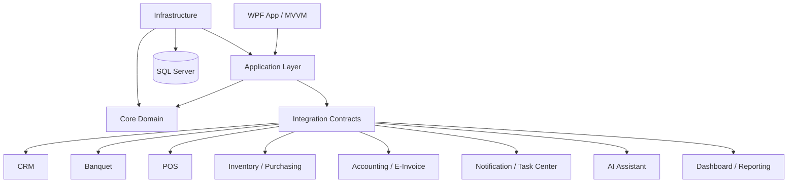

### 0.2. Quyết định kiến trúc nền

1. **Không tạo “siêu module” Front Office:** chia thành các bounded context nhỏ nhưng cùng triển khai trong modular monolith giai đoạn đầu.
2. **Không dùng database như API:** module giao tiếp qua command/query contract hoặc event; read model liên module phải có nguồn gốc rõ.
3. **Không phân tán giao dịch đồng bộ xuyên module:** thay bằng local transaction + outbox + xử lý event có idempotency.
4. **Folio là guest subledger, không phải General Ledger:** Front Office quản lý nghĩa vụ của khách; Accounting nhận bút toán tổng hợp/chi tiết theo policy.
5. **CRM sở hữu hồ sơ khách chuẩn:** Front Office chỉ giữ snapshot cần thiết tại thời điểm giao dịch và thông tin stay-specific.
6. **Room master thuộc dữ liệu tài sản/property dùng chung:** Front Office sở hữu availability và room assignment; Housekeeping sở hữu trạng thái vệ sinh vận hành.
7. **Night Audit sở hữu business date của khách sạn:** không lấy ngày hệ điều hành làm ngày nghiệp vụ.
8. **AI không được commit nghiệp vụ rủi ro:** AI có thể phát hiện, tóm tắt, đề xuất và chuẩn bị thao tác; người có quyền phải xác nhận.

---

## PHẦN 1 — PHẠM VI FRONT OFFICE

### 1.1. Bản đồ bounded context

Front Office gồm 12 nhóm năng lực chính.

#### A. Reservation & Distribution Operations

- Reservation cá nhân.
- Reservation đoàn/crew.
- Inquiry, tentative hold và waitlist.
- Confirmed/guaranteed booking.
- Amendment, cancellation và reinstatement.
- No-show và late cancellation.
- Room type inventory và overbooking control.
- Rate quote, package, promotion và guarantee policy.
- Source/channel/market segment.
- Room Plan, Room Rack và reservation timeline.
- Allotment, block, cut-off và rooming list.

Front Office vận hành reservation; pricing master và distribution/channel có thể là bounded context riêng về sau nhưng phải cung cấp contract cho Front Office.

#### B. Arrival & Check-in

- Arrivals board.
- Pre-arrival review.
- Pre-check-in và online registration.
- Walk-in.
- Hourly/Day-use stay.
- Individual check-in.
- Group check-in.
- Guest identity, passport/CCCD và registration card.
- Room assignment.
- Upgrade/upsell.
- Deposit/guarantee verification.
- Key card/digital key issuance.
- Early check-in policy.

#### C. In-house Stay Operations

- In-house guest list.
- Stay detail.
- Extend/shorten stay.
- Room move.
- Room upgrade/downgrade.
- Add/remove accompanying guest.
- Guest preference và trace/request.
- Posting/routing instruction.
- Credit limit và high-balance control.
- Key replacement/reissue/revoke.
- VIP handling.
- Incognito/do-not-disturb/privacy flags.
- Message, parcel và guest service request.

#### D. Folio, Cashiering & Billing

- Folio và nhiều folio window.
- Charge, allowance, correction và adjustment.
- Room charge, package charge, tax/service charge.
- Payment.
- Deposit, pre-authorization và guarantee.
- Refund.
- Void/reversal.
- Split/transfer/routing charge.
- City ledger/direct billing request.
- Invoice/e-invoice request.
- Cashier shift, cash drawer và shift closing.
- Foreign currency và exchange rate policy.
- Credit limit, balance alert và reconciliation.

#### E. Departure & Checkout

- Departure board.
- Checkout readiness.
- Express checkout.
- Individual checkout.
- Group checkout.
- Late checkout.
- Settlement, invoice và refund.
- Key revoke.
- Room-to-dirty handoff.
- Post-stay follow-up.
- Reopen checkout theo quyền đặc biệt.

#### F. Rooms, Housekeeping & Linen Operations

- Room Rack và room operational status.
- Dirty, clean, inspected, pickup, do-not-disturb.
- Housekeeping assignment theo zone/floor.
- Turndown.
- Minibar check.
- Amenities request.
- Linen/housekeeping supply consumption.
- Housekeeping discrepancy: sleeper/skipper/person count mismatch.
- Room inspection và release-to-sell.
- Out of Order/Out of Service coordination.
- Productivity và SLA.

Housekeeping có thể là bounded context con độc lập nhưng nằm trong Front Office operational domain vì ảnh hưởng trực tiếp khả năng bán và check-in.

#### G. Maintenance & Room Blocking

- Maintenance request/case.
- Priority, SLA và assignment.
- Inspection, repair và verification.
- Out of Order/Out of Service.
- Block theo phòng/khu vực/thời gian.
- Asset/equipment reference.
- Chi phí, vật tư và external vendor handoff.
- Release room sau xác nhận kỹ thuật và housekeeping.

#### H. Guest Services

- Wake Up Call.
- Lost & Found.
- Transportation/airport pickup.
- Concierge request.
- Parcel/message handling.
- Complaint/service recovery.
- Amenity, laundry và extra bed request.
- Guest incident và safety note theo phân quyền.

#### I. Night Audit & Business Date

- Quản lý business date theo property.
- Pre-audit checklist.
- Trial balance và interface status.
- Auto room/package charge.
- No-show processing.
- Deposit/payment/folio exception control.
- Cashier closure verification.
- POS/Banquet/Inventory/Accounting interface reconciliation.
- Day close, date rollover và reopen control.
- Audit pack và sign-off.

#### J. Task Center & Notification

- Task phát sinh từ reservation, stay, housekeeping, maintenance, finance và AI.
- Assignment cho cá nhân/nhóm/ca làm việc.
- Priority, SLA, escalation và acknowledgment.
- Comment, attachment và evidence.
- Notification inbox, toast, email/SMS/app channel.
- Shift handover và unresolved item carry-forward.

Phần này tái sử dụng Notification Task Center dùng chung của Asmile-BO; Front Office chỉ định nghĩa task type, context và SLA nghiệp vụ.

#### K. Front Office Dashboard & Reporting

- Live operational dashboard.
- Room and occupancy overview.
- Arrival/departure/in-house exception.
- Revenue/balance/payment snapshots.
- Housekeeping/maintenance readiness.
- Staff workload và SLA.
- Audit/exception report.
- Forecast, pickup và pace.
- Export/print/subscription qua Reporting dùng chung.

#### L. Integration & Device Operations

- POS room charge.
- Banquet/group linkage.
- CRM/profile/loyalty.
- Inventory/minibar/laundry/amenities.
- Accounting/journal/AR/e-invoice.
- Payment gateway/terminal.
- Key card/digital key.
- OCR/document scanner.
- PBX/wake-up call.
- Channel manager/OTA.
- Door lock, kiosk, mobile check-in.
- Integration exception queue và replay có kiểm soát.

### 1.2. Ngoài phạm vi sở hữu của Front Office

Front Office **sử dụng nhưng không sở hữu**:

- hồ sơ khách chuẩn, loyalty tier và consent: CRM;
- menu, order và revenue center: POS;
- banquet event, package, contract và banquet deposit: Banquet;
- tồn kho, kho, cost và stock movement: Inventory;
- requisition, PO và supplier: Purchasing;
- chart of accounts, journal, AR/AP, tax ledger: Accounting;
- e-invoice provider và regulatory submission: E-Invoice/Accounting;
- notification delivery channel: Notification;
- mô hình AI và knowledge base: AI Assistant;
- report engine và enterprise dashboard: Reporting/Dashboard.

### 1.3. Vai trò người dùng chính

- Reservation Agent.
- Front Desk Agent.
- Cashier.
- Front Office Supervisor/Manager.
- Night Auditor.
- Housekeeping Attendant/Supervisor.
- Maintenance Technician/Supervisor.
- Concierge/Guest Service.
- Revenue/Reservation Manager.
- Accountant/AR Officer.
- System/Integration Administrator.

Mỗi command phải kiểm tra property, role, ca làm việc, cashier session và quyền override; không chỉ kiểm tra quyền ở UI.

---

## PHẦN 2 — LIÊN KẾT VỚI CÁC MODULE KHÁC

### 2.1. Nguyên tắc tích hợp

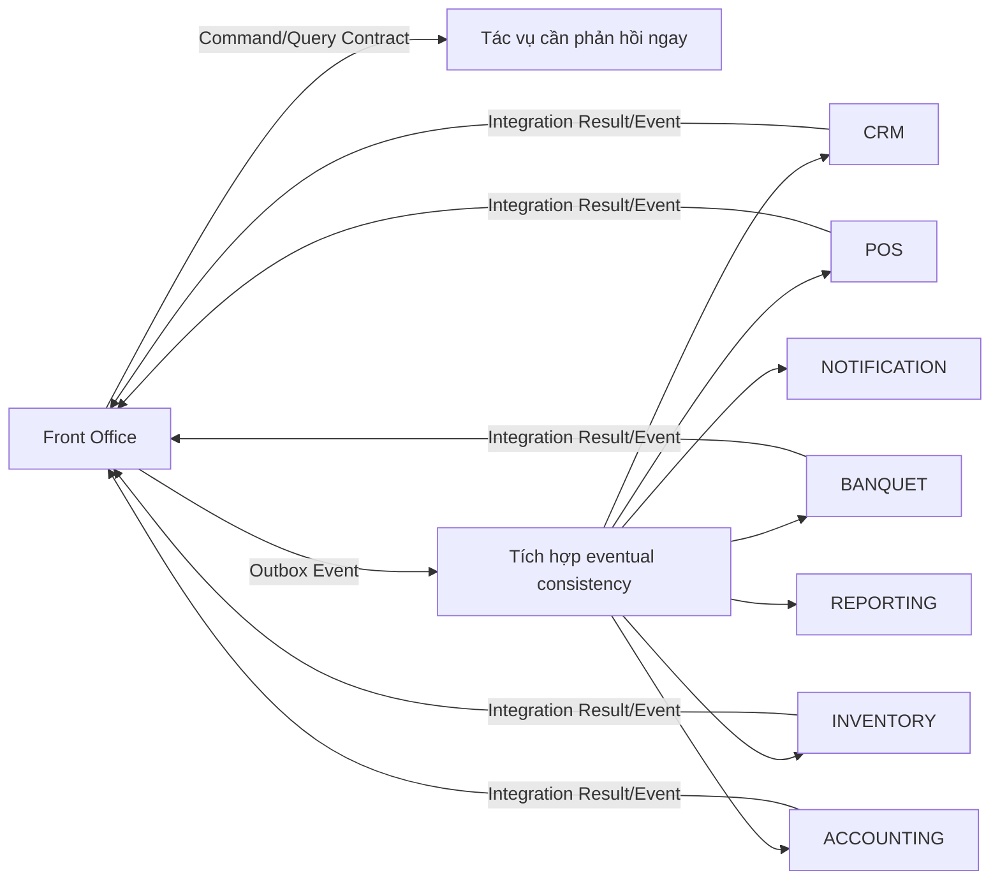

- Gọi đồng bộ chỉ khi người dùng cần kết quả để quyết định ngay, ví dụ xác thực payment terminal hoặc kiểm tra room charge eligibility.
- Event bất đồng bộ cho đồng bộ hồ sơ, journal, reporting, notification và hoạt động không cần khóa transaction UI.
- Mọi message có event ID, correlation ID, property ID, business date, actor và version.
- Consumer phải idempotent; retry không tạo charge, stock movement hoặc journal trùng.
- Lỗi tích hợp đi vào exception queue, không biến mất trong log kỹ thuật.

### 2.2. CRM

#### Khi tạo reservation

Front Office yêu cầu CRM tìm khách theo số điện thoại, email, giấy tờ và loyalty ID. CRM trả về profile chuẩn, consent, tier, preference, blacklist/risk flag được phép hiển thị và lịch sử tóm tắt.

Front Office gửi cho CRM:

- booking intent;
- property, arrival/departure;
- source/channel/market;
- room type/rate/package đã chọn;
- campaign/referral nếu có;
- preference hoặc request mới được khách đồng ý lưu.

#### Khi check-in

CRM nhận event check-in gồm:

- guest/profile reference;
- stay reference và property;
- room assignment;
- số khách, purpose/source/segment;
- VIP/loyalty recognition outcome;
- consent và contact verification đã cập nhật;
- preference phát hiện trong quá trình check-in.

CRM không nhận dữ liệu thẻ thanh toán nhạy cảm hoặc ảnh giấy tờ vượt quá policy.

#### Khi checkout

CRM cập nhật:

- stay đã hoàn tất và actual arrival/departure;
- tổng chi tiêu theo category, không nhất thiết từng bút toán nhạy cảm;
- dịch vụ đã dùng: room, POS, Banquet, laundry, spa nếu có;
- preference, complaint, recovery và satisfaction signal;
- eligibility cho loyalty earning;
- next-best-offer và post-stay campaign trigger.

#### Quy tắc sở hữu

- CRM là master của profile và consent.
- Front Office là master của reservation/stay.
- Merge profile phải thực hiện tại CRM và phát event cập nhật reference cho Front Office.

### 2.3. Banquet

#### Khách lưu trú đặt tiệc

1. Từ reservation/stay, lễ tân tạo lead hoặc mở Banquet workspace với guest/company đã liên kết.
2. Banquet sở hữu event, venue, menu, service, contract và banquet deposit.
3. Banquet trả về event reference, lịch, số khách, contract/deposit status và billing instruction.
4. Nếu được routing vào phòng, Banquet phát charge request sau khi dịch vụ được xác nhận.
5. Front Office kiểm tra Folio còn mở, routing instruction và credit limit trước khi nhận charge.
6. Banquet nhận kết quả accepted/rejected và không tự ghi vào Folio.

#### Khách đoàn

- Group Booking trong Front Office liên kết một Banquet Event hoặc nhiều event.
- Dùng chung CRM company/contact reference.
- Room block, rooming list và banquet attendee list là hai khái niệm riêng nhưng có thể đối chiếu.
- Billing instruction xác định khoản nào về master folio, individual folio hoặc Banquet contract.
- Deposit không được ghi hai lần: mỗi khoản có owner module và allocation rõ.

#### Event trao đổi chính

- GroupBookingCreated/Changed/Cancelled.
- StayLinkedToBanquetEvent.
- BanquetChargeRequested/Accepted/Rejected.
- BanquetDepositReceived/Allocated/Refunded.
- GuestCountChanged khi ảnh hưởng catering/rooming.

### 2.4. POS

#### Quy trình khách ký phòng

1. POS nhập room number hoặc đọc guest/folio token.
2. POS gọi Front Office để kiểm tra:
   - room có stay active;
   - guest được phép ký phòng;
   - folio window/routing đích;
   - credit limit và no-post flag;
   - tên hiển thị đã che bớt theo privacy.
3. POS hoàn tất order theo nghiệp vụ POS.
4. Khi order được close/approved, POS phát `RoomChargeRequested` với order reference duy nhất, amount, tax, service charge, revenue center và business date.
5. Front Office kiểm tra lại stay/folio/routing, chống trùng và post Folio entry.
6. Front Office trả `Accepted` kèm folio entry reference hoặc `Rejected` kèm lý do nghiệp vụ.
7. Nếu POS void/refund, POS gửi reversal request tham chiếu charge gốc; không gửi charge âm không rõ nguồn.
8. Night Audit đối soát tổng POS room charge với tổng Folio entry đã nhận.

#### Trường hợp đặc biệt

- Guest vừa checkout: reject hoặc chuyển cashier review, không tự reopen Folio.
- Folio vượt credit limit: supervisor override có audit.
- POS offline: queue theo order ID, nhận lại phải idempotent.
- Split bill: mỗi phần có routing đích rõ.

### 2.5. Inventory

#### Minibar

1. Housekeeping ghi nhận minibar consumption theo room/stay.
2. Front Office tạo service consumption reference và yêu cầu Folio charge.
3. Inventory nhận consumption đã xác nhận để tạo stock issue từ pantry/minibar warehouse.
4. Nếu charge bị correction/void, stock reversal không tự động tuyệt đối; dùng policy theo hàng đã thực sự tiêu thụ.
5. Night Audit đối chiếu minibar pending chưa charge và stock movement chưa hoàn tất.

#### Laundry

- Front Office tạo laundry request và guest charge estimate.
- Operational service xử lý item/quantity/status.
- Inventory xuất vật tư tiêu hao nếu cần; POS/service module có thể tính tiền.
- Khi giao trả, charge được xác nhận vào Folio; cancellation/rework có reason.

#### Amenities và extra bed

- Complimentary amenity: tạo issue theo cost center/property policy, không post guest charge.
- Chargeable amenity/extra bed: tạo Folio charge và stock/service movement liên quan.
- Mỗi request có room, stay, requester, approver, quantity, SLA và completion evidence.

#### Quy tắc

- Front Office không sửa on-hand quantity.
- Inventory là master của item, warehouse, unit và stock movement.
- Front Office là master của guest request và Folio charge.

### 2.6. Purchasing

Front Office không tạo PO trực tiếp trong hoạt động thông thường. Dữ liệu từ Housekeeping/Minibar/Amenities tạo demand signal:

- par level và consumption forecast;
- shortage alert;
- replenishment request;
- emergency purchase request có approval.

Purchasing sở hữu requisition, sourcing, PO, receipt và supplier. Front Office chỉ xem ETA và trạng thái vật tư ảnh hưởng vận hành.

### 2.7. Accounting

#### Phân ranh sổ sách

- Front Office Folio: guest subledger theo stay và folio window.
- Accounting: General Ledger, cash/bank, tax, AR và financial period.
- Mọi Folio entry có posting category và accounting mapping version.
- Journal phát sinh qua Posting Engine/contract, không ghi tài khoản kế toán từ ViewModel.

#### Payment

1. Front Office tạo payment intent và xác thực cashier session.
2. Payment terminal/gateway xác nhận authorize/capture nếu cần.
3. Front Office post payment vào Folio với idempotency key.
4. Accounting nhận payment posting event để tạo cash/bank/clearing journal.
5. Hai module reconciliation theo reference, amount, currency và business date.

#### Deposit

- Trước check-in: deposit là liability/prepayment, chưa phải room revenue.
- Khi áp dụng vào Folio: tạo allocation có liên kết hai phía.
- Refund/forfeit có approval và lý do.
- Banquet deposit và room deposit có owner riêng nhưng Accounting nhìn thấy cùng customer balance.

#### Refund

- Phải tham chiếu payment/deposit gốc.
- Kiểm tra refundable amount, payment method và approval threshold.
- Reversal kế toán và gateway refund phải có trạng thái độc lập, cho phép xử lý pending/failure.

#### Invoice/e-invoice

1. Front Office chuẩn bị billing profile, line summary và tax information.
2. Accounting/E-Invoice validate tax period, seller/buyer data và numbering.
3. Provider phát hành hóa đơn.
4. Front Office nhận invoice reference/status để hiển thị trên stay/folio.
5. Adjustment/replacement/cancellation thuộc workflow e-invoice, không sửa Folio tùy ý.

#### Journal và kỳ kế toán

- Business date của Front Office và posting date của Accounting có thể khác nhưng phải được validate.
- Night Audit không được đóng ngày nếu interface journal bắt buộc đang lỗi hoặc chưa reconcile.
- Reopen ngày phải có quyền kép và audit.

### 2.8. Notification & Task Center

Front Office sử dụng Task Center chung cho:

- pre-arrival room not ready;
- VIP amenity;
- high balance;
- expiring deposit authorization;
- late checkout approval;
- housekeeping/maintenance overdue;
- lost-and-found follow-up;
- wake-up call escalation;
- integration exception;
- night audit blocker;
- shift handover.

Front Office phát task context gồm object reference, property, room, guest display-safe, due time, priority, deep-link target và suggested action. Notification module quyết định channel, delivery, read state và escalation.

### 2.9. Dashboard & Reporting

- Front Office cung cấp operational events và read model.
- Dashboard dùng chung tổng hợp KPI liên module.
- Report Engine sở hữu template, parameter, export, subscription và history.
- Front Office định nghĩa metric semantics và data contract.
- Mỗi KPI ghi rõ business date, property, timezone, source, latency và trạng thái dữ liệu.

### 2.10. AI Assistant

AI đọc dữ liệu qua tool/contract được phân quyền, không truy cập trực tiếp database. AI trả recommendation kèm bằng chứng, confidence, thời điểm dữ liệu và deep link. Mọi đề xuất dẫn đến command phải hiển thị preview và yêu cầu user xác nhận.

---

## PHẦN 3 — THIẾT KẾ DOMAIN NGHIỆP VỤ

### 3.1. Bounded context và Aggregate chính

| Bounded context | Aggregate | Trách nhiệm |
|---|---|---|
| Reservation | **Reservation** | Vòng đời booking, guest/contact snapshot, dates, occupancy, room type demand, rate guarantee, source, cancellation/no-show, version và conflict rule. |
| Reservation | **RoomBlock** | Giữ inventory cho đoàn/crew/company; allotment, cut-off, release, pickup và rooming progress. |
| Reservation | **WaitlistEntry** | Nhu cầu chưa có inventory, priority, expiry và conversion thành reservation. |
| Stay | **Stay** | Thời gian lưu trú thực tế, check-in/out, in-house guests, extension, privacy/VIP, posting permission và status. |
| Stay | **RoomAssignment** | Gán phòng theo khoảng thời gian, move/upgrade/downgrade, overlap guard, assignment history. |
| Stay | **KeyCredential** | Yêu cầu phát hành, hiệu lực, revoke, replacement, vendor reference và trạng thái tích hợp. |
| Folio | **Folio** | Guest subledger, folio windows, routing, balance, credit limit, closure/reopen và invariant tổng số dư. |
| Cashiering | **Payment** | Payment intent, authorization/capture, posting, failure, refund reference và reconciliation. |
| Cashiering | **Deposit** | Receipt, authorization, allocation, release, refund, forfeit và outstanding amount. |
| Cashiering | **CashierShift** | Ca thu ngân, opening float, payment totals, variance, handover và closure. |
| Billing bridge | **BillingRequest** | Yêu cầu invoice/direct bill, buyer snapshot, folio allocation, status từ Accounting/E-Invoice. |
| Rooms | **RoomAvailability** | Inventory sellable theo room type/date/property, holds, confirmed demand, out-of-order impact và overbooking limit. |
| Housekeeping | **RoomOperation** | Trạng thái dirty/clean/inspected/DND, assignment, inspection và release-to-sell. |
| Housekeeping | **HousekeepingTask** | Công việc theo room/zone/shift, SLA, checklist, consumption và completion evidence. |
| Maintenance | **MaintenanceCase** | Sự cố, severity, affected room/asset, block interval, work log, cost và release approval. |
| Guest Services | **ServiceRequest** | Yêu cầu guest service, category, SLA, assignment, chargeability và completion. |
| Guest Services | **WakeUpCall** | Lịch gọi, channel, attempts, acknowledgment, failure escalation và completion. |
| Guest Services | **LostFoundCase** | Item, found/lost context, custody chain, matching, claimant verification, return/disposal. |
| Operations | **OperationalTask** | Task liên module, assignee/team, priority, due time, escalation và completion reference. |
| Night Audit | **NightAuditRun** | Business date, checklist, blockers, batch posting, reconciliation, sign-off, rollover và reopen history. |
| Group | **GroupStay** | Group identity, rooming list progress, master billing instruction, group arrival/departure và coordinator. |

### 3.2. Aggregate thuộc module khác nhưng Front Office phải liên kết

| Aggregate ngoài Front Office | Module sở hữu | Front Office sử dụng |
|---|---|---|
| Customer/Guest Profile | CRM | Nhận dạng, preference, loyalty, consent, history summary |
| Company/Travel Agent | CRM | Payer, contract reference, negotiated relationship |
| Banquet Event/Contract | Banquet | Stay-event linkage, group schedule, charge routing |
| POS Order | POS | Room charge request và reversal reference |
| Inventory Item/Stock Movement | Inventory | Minibar, amenity, linen, consumption/replenishment |
| Purchase Requisition/Order | Purchasing | Shortage response và ETA |
| Journal/Accounting Period/AR | Accounting | Posting, direct bill, reconciliation và period control |
| Invoice/E-Invoice Document | Accounting/E-Invoice | Issuance, tax status và document reference |
| Notification/Task Delivery | Notification | Delivery, inbox, read state, escalation channel |
| AI Recommendation | AI Assistant | Suggestion, risk score, evidence và user feedback |

### 3.3. Invariant quan trọng

#### Reservation

- Departure phải sau arrival.
- Occupancy không vượt policy nếu chưa có override.
- Một reservation không được vừa cancelled vừa checked-in.
- Guaranteed rate phải lưu version và điều kiện áp dụng.
- Room assignment không được overlap cùng phòng nếu không có overbooking/house-use policy hợp lệ.

#### Stay

- Chỉ reservation đủ điều kiện hoặc walk-in hợp lệ mới check-in.
- Stay in-house luôn có ít nhất một guest và một room assignment active, trừ virtual/master folio được định nghĩa riêng.
- Extend/move room phải kiểm tra availability và financial impact.
- Checkout không hoàn tất khi còn blocker bắt buộc.

#### Folio

- Entry đã post không bị sửa/xóa; correction qua reversal/adjustment.
- Balance là kết quả ledger, không là field nhập tay.
- Mọi external charge có source reference duy nhất.
- Closed Folio không nhận charge mới nếu chưa reopen có quyền.
- Transfer phải bảo toàn tổng debit/credit và audit hai đầu.

#### Payment/Deposit

- Không post trùng idempotency key.
- Refund không vượt refundable amount.
- Allocation deposit không vượt unallocated balance.
- Payment thành công tại gateway nhưng posting lỗi phải vào reconciliation, không thu lại lần hai.

#### Room/Housekeeping

- Room dirty không được check-in trừ emergency override có audit.
- Out of Order loại khỏi sellable inventory theo đúng khoảng thời gian.
- Chỉ inspected/released room mới là Ready khi property yêu cầu inspection.

#### Night Audit

- Một property chỉ có một business date active.
- Một audit run không rollover khi còn hard blocker.
- Batch posting và integration reconciliation phải idempotent.

### 3.4. Domain service/policy cần có về mặt thiết kế

- Availability and Overbooking Policy.
- Rate and Package Eligibility Policy.
- Guarantee and Cancellation Policy.
- Room Assignment Optimizer.
- Upgrade/Upsell Eligibility Policy.
- Check-in Eligibility Policy.
- Credit Limit and High Balance Policy.
- Charge Routing Policy.
- Checkout Readiness Policy.
- Payment/Refund Approval Policy.
- Deposit Allocation Policy.
- Room Move Pricing Policy.
- Housekeeping Release Policy.
- Night Audit Blocking Policy.
- Idempotency and Reconciliation Policy.
- Privacy/Data Retention Policy.

### 3.5. Domain event catalog tối thiểu

#### Reservation/Stay

- ReservationCreated, Confirmed, Guaranteed, Amended, Cancelled, Reinstated, NoShowMarked.
- RoomAssigned, RoomAssignmentChanged, RoomMoved, RoomUpgraded.
- GuestCheckedIn, StayExtended, StayShortened, GuestCheckedOut.

#### Folio/Cashiering

- FolioOpened, FolioEntryPosted, ChargeTransferred, FolioClosed, FolioReopened.
- PaymentReceived, PaymentFailed, RefundRequested, RefundCompleted.
- DepositReceived, DepositAllocated, DepositRefunded, DepositForfeited.
- InvoiceRequested, InvoiceIssued, InvoiceFailed.

#### Operations

- RoomMarkedDirty, CleaningStarted, RoomCleaned, RoomInspected, RoomReleased.
- MaintenanceReported, RoomBlocked, MaintenanceCompleted, RoomBlockReleased.
- WakeUpCallScheduled, WakeUpCallFailed, WakeUpCallCompleted.
- LostFoundItemRegistered, Matched, Returned, Disposed.
- OperationalTaskCreated, Escalated, Completed.
- NightAuditStarted, Blocked, Completed, BusinessDateRolled.

#### Integration

- RoomChargeRequested/Accepted/Rejected.
- AccountingPostingRequested/Accepted/Rejected.
- InventoryConsumptionRequested/Posted/Rejected.
- KeyIssueRequested/Issued/Failed/Revoked.
- ProfileStayActivityPublished.

---

## PHẦN 4 — THIẾT KẾ WORKFLOW

### 4.1. Reservation lifecycle

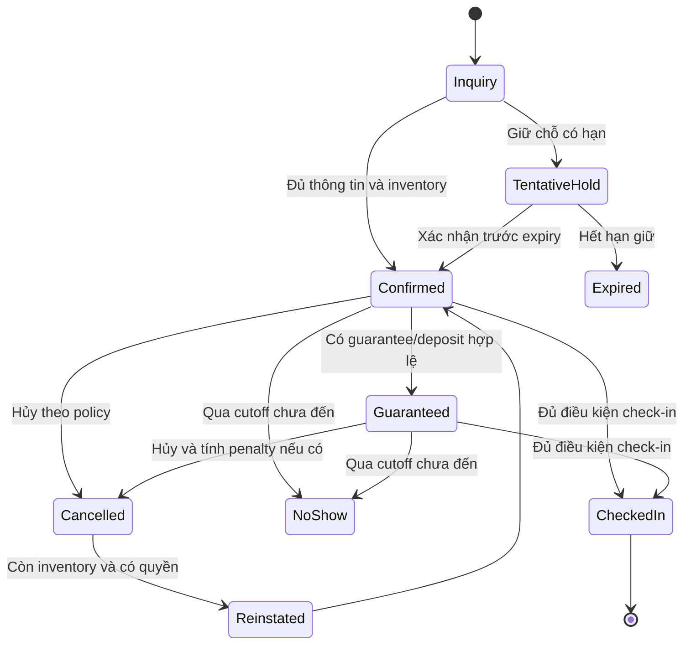

Điều kiện chính:

- `Confirmed`: guest/contact, dates, occupancy, room type demand và rate quote hợp lệ.
- `Guaranteed`: guarantee method còn hiệu lực; deposit/authorization đạt policy.
- `CheckedIn`: identity/registration hoàn tất, room Ready hoặc override, deposit/credit đạt yêu cầu.
- `NoShow`: business date/cutoff đã qua, không có active stay, xử lý penalty theo policy.
- `Reinstated`: kiểm tra lại availability, rate và guarantee; không khôi phục mù.

### 4.2. Arrival và Check-in

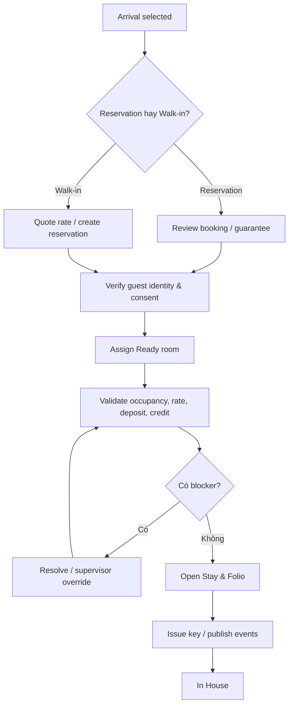

Check-in phải là một workflow có thể resume. Nếu key issuance lỗi sau khi Stay đã mở, Stay vẫn in-house nhưng tạo task khẩn cấp; không rollback nghiệp vụ khách đã nhận phòng một cách nguy hiểm.

### 4.3. In-house Stay

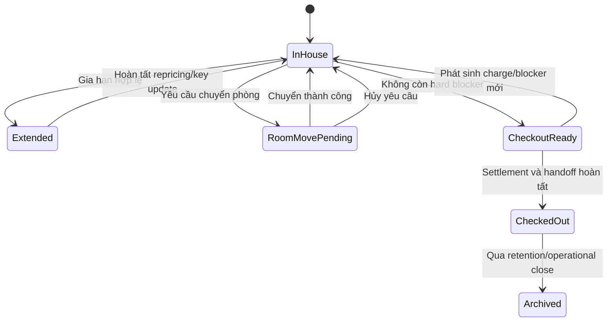

### 4.4. Extend Stay

1. Chọn thời gian departure mới.
2. Kiểm tra room availability cho phần thời gian tăng thêm.
3. Requote rate/package/tax và xác định chênh lệch.
4. Kiểm tra credit/deposit bổ sung.
5. Yêu cầu approval nếu rate override hoặc overbooking.
6. Cập nhật reservation/stay và room assignment interval.
7. Gia hạn key/digital credential.
8. Phát event cho CRM, Housekeeping, POS credit authorization và Reporting.
9. Nếu integration key lỗi, tạo task nhưng không làm mất thay đổi stay đã commit.

### 4.5. Room Move/Upgrade/Downgrade

1. Chọn reason và room đích.
2. Kiểm tra room đích Ready, không bị block và không conflict.
3. Xác định move hay upgrade/downgrade; tính rate impact.
4. Xác nhận guest, thời điểm chuyển và xử lý đồ đạc.
5. Chốt charge/routing phát sinh ở phòng cũ.
6. Kết thúc assignment cũ, mở assignment mới trong cùng workflow.
7. Reissue key; revoke key cũ.
8. Đánh dấu phòng cũ Dirty và tạo housekeeping task.
9. Cập nhật POS, PBX, CRM, Notification và room plan.

Không đổi `RoomNo` trực tiếp trên Stay; phải giữ lịch sử assignment.

### 4.6. Folio entry và POS Room Charge

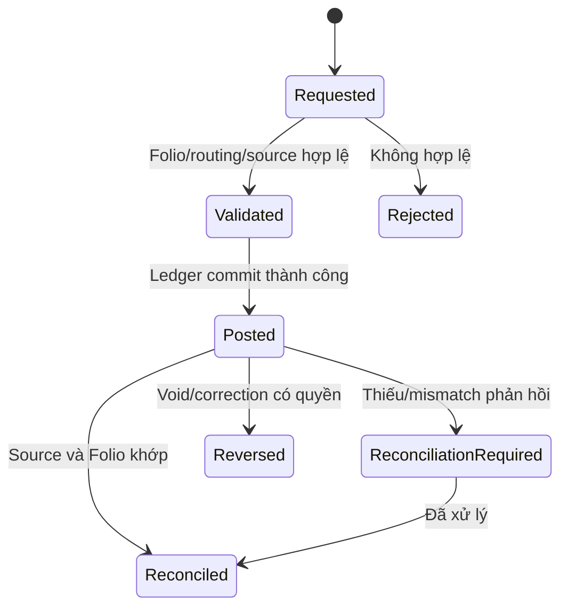

Điều kiện post: source reference chưa tồn tại, Folio/window mở, stay cho phép charge, currency/tax/mapping hợp lệ và credit policy không chặn.

### 4.7. Payment

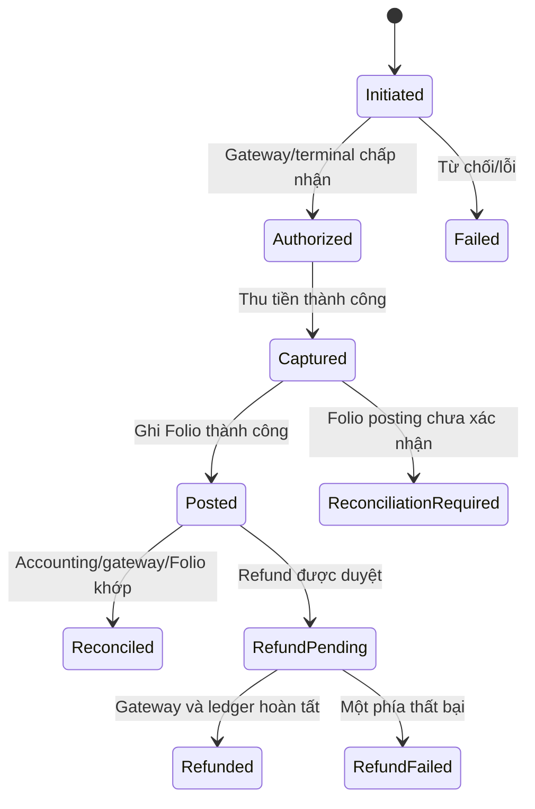

Không retry capture nếu chưa biết kết quả giao dịch trước. Trường hợp không xác định phải tra soát theo merchant reference.

### 4.8. Deposit

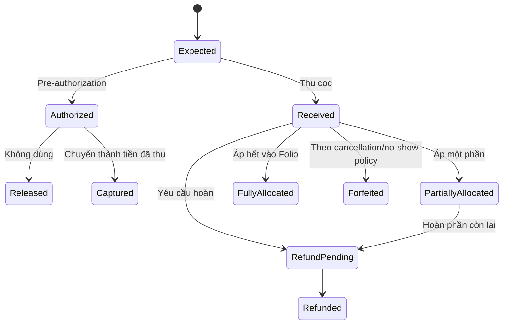

### 4.9. Checkout

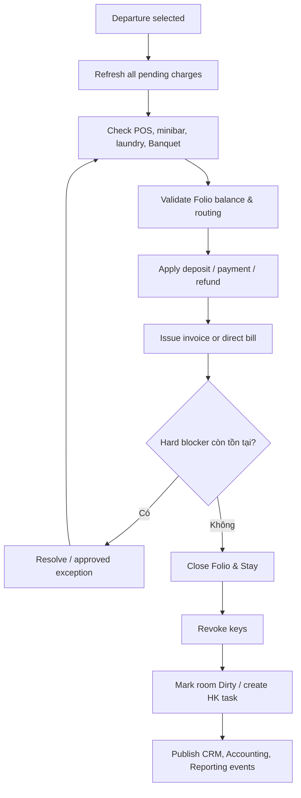

Hard blocker mặc định:

- Folio imbalance hoặc unreconciled payment quan trọng;
- pending POS/minibar charge theo policy;
- invoice/direct bill bắt buộc chưa đủ dữ liệu;
- deposit/refund chưa quyết định;
- stay/room assignment không nhất quán;
- cashier session không hợp lệ;
- business date/period không cho posting.

### 4.10. Housekeeping

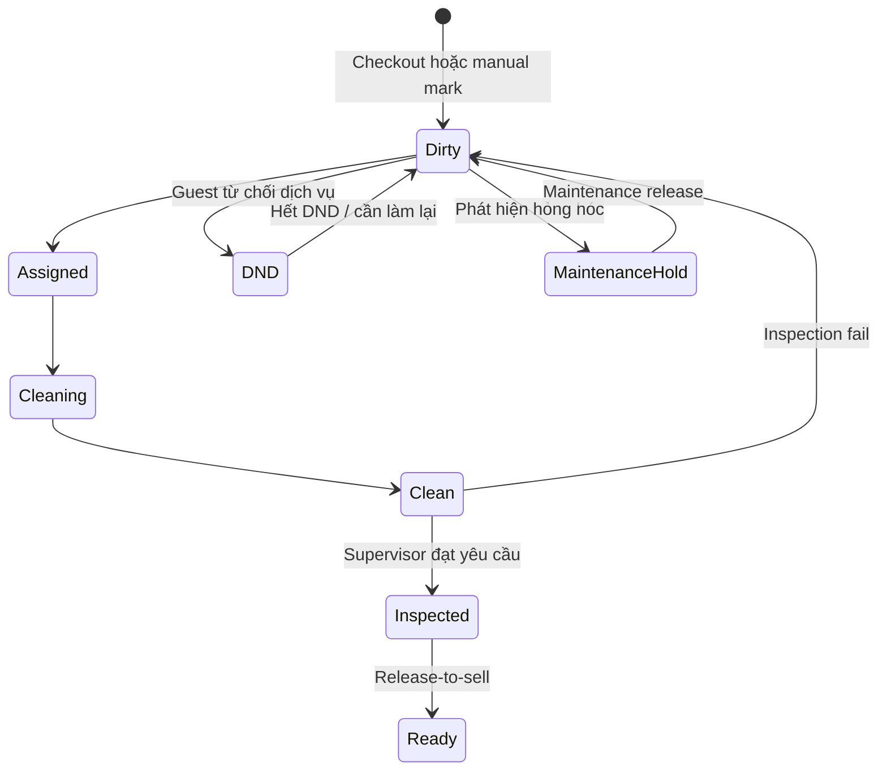

Property có thể cấu hình bỏ bước inspection cho một số room/category, nhưng rule phải minh bạch.

### 4.11. Maintenance và Room Block

- `Reported → Triaged → Assigned → InProgress → WaitingPart/ExternalVendor → Fixed → Verified → Closed`.
- Severity cao có thể tạo Out of Order ngay.
- Room chỉ release khi maintenance verified và housekeeping xác nhận trạng thái phù hợp.
- Nếu block làm ảnh hưởng reservation, Front Office tạo re-accommodation task và cảnh báo inventory.

### 4.12. Wake Up Call

- `Scheduled → Due → Attempting → Acknowledged → Completed`.
- Nếu không kết nối: `Retrying → Escalated` theo số lần và SLA.
- PBX kết quả phải gắn timestamp; manual call cần staff confirmation.
- Không xóa lịch sử vì đây có thể là dữ liệu an toàn/vận hành.

### 4.13. Lost & Found

- `Reported/Found → Registered → InCustody → PotentialMatch → ClaimVerification → Returned`.
- Nhánh khác: `Unmatched → RetentionExpired → Disposed/Donated` theo policy.
- Custody handover phải ghi người giao/nhận, thời gian, vị trí và evidence.
- Dữ liệu claimant/guest chỉ hiển thị theo quyền và retention.

### 4.14. Group Booking/Group Stay

1. Tạo group profile và room block.
2. Định nghĩa allotment, cut-off, rate, guarantee và billing instruction.
3. Nhận rooming list, match/merge với CRM profile.
4. Pickup room và release phần không dùng.
5. Assign room hàng loạt có conflict check.
6. Check-in theo batch nhưng mỗi room có kết quả riêng.
7. Charge routing về master/individual Folio theo rule versioned.
8. Banquet event linkage và shared itinerary.
9. Group checkout readiness tổng hợp nhưng không che lỗi từng Folio.
10. Close group khi mọi stay, folio, deposit và invoice đã xử lý.

### 4.15. Night Audit

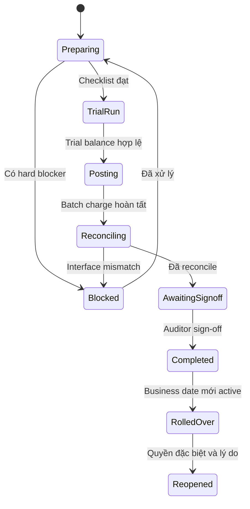

Night Audit phải có preview, dry-run, checkpoint, resume và idempotency. Không chạy một transaction khổng lồ xuyên tất cả module.

---

## PHẦN 5 — DASHBOARD LỄ TÂN

### 5.1. Nguyên tắc

- Dashboard là **command center**, không chỉ là biểu đồ.
- Mọi widget có số lượng, severity, SLA, dữ liệu cập nhật lúc nào và deep link tới danh sách xử lý.
- Hiển thị theo property, business date và ca làm việc.
- Người dùng tùy biến bố cục theo role nhưng KPI semantics không thay đổi.
- Critical alert không bị chìm trong notification thông thường.

### 5.2. Header vận hành

- Property và business date.
- Ca hiện tại/cashier session.
- Occupancy hôm nay và forecast 7 ngày.
- Room Ready/Dirty/OOO.
- Arrivals remaining/Departures remaining.
- System integration health.
- Unread critical alerts.

### 5.3. Widget bắt buộc

| Nhóm | Widget | Nội dung và hành động |
|---|---|---|
| Arrival | **Today Arrivals** | Tổng, checked-in, waiting, unassigned, room-not-ready; mở arrivals board |
| Arrival | **VIP Arrivals** | Tier/VIP reason, ETA, room, amenity/task readiness |
| Arrival | **Early Arrival** | Khách đến trước giờ, room readiness và early fee/waiver |
| Arrival | **Unassigned Reservation** | Booking chưa có phòng và conflict risk |
| Arrival | **Guarantee/Deposit Missing** | Booking chưa đạt guarantee policy |
| Departure | **Today Departures** | Tổng, checked-out, pending, express checkout |
| Departure | **Late Checkout** | Approved/pending/overdue và charge impact |
| Departure | **Overstay** | Quá departure time/date, balance và contact action |
| Departure | **Checkout Blockers** | Pending POS/minibar/invoice/payment/reconciliation |
| Guest | **VIP In-house** | VIP currently in-house, request và incident |
| Guest | **Birthday/Anniversary** | CRM signal và suggested action |
| Finance | **High Balance** | Folio vượt threshold/credit limit |
| Finance | **Unapplied Deposit** | Cọc chưa allocate hoặc sắp hết authorization |
| Finance | **Payment Exception** | Captured-not-posted, duplicate risk, refund failure |
| Rooms | **Room Ready** | Ready by floor/type và rooms prioritized for arrivals |
| Rooms | **Dirty Room** | Dirty duration, assignment, SLA breach |
| Rooms | **Out of Order** | Block reason, ETA và impacted reservations |
| Rooms | **Room Discrepancy** | Housekeeping vs Front Office mismatch |
| Reservation | **No Show Risk** | Chưa đến gần cutoff, contact/guarantee status |
| Reservation | **Waitlist Opportunity** | Inventory vừa mở có thể convert |
| Operations | **Open Tasks** | My tasks/team tasks, due/overdue/critical |
| Operations | **Wake-up Calls** | Due in 60 minutes, failed/escalated |
| Operations | **Maintenance SLA** | Cases ảnh hưởng room sellability |
| Integration | **Interface Exceptions** | POS, Accounting, key, OCR, inventory failures |
| Night Audit | **Audit Readiness** | Blocker count, cashier closure, interfaces, trial balance |
| AI | **AI Action Queue** | Recommendation đã lọc theo confidence và impact |

### 5.4. Views hỗ trợ dashboard

- Arrivals Board.
- Departures Board.
- In-house Board.
- Room Rack.
- Room Plan/Timeline.
- Housekeeping Board.
- Folio Exception Queue.
- Integration Exception Queue.
- Task/Notification Center.
- Night Audit Control Center.

### 5.5. KPI vận hành

- Check-in average handling time.
- Percentage rooms ready before check-in time.
- Arrival wait time.
- Checkout average handling time.
- Late checkout and overstay rate.
- Housekeeping turnaround time.
- Room discrepancy rate.
- Payment reconciliation exception rate.
- Upsell conversion and incremental revenue.
- Guest request SLA compliance.
- No-show and cancellation rate.
- Night audit completion time và blocker trend.

---

## PHẦN 6 — THIẾT KẾ AI THAM GIA NGHIỆP VỤ

### 6.1. Vai trò AI

AI có bốn vai trò:

1. **Copilot:** tóm tắt, tìm kiếm và chuẩn bị thao tác.
2. **Prediction:** dự đoán khả năng/rủi ro.
3. **Recommendation:** đề xuất next-best-action có bằng chứng.
4. **Control Assistant:** kiểm tra thiếu sót, bất thường và reconciliation; rule engine vẫn quyết định hard blocker.

### 6.2. AI theo hành trình khách

#### Pre-arrival

- Tóm tắt hồ sơ khách, lịch sử stay và preference từ CRM.
- Phát hiện duplicate profile cần merge.
- Gợi ý room assignment theo preference, accessibility, loyalty và operational cost.
- Gợi ý upgrade/upsell có giải thích giá trị cho khách.
- Dự đoán ETA/no-show/late arrival.
- Cảnh báo guarantee/deposit yếu hoặc authorization sắp hết hạn.
- Tạo checklist VIP amenity và phối hợp Banquet/POS/Housekeeping.

#### Check-in

- OCR và kiểm tra logic giấy tờ; cảnh báo trường mâu thuẫn.
- Tóm tắt booking changes và điều kiện rate/cancellation quan trọng.
- Gợi ý phòng thay thế khi phòng chưa Ready.
- Gợi ý ưu đãi breakfast, late checkout, airport transfer, Banquet hoặc POS package.
- Phát hiện occupancy bất thường, room assignment conflict hoặc rate override không hợp lý.
- Soạn nội dung giao tiếp đa ngôn ngữ cho lễ tân.

#### In-house

- Dự đoán khách có khả năng gia hạn.
- Gợi ý thời điểm liên hệ và mức giá gia hạn.
- Phát hiện service request có nguy cơ trễ SLA.
- Tóm tắt complaint và gợi ý service recovery trong hạn mức quyền.
- Cảnh báo high balance, unusual spending hoặc no-post risk.
- Gợi ý minibar/laundry/amenity dựa trên preference có consent.
- Phát hiện pattern maintenance/housekeeping ảnh hưởng trải nghiệm.

#### Pre-checkout/Checkout

- Tính checkout risk score.
- Cảnh báo POS/minibar/laundry/Banquet charge còn pending.
- Cảnh báo deposit chưa allocate, payment captured chưa post hoặc refund pending.
- Phát hiện folio entry bất thường/trùng/khác pattern.
- Tóm tắt Folio bằng ngôn ngữ dễ giải thích cho khách.
- Gợi ý split/routing nhưng không tự thực hiện.
- Nhắc invoice information còn thiếu.
- Gợi ý late checkout charge/waiver theo policy và lịch sử.

#### Post-stay

- Tóm tắt stay outcome gửi CRM.
- Gợi ý loyalty earning/next offer.
- Phân loại complaint và root cause.
- Phát hiện lost-and-found match.
- Gợi ý post-stay message theo consent/language.

### 6.3. AI cho Housekeeping và Maintenance

- Ưu tiên thứ tự làm phòng dựa trên ETA, VIP, room type và workload.
- Dự đoán thời gian hoàn thành từng phòng.
- Cân bằng assignment theo zone, skill và SLA.
- Phát hiện room status discrepancy.
- Dự đoán vật tư/linen/minibar replenishment.
- Phân loại ảnh sự cố phòng và gợi ý maintenance category.
- Dự đoán recurring defect và đề xuất preventive maintenance.

### 6.4. AI cho Night Audit

- Tóm tắt blocker theo mức độ và owner.
- Phát hiện revenue/payment/tax/interface anomaly.
- Nhóm lỗi trùng nguồn để giảm alert noise.
- Gợi ý thứ tự xử lý blocker.
- So sánh với pattern các ngày tương tự.
- Sinh bản giải thích audit pack; không tự sign-off hoặc rollover.

### 6.5. AI cho doanh thu và upsell

- Upgrade recommendation theo room availability và willingness-to-pay.
- Dynamic offer cho breakfast, late checkout, extra bed, airport transfer, Banquet/POS.
- Waitlist conversion opportunity.
- Overbooking risk và re-accommodation suggestion.
- Group pickup anomaly và cut-off recommendation.
- Forecast extension/no-show/cancellation.

AI không tự đặt giá cuối nếu Revenue policy chưa cho phép. Mọi recommendation phải nêu nguồn dữ liệu và constraint.

### 6.6. AI Action Card chuẩn

Mỗi đề xuất AI phải có:

- tiêu đề hành động;
- đối tượng và phạm vi property;
- lý do và bằng chứng;
- confidence;
- lợi ích dự kiến;
- rủi ro/constraint;
- dữ liệu cập nhật lúc nào;
- nút xem chi tiết;
- nút chuẩn bị thao tác;
- feedback “hữu ích/không hữu ích/lý do”.

### 6.7. Guardrail AI

AI không được tự động:

- check-in hoặc checkout;
- post/void/transfer charge;
- capture/refund payment;
- issue invoice;
- thay đổi rate đã guarantee;
- room move khách đang ở;
- đánh dấu room Ready;
- đóng Night Audit;
- merge guest profile;
- tiết lộ dữ liệu nhạy cảm ngoài quyền.

Yêu cầu nền:

- human-in-the-loop;
- role- and property-scoped retrieval;
- PII minimization và masking;
- prompt/tool audit;
- chống prompt injection từ note/document bên ngoài;
- model/version tracking;
- explainability và confidence calibration;
- fallback khi AI không khả dụng;
- không dùng dữ liệu khách để huấn luyện ngoài policy/consent;
- đo recommendation acceptance, outcome và bias.

---

## PHẦN 7 — CẢI TIẾN THEO TIÊU CHUẨN PMS HIỆN ĐẠI 2026

### 7.1. Mobile-first guest journey

- Pre-check-in link/app.
- Digital registration card và e-signature.
- Mobile ID capture theo pháp luật địa phương.
- Guest messaging đa kênh.
- Mobile checkout và invoice delivery.
- Digital key, wallet pass và key sharing có kiểm soát.
- Kiosk self check-in/out với staff escalation.

### 7.2. Unified Guest 360

- Một CRM profile xuyên Front Office, POS, Banquet và loyalty.
- Identity resolution/merge workflow.
- Preference có provenance và consent.
- Privacy request, retention và right-to-access/delete theo policy.
- Household/company/travel party relationship.
- Service recovery và lifetime value không bị silo theo module.

### 7.3. Multi-property và enterprise-ready

- Property, company và legal-entity scope rõ.
- Central reservation và cross-property availability.
- Cross-property guest history.
- Transfer reservation/stay giữa property có workflow.
- Shared company/TA contract và negotiated rate.
- Property-local business date, timezone, currency và tax.
- Consolidated dashboard/reporting nhưng transaction vẫn property-isolated.

### 7.4. Event-driven integration platform

- Outbox/inbox và idempotent consumer.
- Event catalog/versioning.
- Replay có quyền và audit.
- Dead-letter/exception queue cho người vận hành.
- Correlation end-to-end từ POS/Banquet/Payment tới Folio/Accounting.
- API/webhook cho channel manager, lock, PBX, payment và mobile app.
- Không phụ thuộc shared-table integration.

### 7.5. Modern revenue and distribution

- Channel manager và OTA connectivity.
- Real-time availability/rate/inventory.
- Restriction: CTA/CTD, min/max stay, close-out.
- Rate plan/package/promotion engine.
- Overbooking policy và displacement analysis.
- Forecast, pickup, pace và demand signal.
- AI-assisted upsell nhưng policy-controlled.

### 7.6. Advanced Folio & Billing

- Nhiều Folio window và routing rule có hiệu lực theo thời gian.
- Split theo guest/company/package/revenue category.
- Append-only ledger và reversal chain.
- Durable idempotency.
- Payment orchestration với uncertain outcome handling.
- Deposit lifecycle đầy đủ.
- Direct bill/AR handoff.
- E-invoice status lifecycle.
- Multi-currency và exchange gain/loss handoff.

### 7.7. Operational resilience

- Offline/degraded mode cho room board và essential arrivals nếu hạ tầng lỗi.
- Queue thao tác thiết bị với exactly-once business effect.
- Health dashboard theo integration.
- Timeout/circuit breaker/retry policy phân loại theo lỗi.
- Backup/restore drill, RPO/RTO rõ.
- Business continuity playbook cho payment, key và Night Audit.
- Feature flag và staged rollout theo property.

### 7.8. Security và privacy 2026

- Zero-trust module access.
- MFA/passkey cho hành động nhạy cảm.
- Least privilege, separation of duties và approval threshold.
- Field-level masking cho ID, phone, email, payment reference.
- Encryption in transit/at rest và secret management.
- Tamper-evident audit trail.
- Device/session management cho front desk terminal.
- PCI scope reduction; không lưu raw card data.
- Data retention theo loại tài liệu và jurisdiction.

### 7.9. Accessibility và internationalization

- Keyboard-first workflow cho lễ tân.
- Screen reader, focus order, contrast và scalable text.
- Locale/timezone/currency/date format đúng property.
- Unicode end-to-end; không có đường mã hóa legacy.
- Guest name/address/document hỗ trợ đa ngôn ngữ.
- Right-to-left readiness nếu mở rộng thị trường.

### 7.10. Sustainability và smart operations

- Linen/towel preference.
- Room energy integration theo occupancy.
- Housekeeping route optimization.
- Waste/amenity consumption tracking.
- Carbon/sustainability reporting theo property.
- Preventive maintenance giảm room downtime.

### 7.11. Observability và product analytics

- Business event và technical telemetry tách biệt nhưng liên kết correlation ID.
- SLI/SLO cho check-in, payment, room charge, key, checkout và Night Audit.
- Funnel reservation → check-in → upsell → checkout.
- Error budget cho integration quan trọng.
- Audit dashboard cho override, void, refund, reopen và late posting.
- Data quality score cho KPI/report/AI feature.

### 7.12. Những cải tiến có tính khác biệt cho Asmile-BO

1. **Hospitality orchestration xuyên module:** một guest journey nối CRM, room, POS, Banquet, Inventory và Accounting.
2. **Single operational command center:** Front Desk Board và Task Center chung, không mở nhiều phần mềm.
3. **AI action layer:** AI đề xuất ngay tại đối tượng nghiệp vụ, không tách thành cửa sổ chat.
4. **Real-time checkout readiness:** tổng hợp pending charge và accounting/payment exception trước khi khách ra quầy.
5. **Event-based entitlement:** breakfast/lounge/parking/amenity không gắn cứng vào thẻ khóa.
6. **Business date as first-class concept:** mọi module hospitality đối soát theo cùng property business date.
7. **Explainable room assignment:** lý do chọn phòng, constraint và override được lưu rõ.
8. **Integration exception as business work:** lỗi POS/key/accounting tạo task có owner và SLA.

---

## 8. Kiến trúc triển khai đề xuất

### 8.1. Modular monolith trước, microservice sau

Không tách microservice ngay. Front Office cần transaction nhất quán, triển khai đơn giản và đội ngũ có thể phát triển nhanh trong Asmile-BO. Tách dịch vụ chỉ khi có bằng chứng:

- tải hoặc availability khác biệt lớn;
- cần scale độc lập;
- vendor/device runtime bắt buộc process riêng;
- vòng đời release độc lập;
- ranh giới dữ liệu và team ownership đã ổn định.

Các ứng viên tách sau: payment orchestration, channel manager, OCR, digital key, guest messaging và AI inference.

### 8.2. Read/Write model

- Write model bảo vệ aggregate invariant.
- Read model tối ưu cho Room Rack, Timeline, Arrivals, Departures và Dashboard.
- Read model cập nhật bằng event và có timestamp/latency indicator.
- Command không dựa hoàn toàn vào dữ liệu cache; luôn revalidate invariant trước commit.

### 8.3. Concurrency

Các điểm phải có optimistic concurrency hoặc lock nghiệp vụ ngắn:

- room assignment;
- reservation amendment;
- Folio posting/closure;
- payment/refund;
- deposit allocation;
- room status release;
- Night Audit sign-off/rollover.

Xung đột phải trả thông tin để người dùng refresh/compare, không ghi đè im lặng.

### 8.4. Audit

Audit cho mọi hành động nhạy cảm gồm:

- actor, role, property, workstation/session;
- business date và system time;
- object/version trước và sau;
- reason/approval;
- source module/device;
- correlation/idempotency reference;
- AI recommendation reference nếu hành động bắt nguồn từ AI.

### 8.5. Chỉ tiêu phi chức năng

- Room/Arrival board mở dưới 2 giây ở dữ liệu property điển hình.
- Command quầy lễ tân phản hồi rõ trong 1 giây nếu chưa phụ thuộc thiết bị ngoài.
- Không duplicate financial effect khi retry.
- Trace end-to-end cho 100% payment, room charge, checkout và key issue.
- Không mất task/integration event sau restart.
- Có degraded-mode playbook khi POS, key, payment hoặc Accounting unavailable.
- Hỗ trợ dữ liệu nhiều property, timezone và business date ngay từ đầu.

---

## 9. Lộ trình thiết kế và xây dựng

### Giai đoạn 1 — Foundation

- Chốt ubiquitous language, aggregate boundary và state machine.
- Chốt ownership giữa Front Office, CRM, POS, Banquet, Inventory và Accounting.
- Định nghĩa event catalog, error taxonomy, permission và audit policy.
- Thiết kế business date và property scope.

### Giai đoạn 2 — Read-only Operations

- Room Rack/Room Plan/Timeline.
- Arrivals, Departures, In-house.
- Guest 360 link với CRM.
- Dashboard và Notification Task Center.

### Giai đoạn 3 — Reservation & Arrival

- Reservation lifecycle, availability, rate quote, guarantee.
- Walk-in, pre-check-in, room assignment, check-in.
- OCR, registration và key integration contract.
- Group block/rooming list nền tảng.

### Giai đoạn 4 — Folio & Cashiering

- Folio windows, charge/routing/transfer.
- POS room charge.
- Payment, deposit, refund, void và reconciliation.
- Accounting/E-Invoice integration.

### Giai đoạn 5 — In-house & Departure

- Extend, room move, upgrade/downgrade.
- Checkout readiness và checkout.
- CRM post-stay và room-dirty handoff.

### Giai đoạn 6 — Housekeeping, Maintenance & Guest Services

- Housekeeping board, inspection, discrepancy.
- Maintenance/OOS/OOO.
- Wake-up call, Lost & Found, service request.
- Inventory/Purchasing consumption/replenishment integration.

### Giai đoạn 7 — Night Audit & Advanced PMS

- Business date, batch posting, reconciliation và audit pack.
- Channel/distribution, mobile guest journey, digital key.
- Forecast/revenue/upsell và AI operational optimization.

### Giai đoạn 8 — Pilot & Scale

- Shadow/read-only pilot.
- Write-path theo feature flag và property.
- Reconciliation song song với quy trình hiện tại.
- SLO, security, load, recovery và audit test.
- Rollout theo ca/property, có rollback plan.

---

## 10. Tiêu chí hoàn thành thiết kế trước khi viết code

Chỉ bắt đầu Domain Model khi đã chốt:

- bounded context map;
- aggregate responsibility và invariant;
- state transition và reason code;
- module ownership matrix;
- integration event catalog/versioning;
- Folio/accounting boundary;
- payment/deposit/refund lifecycle;
- room availability/assignment/housekeeping boundary;
- business date/Night Audit policy;
- permission, approval và audit matrix;
- PII/retention/consent policy;
- AI guardrail và evaluation metric;
- acceptance scenario cho happy path, conflict, duplicate, partial failure và recovery.

SẴN SÀNG THIẾT KẾ DOMAIN MODEL FRONT OFFICE.
